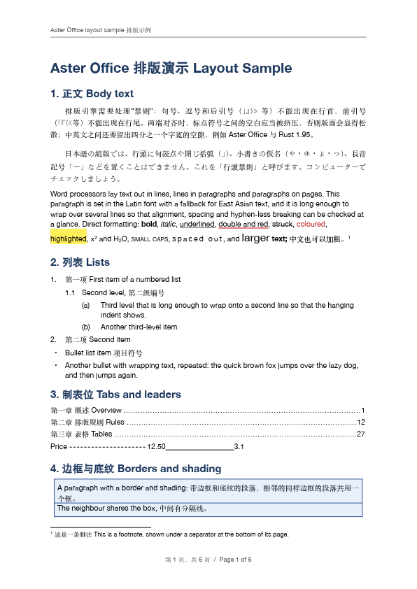
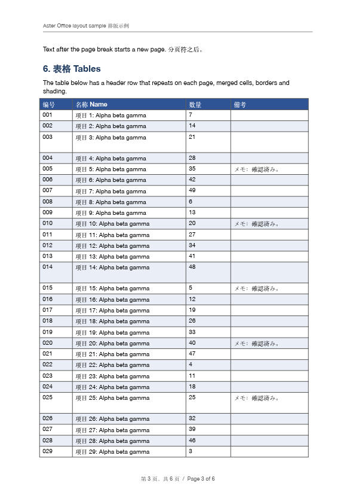
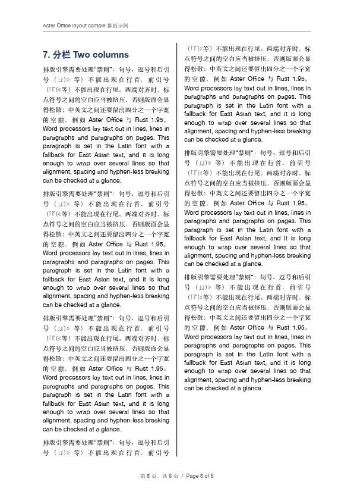

# aster-layout：Writer 的页面排版

把一份 `aster_writer::Document` 排成页：每一页是一张按绘制顺序排列的显示列表，再加上一组查询（点击落在哪个位置、光标在哪里、选区覆盖哪些矩形、上下左右键去哪里）。这个 crate 不画图，也不认识界面库；`aster-surface` 里的 `doc_paint` 负责把页面画出来。行内的断行、制表位、行高规则等由 `aster-text` 完成，本 crate 管的是段落以上的事：节、栏、分页、表格、页眉页脚、脚注、浮动图形。

单位是点（1/72 英寸），原点在页面左上角，y 向下。

```sh
cargo run -p aster-surface --example render_doc -- out/ 1.5     # 排一份示例文档，每页写成一个 PNG
cargo run --release -p aster-layout --example bench_layout      # 5000 段中英混排的计时
cargo test -p aster-layout
```

## 用法

```rust
let mut layouter = Layouter::new();
let layout = layouter.layout(&document);         // Layout：pages + 查询

for page in &layout.pages { /* page.items 按绘制顺序：Fill、Text、Picture、Rule…… */ }

layout.caret(&pos)                // Option<Caret { page, x, top, height }>
layout.hit(page, x, y)            // Option<Pos>：点击处最近的位置
layout.selection(&a, &b)          // Vec<(页, Rect)>
layout.line_start(&pos) / line_end(&pos)
layout.above(&pos, goal_x) / below(&pos, goal_x)
layout.page_of(&pos)
layout.outline()                  // 每个带大纲级别的段落：级别、文字、位置、页

// 页眉、页脚、脚注、尾注：位置的路径（Path）带着它所在的文字块（StoryId）
layout.story_at(page, x, y)       // Option<StoryId>：这一点在哪个文字块的区域里（页眉区、页脚区、脚注，否则正文）
layout.hit_in(page, story, x, y)  // 只在这个文字块里找最近的位置；hit(page, x, y) 仍只答正文
layout.caret_on(Some(page), &pos) // 页眉页脚在好几页上都有：带页的版本。selection_on、line_start_on、
                                  // line_end_on、above_on、below_on 同理；页只对页眉页脚有用
layout.page_info(page)            // 这一页的节、页眉页脚是哪个文字块、属于默认/首页/偶数页的哪一种、页眉区与页脚区的矩形
```

`Layouter` 会缓存排过版的段落。文档里的块在 `Arc` 之后，改动一处只会换掉那一块的 `Arc`；再次 `layout` 时，没变的段落直接取缓存（缓存键是段落的 `Arc` 地址、可用宽度，以及页码、脚注编号、网格等其他会影响排版的值），只有改过的段落重新整形。`Layouter::shaped_count()` 给出整形过多少个段落，测试用它确认这一点。

示例页（`render_doc` 的输出，下同）：







## 做了什么

- **节与页**：页面大小、页边距（装订线加在左边）、等宽或不等宽的栏、栏分隔线、分栏符；节的起始方式：下一页、连续（栏数不同则从当前页已有内容之下开始）、偶数页、奇数页（需要时插一张空白页）。页码有重新起始和格式。
- **段落**：缩进、首行缩进与悬挂缩进、段前段后（相加；“相同样式不加间距”时去掉；自动间距（`beforeAutospacing`/`afterAutospacing`，读入时记在 `ParaProps::space_before_auto`/`space_after_auto`）按 14 磅算，相邻的两个自动间距合成一个，列表项之间没有自动间距）、行距（倍数、最小值、固定值）、文档网格（按整数个网格行取高，文字居中）、左对齐/居中/右对齐/两端对齐/分散对齐、制表位（左、居中、右、小数点，带前导符）、列表标签（标签从首行起点开始，后接制表符、空格或什么也不接）、段落边框与底纹（相邻且边框相同的段落共用一个框，之间可有分隔线）、段前分页、与下段同页、段中不分页、孤行控制（两行）、段内的分页符和分栏符、隐藏文字（段落标记和内容都隐藏的段落不占位置，段前段后也不算）、全部大写和小型大写、上标下标、字符间距、下划线（双线单独画）、删除线、高亮和字符底纹。
- **行高**：机器上没有的字体（宋体、Calibri 等）按 Word 里该字体的行高比例排，不用替代字体的度量；文档网格下一行占 `ceil(自然高度/网格行高)` 个网格行，倍数再乘在其上，文字居中。
- **字体**：每个文字块的字体表是“西文字体、东亚字体、再加系统字体”。文档里的字体名（宋体、黑体、微软雅黑、楷体、仿宋、MS 明朝、MS ゴシック、Calibri……）在 `fonts.rs` 里映射到 macOS 自带的相近字体。不随包带字体。粗体用字体自己的粗体：宋体（Songti SC）、冬青黑体（Hiragino Sans GB）带真粗体，直接用，不再加粗一遍；楷体（Kaiti SC）的粗体面在系统里被标成常规，按名字（“粗体”）找出来单独注册；没有粗体的（Heiti SC 等）才用常规体手工加粗。
- **语言**：断行规则取自设置里的东亚语言；标点挤压取自 `compress_punctuation`；行首行尾禁则、标点悬挂、汉字与西文之间的四分之一字宽都来自 `aster-text`。
- **表格**：列宽、跨列、竖向合并、行高（自动、至少、固定）、单元格边距与垂直对齐、底纹、边框（共用的边只画一次，两边都有时取较粗的）、嵌套表格、`grid_before` 和 `grid_after`、表头行在后续每页重复、放不下的行整行移到下一页、比整页还高的行在行与行内的文字行之间切开（内容不会丢）。
- **页眉页脚**：每节有默认、首页、偶数页三种；逐页排版，所以页码、总页数、本节页数都是真值；页眉比上边距高时把正文往下推。
- **脚注与尾注**：脚注放在引用所在页的底部，上方有一条短分隔线，全文按引用顺序编号 1、2、3；正文里的引用和脚注里的编号都用所在文字块的样式；尾注排在文档末尾。脚注太长、本页放不下时，引用所在的行仍留在本页（至少给脚注留一行），脚注排下尽量多的行，剩下的接到下一页底部、该页自己的脚注之上、同样在分隔线之下，一页放不下就继续往后接；续接中的脚注之后出现的引用，其脚注要等到续接完才轮到，所以那一行挪到下一页。
- **图形**：行内的按图形大小占位，使所在行变高；浮动的按页、页边距、栏、段落、文字相对定位，可偏移或对齐；`behind` 画在文字下面；图片带裁剪；文本框里的块像单元格一样排版；其他图形画占位框。
- **文字绕排**：`Wrap::Square` 和 `Wrap::Tight`（按外框）的浮动图形，文字排在它旁边：同一段落的行按所在高度取不同的宽度和起点，图形锚定段落之后的段落也让开它（含 `distance`），栏里同样；图形在栏中间时取较宽的一边。一行放不下一个词就整行移到图形下面。`Wrap::TopAndBottom` 仍是文字在图形上下，`Wrap::None` 不管它。绕排只在图形所在的页上起作用。
- **查询**：正文、页眉、页脚、脚注、尾注（含其中的表格单元格）都能点到、定位、选择；上下左右键、Home、End 留在所在的文字块里（页眉不会走到正文）。页眉页脚每页都画一遍，所以这些查询要带页；脚注接到下一页时，两页上的行都属于同一个脚注，查询跨页。没有页眉或页脚的页，`page_info` 仍给出上下两条区域，用来双击后新建。文本框里的文字能画出来但点不到。

## 与 Word 不一样的地方（简化）

- 文字绕排：图形在栏中间时文字只排在较宽的一边，不是两边都排；`Tight` 当作外框，不沿图形轮廓；表格不绕图形（表格从图形下面开始）；图形相对“文字”（所在行）定位时，位置按绕排之前的行算，绕排后锚点所在行若变了，图形不跟着动；段落跨页后，下一页上的行不受上一页图形影响，但紧挨页底、被挪到下一页的行可能还带着旁边的缩进。
- 不等宽的栏里，段落按最窄的那一栏整形，所以不会溢出，但较宽的栏会留白；栏不做平衡。
- 行距倍数大于 1 时，多出的空间加在行的上方（文字贴着行底）；文档网格下，倍数按网格行高计。
- 孤行控制与“与下段同页”只在链很短（不超过 12 段、长段落只看开头两行）时精确；超长的链会放弃，保证排得完。
- 一行的高度取这一行最大字体的上升加下降加行距（Word 的“单倍行距”），不看段落标记的字体。
- 表格的 `fixed_layout` 不起作用，列宽一律按给定值；`cant_split` 也没有额外效果（本来就整行移页）。嵌套表格的行不再切开。竖向合并的单元格跨页时，文字按行落在各页上，不重画。
- 竖排（`vertical_text`）按横排排。注音画在底文上方居中，小字号，所在行相应加高。
- 尾注用阿拉伯数字编号，不单独起页，不显示“尾注”标题。
- 表格边框的虚线、点线、双线都按样式画；波浪线边框画成单线。下划线的波浪、点线、虚线都按样式画。
- 苹方（PingFang SC）装在系统私有目录里，字体库枚举不到，所以“微软雅黑”等映射到它的文字实际落到 Heiti SC（常规，粗体靠手工加粗）。
- 自动颜色在深色底纹（段落、单元格、字符）上为白色，其余为黑色。
- 空白页只在奇偶页起始的节里插入，且不带正文。

## 不做什么

读写文件、编辑、滚动与缩放、光标与输入处理都不在这里；交互视图会用这里的查询和 `aster-surface` 的 `doc_paint`。
