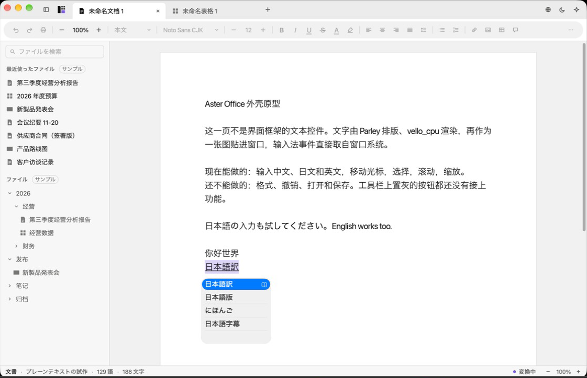
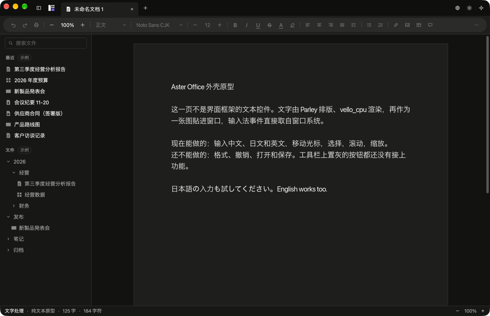
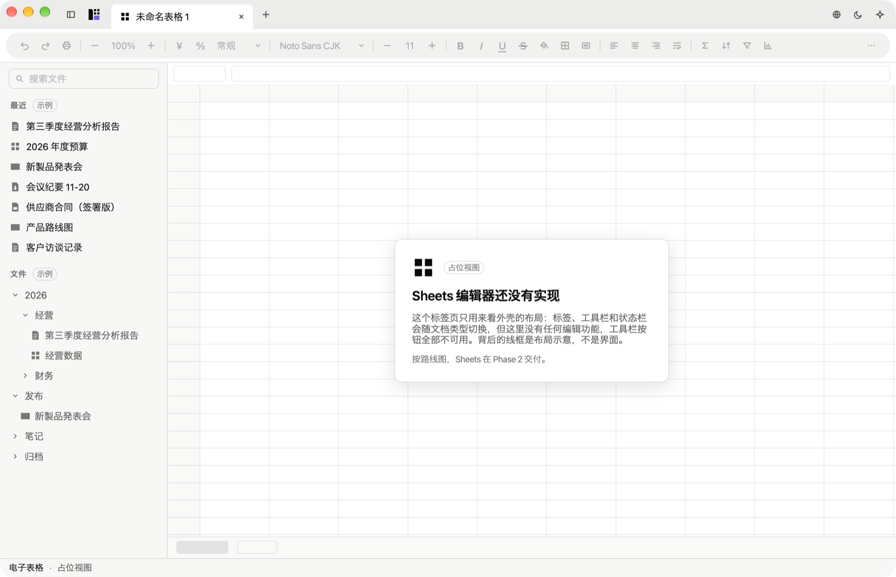

# aster-shell：应用外壳原型

Aster Office 的主窗口：标签栏、单行工具栏、工作区侧边栏、文档区、状态栏，以及开始页。目的是让人打开就能认出产品的样子，并把外壳的结构定下来。**它还不是一个能用的办公软件**，下面逐项写明哪些是真的、哪些是占位。

Markdown 标签是第一个能打开和保存真实文件的编辑器，见“[Markdown 标签](#markdown-标签)”一节。

```sh
cargo run -p aster-shell                                  # 开始页
cargo run -p aster-shell -- --open writer                 # 直接打开一个 Writer 标签
cargo run -p aster-shell -- --theme dark --lang ja        # 深色主题，日文界面
cargo run -p aster-shell -- --open sheets --assistant     # Sheets 占位视图，AI 面板展开
cargo run -p aster-shell -- notes.md 会议.txt             # 在 Markdown 标签里打开磁盘上的文件

cargo build -p aster-shell && spikes/bundle-macos.sh aster-shell   # macOS：打成带图标的 .app
open target/debug/aster-shell.app
```

macOS 上要测输入法，请用 `.app` 包启动：裸的可执行文件不是一个正常的应用，切不到前台时收不到输入法事件。

## 截图

开始页（简体中文，浅色）：


Writer 标签，拼音正在组字。预编辑串带下划线出现在光标处，候选窗在它正下方，状态栏右侧显示“正在组字”。截图时界面语言是日文：


同一个标签，日文罗马字输入，按空格转换后：



上屏之后。“你好世界”和“日本語訳”都是经输入法打进去的，各出现一次：


深色主题：



Sheets 占位视图，和展开的 AI 面板占位：




法文界面的开始页，日文界面加深色主题的 Slides 占位视图：


## Markdown 标签

Phase 1 的第一步：在 Markdown 标签里打开、编辑、保存磁盘上的真实文件。它编辑的是纯文本，**还不认识 Markdown 语法**：没有高亮、没有预览，状态栏写着“纯文本编辑，尚无高亮和预览”。

磁盘上的一个 CRLF 文件，打开后（状态栏右侧是编码和换行符）：


有未保存的修改时，标签上的关闭按钮换成一个圆点；关闭前会问：


不是 UTF-8 的文件被拒绝，文件本身不动：


Markdown 标签里的拼音和日文输入：


### 能做什么

| 功能 | 说明 |
| --- | --- |
| 打开 | 文件菜单的“打开…”（Cmd/Ctrl+O）、开始页的“打开文件…”按钮、命令行参数。已经打开的文件再打开一次会切到它的标签，不会开第二个 |
| 新建 | 文件菜单的“新建 Markdown 文档”（Cmd/Ctrl+N）、“+”菜单、开始页的 Markdown 卡片 |
| 保存 | “保存”（Cmd/Ctrl+S）写回原文件；没有文件的文档会弹出系统的保存对话框。“另存为…”（Cmd/Ctrl+Shift+S）总是问，存完后标签改名、之后的保存写到新文件 |
| 原子写入 | 先写同目录的临时文件、刷盘、再改名覆盖，最后刷目录；中途出错原文件不变。原文件的权限保留，经符号链接保存时写到链接指向的文件。实现在 `crates/aster-storage`，来自 G6 关卡 |
| 编码 | 只读写 UTF-8。UTF-16 和其他编码的文件明确拒绝并说明原因，文件不会被改写。文件开头的 BOM 保留 |
| 换行符 | 记住文件原来的风格（LF、CRLF、CR），新输入的换行也按这个风格写回；状态栏显示是哪一种。换行符混用的文件会在状态栏提示“保存时统一为 X” |
| 未保存提示 | 标签上的圆点；关闭有修改的标签前询问“保存 / 不保存 / 取消”；退出时有未保存的文档会问 |
| 读写线程 | 读文件和写文件都在工作线程上，结果经事件循环回到界面线程。保存期间可以继续输入：保存完成时，只有写进去的那个状态算“已保存” |
| 光标与选区 | 方向键、Home、End、Cmd/Ctrl 加左右键、Option/Alt 加左右键按词移动、鼠标点击；Shift 加这些键扩展选区；鼠标拖动选择；全选 |
| 剪贴板 | 剪切、复制、粘贴（编辑菜单和 Cmd/Ctrl+X/C/V），经过系统剪贴板。粘贴进来的换行统一成文档的风格 |
| 撤销重做 | 编辑菜单、工具栏、Cmd/Ctrl+Z 和 Cmd/Ctrl+Shift+Z。连续输入合并成一步；连续的退格、连续的删除各合并成一步；换行、粘贴、剪切各是一步；**输入法的一次上屏是一步，预编辑过程不进撤销栈**；在选区上开始组字时，删掉选区和随后的上屏合成一步。移动光标、保存之后再输入会开始新的一步。撤销回到保存时的状态，圆点会消失 |
| 退格与删除 | 按“用户看到的一个字”删：带组合符的字母、多个码点组成的表情都是一次删掉 |
| 滚动 | 滚轮滚动；光标移出可见区域时视图跟过去，包括撤销和重做之后 |
| 中日文输入法 | 与 G1 和 Writer 标签相同的路径。切换标签、关闭标签、弹出对话框时，进行中的组字会被丢弃，候选窗也会关掉 |

### 不在这一步里的

没有做，碰到了也没有做：自动保存与崩溃恢复、语法高亮、预览和分屏、查找替换、大文件性能、文件树、最近文件的真实记录、外部程序改了文件之后的提示、拖放打开、编码选择、换行符转换的界面、打印。

Writer 标签保持原样：仍然是没有文档模型、不能保存的纯文本表面。

## 外壳里哪些是真的

| 部分 | 状态 |
| --- | --- |
| 标签栏 | 真的。新建、切换、关闭；关掉当前标签后右侧邻居顶上来，没有右侧邻居就是左侧的；全部关掉回到开始页。左侧的标志按钮随时回开始页 |
| Writer 标签的文档区 | 真的，但只是纯文本。就是 G1 关卡的自绘表面：Parley 排版、vello_cpu 渲染，整帧作为一张图交给 Slint。能输入、移动光标、选择、滚动、缩放 |
| 中文和日文输入法 | 真的。输入法事件经 Slint 的 winit 钩子直接取自窗口系统，候选窗跟随光标 |
| 缩放 | 真的。工具栏和状态栏的 −、100%、+。每个文档各记各的。键盘快捷键写了但没试过 |
| 字数和字符数 | 真的。汉字、假名、谚文每个算一个字，其余按词算 |
| 浅色和深色主题 | 真的。一套令牌两组取值，文档区的页面一起变。用启动参数看过两种主题；界面上的切换按钮没有用真实点击试过 |
| 界面语言 | 真的。八种：简体中文、繁體中文、日本語、English、Français、Deutsch、Español、한국어。标签栏右侧的地球按钮切换，即时生效 |
| 侧边栏开合、AI 面板开合 | 写了，带展开动画。AI 面板用启动参数看过展开的样子；两个按钮本身没有用真实点击试过 |
| macOS 上标签栏与标题栏合一 | 真的。空白处可以拖动窗口，双击缩放 |

## 外壳里哪些是占位

| 部分 | 说明 |
| --- | --- |
| Sheets、Slides、PDF 标签 | 只有一张说明卡片，背后是一层淡的布局线框。线框是画出来的示意，不响应任何操作 |
| 工具栏上除 Writer 的缩放、Markdown 的撤销和重做以外的所有按钮 | 置灰，点了没有反应。它们的位置和分组是设计稿，功能都没接 |
| 字体、字号、段落样式这几个下拉框里显示的值 | 写死的。`Noto Sans CJK` 是方案里计划内置的字体名，现在并没有内置 |
| 最近文件 | 固定的示例数据，界面上标了“示例”。点开会得到一个同名标签，里面是一段说明“这不是从磁盘读的文件”的文字；Markdown 类型的可以编辑，保存时会问存到哪里 |
| 文件树 | 固定的示例数据，不能展开、折叠或点击 |
| 搜索框 | 只是画了位置，不能输入 |
| AI 面板 | 只有说明文字和一个不能输入的提问框。没有接任何模型，也没有 MCP 服务 |
| Writer 这个名字 | 标签叫 Writer，里面其实是纯文本表面。状态栏写着“纯文本原型” |

没有做的：Writer 的文档模型、格式、右键菜单、提示气泡、设置、工具栏放不下时的“更多”菜单（现在是直接裁掉）、跟随系统的主题和语言（现在默认浅色、简体中文，由启动参数或界面按钮改）。

## 结构

外壳分成两个 crate，名字和分层取自技术方案的 crate 表。

**`aster-surface`**（`crates/aster-surface`）是文档表面。

- `text_surface.rs`：从 `spikes/g1-ime` 搬出来的纯文本表面。不出现 Slint 和 winit 的类型，拿到输入事件，吐出像素。这次加了调色板、居中的定宽页面、滚动、缩放。
- `host.rs`：把表面接进 Slint 窗口的胶水：按键解码、winit 输入法事件的转换、候选窗定位、界面字体的汉字回退链。

G1 的 spike 现在依赖这个 crate，不再有自己的一份表面代码，`cargo run -p g1-ime` 照常可用。

Markdown 这一步又加了三个 crate，都不依赖 Slint：

- **`aster-markdown`**：文档模型。文本、选区、编辑命令、撤销历史（`document.rs`、`history.rs`），以及文件的编码和换行符规则（`file.rs`）。需要排版才能回答的问题（光标上移一行到哪里、鼠标下面是哪个字）由视图回答，再把结果告诉文档。
- **`aster-storage`**：原子写入。从 `spikes/g6-storage` 搬过来，G6 的 spike 现在用它。命令日志和崩溃恢复以后也放这里。
- **`aster-platform`**：系统的打开和保存对话框，用 `rfd` 0.18（MIT）。

编辑时的分工：每个编辑先交给文档，文档改完文本、记好撤销，再把“哪一段换成了什么”交给文字表面重放。所以两边的文本始终一致，有一组测试专门检查这一点。组字中的预编辑文字只在表面上，文档在上屏时才知道。

**`aster-shell`**（本目录）是外壳，一半是库，一半是程序。

| 文件 | 内容 | 是否引用 Slint |
| --- | --- | --- |
| `src/theme.rs` | 设计令牌：颜色、间距、圆角、字号、控件高度，浅色和深色各一组。**颜色和尺寸只写在这一处** | 否 |
| `src/i18n.rs` | 八种语言的界面文字。**界面文字只写在这一处** | 否 |
| `src/icons.rs` | 线性图标的路径数据，自己画的 | 否 |
| `src/tabs.rs` | 标签状态：打开、关闭、切换、未命名文档的编号 | 否 |
| `src/toolbar.rs` | 每种文档的工具栏有哪些控件、哪些可用 | 否 |
| `src/stats.rs` | 字数统计 | 否 |
| `src/sample.rs` | 最近文件和文件树的示例数据 | 否 |
| `src/cli.rs` | 启动参数 | 否 |
| `src/files.rs` | 读写 Markdown 标签背后的文件（阻塞调用，只在工作线程上用） | 否 |
| `src/main.rs` | 把上面这些和界面接起来：标签、菜单、对话框、后台读写 | 是 |
| `src/content.rs` | 标签的内容：Writer 的纯文本视图，Markdown 的编辑器（文档模型加文字表面） | 是 |
| `src/macos.rs` | macOS 专用的两处修正，见下文 | 是 |
| `ui/*.slint` | 界面。只引用令牌和语言表，自己不写颜色、尺寸和文字 | — |

标着“否”的模块不出现 Slint、winit 和 `aster-surface`，有一条单元测试专门检查这一点。但要说清楚：它们和程序同在一个 crate，这个 crate 整体是链接 Slint 的，所以这是模块级的隔离，不是 crate 级的。

### 和技术方案不一致的地方

- **令牌的出处**。方案写的是“在 aster-shell 里用一个 Slint 全局单例定义”。这里改成写在 Rust 里，启动和切换主题时拷进 Slint 的全局单例。原因有两个：自绘的文档区也要用这套颜色，而它不能依赖 Slint；写在 Rust 里才能脱离窗口做单元测试（对比度、“紫罗兰是唯一色相”等）。
- **界面字体没有内置**。方案要求内置界面字体以保证三端一致。这里用的是系统界面字体，加一条显式的汉字回退链，取的都是 macOS 自带的字体。Windows 和 Linux 上这些字体名不存在，会落回系统默认。
- **渲染在 UI 线程上**。方案要求排版和渲染在文档线程。这里和 G1 一样，每次按键都在 UI 线程上整帧重绘。G2 测过这条路径在 60 Hz 下够用，但它不是最终结构。
- **图标**。方案提到 Material Symbols，前提是先复核许可。这里用的是自己画的线性图标，没有引入任何外部图标。
- **AI 和 MCP**。方案的 crate 表里没有这一块。
- **文档模型和撤销历史放在 `aster-markdown`，不在 `aster-model`**。方案把 `History` 和 `DocumentSession` 放在 `aster-model`。现在只有一种文本文档，为它单独建 `aster-model` 太早；等第二种编辑器出现、知道哪些是共用的，再把通用部分提出来。
- **编辑在界面线程上**。方案要求每个文档一个文档线程。这一步只把读写文件放到了工作线程，按键到文档的路径仍在界面线程。
- **剪贴板不在 `aster-platform`**。Slint 没有给应用代码的剪贴板接口，这里借用一个看不见的 Slint 文本框来复制和粘贴（`ui/app.slint` 的 `copy-to-clipboard` 和 `clipboard-text`）。只能传纯文本。

## 检查过什么

在 macOS 27.0.1（Apple Silicon，2 倍缩放的内置屏）上，用 `.app` 包启动，以下各项是用真实的鼠标和键盘事件逐项操作并截图确认的：

- 标签单击切换；在标签上双击只切换，不缩放窗口
- 在标签栏空白处双击缩放窗口，再双击还原；按住空白处拖动窗口
- 语言菜单打开、选择、界面即时切换
- 简体拼音：`nihao` 出预编辑串和候选窗，空格上屏“你好”；接着“世界”。各出现一次
- 日文罗马字：`nihongo` 出假名，空格转换出候选列表，回车上屏。只出现一次
- 状态栏的字数随上屏增加（125 → 129 → 133），输入法状态在“已启用”和“正在组字”之间变化

以下各项只用后台注入的点击或启动参数看过，没有用真实点击复核：

- 开始页的卡片、“+”菜单、侧边栏的最近文件：都能打开对应的标签
- 标签上的关闭按钮
- 状态栏的缩放按钮（100% → 110%，页面跟着放大）
- 文档区滚轮滚动、拖动选择文字
- AI 面板（用 `--assistant` 启动）、深色主题（用 `--theme dark` 启动）
- 八种语言里，法、德、日文界面看过截图

以下各项写了代码但**没有在界面上试过**：

- 标签栏右侧的主题按钮、左侧的侧边栏按钮。后台注入的点击在标题栏那一条里会被投递两次（见“已知问题”），开了又关，看不出结果
- 鼠标中键关闭标签
- 缩放的键盘快捷键（Cmd/Ctrl 加 `=`、`-`、`0`）。按键到命令的映射有单元测试
- 在文档区用真实鼠标双击
- 繁体中文、英文、西班牙文、韩文界面。文字齐全由单元测试保证，排版没有逐屏看过
- 全屏状态下标签栏左侧的留白收回

自动化检查：`cargo fmt --all --check`、`cargo clippy --workspace --all-targets -- -D warnings`、`cargo test --workspace` 通过。

**Windows 和 Linux 完全没有运行过。** 代码里为它们留了路径（标签栏放在系统标题栏下面，窗口图标取自 `assets/brand`），但从未在那两个系统上构建或打开，输入法也没有测。

## Markdown 标签检查过什么

在 macOS 27.0.1 上，用 `.app` 包启动，真实的鼠标和键盘：

- 打开一个 CRLF 的中日文 Markdown 文件，在末尾输入英文、换行、再输入，保存；文件和预期**逐字节一致**，换行全是 CRLF，没有混进 LF。
- 简体拼音在 Markdown 标签里组字：预编辑串带下划线、候选窗在它正下方；上屏“世界”后撤销一次正好撤掉“世界”，重做恢复。
- 日文罗马字：`nihongo` 实时转换、空格出候选、回车确认、再回车上屏，“日本語版”只出现一次。
- 用 Shift 加左键选中两个字，再用日文输入法在选区上组字：选区被替换；撤销一次，原来的两个字和选区一起回来。
- 用 Cmd+S 保存后再打开，内容与保存的一致；这一份同样逐字节核对过。
- “另存为”（Cmd+Shift+S）存到新文件名：新文件逐字节等于原文件，原文件没有被改动，标签改成新文件名。
- 鼠标拖动选中一段文字，Cmd+C 后系统剪贴板里正是这段文字；在行首 Cmd+V 粘贴；Shift 加右键选两个字后 Cmd+X，文字消失、剪贴板里是这两个字；两次撤销恢复原文。测试前备份了剪贴板，测试后原样恢复。
- 连按 45 次下方向键，视图跟着光标往下滚。
- 组字过程中关闭标签：候选窗随之关掉（修正前它会留在屏幕上，跟到下一个文档的光标处）。

用后台注入的点击和菜单操作看过：

- 打开 GBK 编码的文件：弹出“这个文件不是 UTF-8 编码……文件没有被改动”，文件的 SHA-1 前后一致。
- 换行符混用的文件、200 行的长文件同时打开；长文件滚轮滚动、点击插入。
- 全选后输入整篇替换；关闭时出现询问，选“取消”回到文档，撤销恢复全文；选“保存”写入后关闭，文件内容正确；对新建文档选“不保存”直接关闭。
- 新建文档后“保存”弹出系统保存对话框，取消后什么都没写。
- 有未保存修改时从应用菜单退出，出现“有 1 个文档尚未保存”，取消后留在原处。

**没有检查的**：

- Windows 和 Linux 完全没有构建、运行过，包括文件对话框、剪贴板和输入法。
- 系统的“打开”对话框一次也没有打开过：测试用的文件都是从命令行参数打开的。两条路之后走的是同一个读取函数，但对话框本身、开始页的“打开文件…”按钮和 Cmd/Ctrl+O 都没有试过。
- 同一个文件再打开一次切到已有标签：只有单元测试。
- 按键里，Cmd 加左右键、Shift 加左右键、下方向键、退格、回车用真实按键试过；Option/Alt 按词移动、Home、End、上方向键、Delete 没有在窗口里试过（解码有单元测试）。
- 退出确认里的“放弃修改并退出”按钮，以及在有未保存文档时点窗口的关闭按钮。
- 保存失败的提示（比如写到只读目录），只有单元测试。
- 外部程序在编辑期间修改或删除了文件，没有处理也没有测。
- 大文件：只试过 200 行。每次按键都要整篇重算字数，几 MB 的文件会明显变慢。

## 已知问题

- **macOS 标题栏的点击归属**。标签栏画在透明的标题栏下面。winit 的内容视图默认允许“按住即拖动窗口”，于是系统会把标签上的双击当成双击标题栏而缩放窗口。`src/macos.rs` 在运行时把这个视图的 `mouseDownCanMoveWindow` 改成返回否，之后拖动和缩放都由外壳自己在空白处处理。这是对 winit 的类做的运行时替换，winit 升级后要重测。
- **后台注入的点击会出错**。用自动化工具向后台窗口注入点击时，落在标题栏那一条高度内的点击会被投递两次（间隔约 0.37 秒，日志里切换函数被调了两次），间隔很短的两次点击还会让系统缩放窗口，而外壳自己的拖动和缩放处理函数都没有被调用。真实鼠标下没有复现：真实点击打开的语言菜单在一秒后仍然开着，真实的标签双击也不缩放。原因没有查清，写在这里是为了以后做界面自动化测试的人不要被它骗到。
- **红绿灯按钮偏高**。标签栏高 40，系统的窗口按钮按 28 高的标题栏居中，比标签栏里的其他按钮高出约 4 像素。
- **工具栏放不下时直接裁掉**。窗口窄于工具栏时右侧的控件看不见，还没有“更多”菜单。
- **切换语言后，已经显示过的汉字可能保留原来的字形**。日文界面优先用日文字体，繁体界面优先用繁体字体，但 Slint 已经排过版的文字不一定重排。重启后一定正确。
- **示例数据不随语言变**。最近文件的名称、位置和时间是内容，不是界面文字，切到别的语言时仍是中文。
- **切到别的窗口再回来时，拼音的预编辑串会按原字母上屏**。组字时窗口失去焦点再回来，按空格得到的是 `nihao` 而不是“你好”。没有和系统原生应用对比过，可能是输入法本身的行为（G1 清单第 6 项，一直没测）。没有丢字，也没有重字。
- **后台注入的拖动在这个窗口上不可靠**：自动化工具在拖动结束后会多送一次点击，把刚拖出的选区收成光标。真实鼠标拖动没有这个问题。
- **字数统计每次按键都重算整篇**，长文件会慢。
- **截图会触发系统提示**。用 `screencapture` 截窗口时，macOS 弹过一次屏幕录制的提醒。
- **日文候选窗打开时按回车**，第一次只关候选窗，第二次才上屏。和 G1 记录的一样，还没有和系统原生应用逐键对比。

## 已定的设计问题

- **界面正文 13 px，控件高 28**（2026-11-22 定）。和参照对象一致；方案里“中日文界面用 14 px、控件高 30”的建议不采用。取值在 `src/theme.rs` 的 `Metrics::standard`。

## 待定的设计问题

1. **深色主题下页面是深色还是保持白色**。现在是深色页面配浅色字。文档本身的页面颜色将来是文档的属性，这里只决定默认观感。
2. **标签栏的“+”**。现在弹出五种类型的菜单。另一种做法是点“+”直接回开始页。
3. **开始页是不是一个常驻标签**。现在它不是标签，由左上角的标志按钮进入。
4. **AI 与 MCP 的形态**。面板位置已经留在右侧。参照 MySSH 的做法是：MCP 服务跑在应用进程内，另配一个只转发字节的小程序给外部客户端；内置助手和 MCP 共用同一份工具目录、策略、审批和审计。办公套件里“策略的单位”是什么（文档、文件夹还是工作区）需要定，方案的 crate 表也要补上这一块。
5. **语言范围和默认值**。现在八种，默认简体中文。是否跟随系统语言、要不要再加，需要定。译文是我写的，没有经过母语者校对。
6. **令牌写在 Rust 还是 Slint**。见上文“和技术方案不一致的地方”，如果认可现在的做法，方案文档要跟着改。
7. **图标**。继续用自绘的这一套，还是复核许可后换成 Material Symbols。
8. **平台相关的代码放哪**。`src/macos.rs` 按方案应当属于 `aster-platform`，那个 crate 还不存在。
