# aster-shell：应用外壳原型

Aster Office 的主窗口：标签栏、单行工具栏、工作区侧边栏、文档区、状态栏，以及开始页。目的是让人打开就能认出产品的样子，并把外壳的结构定下来。**它还不是一个能用的办公软件**，下面逐项写明哪些是真的、哪些是占位。

Markdown 标签是第一个能打开和保存真实文件的编辑器，见“[Markdown 标签](#markdown-标签)”一节；100 MB 的文件也能打开和编辑，见“[大文件](#大文件)”一节；源码有语法高亮，可以分屏或单独看预览，见“[高亮、预览和分屏](#高亮预览和分屏)”一节；它的未保存修改在程序崩溃或被强杀后可以找回，见“[崩溃恢复](#崩溃恢复)”一节。Excel 和 PowerPoint 文件可以打开查看，见“[Excel 和 PowerPoint 标签](#excel-和-powerpoint-标签)”一节。

```sh
cargo run -p aster-shell                                  # 开始页
cargo run -p aster-shell -- --open writer                 # 直接打开一个 Writer 标签
cargo run -p aster-shell -- --theme dark --lang ja        # 深色主题，日文界面
cargo run -p aster-shell -- --open sheets --assistant     # Sheets 占位视图，AI 面板展开
cargo run -p aster-shell -- notes.md 会议.txt             # 在 Markdown 标签里打开磁盘上的文件
cargo run -p aster-shell -- 预算.xlsx 发布会.pptx          # 只读的 Sheets 和 Slides 标签

cargo build -p aster-shell && spikes/bundle-macos.sh aster-shell   # macOS：打成带图标的 .app
open target/debug/aster-shell.app
```

macOS 上要测输入法，请用 `.app` 包启动：裸的可执行文件不是一个正常的应用，切不到前台时收不到输入法事件。

## 截图

开始页（简体中文，浅色）：

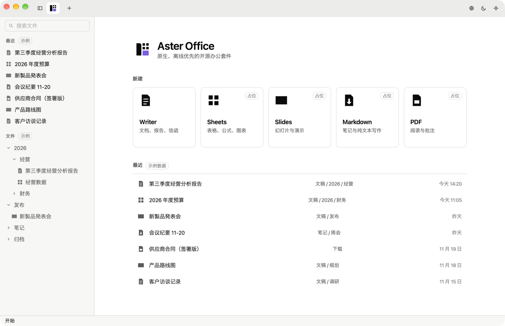

Writer 标签，拼音正在组字。预编辑串带下划线出现在光标处，候选窗在它正下方，状态栏右侧显示“正在组字”。截图时界面语言是日文：

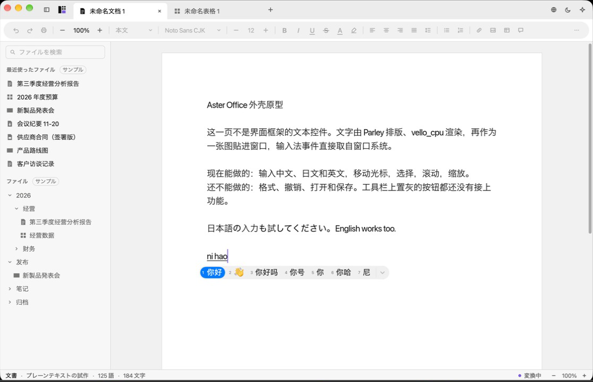

同一个标签，日文罗马字输入，按空格转换后：


上屏之后。“你好世界”和“日本語訳”都是经输入法打进去的，各出现一次：

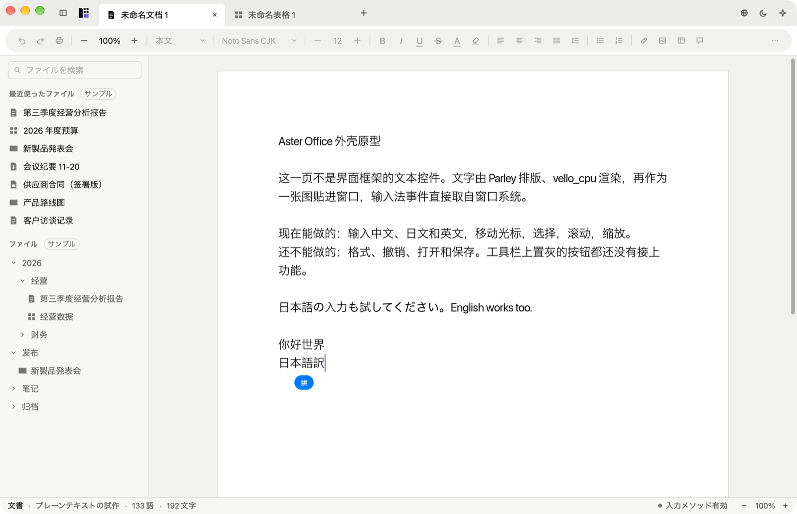

深色主题：


Sheets 占位视图，和展开的 AI 面板占位：


法文界面的开始页，日文界面加深色主题的 Slides 占位视图：


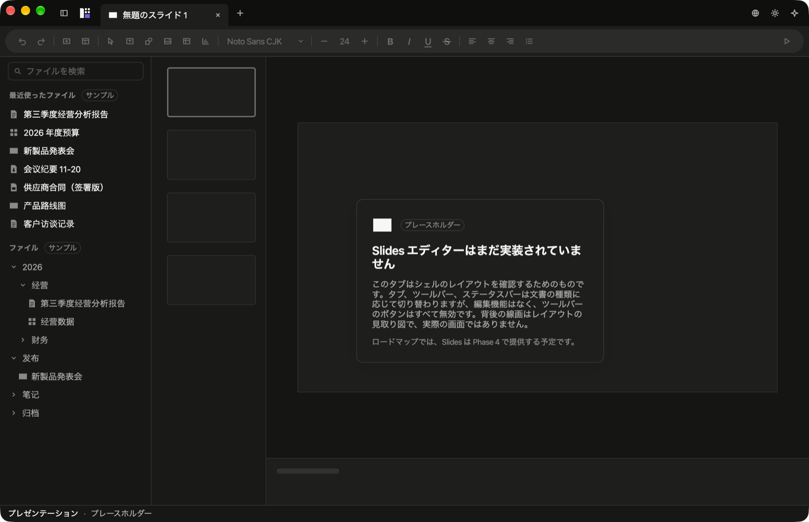

## Markdown 标签

Phase 1 的第一步：在 Markdown 标签里打开、编辑、保存磁盘上的真实文件。编辑的始终是源码本身；语法高亮和预览是后来加的，见下一节。下面这几张截图是加高亮之前拍的。

磁盘上的一个 CRLF 文件，打开后（状态栏右侧是编码和换行符）：


有未保存的修改时，标签上的关闭按钮换成一个圆点；关闭前会问：

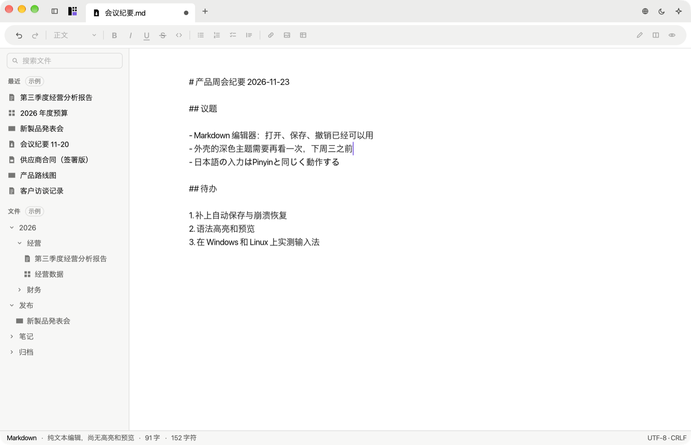

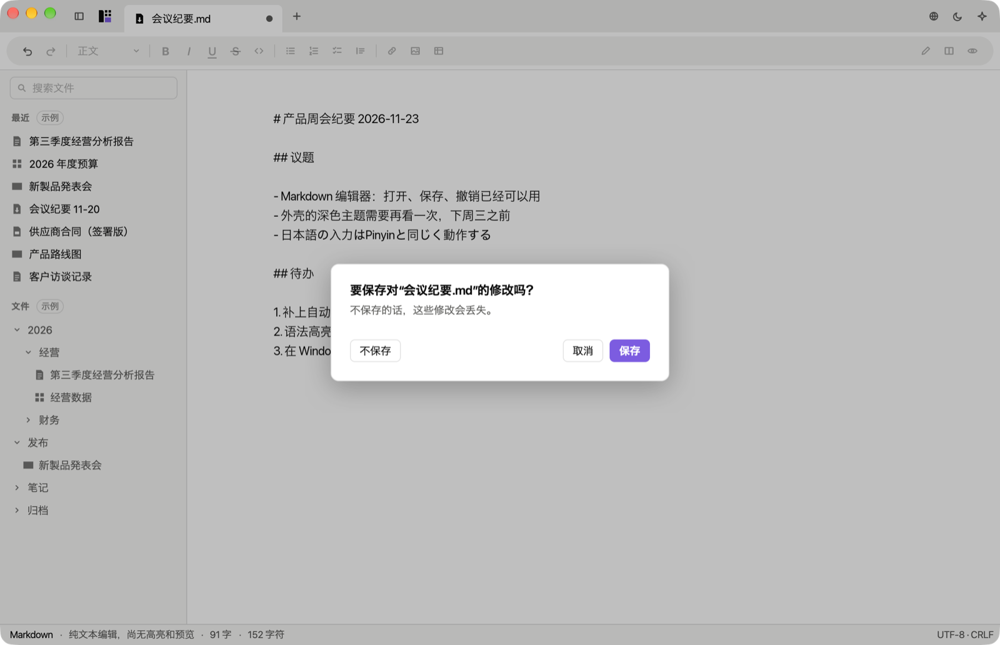

不是 UTF-8 的文件被拒绝，文件本身不动：


Markdown 标签里的拼音和日文输入：


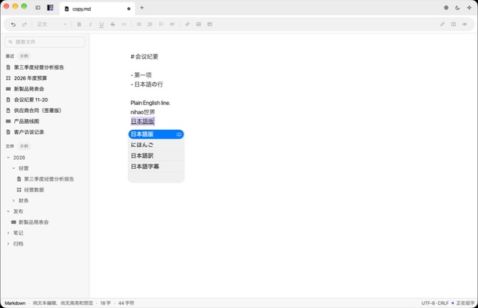

### 能做什么

| 功能 | 说明 |
| --- | --- |
| 打开 | 文件菜单的“打开…”（Cmd/Ctrl+O）、开始页的“打开文件…”按钮、命令行参数。已经打开的文件再打开一次会切到它的标签，不会开第二个 |
| 新建 | 文件菜单的“新建 Markdown 文档”（Cmd/Ctrl+N）、“+”菜单、开始页的 Markdown 卡片 |
| 保存 | “保存”（Cmd/Ctrl+S）写回原文件；没有文件的文档会弹出系统的保存对话框。“另存为…”（Cmd/Ctrl+Shift+S）总是问，存完后标签改名、之后的保存写到新文件 |
| 原子写入 | 先写同目录的临时文件、刷盘、再改名覆盖，最后刷目录；中途出错原文件不变。原文件的权限保留，经符号链接保存时写到链接指向的文件。实现在 `crates/aster-storage`，来自 G6 关卡 |
| 编码 | 只读写 UTF-8。UTF-16 和其他编码的文件明确拒绝并说明原因，文件不会被改写。文件开头的 BOM 保留 |
| 换行符 | 记住文件原来的风格（LF、CRLF、CR），新输入的换行也按这个风格写回；状态栏显示是哪一种。换行符混用的文件会在状态栏提示“保存时统一为 X” |
| 未保存提示 | 标签上的圆点；关闭有修改的标签前询问“保存 / 不保存 / 取消”；退出时有未保存的文档会问 |
| 读写线程 | 读文件和写文件都在工作线程上，结果经事件循环回到界面线程。保存期间可以继续输入：保存完成时，只有写进去的那个状态算“已保存” |
| 光标与选区 | 方向键、Home、End、Cmd/Ctrl 加左右键、Option/Alt 加左右键按词移动、鼠标点击；Shift 加这些键扩展选区；鼠标拖动选择；全选 |
| 剪贴板 | 剪切、复制、粘贴（编辑菜单和 Cmd/Ctrl+X/C/V），经过系统剪贴板。粘贴进来的换行统一成文档的风格 |
| 撤销重做 | 编辑菜单、工具栏、Cmd/Ctrl+Z 和 Cmd/Ctrl+Shift+Z。连续输入合并成一步；连续的退格、连续的删除各合并成一步；换行、粘贴、剪切各是一步；**输入法的一次上屏是一步，预编辑过程不进撤销栈**；在选区上开始组字时，删掉选区和随后的上屏合成一步。移动光标、保存之后再输入会开始新的一步。撤销回到保存时的状态，圆点会消失 |
| 退格与删除 | 按“用户看到的一个字”删：带组合符的字母、多个码点组成的表情都是一次删掉 |
| 滚动 | 滚轮滚动；光标移出可见区域时视图跟过去，包括撤销和重做之后 |
| 中日文输入法 | 与 G1 和 Writer 标签相同的路径。切换标签、关闭标签、弹出对话框时，进行中的组字会被丢弃，候选窗也会关掉 |

### 不在这一步里的

没有做，碰到了也没有做：自动写回原文件、查找替换、文件树、最近文件的真实记录（后两项后来做了，见“文件和文件夹”一节）、编辑期间外部程序改了文件的提示（恢复时会提示，见下一节）、拖放打开、编码选择、换行符转换的界面、打印。

Writer 标签保持原样：仍然是没有文档模型、不能保存的纯文本表面。

## 高亮、预览和分屏

Markdown 标签现在认识 Markdown：源码带语法高亮，工具栏右端的三个按钮在“只看源码”“左源码右预览”“只看预览”之间切换，每个标签各记各的。预览用的是和编辑器同一套文字栈（Parley 排版、vello_cpu 渲染、同一条汉字回退链），没有浏览器或 WebView。

分屏，浅色主题。左边的 `#`、`**`、链接地址、列表符号是灰色，标题和粗体加粗，链接文字是紫色，行内代码有底色；右边是预览：

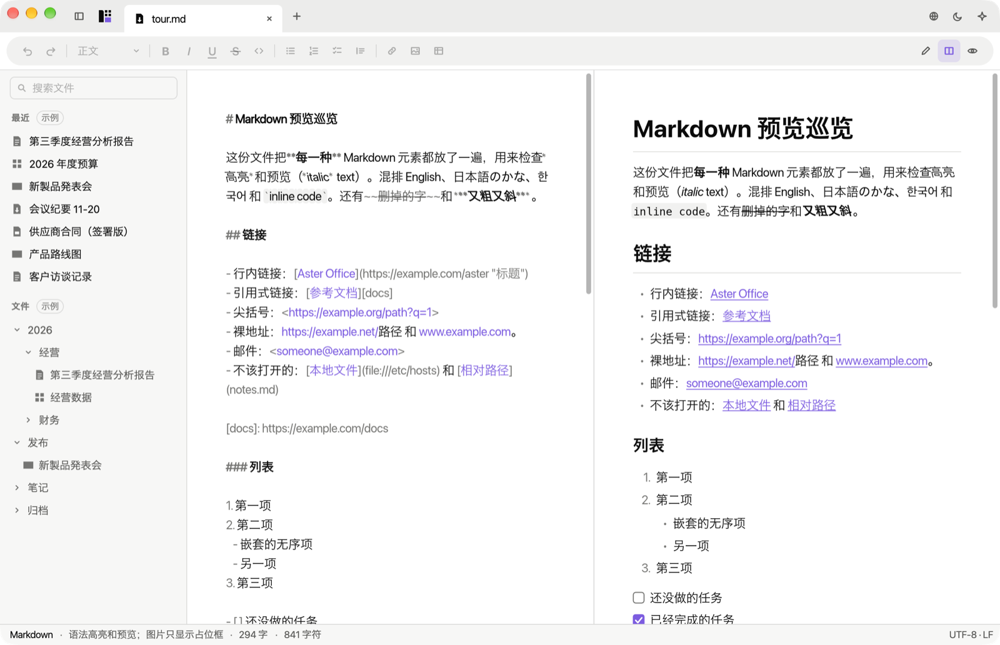

深色主题。源码里的代码块整行有底色，预览里的代码块、引用和任务列表：


在一级标题末尾用拼音组字：预编辑串带下划线，不受高亮影响；上屏后这两个字和标题一起变粗，停手一会儿后预览里的标题也跟着变了：


### 能做什么

| 功能 | 说明 |
| --- | --- |
| 解析 | `pulldown-cmark` 0.13（MIT），不带 HTML 输出。CommonMark，加 GitHub 的表格、任务列表、删除线、`[!NOTE]` 提示块，以及脚注和 `$` 数学。编辑器和预览用同一套选项（`aster-markdown/src/syntax.rs`） |
| 源码高亮 | 标题、强调、行内代码、代码块、链接、列表符号、引用、表格竖线和分隔行、分隔线、HTML、数学、链接引用定义。紫色只用在链接文字上，语法符号是第三级灰，引用和删除线是第二级灰，代码用填充色作底。颜色全部来自 `theme.rs` 的令牌，浅色和深色各一组；为深色背景加了一个 `link` 令牌（深色下比强调色浅一些，对比度测试覆盖） |
| 高亮不动文字 | 粗体和斜体是把常规字形描粗、倾斜画出来的，不换字体也不改字号，所以文字位置、换行、光标、选区、输入法都和不高亮时一样。有一条测试专门检查这一点 |
| 高亮不拖慢输入 | 文本按“不可能在任何结构里面的空行”切成块，每块单独解析。一次编辑只从它所在的块重新切，切到和旧切点重合就停，只重新解析中间的块。2000 段的文档里打一个字只解析一两段（有测试）；随机做 3000 次编辑，每次都和整篇重算的结果逐项相同（有测试）。每一帧只取可见的几行的高亮 |
| 预览 | 标题（一、二级带分隔线）、段落、粗体、斜体、删除线、行内代码、代码块（等宽字体，自动换行）、引用（可嵌套）、有序和无序列表（可嵌套）、任务列表（勾选框）、表格（按列对齐，太宽时按比例收窄、单元格内换行）、分隔线、脚注 |
| 图片 | 不加载任何文件或网络资源。单独成段的图片画成一个带边框的框，中间是图片描述；行内图片是带底色的描述文字 |
| 只当代码显示的 | HTML 块和行内 HTML、`$` 数学、脚注引用，按原文显示成代码样式 |
| 链接 | 预览里的链接可以点：`http`、`https` 和 `mailto` 直接交给系统打开，不确认；其他的（`file:`、相对路径、`javascript:`、别的程序注册的协议）一概不打开，状态栏说明原因。白名单在 `aster-platform/src/links.rs`，URL 作为一个参数交给 `open`（Windows 上 `rundll32`，Linux 上 `xdg-open`），不经过 shell。鼠标移到链接上变成手形 |
| 裸地址 | 正文里写出来的 `http://`、`https://`、`www.` 地址也算链接，和 GitHub 一样；不同的是遇到非 ASCII 字符就停，所以“访问https://example.com获取”不会把后面的汉字吞进去 |
| 刷新 | 停止输入 250 毫秒后，在单独的线程上重新排版；界面线程只画可见的部分。排版线程只做每个文档最新的一份请求，过时的丢掉。改窗口大小、换主题会立刻重排 |
| 分屏同步 | 滚编辑器时预览跟着到同一处源码，滚预览时编辑器跟着；按块的源码范围对应，块内按比例插值，所以是“大致”对齐。切换视图时也停在同一处 |
| 只看预览时 | 键盘输入和输入法都不进文档；切过去时进行中的组字被丢弃 |

### 不在这一步里的

查找替换（后来做了，见“查找替换”一节）、导出 HTML 或 PDF、所见即所得编辑、拼写检查、预览里的中日文禁则（用 Parley 的默认断行）。

### 检查过什么

在 macOS 27.0.1（Apple Silicon，2 倍缩放）上，用 `.app` 包打开 `crates/aster-surface/tests/data/markdown-tour.md`（每种元素都有，中日韩英混排），以下各项用后台注入的点击、滚轮和按键操作，并截图确认：

- 高亮：标题、粗体、斜体、删除线、行内代码、代码块整行底色、链接文字和地址、尖括号链接、裸地址、邮件、列表符号、任务框、引用符号、链接引用定义，浅色和深色都看过。
- 三个视图按钮：只看源码、分屏、只看预览，按下的那个有紫色底；来回切换几轮。
- 分屏同步：滚编辑器，预览停在同一节（“## 链接”对“链接”）；滚预览，编辑器跟着到“### 列表”。
- 点预览里的 `https` 链接：Chrome 打开了 example.com（窗口标题“Example Domain”），没有任何确认框。
- 点 `file:///etc/hosts` 那个链接：没有打开，状态栏显示“只会打开网页和邮件链接，这个链接没有打开”。
- 拼音输入法：在标题末尾打 `ceshi`，预编辑串带下划线、候选窗在下方、状态栏“正在组字”；空格上屏“测试”，只出现一次，并且加粗；约四分之一秒后预览里的标题变成“Markdown 预览巡览测试”。在新建的空文档里打 `# ` 和 `xinwenjian`，`#` 变灰、“新文件”加粗。
- 每个标签记住自己的视图：一个标签分屏、另一个只看预览，来回切换各自保持；切回分屏的标签时预览是它自己的内容（第一版这里会残留另一个标签的画面，已修）。
- 深色主题（用 `--theme dark` 启动）下的源码和预览。
- 空闲时的 CPU：只看源码约 2%，只看预览约 0%（第一版只看预览时每 33 毫秒重画一次、占 50%，已修）。

自动化测试覆盖的（`cargo test --workspace`）：高亮的每种元素、中日文、空文档、10 万字的长行、未闭合的代码块（一直到文末都是代码）、没写完和不规整的表格、增量和整篇重算一致、编辑只解析附近的块；预览结构的每种块、中日文换行不加空格、20 万字的长行、未闭合代码块、不规整表格、松散和紧凑列表；预览排版后链接的位置、源码位置和高度互相换算、空文档和极窄窗口不崩、排版线程只做最新的一份；编辑器里高亮跟着输入和撤销走、组字时高亮不影响上屏、只在需要时请求排版、切换视图和双向滚动后两边停在同一处；链接白名单。

**没有检查的**：

- 没有用真实的鼠标和键盘试过：这一轮的点击、滚轮和按键都是自动化工具注入的（申请全屏控制时没有人在电脑前确认）。拼音组字经过了系统输入法，候选窗是真的。
- 日文输入法在高亮下没有试（拼音试过）。
- 大文件下打字的手感：这一节写的时候没有试过。后来的“大文件”一节解决并实测了。
- 主题按钮在界面上切换：2026-11-23 用真实鼠标在 macOS 上点过，点一次切到深色，再点一次切回浅色。后台注入的点击在标题栏那一条会被投递两次（见“已知问题”），所以自动化测试看不出结果。
- `mailto:` 链接没有点过（白名单有单元测试）。
- Windows 和 Linux 上的链接打开、预览字体，都没有运行过。

### 留下的问题

- **数学、HTML 只显示原文**，不排版公式。（脚注后来做了，见“预览的细节”。）
- ~~预览不做中日文禁则~~、~~中日文的强调不倾斜~~、~~GitHub 提示块显示成普通引用~~、~~预览里不能选择和复制文字，也不能用键盘滚动~~、~~第一次切到预览时有一瞬间是空白~~、~~裸邮件地址不算链接~~：后来都做了，见“预览的细节”。查倾斜时发现，合成的倾斜原来一直是**反方向**的（上端向左），编辑器里也是；已改正。
- **编辑器里的标题不放大**：高亮只能改颜色、粗细和倾斜，不改字号，这是“不动文字”的代价。
- **跨块的结构**：块是单独解析的，一个块里定义的脚注在另一个块里不认；链接引用定义是共享的。高亮只是给眼睛的提示，预览是整篇解析，不受影响。

## 大文件

路线图 Phase 1 的出口条件之一是“100 MB 文本可编辑”。这一步先量、再改、再量；两次的数字都在下面，测量程序在仓库里，可以重复运行。


打开 100 MB 的文件时，读文件、建 rope、算行长、高亮、数字数都在工作线程上，界面照常响应，状态栏写着“正在打开 big2.md…”。上图是那时的开始页。


在 100 MB 的文件里用拼音组字：预编辑串、候选窗和平常一样。


超过 4 MB 的文档没有预览，预览格里说明原因；源码照常编辑，换成窄栏后重新折行也只排可见的部分。

### 怎样测的

```sh
cargo run --release -p aster-shell --example large_files                    # 1、10、100 MB
cargo run --release -p aster-shell --example large_files -- --sizes 1,10    # 只测小的
cargo run --release -p aster-shell --example large_files -- --timeout 300   # 每种情况最多 300 秒
```

`crates/aster-shell/examples/large_files.rs` 先生成测试文件（放在 `target/large-files/`，不进仓库）：每种大小两份，一份是中日英混排的 Markdown（标题、列表、代码块、表格、链接、粗体），一份是整个文件只有一行。每份文件在单独的子进程里测，超时或内存不够只影响那一份。走的是窗口用的同一套代码（`MarkdownEditor`、读文件、恢复记录的写线程），只是没有窗口：

- **按键到画完**：一次编辑、高亮、恢复记录的那一步、把 1008 × 700 的编辑区按 2 倍缩放整个重画一遍。不含 Slint 把这张图贴到窗口上的时间，那部分和文件大小无关。
- **连续滚动一帧**：滚 120 个物理像素（约一格滚轮）再重画。
- **常驻内存**：`ps` 报告的 RSS；峰值来自 `getrusage`。
- 机器：Apple Silicon 的 Mac，macOS 27.0.1，发布模式。

这个程序不在 `cargo test` 里跑（100 MB 那几份要几分钟），`scripts/ci.sh` 只编译它。

### 第一次测（改之前）

每次按键都把整篇重新交给 Parley 排一遍（`PlainEditor`），1 MB 时一次按键约 175 毫秒，10 MB 时约 1.8 秒；100 MB 的文件打开到首屏要一分钟，内存 4.5 到 5.3 GB，在 3 分钟的时限里一次按键都没测完。

| | 1 MB 混排 | 10 MB 混排 | 100 MB 混排 | 100 MB 一行 |
| --- | --- | --- | --- | --- |
| 打开到首屏 | 0.63 秒 | 5.8 秒 | 62 秒 | 58 秒 |
| 打开后常驻内存 | 127 MB | 907 MB | 4477 MB | 5351 MB |
| 按键到画完（中位） | 175 毫秒 | 1.7 秒 | 超时 | 超时 |

<details>
<summary>第一次测的全部结果</summary>

#### 1 MB, 中日英混排

| 项目 | 结果 |
| --- | --- |
| 打开：读文件和解码 | 4.3 ms |
| 打开：到首屏画完 | 630.3 ms |
| 常驻内存（打开后） | 127 MB |
| 按键到画完（文首） | 中位 177.92 ms，95% 199.07 ms，最大 207.13 ms（40 次） |
| 按键到画完（文中） | 中位 173.22 ms，95% 185.89 ms，最大 188.34 ms（40 次） |
| 按键到画完（文末） | 中位 175.60 ms，95% 186.81 ms，最大 191.84 ms（40 次） |
| 连续滚动一帧 | 中位 0.78 ms，95% 1.06 ms，最大 1.34 ms（200 次） |
| 保存：界面线程上取全文 | 0.0 ms |
| 保存：总计 | 12.5 ms |
| 恢复记录：开始（界面线程） | 0.0 ms |
| 恢复记录：开始（写线程，含刷盘） | 29.9 ms |
| 恢复记录：检查点（写线程，含刷盘） | 15.9 ms |
| 恢复记录：检查点（界面线程，最慢一次） | 0.0 ms |
| 常驻内存峰值 | 224 MB |
| 预览：排版全文（工作线程） | 271.9 ms |
| 预览：文档高度 | 1023597 px |
| 文件大小 | 1.0 MB |

#### 1 MB, 只有一行

| 项目 | 结果 |
| --- | --- |
| 打开：读文件和解码 | 2.4 ms |
| 打开：到首屏画完 | 610.8 ms |
| 常驻内存（打开后） | 126 MB |
| 按键到画完（文首） | 中位 186.77 ms，95% 200.15 ms，最大 214.50 ms（40 次） |
| 按键到画完（文中） | 中位 186.23 ms，95% 203.73 ms，最大 212.26 ms（40 次） |
| 按键到画完（文末） | 中位 183.02 ms，95% 189.91 ms，最大 192.96 ms（40 次） |
| 连续滚动一帧 | 中位 1.89 ms，95% 2.21 ms，最大 2.35 ms（200 次） |
| 保存：界面线程上取全文 | 0.0 ms |
| 保存：总计 | 10.7 ms |
| 恢复记录：开始（界面线程） | 0.0 ms |
| 恢复记录：开始（写线程，含刷盘） | 29.5 ms |
| 恢复记录：检查点（写线程，含刷盘） | 15.1 ms |
| 恢复记录：检查点（界面线程，最慢一次） | 0.1 ms |
| 常驻内存峰值 | 225 MB |
| 预览：排版全文（工作线程） | 258.1 ms |
| 预览：文档高度 | 637152 px |
| 文件大小 | 1.0 MB |

#### 10 MB, 中日英混排

| 项目 | 结果 |
| --- | --- |
| 打开：读文件和解码 | 23.6 ms |
| 打开：到首屏画完 | 5755.8 ms |
| 常驻内存（打开后） | 907 MB |
| 按键到画完（文首） | 中位 1748.65 ms，95% 1851.45 ms，最大 1856.50 ms（40 次） |
| 按键到画完（文中） | 中位 1706.32 ms，95% 1915.51 ms，最大 1919.73 ms（40 次） |
| 结束 | 超过 180 秒，已终止 |

#### 10 MB, 只有一行

| 项目 | 结果 |
| --- | --- |
| 打开：读文件和解码 | 21.3 ms |
| 打开：到首屏画完 | 5588.6 ms |
| 常驻内存（打开后） | 902 MB |
| 按键到画完（文首） | 中位 1809.08 ms，95% 1851.48 ms，最大 1855.81 ms（40 次） |
| 按键到画完（文中） | 中位 1808.98 ms，95% 1870.88 ms，最大 1878.86 ms（40 次） |
| 结束 | 超过 180 秒，已终止 |

#### 100 MB, 中日英混排

| 项目 | 结果 |
| --- | --- |
| 打开：读文件和解码 | 236.4 ms |
| 打开：到首屏画完 | 62067.5 ms |
| 常驻内存（打开后） | 4477 MB |
| 结束 | 超过 180 秒，已终止 |

#### 100 MB, 只有一行

| 项目 | 结果 |
| --- | --- |
| 打开：读文件和解码 | 208.3 ms |
| 打开：到首屏画完 | 57712.6 ms |
| 常驻内存（打开后） | 5351 MB |
| 结束 | 超过 180 秒，已终止 |

</details>

### 改了什么

改哪里是测出来的：时间几乎全花在整篇排版上，其次是每次按键都整篇数一遍字。

- **文本存在 rope 里**（`ropey` 1.6，MIT，只把 `\n` 当换行）。编辑是对数时间；保存、恢复记录要“全文”时拿的是一个共享片段的副本，不复制 100 MB。`Document`、日志重放、保存的编码都改成直接读 rope。没有自己写：`ropey` 成熟，许可证合适，自己写一个同样能共享片段的平衡树没有好处。
- **新的文本视图只排可见的行**（`aster-surface/src/text_view.rs`）。每行有一个高度，排过的是实测值，没排过的按长度估计；每 256 行汇总一次，所以按高度找行、按行找高度只走一遍组。滚动位置记成“哪一行、往下多少”，上面的行量出来和估计不同时，画面不跳。排过的行有缓存，离开画面就丢掉。超过 8 KB 的行分成 8 KB 一段分别排，只有一行的 100 MB 文件也是一次排几千字节。光标移动、点击、选区、输入法组字、高亮装饰都按段处理。Writer 标签仍用原来的整篇表面。
- **高亮在大文件下也是局部的**。块按组存放，一次编辑只改动一组、移动后面各组的起点，不再挪动后面所有的块；切块时只看每行开头 256 字节；超过 256 KB 的块（比如一整行 100 MB、一直没闭合的代码块）不高亮，免得每次按键都解析一遍；链接定义变化时只重新解析用到别处定义的块。
- **字数按编辑局部更新**：向两边找到最近的断词处，只把这一小段的旧文和新文各数一遍。找不到（一个上千字节的“词”）时，1 MB 以下当场整篇重数，更大的在后台线程数完再更新。
- **打开、恢复都不占界面线程**：读文件、解码、建 rope、算行长、高亮、数字数都在工作线程上做完，界面线程只把它们装进编辑器（约 50 毫秒）。打开期间状态栏显示“正在打开 …”，窗口照常响应。崩溃后找到的记录也在扫描线程上准备好，点“恢复”时立刻打开。
- **恢复记录**：界面线程只交出 rope 的副本，转成字节在写线程上做（`aster-storage` 的 `Contents::later`）。检查点的间隔随文档变大：至少 256 条或 256 KB，100 MB 时约 1600 条或 6.25 MB 一次，写线程花在检查点上的时间有上限。
- **保存**：取全文是 rope 副本，编码和写盘都在工作线程上。
- **预览**：超过 4 MB 的文档关闭预览，在预览格里说明。10 MB 的文档排一次预览要 2 秒多、上百万像素高，留着不划算。

### 第二次测（改之后）

所有按键、回车和滚动都在 9 毫秒以内，落在一个 60 Hz 刷新周期（16.7 毫秒）里。

| | 1 MB 混排 | 10 MB 混排 | 100 MB 混排 | 100 MB 一行 |
| --- | --- | --- | --- | --- |
| 打开总计（几乎都在工作线程上） | 59 毫秒 | 181 毫秒 | 1.37 秒 | 0.51 秒 |
| 其中界面线程 | 41 毫秒 | 40 毫秒 | 50 毫秒 | 43 毫秒 |
| 打开后常驻内存 | 44 MB | 83 MB | 452 MB | 355 MB |
| 常驻内存峰值（含保存、检查点） | 54 MB | 117 MB | 646 MB | 569 MB |
| 按键到画完（文首、文中、文末，中位） | 1.1 / 1.0 / 0.9 毫秒 | 1.1 / 1.2 / 0.9 毫秒 | 1.2 / 1.0 / 1.2 毫秒 | 4.5 / 7.2 / 3.4 毫秒 |
| 按键到画完（最慢一次） | 1.5 毫秒 | 2.1 毫秒 | 2.0 毫秒 | 9.0 毫秒 |
| 文首回车（中位） | 0.7 毫秒 | 0.8 毫秒 | 2.4 毫秒 | 4.6 毫秒 |
| 连续滚动一帧（中位 / 最慢） | 0.8 / 1.4 毫秒 | 0.8 / 1.4 毫秒 | 0.9 / 1.4 毫秒 | 2.9 / 7.8 毫秒 |
| 保存（工作线程） | 10 毫秒 | 23 毫秒 | 184 毫秒 | 176 毫秒 |
| 检查点（界面线程 / 写线程含刷盘） | 0 / 17 毫秒 | 0 / 28 毫秒 | 0 / 204 毫秒 | 0 / 185 毫秒 |

内存：100 MB 文本打开后常驻 452 MB，是文本的 4.5 倍；峰值 646 MB（6.5 倍），出现在保存和写检查点时，那时各有一份 100 MB 的字节缓冲。打开后的大头是 rope（约 100 MB 多一点）和高亮（每块的标记），行长和行高每行 8 字节。

<details>
<summary>第二次测的全部结果</summary>

#### 1 MB, 中日英混排

| 项目 | 结果 |
| --- | --- |
| 打开：读文件和解码（工作线程） | 4.6 ms |
| 打开：准备文本、行长、高亮、字数（工作线程） | 12.9 ms |
| 打开：建编辑器到首屏画完（界面线程） | 41.3 ms |
| 打开：总计 | 58.8 ms |
| 常驻内存（打开后） | 44 MB |
| 按键到画完（文首） | 中位 1.06 ms，95% 1.21 ms，最大 1.22 ms（40 次） |
| 按键到画完（文中） | 中位 0.97 ms，95% 1.13 ms，最大 1.53 ms（40 次） |
| 按键到画完（文末） | 中位 0.92 ms，95% 1.21 ms，最大 1.34 ms（40 次） |
| 回车到画完（文首） | 中位 0.65 ms，95% 1.08 ms，最大 1.14 ms（40 次） |
| 连续滚动一帧 | 中位 0.79 ms，95% 1.26 ms，最大 1.40 ms（200 次） |
| 保存：界面线程上取全文 | 0.0 ms |
| 保存：编码和写盘（工作线程） | 9.5 ms |
| 恢复记录：开始（界面线程） | 0.0 ms |
| 恢复记录：开始（写线程，含刷盘） | 29.7 ms |
| 恢复记录：检查点（写线程，含刷盘） | 16.7 ms |
| 恢复记录：检查点（界面线程，最慢一次） | 0.0 ms |
| 常驻内存峰值 | 54 MB |
| 预览：排版全文（工作线程） | 267.6 ms |
| 预览：文档高度 | 1023622 px |
| 文件大小 | 1.0 MB |

#### 1 MB, 只有一行

| 项目 | 结果 |
| --- | --- |
| 打开：读文件和解码（工作线程） | 5.2 ms |
| 打开：准备文本、行长、高亮、字数（工作线程） | 2.7 ms |
| 打开：建编辑器到首屏画完（界面线程） | 43.6 ms |
| 打开：总计 | 51.5 ms |
| 常驻内存（打开后） | 43 MB |
| 按键到画完（文首） | 中位 4.07 ms，95% 4.70 ms，最大 4.76 ms（40 次） |
| 按键到画完（文中） | 中位 6.72 ms，95% 7.55 ms，最大 7.99 ms（40 次） |
| 按键到画完（文末） | 中位 2.85 ms，95% 3.15 ms，最大 4.11 ms（40 次） |
| 回车到画完（文首） | 中位 4.15 ms，95% 4.62 ms，最大 4.80 ms（40 次） |
| 连续滚动一帧 | 中位 2.87 ms，95% 5.71 ms，最大 7.57 ms（200 次） |
| 保存：界面线程上取全文 | 0.0 ms |
| 保存：编码和写盘（工作线程） | 9.6 ms |
| 恢复记录：开始（界面线程） | 0.0 ms |
| 恢复记录：开始（写线程，含刷盘） | 27.2 ms |
| 恢复记录：检查点（写线程，含刷盘） | 15.8 ms |
| 恢复记录：检查点（界面线程，最慢一次） | 0.0 ms |
| 常驻内存峰值 | 57 MB |
| 预览：排版全文（工作线程） | 228.9 ms |
| 预览：文档高度 | 637178 px |
| 文件大小 | 1.0 MB |

#### 10 MB, 中日英混排

| 项目 | 结果 |
| --- | --- |
| 打开：读文件和解码（工作线程） | 29.0 ms |
| 打开：准备文本、行长、高亮、字数（工作线程） | 111.6 ms |
| 打开：建编辑器到首屏画完（界面线程） | 39.8 ms |
| 打开：总计 | 180.5 ms |
| 常驻内存（打开后） | 83 MB |
| 按键到画完（文首） | 中位 1.09 ms，95% 1.48 ms，最大 1.56 ms（40 次） |
| 按键到画完（文中） | 中位 1.17 ms，95% 1.73 ms，最大 2.12 ms（40 次） |
| 按键到画完（文末） | 中位 0.88 ms，95% 1.13 ms，最大 1.35 ms（40 次） |
| 回车到画完（文首） | 中位 0.78 ms，95% 1.43 ms，最大 1.58 ms（40 次） |
| 连续滚动一帧 | 中位 0.82 ms，95% 1.14 ms，最大 1.43 ms（200 次） |
| 保存：界面线程上取全文 | 0.0 ms |
| 保存：编码和写盘（工作线程） | 22.6 ms |
| 恢复记录：开始（界面线程） | 0.0 ms |
| 恢复记录：开始（写线程，含刷盘） | 42.3 ms |
| 恢复记录：检查点（写线程，含刷盘） | 28.4 ms |
| 恢复记录：检查点（界面线程，最慢一次） | 0.0 ms |
| 常驻内存峰值 | 117 MB |
| 预览：排版全文（工作线程） | 2351.7 ms |
| 预览：文档高度 | 10239808 px |
| 文件大小 | 10.0 MB |

#### 10 MB, 只有一行

| 项目 | 结果 |
| --- | --- |
| 打开：读文件和解码（工作线程） | 22.6 ms |
| 打开：准备文本、行长、高亮、字数（工作线程） | 25.3 ms |
| 打开：建编辑器到首屏画完（界面线程） | 41.0 ms |
| 打开：总计 | 88.9 ms |
| 常驻内存（打开后） | 73 MB |
| 按键到画完（文首） | 中位 3.91 ms，95% 4.47 ms，最大 4.57 ms（40 次） |
| 按键到画完（文中） | 中位 6.45 ms，95% 7.27 ms，最大 7.75 ms（40 次） |
| 按键到画完（文末） | 中位 2.54 ms，95% 3.21 ms，最大 3.95 ms（40 次） |
| 回车到画完（文首） | 中位 4.12 ms，95% 4.71 ms，最大 5.01 ms（40 次） |
| 连续滚动一帧 | 中位 2.88 ms，95% 5.38 ms，最大 7.74 ms（200 次） |
| 保存：界面线程上取全文 | 0.0 ms |
| 保存：编码和写盘（工作线程） | 23.9 ms |
| 恢复记录：开始（界面线程） | 0.0 ms |
| 恢复记录：开始（写线程，含刷盘） | 42.9 ms |
| 恢复记录：检查点（写线程，含刷盘） | 27.8 ms |
| 恢复记录：检查点（界面线程，最慢一次） | 0.0 ms |
| 常驻内存峰值 | 105 MB |
| 预览：排版全文（工作线程） | 1961.4 ms |
| 预览：文档高度 | 6368666 px |
| 文件大小 | 10.0 MB |

#### 100 MB, 中日英混排

| 项目 | 结果 |
| --- | --- |
| 打开：读文件和解码（工作线程） | 242.2 ms |
| 打开：准备文本、行长、高亮、字数（工作线程） | 1080.1 ms |
| 打开：建编辑器到首屏画完（界面线程） | 49.9 ms |
| 打开：总计 | 1372.3 ms |
| 常驻内存（打开后） | 452 MB |
| 按键到画完（文首） | 中位 1.15 ms，95% 1.34 ms，最大 1.37 ms（40 次） |
| 按键到画完（文中） | 中位 1.02 ms，95% 1.34 ms，最大 2.02 ms（40 次） |
| 按键到画完（文末） | 中位 1.16 ms，95% 1.33 ms，最大 1.79 ms（40 次） |
| 回车到画完（文首） | 中位 2.44 ms，95% 3.08 ms，最大 3.38 ms（40 次） |
| 连续滚动一帧 | 中位 0.90 ms，95% 1.28 ms，最大 1.40 ms（200 次） |
| 保存：界面线程上取全文 | 0.0 ms |
| 保存：编码和写盘（工作线程） | 184.4 ms |
| 恢复记录：开始（界面线程） | 0.0 ms |
| 恢复记录：开始（写线程，含刷盘） | 227.2 ms |
| 恢复记录：检查点（写线程，含刷盘） | 204.4 ms |
| 恢复记录：检查点（界面线程，最慢一次） | 0.0 ms |
| 常驻内存峰值 | 646 MB |
| 文件大小 | 100.0 MB |

#### 100 MB, 只有一行

| 项目 | 结果 |
| --- | --- |
| 打开：读文件和解码（工作线程） | 224.6 ms |
| 打开：准备文本、行长、高亮、字数（工作线程） | 238.4 ms |
| 打开：建编辑器到首屏画完（界面线程） | 42.6 ms |
| 打开：总计 | 505.7 ms |
| 常驻内存（打开后） | 355 MB |
| 按键到画完（文首） | 中位 4.53 ms，95% 4.83 ms，最大 4.89 ms（40 次） |
| 按键到画完（文中） | 中位 7.24 ms，95% 8.00 ms，最大 8.95 ms（40 次） |
| 按键到画完（文末） | 中位 3.36 ms，95% 3.92 ms，最大 4.83 ms（40 次） |
| 回车到画完（文首） | 中位 4.59 ms，95% 5.28 ms，最大 5.50 ms（40 次） |
| 连续滚动一帧 | 中位 2.88 ms，95% 5.48 ms，最大 7.78 ms（200 次） |
| 保存：界面线程上取全文 | 0.0 ms |
| 保存：编码和写盘（工作线程） | 176.4 ms |
| 恢复记录：开始（界面线程） | 0.0 ms |
| 恢复记录：开始（写线程，含刷盘） | 205.4 ms |
| 恢复记录：检查点（写线程，含刷盘） | 184.7 ms |
| 恢复记录：检查点（界面线程，最慢一次） | 0.0 ms |
| 常驻内存峰值 | 569 MB |
| 文件大小 | 100.0 MB |

</details>

### 检查过什么

在 macOS 27.0.1（Apple Silicon，2 倍缩放）上，用发布模式的 `.app` 包，打开 100 MB 的中日英混排文件的一份副本（不是仓库里的文件），用后台注入的点击、滚轮、按键和菜单操作，截图确认：

- 从命令行参数打开 100 MB 的文件：开始页一直可以操作，状态栏显示“正在打开 big2.md…”，随后标签出现，高亮正常，状态栏显示 25,880,543 字。两次打开后的常驻内存是 395 MB 和 616 MB（后者刚打开完，释放还没完成）；空闲时 CPU 2% 到 10%，是光标闪烁时的重画。
- 滚轮滚动；在文中点一下放光标。
- 拼音输入法：`xyzceshi` 出预编辑串和候选窗，空格上屏“需要做测试”，只出现一次；字数和字符数各加 5。
- “全选”后按右方向键，光标到 100 MB 的末尾，视图跟过去；回车、输入 `123`。
- “保存”：写出的文件和原文件相比，正好是在第 4215 字节插入了“需要做测试”、末尾多了 `\n123`，其余逐字节相同。
- 再输入 `456` 不保存，`kill -9` 强杀：恢复记录里有 100 MB 的检查点和日志；重新启动后弹出恢复对话框，点“恢复”标签立刻出现，字符数正是强杀前的数；再保存，文件逐字节等于预期（原文件加上三处输入），恢复记录随之删除。
- 分屏：预览格显示“文档超过 4 MB，预览已关闭”，源码在半宽里重新折行。

自动化测试（`cargo test --workspace`）里新增的：文本视图在 1500 次随机编辑后文本、行长、行高汇总都和重算的一致；光标左右、上下、行首行尾、跨换行、跨长行的段；点击和拖选；组字不进文本；滚过两万行时缓存的版面不超过两百个；长行只排可见的段；装饰不移动文字；改宽度后顶部还是同一处。高亮在每组只有 4 块的设置下做 3000 次随机编辑，和整篇重算一致；超过上限的块不解析。字数的局部更新在 2000 次随机编辑后和整篇重数一致。

**没有检查的**：

- 从系统的“打开”面板选 100 MB 的文件：面板打开了，但后台注入的点击和按键进不了面板，要全屏控制，这次没有人确认，所以只用命令行参数打开过（两条路之后走的是同一段代码）。
- 真实的鼠标和键盘：这一轮都是自动化工具注入的；拼音经过了系统输入法。
- 日文输入法在大文件里没有试。
- 滚动只用滚轮试过几屏；拖动滚动条还不支持（滚动条只是指示）。
- 10 GB 级别、几百 MB 的文件没有试；内存大约是文本的 4.5 到 6.5 倍，几百 MB 的文件会用掉几 GB。
- Windows 和 Linux。

### 留下的问题

- **长行在段的边界处会提前折行**：超过 8 KB 的行按 8 KB 分段排，段尾那一行可能比栏宽短。
- **超过 256 KB 的块不高亮**：一整行很长的文件、没闭合的代码块后面的全部内容，都显示成普通文字。
- **超过 4 MB 的文档没有预览**。
- **滚动条的位置是估计的**：没排过的行按长度估高度，滚动时滚动条会轻微伸缩；画面本身不跳。
- **没有跳到文首、文末的快捷键**（Cmd+上下方向键），也不能拖动滚动条；现在要到文末只能“全选”再按右方向键。
- **复制整篇**：复制 100 MB 会在界面线程上拼出一个 100 MB 的字符串交给剪贴板，会卡一下。
- **撤销整篇替换**：全选后输入，撤销记录里存着被换掉的 100 MB。
- **恢复对话框的点击会穿透**：后来查明不是穿透，是自动化工具把一次点击投递了两次，见“已知问题”。

## 查找替换

Markdown 标签有了查找栏，在编辑区上方。查找和替换的逻辑在 `aster-markdown/src/search.rs`，不依赖 Slint；编辑器里的状态、后台任务和撤销在 `src/content.rs`。

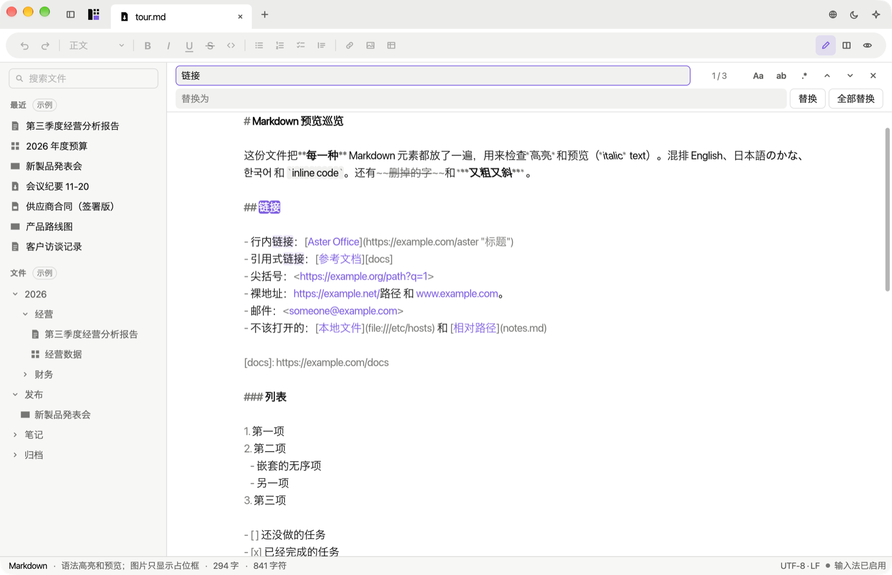

### 能做什么

| 功能 | 说明 |
| --- | --- |
| 打开 | Cmd+F 打开查找栏，Cmd+Option+F 打开带替换框的查找栏；都在原生“编辑”菜单里。再按一次会选中查找框里的字 |
| 边输入边查 | 每输入一个字就查，查找栏显示“第几个 / 共几个”；查不到显示“无结果”，正则写错了显示“正则表达式有误”并给框加边 |
| 跳转 | Enter 下一个，Shift+Enter 上一个，到头后绕回来；栏上的 ▲▼ 按钮、菜单里的“查找下一个”（Cmd+G）和“查找上一个”（Shift+Cmd+G）也一样。打开查找时从光标处往后找第一个 |
| 关闭 | Esc 或 × 关闭，当前匹配成为选区；焦点在编辑区时按 Esc 也关闭 |
| 用所选内容查找 | Cmd+E 把选中的文字放进查找框，关掉正则选项，打开查找栏并查找；焦点留在文档里，之后可以直接 Cmd+G |
| 选项 | 区分大小写（Aa）、全字匹配（ab）、正则表达式（.\*），快捷键 Cmd+Option+C、W、R。默认不区分大小写，按 Unicode 的大小写折叠（希腊字母 σ、ς、Σ 视为相同） |
| 正则 | `regex-automata` 0.4 和 `regex-syntax` 0.8（`regex` 项目本身的引擎，MIT 或 Apache-2.0），不支持回溯引用和环视，保证线性时间。`^` `$` 按行匹配，`.` 不跨行，`\n` 可以跨行 |
| 高亮 | 可见区域里所有匹配有浅紫底，当前匹配是强调色底、白字。和语法高亮叠在一起，不动文字位置 |
| 替换 | “替换”换掉当前一个并跳到下一个（替换框里按 Enter 也是）；“全部替换”一次换完（替换框里 Cmd+Enter），只占一步撤销，状态栏说“已替换 N 处”，之后再编辑或撤销这句话就消失 |
| 分组引用 | 正则模式下替换文本里可以写 `$1`、`${name}`，`$$` 是一个 `$`。不是正则模式时，替换文本原样插入，`$1` 就是 `$1` |
| 中日文 | 按字符查找，不会在一个字的中间匹配；`.` 是一个字符，emoji 的组合序列（👨‍👩‍👧）按字符而不是按字形簇算。全角和半角、平假名和片假名视为不同（见下面“留下的问题”） |
| 输入法 | 查找框里组字时不查，上屏后才查；编辑区里组字时匹配照常跟着文字走，但不移动光标 |
| 编辑菜单 | 焦点在查找框或替换框里时，“全选”“剪切”“拷贝”“粘贴”“撤销”“重做”作用在框里，不作用在文档上 |

查找栏只在 Markdown 标签上。Writer 标签现在是纯文本表面，没有文档模型，没有接上；`search.rs` 只认文本，以后 Writer 有了文本模型可以直接用。

### 大文件怎么办

- **查找**：2 MB 以内的文档在界面线程上直接查（几毫秒）。更大的文档在工作线程上查，每查完 1 MB 看一眼取消标记；输入下一个字、改选项、关闭查找栏都会取消上一次查找。查找期间查找栏显示“正在统计…”，界面照常响应。100 MB 里找一个出现 100 万次的词约 65 ms（发布模式），取消后 1.2 ms 内停下（`cargo test --release -p aster-markdown search -- --ignored`）。
- **编辑时**：匹配跟着编辑移位，被改到的匹配去掉；停手 200 ms 后在后台重新查一遍，补上新出现的匹配。重新查不移动光标。
- **全部替换**：大文档在工作线程上查找并拼出新的 rope，完成后一次装上。**选的处理方式是：替换期间文档锁住**，输入、粘贴、撤销、重做和输入法都不进文档，状态栏显示“正在全部替换…”；关闭查找栏或按 Esc 取消，文档保持原样。替换的结果超过 4 MB 时，语法高亮在后台重建（期间源码是普通文字），恢复记录直接写一个检查点而不是把 100 MB 写进日志。
- **为什么锁而不是边替换边编辑**：替换是对某一版文本算出来的，期间如果允许编辑，要么丢掉用户的输入，要么把替换结果重新映射到新文本上；后者复杂，而 100 MB 的替换在发布模式下不到一秒，锁住的代价很小。
- **上限**：最多记 100 万个匹配，超过时显示“1 / 1,000,000 个以上”，“全部替换”也只换前 100 万个。

### 检查过什么

在 macOS 27.0.1（Apple Silicon，2 倍缩放）上用 `.app` 包操作，截图确认。**这一轮没有用真实的键盘和鼠标**：点击和按键都是自动化工具在后台注入的，菜单用的是辅助功能接口（等于用鼠标点菜单项），拼音经过了系统输入法。

用开发版打开 `markdown-tour.md` 的一份副本：

- 菜单“查找…”打开查找栏，输入“链接”：显示 1 / 3，当前匹配是紫底白字，另外两个是浅紫底（上图）。
- Enter：1 → 2 → 3。▲ 按钮：1 → 3（绕回）。菜单“查找上一个”：3 → 2；“查找下一个”：1 → 2。
- Esc：查找栏关闭，第 2 个匹配成为选区。
- 菜单“替换…”，替换框填 `LINK`，点“替换”：“行内链接”变成“行内LINK”，查找栏跳到下一个。
- 点“全部替换”：状态栏“已替换 2 处”；菜单“撤销”一次，两处都恢复，重新查到 2 / 2。
- 焦点在查找框时按 Cmd+A（菜单“全选”）：选中的是查找框里的字。
- 查找框里用拼音打“lian jie”：预编辑时位置标签是空的（没有查）；上屏“链接”后显示 1 / 3。
- 查找栏开着时在编辑区里用拼音组字：预编辑串、候选窗正常；上屏后重新查到 4 / 4。

用发布版打开 100 MB 的中日英混排文件的副本：

- 查“Performance”：1 / 117,056，和 `grep -o` 数出来的一样；查“的”：468,010，也和 `grep` 一样。两次都快得看不到“正在统计…”。
- 替换为“性能”，点“全部替换”：状态栏“已替换 117,056 处”，正文里是“性能 budgets matter”，查找栏“无结果”；字符数正好少了 9 × 117,056，字数少了 117,056。
- 菜单“撤销”：正文回到“Performance”，字数和字符数回到打开时的值，标签不再显示有改动。（第一次试时“已替换 117,056 处”在撤销后还留在状态栏，已改成任何编辑或撤销后消失。）

自动化测试覆盖的（`cargo test --workspace`）：大小写和希腊字母折叠、中日文和 emoji（含组合序列）、全角不等于半角、全字匹配、跨行的正则和按行的 `^…$`、零长度匹配（不死循环、不切开字符）、空查找词、写错的正则、分组和命名分组替换、`$$`、非正则模式下替换文本里的 `$1` 原样保留、零长度匹配的替换（每行行首加 `> `）、落在 1 MB 窗口边界上的匹配、取消、从某处往后找并绕回；编辑器里跳转和关闭后的选区、替换一个后跳到下一个、全部替换是一步撤销、匹配跟着输入移位且重新查找不动光标、组字时不移动光标、大文档走后台任务（过时的结果被丢弃、替换期间不能编辑、高亮在后台重建、恢复记录写检查点）。100 MB 的取消测试比较慢，标了 `#[ignore]`，不在默认测试里。

**没有检查的**：

- 真实键盘和鼠标。
- Shift+Enter 跳上一个、Cmd+Option+C/W/R 切换选项、替换框里的 Cmd+Enter：注入的按键不带修饰键（调试日志里 Shift+Return 收到的是 Return，Cmd+Option+R 收到的是 `r`），这几个快捷键只读过代码。Cmd+F、Cmd+G 等菜单快捷键是通过菜单项试的，不是按键。
- 点三个选项按钮：注入的点击会来两次（见“已知问题”），按钮切过去又切回来，界面上看不出效果。因此**正则分组替换只有单元测试，没有在界面上做过**。
- 在界面上取消一次正在进行的查找或全部替换：100 MB 上都在一秒内完成，来不及操作。取消的代码路径在输入查找词时每个字都会走一遍，单元测试覆盖了取消和过时结果。
- 日文输入法；Windows 和 Linux。
- 主会话提到的“全选后按右方向键，插入点没到文末”：没有真实键盘，没能复现。很可能和注入点击投递两次是一回事（见“已知问题”）。

### 留下的问题

- **全角和半角、平假名和片假名视为不同**：“ＡＢＣ”找不到“ABC”，“カタカナ”找不到“かたかな”。要不要提供选项、默认怎样，待定（见“待定的设计问题”）。
- **全字匹配对中日文没有用**：汉字和假名都算“词字符”，`\b` 只在汉字和空格、标点之间成立，“全字匹配”找“文档”时，“文档编辑”里的那个也不算。中日文需要分词才能做好。
- **超过 64 KB 的匹配可能找不到**：后台查找按 1 MB 的窗口、64 KB 的重叠来查，一个横跨窗口边界又长于 64 KB 的正则匹配会被切开。
- **100 万个匹配的上限**：超过时“全部替换”只换前 100 万个，状态栏说的是实际换了几个。
- **撤销 100 MB 的全部替换在界面线程上做**：rope 的编辑本身很快，但撤销记录里存着被换掉的整段文字（最长可达整篇）。
- **点“替换”时只核对当前匹配附近 1 KB**：替换前确认它仍然是一个匹配；依赖更远上下文的正则（比如很长的跨行模式）可能判断不准。
- **Writer 标签没有查找**。

## 文件和文件夹

侧边栏和开始页上原来标着“示例”的数据换成了真的：最近打开过的文件，和一个打开的文件夹。模型在新 crate `aster-workspace` 里，不依赖 Slint；外壳里的 `src/sidebar.rs` 把它们写成界面文字，`src/main.rs` 接线。


上图：最近列表里有两个文件；文件夹“工作区”展开了几层。当前文档“会议纪要 11-20.txt”是紫色的；“私密”没有读取权限，下面说明了原因；“上一层”是指回上层文件夹的链接，图标变灰、不展开；`.pdf` 和 `.docx` 列出来了，标着“暂不支持”。

### 能做什么

| 功能 | 说明 |
| --- | --- |
| 最近文件 | 打开或保存成功的文件记下来，最多 30 个，最新的在前。同一个文件按规范路径只记一次。开始页列出全部，侧边栏列前 5 个。侧边栏的“最近”一栏总是 5 行高，空着、一项还是五项都一样，免得列表变长时下面的树在光标下移动（过滤时匹配超过 5 个就在这一栏里滚动）。工具栏只在文档区上方，不横跨侧边栏：原来从开始页打开第一个文档时工具栏出现，整个侧边栏下移约 46 像素，双击时第二下会落到另一个文件上每行有文件名、所在文件夹（家目录写成 `~`）和打开时间（“今天 14:20”“昨天 09:05”“11 月 19 日”“2025 年 12 月 31 日”，八种语言各有写法） |
| 不在了的文件 | 启动时、窗口回到前台时、点刷新按钮时，在工作线程上看一遍文件还在不在。不在了的那一行变灰，后面写“不可用”。点它会说明它原来在哪个文件夹、可能被移动改名或删除，并提供“从最近列表中移除”。点的时候会当场再看一次，刚恢复的文件可以直接打开 |
| 移除和清除 | 每行的右键菜单有“从最近列表中移除”和“清除最近列表”；“文件”菜单里也有“清除最近列表”。都不碰文件本身 |
| 只记路径和时间 | 存在应用数据目录的 `recent-files` 里，和恢复记录同一个根目录，原子写入。一行一个文件：秒数、制表符、路径（制表符、换行和反斜杠转义）。不是 Unicode 的路径不记。读到坏行就跳过那一行 |
| 打开文件夹 | “文件”菜单的“打开文件夹…”（Shift+Cmd+O）、侧边栏的按钮、开始页的按钮。用系统的选择文件夹对话框，异步打开（macOS 上是贴在窗口上的面板），不在事件处理里等它 |
| 文件树 | 文件夹在展开时才读，读在工作线程上；同一批要读的文件夹在一个线程上依次读，读完一个显示一个。文件夹在前，再按名字排，名字里的数字按大小排（“第2章”在“第10章”前面）；没读完的文件夹下面写“正在读取…” |
| 跳过的 | 以点开头的文件和文件夹（含 `.git`）、Windows 上标了隐藏属性的（没在 Windows 上试过）、`node_modules`、`target`、`__pycache__` |
| 显示的文件 | `.md`、`.markdown`、`.txt` 点了就在 Markdown 标签里打开（已经开着就切过去）；`.docx`、`.xlsx`、`.pptx`、`.pdf` 显示出来、变灰、标“暂不支持”，点了说明这一版只能打开哪些；其他文件不显示 |
| 大文件夹 | 一个文件夹最多列 2000 项，后面一行写“还有 N 项没有列出”。超过 10 万项的文件夹不读到底，写“还有至少 N 项没有列出” |
| 读不了的 | 没有读取权限、文件夹不在了、不是文件夹，都在那一行下面说明，不是悄悄地空着 |
| 符号链接 | 跟着链接走。指向自己所在文件夹或更上层的链接显示成灰色的文件夹，不展开，点了说明原因；断了的链接不显示 |
| 当前文档 | 在树里用强调色标出来 |
| 双击文件夹 | 半秒内对同一个文件夹的第二下点击算作双击的一部分，文件夹只开或关一次（从访达来的人习惯双击）。这也让自动化工具投递两次的点击不再把文件夹开了又关 |
| 重启后 | 记得上次的文件夹和展开了哪些，存在应用数据目录的 `workspace` 里。启动时在工作线程上读这两个文件；启动后、读到之前打开的文件排在读到的列表前面 |
| 刷新 | 不监视文件夹（`notify` 是 CC0-1.0，方案里属于要法务确认的许可证，没有引入）。窗口重新获得焦点时和点刷新按钮时，把屏幕上展开着的文件夹重新读一遍；新的列表到之前旧的留在屏幕上，不闪 |
| 搜索框 | 按文件名过滤最近列表和树里已经读到的条目，不分大小写，先把名字合成 NFC 再比（macOS 给的文件名常是分解形式，不合成的话输入的“が”找不到磁盘上的“が”）。树里留下匹配的条目和通往它们的文件夹；没展开过的文件夹没读过，不在搜索范围里。Esc 或 × 清空。不做全文搜索 |
| 在访达中显示 | 树和最近列表每行的右键菜单，以及“文件”菜单里对当前文档的一项。macOS 用 `open -R`；Windows 用 `explorer.exe /select,`；Linux 先试 freedesktop 的 `FileManager1.ShowItems`，不行就用 `xdg-open` 打开所在文件夹。路径作为参数传，不经过 shell，在工作线程上等它结束；失败时说明原因。Windows 和 Linux 的写好了，**没有运行过** |

不做的：不监视文件夹；不新建、改名、移动、删除文件（会动用户的文件，以后单独做）；不做全文搜索。

新依赖：`icu_normalizer` 2.3（Unicode-3.0，ICU4X 的一部分，原来只是 Slint 编译器的依赖，现在进了程序本身，顺带进来 `utf16_iter` 和 `write16` 两个小 crate，都是 MIT 或 Apache-2.0），用来合成文件名；`chrono` 0.4（MIT 或 Apache-2.0，Slint 原来就带着），用来取本地时间写“今天 14:20”。

### 检查过什么

在 macOS 27.0.1（Apple Silicon，2 倍缩放）上用 `.app` 包，`ASTER_DATA_DIR` 指向草稿目录，测试文件夹也在临时目录里（中日文名字、多层文件夹、各种扩展名、隐藏文件、`.git`、`node_modules`、`target`、一个权限是 000 的文件夹、一个指向上层的链接、一个有 2300 个文件的文件夹）。**这一轮没有用真实的键盘和鼠标**：点击和按键是自动化工具在后台注入的，菜单走辅助功能接口。

- 空的数据目录启动：开始页和侧边栏的最近列表写“还没有打开过文件”，文件区写“打开一个文件夹……”和按钮。
- 点侧边栏的“打开文件夹…”：系统的选择文件夹面板贴在窗口上弹出，标题“打开文件夹”。**后台注入的点击和输入进不了面板里的文件列表**（全屏控制没有人确认），所以没能在面板里选到测试文件夹；面板的“打开”按钮可以通过辅助功能接口按下，它把面板当时所在的文件夹（草稿目录里的一个文件夹）打开到了侧边栏，树正确列出了里面的 `.md` 文件，`workspace` 文件里记下了它。之后为了换成测试文件夹，**手工改写了 `workspace` 文件再重启**，这同时验证了“重启后记得文件夹”。
- 树：隐藏文件、`.git`、`node_modules`、`target`、`.png` 都没有出现；展开“2026”“经营”“笔记”“私密”；“私密”下面写“没有读取权限”；“上一层”灰色，点了说明它是指回上层的链接；`.xlsx`、`.pdf`、`.docx` 标“暂不支持”，点 `合同.pdf` 弹出“暂不支持打开“合同.pdf””。
- 点 `第三季度报告.md`：在新标签里打开，树里这一行变紫，最近列表出现这个文件，`recent-files` 里写下了路径和时间。
- 重启：最近列表还在（开始页显示“今天 14:37”），展开过的“2026”“私密”“笔记”自动展开并读好。
- 打开 `README.md` 后，在外面删掉它，点刷新：最近列表里它变灰、写“不可用”，树里它消失。关掉它的标签后点它：弹出“找不到“README.md””，说明原来所在的文件夹；点“从最近列表中移除”，它从列表里消失。
- 在外面新建一个文件，切到访达再切回来：树里出现了“新しいメモ.md”。
- 搜索框输入“报告”：最近列表只剩“第三季度报告.md”，树只剩“笔记/报告.docx”（“经营”这次运行没展开过，没读过，不在范围里，符合设计）；Esc 清空后恢复原样。
- “大目录”：列到“条目2000.md”，最后一行“还有 300 项没有列出”；拖动列表的滚动条到底看的。
- “文件”菜单的“清除最近列表”：两处最近列表都空了，`recent-files` 里只剩表头，文件夹里的文件没有动。
- “文件”菜单的“在访达中显示”：访达打开了一个名为“笔记”的窗口，就是当前文档所在的文件夹（没有截访达的图，文件是否被选中没有确认）。
- 自动化工具把点击投递两次（见“已知问题”）在这里又出现了：打开文件时第二下落在因列表变长而下移的另一行上，多打开了一两个文件。双击文件夹只算一次之后，文件夹不再被开了又关。

自动化测试：`aster-workspace` 24 个（中日文和 emoji 路径的存取、坏行、去重和上限、不在了的文件、权限 000 的文件夹、指回自己和上层的链接、断链、2300 项的文件夹只列 2000、按需读取、过滤、重新读取时旧列表保留到新的到达、文件夹消失后再出现、根文件夹不在了、写线程只写最新一份、写失败会报告、NFC 和大小写、数字排序）；`aster-platform` 的 `reveal.rs` 2 个；外壳的 `sidebar.rs` 5 个（八种语言的时间写法、`~`、过滤、说明行）和 `main.rs` 2 个（同一文件不同写法只记一次、打开文件夹后读展开的子文件夹）。

**没有检查的**：

- 真实键盘和鼠标。
- 在系统面板里选一个指定的文件夹（见上）。
- 右键菜单：后台不能打开右键菜单（会把应用带到前台），所以树和最近列表的“在访达中显示”“从最近列表中移除”“清除最近列表”都没有从右键点过。走的是同一段代码：“在访达中显示”用“文件”菜单试过，移除用“找不到”对话框试过，清除用“文件”菜单试过。这几个右键菜单原来是原生菜单（`ContextMenuArea`），和样式框的列表一样有让 winit panic 的风险（见“Markdown 格式”一节），现在改成了 Slint 自己画的 `PopupWindow`，在鼠标右键松开处打开；改后能编译、左键点行仍然会打开文件，但右键打开菜单这一步**还没有试过**。
- 中日文输入法在搜索框里组字。
- Windows 和 Linux：隐藏属性、`explorer.exe /select,`、`FileManager1` 和 `xdg-open` 都只是写好了。

### 留下的问题

- **中日文名字按码位排序**，不是按读音或部首：“大目录”排在“归档”前面，平假名排在汉字前面。按读音排需要排序规则数据（ICU 的 collator），以后再定。
- **只有已经读过的文件夹能被搜索**。没展开过的文件夹里的文件搜不到；这是有意的（不为了搜索去读整个硬盘），但用户可能以为搜不到就是没有。
- **不监视文件夹**：在外面改了文件，要切回窗口或点刷新才看得到；窗口一直在前台时不会自己变。
- **最近列表的位置一栏很长时只显示开头**，Slint 的省略号只能放在末尾，看不到最后一级文件夹名。
- **最近列表里的文件被移动了不会跟着走**，只会变成“不可用”。
- **展开很多文件夹后重启**，每个展开的文件夹都要重新读；一个 10 万项的文件夹会让它后面的文件夹在同一个线程上等着。
- **最近列表不在 SQLite 里**，是一个小文本文件，见“和方案的关系”。

## 预览的细节

预览的段落改用我们自己的断行器排版，中日文强调有了倾斜，可以选中复制、用键盘滚动，GitHub 提示块、脚注、裸写的电子邮件地址都按类型显示。


上图：中文和日文段落按禁则断行，句号、逗号、右括号不在行首，左括号不在行尾；连续的标点（“（」』）》等）”）挤掉了多余的半个字宽；“Aster Office 使用 Rust 1.95”这样的中西文之间留出四分之一个字宽。强调的中文和日文是倾斜的，英文用字体自带的斜体。五种提示块各有颜色和标题。电子邮件地址是链接。


深色主题的分屏：文末是脚注列表，正文里的脚注编号是抬高的小号数字，每条脚注后面的 ↑ 链回引用处。

### 新 crate：`aster-text`

技术方案“Cargo Workspace 与 Crate 职责”一节里，`aster-text` 的职责是“内置与系统字体库、字体替换表、shaping、段落排版、中日文禁则、命中测试”，所以断行器放在这里，而不是方案里叫“在研的排版内核”的 `aster-layout`（那是分页和版面）。那一节里等你接受的建议只涉及工具、MCP 和 AI 几个 crate，和这里不冲突。方案说 `aster-text` 只依赖 `aster-model`，现在还没有 `aster-model`，它只依赖外部的 Parley 和 ICU4X。

| 文件 | 内容 |
| --- | --- |
| `breaker.rs`、`class.rs` | 从 `spikes/g3-cjk` 搬来的断行器和字符分类，算法和测试原样保留。全部用 1/64 像素的整数计算 |
| `segment.rs` | UAX #14 严格模式的断行机会（ICU4X）；按有没有假名判断段落是日文还是中文 |
| `paragraph.rs` | 让 Parley 把段落排成不换行的一行（只整形、选字体），断行器决定在哪里换行、每个字放在哪里；给出绘制用的字形、下划线和删除线、命中测试（坐标到文字位置）、选区矩形；找出没有任何字体能画的字 |
| `selection.rs` | 跨段落的选区（哪一段、第几个字节），复制成纯文本时段落之间换行、表格单元格之间是制表符 |
| `golden.rs` | 八段中日英样张（G3 的五段加三段新的：中文感叹问号和书名号、日文引号套引号、繁体中文），在 6 种行宽下断行，与 `golden/breaks-18em.txt` 逐字节比对，并算摘要值 `0x993999b07a585027` |

验证工程 `spikes/g3-cjk` 没有动，它的 28 个测试（含摘要 `0x8515cd8a10c36b74`）照常通过；`aster-text` 里另有一个测试只取前五段样张重算摘要，结果和 G3 记录的一致，说明搬过来以后断行没有变。

**三个系统逐字节一致**：金样用的是合成度量（汉字一个字宽，其余半个），不涉及字体，原则上三个系统应得到同样的结果；**目前只在 macOS 上跑过**。真实字体下要一致，还需要三端用同一份字体文件，要等内置字体。

### 能做什么

| 功能 | 说明 |
| --- | --- |
| 禁则 | 句号、逗号、顿号、冒号、分号、问号、感叹号、右括号、后引号、小写假名、长音符号不在行首；左括号、前引号不在行尾。一串没有断行机会又比一行还长的字（比如日文样张里的“（ゃ・ゅ・ょ・っ）、”在很窄的栏里）只能硬切，硬切后的下一行不受这条约束 |
| 行尾标点 | 行尾的右括号、句号、逗号先让出空白的半个字宽；还放不下的逗号和句号悬挂到栏外 |
| 标点挤压 | 相邻的全角标点之间最多留半个字宽。简体中文和日文开，繁体中文关（繁体字体的标点居中，挤压会挤坏） |
| 中西文间距 | 汉字、假名和拉丁字母、数字相邻处加四分之一字宽；已经有空格的地方不加 |
| 对齐 | 预览左对齐，和 GitHub 一样，不两端对齐（断行器支持，没有打开） |
| 中日文强调 | 系统的中日文字体没有斜体，强调的汉字和假名合成倾斜 12° 到 14°（字体库给出角度时用它的），和拉丁字母的斜体一致；粗斜体也是。**理由**：着重号（中文）和傍点（日文）是更传统的写法，但两种语言的位置和形状不同，需要额外的行距，而且一段里中西混排时拉丁字母仍是斜体，两种强调混在一起反而难认；编辑器里的强调本来就是倾斜，预览和它一致。合成的倾斜原来是**反方向**的（上端向左），编辑器里也是，这次一起改正，有测试检查上端在右 |
| 选中和复制 | 在预览里按下拖动选中文字，Shift+点击扩展选区；Cmd+C（“编辑”菜单的“复制”）复制成纯文本，Cmd+A（“全选”）选中整篇。列表符号、提示块的标题、脚注编号不在选区里；表格一行的单元格之间是制表符。预览里“剪切”也只复制，“粘贴”不做事。选中后再拖动或点击，会重新选；排版更新（比如在分屏里打字）后选区清除 |
| 键盘滚动 | 预览单独在屏幕上时，或分屏里最后点的是预览时：上下方向键滚一行（40 像素），PageUp、PageDown、空格、Shift+空格滚一屏，Home、End 到头到尾，Esc 取消选区。分屏里点一下编辑区，键盘就回到源码 |
| 第一次切到预览 | 原来要等排版线程，有一瞬间是空白。现在 256 KB 以内的文档在界面线程上当场排好再显示；为此启动时在后台线程上建好并预热一个排版器（读系统字体列表要一点时间），交给界面线程。更大的文档仍走排版线程 |
| 提示块 | `> [!NOTE]`、`[!TIP]`、`[!IMPORTANT]`、`[!WARNING]`、`[!CAUTION]`：左边一条彩色竖线，上面一行彩色的加粗标题（说明、提示、重要、警告、当心，八种语言各有），正文是普通颜色。颜色取 GitHub 的（“重要”用我们的强调色），浅色和深色各一组，对页面的对比度都不低于 4.5:1（有测试）。没有图标 |
| 脚注 | 按第一次被引用的顺序编号，正文里是抬高的小号数字，点它跳到文末的脚注；脚注列表在文末一条短线下面，每条后面的 ↑ 跳回第一次引用的地方。没被引用的脚注排在最后；引用了不存在的脚注时原样显示 `[^名字]`，和 GitHub 一样。标签不分大小写 |
| 电子邮件地址 | 正文里裸写的 `a@example.com` 变成 `mailto:` 链接，编辑器里也高亮成链接。遇到中日文字符就停，和网址一样 |
| 数学 | 仍按原文显示成代码样式 |

### 程序自己写的符号

脚注返回链接最初用的是 ↩（U+21A9），在预览里画成了一个由几条横线叠成的方块。查明的原因是：**我们的字体回退链里没有任何字体有这个字**，Parley 最后落到系统字体，用的是它的“缺字”字形（`.notdef`），这个字形就是那个方块。不是落到了彩色表情字体上（主会话的推测）：彩色表情（😀、👍）其实能正常显示，见下。现在改用 ↑（U+2191）：它在 GB 2312 和 JIS X 0208 里，所有中日文字体都有，系统字体也有；选它而不是画矢量图标，是因为它是文字，能和正文一起选中、换行、跟着字号变。

为了不再出现这种事，`aster-text` 的段落多了一个检查：哪些字没有任何字体能画（字形号为 0）。`crates/aster-shell/tests/symbols.rs` 用它检查：

- 八种语言的全部界面文字；
- 预览自己生成的符号：列表符号 •、脚注返回 ↑、编号里的数字和点；
- 外壳里当文字画的标签：工具栏的 B I U S、查找栏的 Aa、ab、.*；
- 状态栏和文字里用的 ·、…、—。

在 macOS 上全部能画。任务列表的勾选框、提示块的竖线、所有图标（状态栏、工具栏、侧边栏）都是画出来的矢量路径，不经过字体。注意外壳界面的文字是 Slint 自己画的，它的字体回退和预览不同（可能找得到更多字），这个检查用的是更严的那一条。

**文档里用户写的表情符号**：预览和编辑区里都正常显示成彩色（来自系统的 Apple Color Emoji，vello_cpu 能画它的位图）。截图里“文档里写的表情”那一行就是。Windows 和 Linux 上没有试过。

### 检查过什么

在 macOS 27.0.1（Apple Silicon，2 倍缩放）上用 `.app` 包打开 `crates/aster-surface/tests/data/preview-cjk.md` 的副本（长中日文段落、强调、五种提示块、脚注、电子邮件地址、表情），以及一份把脚注推到 60 段之后的副本。**这一轮没有用真实的键盘和鼠标**：点击、按键、拖动都是自动化工具在后台注入的，菜单走辅助功能接口。

- 断行：对照截图逐行看了浅色预览（一栏约 46 个字宽）和深色分屏（一栏约 26 个字宽）的中文和日文段落，句号、逗号、顿号、右括号、后引号没有出现在行首，左括号、前引号没有出现在行尾。
- 中日文强调倾斜，和英文斜体同向；粗斜体也倾斜。编辑区里的强调也改成了向右倾斜。
- 第一次从源码切到“只看预览”：点下后立即截图，预览已经完整显示。
- 键盘：只看预览时 PageDown、空格到底，Home 回顶，下方向键滚一行，End 到底；分屏里点一下预览后 End 让预览到底、源码跟着到对应位置。
- 选区：“编辑”菜单的“全选”选中了预览里的全部文字，选区颜色在文字下面，提示块标题不在选区里；Esc 取消。
- 脚注：在长文档里点正文的脚注编号，跳到文末的脚注；点脚注后的 ↑，跳回正文的引用处（日志里两次都是对应的 `#fn:远` 和 `#fnref:远`）。
- 提示块的颜色和标题、电子邮件地址的链接样式，浅色和深色。
- ↑ 显示正常，表情显示正常。

自动化测试：`aster-text` 41 个（断行器、分类、断行机会、金样和摘要、G3 摘要不变、段落的禁则在 25 种栏宽下成立、命中测试和选区矩形互相对得上、硬换行和空段落、强调倾斜、对齐、下划线连接、缺字检查、选区和复制的文字）；`aster-markdown` 新增电子邮件地址、脚注编号和收集、提示块；`aster-surface` 新增预览段落的禁则、选中复制和全选、脚注双向链接、提示块颜色、倾斜方向；外壳新增提示块颜色的对比度、程序自己写的符号都能画。

**没有检查的**：

- 真实键盘和鼠标。
- **鼠标拖动选中**：注入的拖动结束后工具会多送一次点击，把选区收成插入点（见“已知问题”），所以界面上只用“全选”验证了选区，拖选只有单元测试。
- **复制到剪贴板**：自动化工具拒绝按“复制”菜单（会碰你的剪贴板，里面有你自己的内容），注入的 Cmd+C 又不带修饰键；复制出来的文字只有单元测试检查。
- Shift+空格、PageUp、上方向键、Shift+点击扩展选区：代码写了，没在界面上按过。
- 三个系统逐字节一致：只在 macOS 上跑过金样。
- 日文输入法、Windows、Linux。
- 很长的段落（几百 KB 的一段）在预览里的断行速度：断行器逐行贪心，每试一个断点都重新累加整行宽度，样张和测试文档都很快，长段落没有量过。

### 留下的问题

- **标点挤压的位置是写死的**：按简体中文和日文字体“空白在哪半边”处理；繁体中文直接不挤压。正式做法是用字体的 OpenType 特性（`halt`、`chws`）。
- **中文里的弯引号来自西文字体**：“ ” 中西文共用，Parley 先在西文字体里找到它，是窄的，不参与挤压。要按内容语言给这几个符号指定字体。
- **段落语言是猜的**：有假名就当日文，否则用简体中文的规则。文档没有语言属性。
- **不能两端对齐**，左对齐；断行器支持，预览没打开。
- **拖选到预览边缘时不会自动滚动**；没有双击选词、三击选段。
- **排版更新后选区清除**：分屏里一边打字，预览里的选区就没了。
- **脚注编号是抬高的小字**，不是字体里真正的上标字形。
- **数学公式原样显示**。
- **只支持从左到右的文字**。
- **大于 256 KB 的文档第一次切到预览仍有短暂空白**（走排版线程）。
- **观察到但没查清**：有一次在输入法组字状态残留（候选窗还开着）之后，工具栏的视图按钮点了没反应，重启后正常。没能稳定复现。

## Markdown 格式

Markdown 标签的工具栏按钮和新的“格式”菜单能用了：它们改的是 Markdown 源码里的标记，不是另一套格式。逻辑在 `aster-markdown/src/format.rs`，不依赖 Slint；编辑器里的接线在 `src/content.rs`（`MarkdownEditor::format`）。

### 能做什么

| 功能 | 怎样用 | 说明 |
| --- | --- | --- |
| 粗体、斜体、删除线、行内代码 | 工具栏 **B** *I* ~~S~~ `<>`；菜单 Cmd+B、Cmd+I、Shift+Cmd+X，行内代码没有快捷键 | 有选区时给选区加标记，选区已经被同种标记包着（标记在选区里或紧挨在外面）就去掉。没有选区时插入一对标记，光标在中间。选区跨行时每行分别加，行首行尾的空白留在标记外面；行首的标题、列表、引用标记不被包进去（全选后加粗得到 `# **标题**`，不是 `**# 标题**`）。`**粗**` 和 `*斜*` 分得开，`***两者***` 两种都算。行内代码遇到内容里有反引号时用更长的反引号 |
| 标题 | 工具栏的段落样式框（正文、标题 1–6）；菜单 Cmd+1 到 Cmd+6 | 改光标所在各行的 `#`。样式框跟着光标显示当前行的级别。“正文”在菜单里没有快捷键：Cmd+0 在 Writer 里是缩放复原 |
| 无序、有序、任务列表 | 工具栏三个列表按钮；菜单 Option+Cmd+U、O、X | 所选的每个非空行都已经是这种列表就去掉，否则加上；别的列表会换成这一种。有序列表按 1. 2. 3. 编号。缩进保留 |
| 引用 | 工具栏、菜单 Option+Cmd+Q | 同上，引用可以套在列表或标题外面 |
| 链接、图片 | 工具栏、菜单 Cmd+K（图片没有快捷键） | 选中文字变成 `[文字]()`，光标在括号里等着填地址；选中的是网址就变成 `[](网址)`，光标在方括号里。图片前面多一个 `!` |
| 表格 | 工具栏、菜单 Option+Cmd+T | 在光标处另起一段插入两列的空表，光标在第一个表头格里 |

每次格式操作只占一步撤销，做完后改过的文字保持选中。只有在源码看得见时（编辑、分屏）才能用；只看预览时按钮置灰，菜单项不可用。输入法组字时和全部替换锁住文档时也不做。**下划线**仍然置灰：Markdown 没有下划线。

**按钮显示当前状态**：光标在粗体里时 **B** 亮起（斜体、删除线、行内代码同理），所在各行都是某种列表或引用时那个按钮亮起。亮着的按钮再点一下就是去掉这种格式：

- 光标在粗体文字里（不在标记外面）时按 **B**，整段粗体的标记去掉，光标留在原来的字旁边；以前这时会在光标处再插入一对 `****`。
- 选区在粗体文字中间时按 **B**，选中的部分变回普通文字，两边剩下的仍是粗体：`**一二三四五**` 选“三”得到 `**一二**三**四五**`，空白留在标记外面。原来用下划线写的（`__一二三__`）拆开后两边改用星号，因为下划线强调在字中间不成立。
- 判断“在不在粗体里”用的是语法高亮的结果（`Highlighter` 的标记），和高亮看到的一致；高亮还没跟上（大段粘贴后在后台重算时）就只认选区正好是带标记文字的情形。选区超过 64 KB 时按钮不显示状态，免得每移动一次光标都读一遍选区。
- 拖动选择时按钮和样式框也跟着变（以前样式框只在点击和按键后更新）。

改动只读、只写所选的那几行，100 MB 的文档上也一样；样式框每次移动光标都要看当前行的级别，只读行首 16 个字节（一行 100 MB 的文件也不会每按一次键就复制整行）。

### 检查过什么

在 macOS 27.0.1（Apple Silicon，2 倍缩放）上用 `.app` 包操作，截图确认。**这一轮没有用真实的键盘和鼠标**：点击和打字是自动化工具在后台注入的，菜单用的是辅助功能接口（等于用鼠标点菜单项）。

- 菜单“格式 › 标题 1”：第一行变成 `# 会议纪要`，工具栏样式框显示“标题 1”；光标移到别的行显示“正文”。
- 光标放在“第二项”上，菜单“有序列表”：变成 `1. 第二项`，光标还在原来的字后面。
- 全选后“粗体”：每行分别加粗，标题和列表标记留在外面；“撤销”一次全部恢复。
- “表格”：在空行之后插入表格，接着打“名称”进了第一个表头格。
- “链接”：在行尾插入 `[]()`，接着打的网址进了括号。
- 分屏的预览里标题、有序列表、表格和链接都正确显示。
- 工具栏上格式按钮可用，下划线置灰；“格式”菜单的各项都在。
- 工具栏样式框点开后出现正文、标题 1–6 的列表，当前级别打勾。
- 按钮状态（注入的点击放光标）：光标点进 `**很重要的粗体文字**` 中间，**B** 亮起、样式框显示“正文”；接着用菜单“格式 › 粗体”，整段粗体的 `**` 去掉（字符数 64 → 60），**B** 熄灭，光标没动。光标点进列表行的 `` `代码` ``，`<>` 和无序列表按钮亮起；点进引用行的 `~~删除线~~`，删除线和引用按钮亮起。

自动化测试覆盖的（`cargo test --workspace`）：加和去掉各种行内标记、粗体和斜体的星号分得开、空选区、空白和逐行包裹、标记放在标题和列表标记里面、反引号围栏、标题级别、三种列表和互换、引用、选区结束在行首时不算那一行、链接和图片的两种情形、表格前后的空行、只读所选的行、行首只读 16 字节；光标在各种样式里去掉整段、`***两者***` 各去各的、紧挨标记外面不算在里面、选区在中间时拆成两段、按钮状态（行内样式、列表和引用、跨行时空行不算、一行 100 MB 时只读行首、没有高亮时的退路）；编辑器里格式操作是一步撤销、改完保持选中、只看预览时不做、光标在粗体里显示粗体并能去掉；工具栏上亮起的按钮跟着状态走、只看预览时不亮。

**没有检查的**：

- 真实键盘和鼠标；所有快捷键都只通过菜单项试过，没有按过键（注入的按键不带修饰键）。
- **在样式框的列表里选一项**：注入的点击落不到 Slint 弹出层的行上，会穿过去落到编辑区，标签栏“+”菜单原有的行也一样，所以没能在界面上试。列表打开、显示、打勾是看过的；选中后的路径（`toolbar-option` → `Format::Heading`）和菜单的标题项是同一个函数。
- 工具栏格式按钮本身的点击：注入的点击会来两次（见“已知问题”），格式会加上又去掉，所以都用菜单试的。按钮和菜单走同一个函数。
- 拖选后再加格式：拖完后注入工具会多补一次点击，把选区收成光标。
- 日文输入法下的格式操作；Windows 和 Linux。

一个修掉的问题：样式框的列表最初用的是原生菜单（`ContextMenuArea` 的 `show()`），从按钮的点击里打开时，原生菜单在 winit 处理事件的过程中跑自己的事件循环，下一个事件进来时 winit 直接 panic（“tried to handle event while another event is currently being handled”），程序退出。现在和标签栏的菜单一样用 Slint 自己画的 `PopupWindow`。（崩溃后重启，恢复对话框把没保存的改动找回来了。）

### 留下的问题

- **没有下划线**：Markdown 本身没有，要不要写成 `<u>` 待定。
- **按钮状态没有用真实鼠标试过拖动选择**：注入的拖动结束后会多补一次点击，把选区收成光标，所以“拖选一段一半粗体一半普通的文字，B 不亮”只有单元测试和代码阅读，没有在界面上看到。从选区中间拆出普通文字也只在单元测试里试过（注入工具不能 Shift 加点击）。
- **“格式”菜单的项不打勾**：只有工具栏按钮显示状态。
- **有序列表不会给后面的项重新编号**；在列表中间加或去掉一项时，后面的号码不跟着变。
- **段落样式框只有标题**：没有“代码块”“引用”之类的段落类型。
- **表格只能插入固定的两列空表**，没有增删行列、对齐。
- **链接没有对话框**：地址直接在源码里打。

## 崩溃恢复

程序被强杀、崩溃或断电式退出之后，再次启动时能把 Markdown 标签里没保存的内容找回来。Writer 标签不在其中：它本来就不能保存。

下次启动时，应用自己画的对话框（不是系统对话框）列出上次没保存的文档，逐个选“恢复”或“丢弃”，也可以“全部恢复”或“稍后决定”：


原文件在这期间被别的程序改过，会写在那一行里：

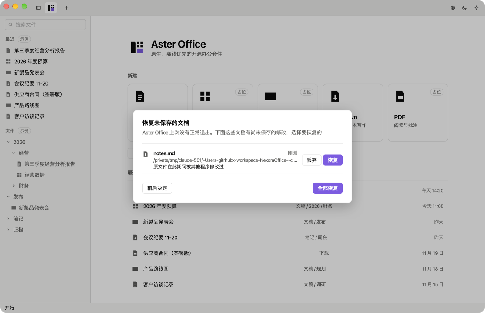

恢复出来的标签带着“有未保存修改”的圆点，记得原来的文件；原文件被改过或不见了，状态栏会说，保存时先问存到哪里，不会悄悄覆盖：

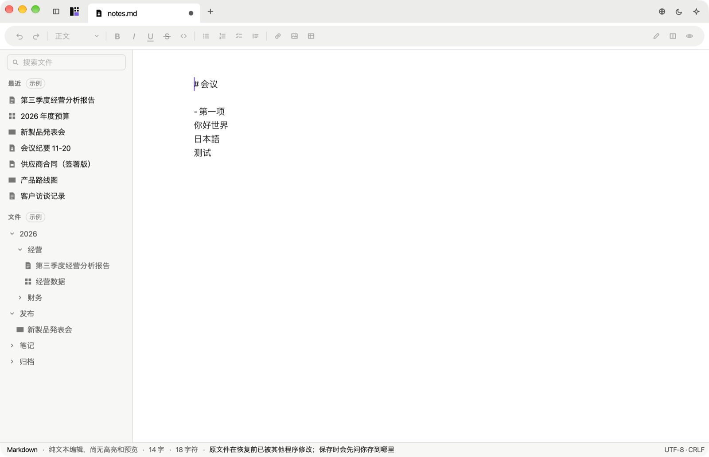

### 怎样做的

- **每个有未保存修改的 Markdown 标签有一条恢复记录**。文档第一次变成“有修改”时，记录以当时的全文开始；之后每个编辑（含撤销和重做）作为“某一段换成了什么”追加进去。保存成功、撤销回已保存的状态、关闭标签（包括选“不保存”）、退出时选“放弃修改并退出”，记录都会删掉。所以下次启动时还在的记录，只能是异常退出留下的。
- **记录放在系统的应用数据目录**，不在用户文档旁边：macOS 是 `~/Library/Application Support/dev.aster.office.preview/recovery`，Windows 是 `%LOCALAPPDATA%\aster-office\recovery`，Linux 是 `$XDG_STATE_HOME/aster-office/recovery`（默认 `~/.local/state/aster-office/recovery`）。设置环境变量 `ASTER_DATA_DIR` 可以换地方。应用标识是占位的，要和 `packaging/common.sh` 一起改。
- **写记录在单独的线程上**，界面线程只把几个字节放进队列，不等磁盘。写线程把攒下的编辑合成一个 SQLite 事务提交，提交了才算确认；每次提交都刷盘，在 macOS 上用 `F_FULLFSYNC`，也就是能扛断电的那种（G6 测得一次 2 到 4 毫秒，所以必须放在后台）。
- **记录的格式**就是 G6 验证过的那套：SQLite WAL 里的命令日志，加一个带校验和的检查点文件。256 条编辑或 256 KB 之后做一次检查点。实现在 `crates/aster-storage`（`journal.rs`、`records.rs`、`writer.rs`），编辑的编码在 `crates/aster-markdown/src/journal.rs`，带版本号。
- **谁的记录**：每条记录有一个锁文件，写它的进程一直锁着。进程不管怎么结束，系统都会释放这把锁；启动时能拿到锁的记录就是没人要的。同时开着的另一个 Aster Office 的记录拿不到锁，不会被列出来。
- **恢复**：在工作线程上扫描、重放、比较原文件，然后才弹出对话框。恢复出来的标签接着写同一条记录，以恢复出的全文作为新的检查点。读不出来的记录照样列出来，只能丢弃或稍后决定，文件不会被自动删除或修复。
- **原文件是否被改过**，按内容判断：记录里存着上次读或写这个文件时的长度和校验和（FNV-1a），恢复时重新读一遍比较。修改时间只用来显示。
- **不会自动写回用户的原文件**。恢复记录已经保证稿子不丢，悄悄改写用户的文件风险太大。

### 检查过什么

**强杀测试**（`crates/aster-storage/tests/kill.rs`，仿照 G6）：测试程序把自己作为子进程启动，子进程扫描恢复目录、接管上一轮留下的记录，然后通过 `RecordWriter` 不停地编辑，写线程每提交一次就在标准输出上报告修订号；父进程在随机时刻杀掉它，再像下次启动那样恢复，检查：至多一条记录、SQLite 完整性检查通过、恢复到的修订号不低于已报告的、恢复出的文本等于从头重算的文本。

| 规模 | 强杀次数 | 丢失已确认的编辑 | 文本不一致 | 杀在启动和接管阶段 | 恢复得比已报告的多 |
| --- | --- | --- | --- | --- | --- |
| `cargo test` 里的默认规模（`scripts/ci.sh` 会跑） | 40 | 0 | 0 | 7 | 17 次，最多 64 个修订 |
| `ASTER_KILL_ROUNDS=1000`，release | 1000 | 0 | 0 | 238 | 225 次，最多 64 个修订 |

“恢复得比已报告的多”是正常的：写线程已经提交、还没来得及打印就被杀了。

**实际运行外壳**，macOS 27.0.1，`.app` 包，真实的鼠标和键盘：

1. 干净启动，没有恢复提示。点开始页的“打开文件…”，在系统的打开面板里选中一个 CRLF 的中文 Markdown 文件。
2. 在末尾用拼音输入“你好世界”，换行，用日文输入法输入“日本語”。Cmd+N 新建一个文档，日文输入“下書き”，换行，拼音输入“草稿”。两个标签都带圆点，恢复目录里有两条记录；原文件没有被写过。
3. `kill -9` 杀掉进程，重新启动：出现恢复对话框，列出两个文档（截图见上）。逐个点“恢复”：两个标签带着圆点回来，未命名文档保留了原来的标题。
4. 保存：未命名文档用系统保存面板存成 `未命名笔记 1.md`，内容逐字节等于 `下書き\n草稿`（新文档是 LF）；`notes.md` 用 Cmd+S 原地保存，逐字节等于原文件加上 `你好世界\r\n日本語`，4 个 CRLF、没有单独的 LF。保存后恢复目录变空。
5. 两个文档都存好以后再 `kill -9`、重启：没有恢复提示。
6. 再打开 `notes.md`，输入“测试”，`kill -9`，然后用 shell 在文件末尾追加一行，模拟别的程序改了它。重启：那一行写着“原文件在此期间被其他程序修改过”。恢复后状态栏提示；按 Cmd+S 弹出保存面板而不是覆盖，取消后文件仍是别的程序写的版本。关闭标签选“不保存”，记录随之删除。
7. 新建文档、输入、`kill -9`、重启，选“稍后决定”：对话框关闭，记录留在磁盘上；正常关闭窗口再启动，同一条记录又被列出来；点“丢弃”，记录删除。
8. 新建文档、输入，点窗口的关闭按钮，出现“有 1 个文档尚未保存”，选“放弃修改并退出”：进程退出，恢复目录为空。

**没有检查的**：

- Windows 和 Linux 完全没有构建、运行过，那里的数据目录、文件锁和刷盘都没有实测。
- 真正的断电。软件模拟不了；刷盘设置按 G6 的建议选的，但没有拔过电源。
- 磁盘写满、恢复目录没有写权限时的提示（`record_failed`）：只有写线程的单元测试，界面上的状态栏提示没有在窗口里看过。
- 读不出来的记录在对话框里的样子：只有单元测试，没有在窗口里造过一条坏记录看。
- 很大的文档：检查点每 256 条编辑复制一次全文，几 MB 的文档会让这一下变慢，没有测。
- 同时开两个 Aster Office：锁的逻辑有单元测试（同一进程里两次打开），两个进程同时跑没有试过。

### 和方案的关系

- 方案“存储与恢复”一节写的是“每个事务先写命令日志再确认，定期写检查点并截断日志，启动时扫描日志、发现未保存的会话就提示恢复”，这里就是这样做的。
- 路线图 Phase 1 写的是“自动保存与恢复”。这里只做了恢复，**没有做“自动保存”**：如果“自动保存”的意思是定时把内容写回用户的原文件，那和这一步“不自动写回原文件”的决定相反，需要你来定。
- “线程模型”一节说存储线程是唯一的 SQLite 写入者。这里的写线程只写恢复记录；元数据、搜索索引都还没有。最近文件后来做了，但不在 SQLite 里，见“文件和文件夹”一节。

## Excel 和 PowerPoint 标签

方案里 Sheets 是 Phase 2、Slides 是 Phase 4（阶段顺序 2026-11-23 定为 Markdown、Sheets、Writer、Slides）。这里是两者共同的第一步：**只读**地打开真实文件。新建的 Sheets 和 Slides 标签仍然是占位卡片。

一个工作簿：公式已经由引擎重新算过，状态栏“已计算 60,019 个公式”；A1:F1 是合并单元格；第 13 行的长文字越过右边的空单元格；日期列放不下“2026年6月27日”，按 Excel 的做法显示 `###`；隐藏的工作表不出现在下面的标签里：

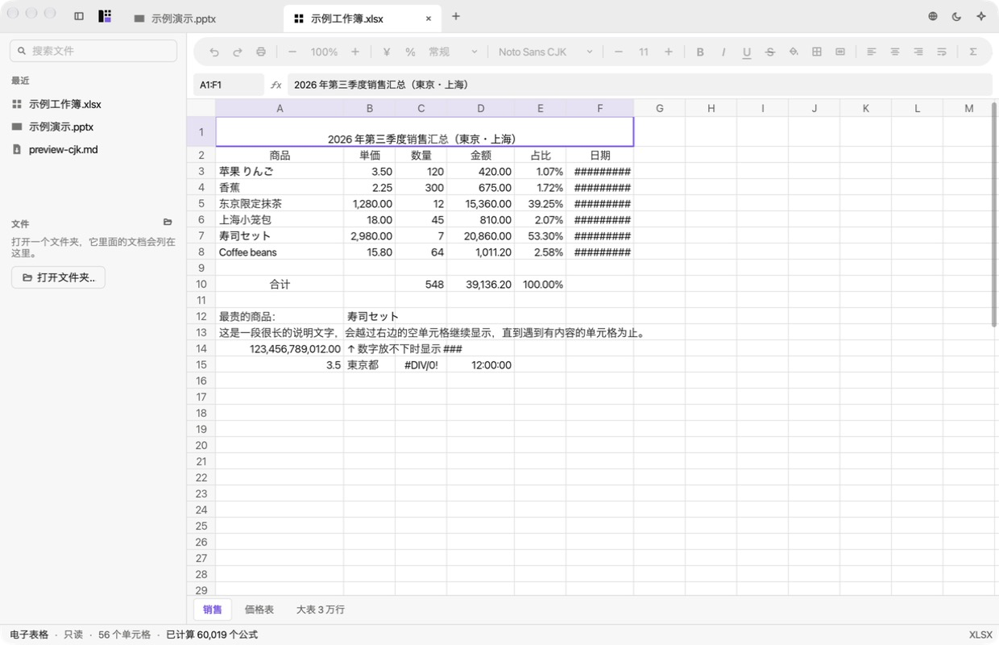

3 万行、6 万个公式的工作表。文件里没有存公式结果，打开时先显示公式原文（灰色，下面第二张是德文界面下计算中的样子），后台算完后换成结果（第一张，深色主题）：

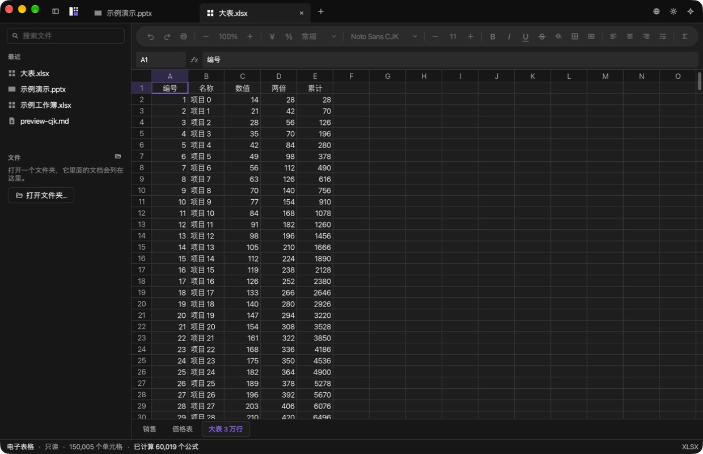


演示文稿：左边是缩略图，右边是当前幻灯片。标题的位置来自版式，字号和对齐来自母版，下面的横线是母版上的形状；第 4 张是放映时跳过的隐藏幻灯片，缩略图上画一条斜线：


### 能做什么

| 功能 | 说明 |
| --- | --- |
| 打开 | “打开…”（对话框多了“所有支持的文件”“Excel 工作簿”“PowerPoint 演示文稿”三个过滤项）、侧边栏的文件树和最近列表、命令行参数。`.xlsx`、`.xlsm`、`.pptx`、`.pptm`。读和解析在工作线程上，状态栏显示“正在打开…”。同一个文件再打开会切到已有的标签 |
| 打不开时 | 按原因给出八种语言的说明：Office 97–2003 格式或设了打开密码（两者外观相同，都是复合文档）、不是 Office 文件、内容和扩展名不符、超过安全限额、某个部件损坏（说出部件名）。文件不会被改动 |
| 安全限额 | 包里最多 2 万个部件；单个部件解压后最多 1 GiB，全部最多 2 GiB；超过 1 MiB 的部件压缩比不得超过 1000:1；文件本身最多 1 GiB。解压的字节是边读边数的，不信 zip 目录里写的大小。部件用到时才解压，演示文稿里的图片不会为了显示文字而解压 |
| 工作表 | 只画窗口里的部分，100 万行的表也一样。列宽、行高、隐藏行列、合并单元格；文字左对齐、数字右对齐、逻辑值和错误居中，单元格设了水平对齐的按设置；左对齐的文字越过右边的空单元格；数字放不下显示 `###` |
| 数字格式 | 常规、小数位、千分位、按千缩放、百分比、科学计数、日期和时间（含 `[h]` 累计时间、上午下午、毫秒）、文字字面量、四段格式、`000-0000` 这类分段数字。按 Excel 的方式舍入（先取 15 位有效数字，再四舍五入，`1.005` 保留两位是 `1.01`）。内置格式 14 和 22 按中日文习惯显示为年在前 |
| 公式 | 打开后在工作线程上用 formualizer 0.15.0 全部重算（ADR 0002），引擎只从我们的模型取输入。算完之前显示文件里存的结果；文件里没存结果的公式先显示公式原文（灰色）。引擎未实现的函数（`#N/IMPL!`）保留文件里的结果。关掉标签会取消还在进行的计算。共享公式按单元格展开，公式栏显示每个单元格自己的公式。6 万个公式的表，发布版从读文件到算完约 0.2 秒 |
| 公式栏和工作表标签 | 公式栏显示选中单元格的地址（合并单元格显示整个区域）和公式或输入值（日期按日期显示）。下方的标签切换工作表，每张表记住自己的选中位置和滚动位置；隐藏的表不列出 |
| 键盘 | 方向键、Tab、回车（加 Shift 反向）、Page Up/Down、Home/End、Cmd/Ctrl 加方向键跳到数据块边缘、Cmd/Ctrl+Home/End 到 A1 和最后一个单元格。跳过隐藏行列，从合并区域出来时从它的远端算起。Cmd/Ctrl+C 复制公式栏的内容 |
| 鼠标 | 点单元格选中；点行号选中那一行在屏幕上的第一个单元格，点列标选中那一列在屏幕上的第一个单元格；滚轮上下左右滚动 |
| 幻灯片 | 按演示文稿里的顺序列出。文字框的文字（字号、粗体、斜体、下划线、对齐、级别、项目符号和自动编号、段内换行、自动缩小字号、上中下对齐）、矩形、圆角矩形、椭圆和线的轮廓、旋转和翻转、组合形状。母版和版式上的非占位形状画在幻灯片自己的形状下面（`showMasterSp` 关掉时不画）；占位符的位置、字号、项目符号、文字边距从版式和母版继承。图片、表格、图表和其他图形画成带名称的灰框 |
| 幻灯片的操作 | 点缩略图切换；上下左右、Page Up/Down、空格、回车翻页，Home/End 到第一张和最后一张；在幻灯片上滚动滚轮翻页，在缩略图上滚动滚轮滚动缩略图。窗口窄于 560 像素时不显示缩略图 |
| 状态栏 | 只读；工作表的单元格数、计算进度和结果；幻灯片的“第 n 张，共 m 张”，隐藏的幻灯片加注“隐藏” |

### 不在这一步里的

编辑和保存（包层的设计是原样写回未改动的部件，但还没有写回）、字体、颜色、填充、边框等样式、自动换行、条件格式、图片、图表、批注、冻结窗格、筛选、数据验证、超链接、打印；幻灯片的背景、主题颜色和字体、表格内容、SmartArt、动画、演讲者备注、放映模式；Word（.docx）、PDF、旧版的 .xls/.ppt，以及 ODF。工具栏在这两种标签上仍然是置灰的设计稿。

### 新 crate 和依赖

| crate | 作用 | 新依赖（许可证） |
| --- | --- | --- |
| `aster-ooxml` | 包层和两个读取器，`FormatCodec` 接口 | `zip` 8.6（MIT，只开解压，后端 zlib-rs 是 Zlib）、`quick-xml` 0.42（MIT），和 G4 关卡用的是同一对 |
| `aster-sheets` | 工作簿模型、数字格式、`CalcEngine` 接口 | 无 |
| `aster-calc` | formualizer 适配器 | `formualizer` =0.15.0（MIT OR Apache-2.0），带进约 140 个 crate，主要是 Apache Arrow；其中 `tiny-keccak` 只有 CC0-1.0，已按 2026-11-23 的决定加进 `deny.toml` |
| `aster-slides` | 演示文稿模型 | 无 |

方案的 crate 表把“CalcEngine 及其 Adapter”放在 `aster-sheets` 里；ADR 0002 要求引擎放在单独的适配器 crate、核心 crate 不直接依赖它，这里按 ADR 放在了 `aster-calc`。方案里 DrawingML 形状属于 Phase 4 的 `aster-drawing`，现在形状的几何暂时放在 `aster-slides`，到时候移过去。`aster-model`、`aster-render` 还不存在，两个视图直接用 `aster-text` 排版、vello_cpu 绘制，和 Markdown 预览一样。

### 检查过什么

在 macOS 27.0.1（Apple Silicon，2 倍缩放）上，用 `.app` 包带着测试文件启动，截图确认：

- 工作簿：数字格式（千分位、百分比、年月日、`h:mm:ss`）、合并的标题行、长文字越格、数字放不下时的 `###`、隐藏工作表不出现在标签里；VLOOKUP（引用名字是日文的工作表）、INDEX/MATCH、CONCAT、`#DIV/0!` 都由引擎算出了正确结果。
- 3 万行、6 万个链式公式的表：先显示公式原文，算完后累计列全部正确。深色主题，德文界面下的状态栏文字。
- 演示文稿：标题从版式继承位置、从母版继承字号和对齐，副标题居中，母版上的横线；第二张的项目符号、二级项目符号和自动编号；第三张的矩形、椭圆、旋转的圆角矩形、连接线、图片框和图表框（名称随界面语言）、斜体小字；隐藏的第四张。日文和简体中文界面。

上面截图里的文件是用 Python 标准库的 zipfile 手写拼出来的。另外用两份 Microsoft Office 存的真实文件试过（Excel 16 存的 JPX 上市公司一览，日文，1 张表；PowerPoint 存的 16 张中日文路演稿），用 `cargo run -p aster-surface --example render_office -- 文件 输出目录` 把每张表的首屏和每张幻灯片渲染成 PNG，看过：表的列宽、日文、数字和文字混排都对；幻灯片的标题、正文、版式继承来的页脚和页码、圆角卡片、项目列表都对，表格只有框（已知限制）。这样发现并修了一处：行首的小图标也印上了“图片”二字，溢出到正文上，现在放不下名称的框只画框。这两份文件不在仓库里。

**和文件里缓存的结果对不上的地方**：`Workbook::mismatches` 列出算出的结果和文件里保存的结果不同的公式（数字按 15 位有效数字比较）。`cargo run --release -p aster-calc --example time_xlsx -- 文件.xlsx [表名!A1 ...]` 打印读文件、载入引擎、计算各花多久，列出对不上的单元格，并打印指定单元格算出的值。用 G5 关卡的三个工作簿（`spikes/g5-formula` 里 `cargo run --release --no-default-features -- write 目录` 写出，缓存值故意写成 0 和 `?`）试过：每个工作簿 10 万个公式全部报为不一致，G5 列出的 11 个期望值（如 `Orders!F2 = 小`、`Ledger!A100001 = 101834.25`）全部逐位相同；每个工作簿从读文件到算完 0.2 到 0.3 秒（发布模式）。外壳里还不显示这个对比。

自动化测试覆盖的（`cargo test --workspace`）：地址、列名、行高列宽的二分查找（100 万行都设了行高）、共享公式的引用平移（字符串、带引号的表名、结构化引用、函数名不动，移出表外变 `#REF!`）、数字格式的每一类和 20 多个奇怪的格式码不崩溃、1900 年的闰年错误和 1904 日期系统；XLSX：中日文共享字符串（富文本拼接、注音假名去掉、`_x000D_` 转义）、各种单元格类型、没有缓存值的公式、共享公式、没有地址的行和单元格、合并单元格、列宽行高、空的工作表和没有 `sheetData` 的工作表、40 万个单元格的表（含 XFD1048576）、不是 zip、旧格式、不是 Office 的 zip、把演示文稿当工作簿打开、XML 不合法、压缩比超限和单个部件超限；PPTX：版式和母版的继承（按 idx 和按类型匹配）、母版文字样式、列表样式的层级、自动编号、组合形状的嵌套变换、AlternateContent、隐藏幻灯片、`showMasterSp`、没有幻灯片的演示文稿、300 张幻灯片里有 30 张部件缺失；计算：中日文文字函数、跨表 VLOOKUP、日期转序列号（两种日期系统）、修改后重算、取消、空工作簿、2 万个链式公式、远角单元格；两个视图的绘制、键盘移动（隐藏列、合并区域、跳到数据边缘）、点击命中、每张表记住位置、翻页和缩略图滚动、空演示文稿和极小窗口。

**没有检查的**：

- **没有用真实的鼠标和键盘试过，界面上的点击和按键也没有在运行的程序里验证。** 这一轮后台注入的点击和按键完全没有送到窗口（连纯 Slint 的标签栏和工作表标签都没反应），申请全屏控制时没有人在电脑前确认。点单元格、方向键、切换工作表、点缩略图、滚轮、复制，都只有单元测试。上面的截图都是启动时就显示的画面（用 `activeTab` 让工作簿打开在第三张表上）。
- Office 存的真实文件只试了两份，而且是用无界面渲染看的，没有在窗口里打开；WPS、Numbers、LibreOffice 存的文件没有试过。
- 文件树和最近列表里点 .xlsx/.pptx 打开、打开对话框的过滤项、各种出错对话框：代码路径和 Markdown 相同，没有在界面上走过。
- Windows 和 Linux 上没有运行过。

### 留下的问题

- **不画样式**：字体、颜色、填充、边框都不读，单元格都是默认字号的系统字体，幻灯片一律白底黑字。深色背景上写白字的幻灯片会看不清。
- **列宽按 Calibri 11 的数字宽度换算**，中日文字体比它宽，Excel 里刚好放得下的日期在这里可能显示 `###`。
- **公式的计算结果可能与 Excel 不同**：ADR 0002 记录的三处差异（`0.1+0.2=0.3`、`VALUE("1,234")`、`LAMBDA` 直接调用）仍在；动态数组溢出只取左上角；易失函数（`NOW`、`RAND`）打开时算一次，之后不再变。
- **幻灯片里的表格只画框**，表格里的文字不显示。
- **竖排文字**按横排画；**翻转的形状**里的文字也跟着翻转（PowerPoint 不翻文字）。
- 内置数字格式 14 和 22 不跟随系统的短日期格式。

## 外壳里哪些是真的

| 部分 | 状态 |
| --- | --- |
| 标签栏 | 真的。新建、切换、关闭；关掉当前标签后右侧邻居顶上来，没有右侧邻居就是左侧的；全部关掉回到开始页。左侧的标志按钮随时回开始页 |
| Writer 标签的文档区 | 真的，但只是纯文本。就是 G1 关卡的自绘表面：Parley 排版、vello_cpu 渲染，整帧作为一张图交给 Slint。能输入、移动光标、选择、滚动、缩放 |
| 中文和日文输入法 | 真的。输入法事件经 Slint 的 winit 钩子直接取自窗口系统，候选窗跟随光标 |
| 缩放 | 真的。工具栏和状态栏的 −、100%、+。每个文档各记各的。键盘快捷键写了但没试过 |
| 字数和字符数 | 真的。汉字、假名、谚文每个算一个字，其余按词算 |
| 浅色和深色主题 | 真的。一套令牌两组取值，文档区的页面一起变。用启动参数看过两种主题；界面上的切换按钮没有用真实点击试过 |
| 界面语言 | 真的。八种：简体中文、繁體中文、日本語、English、Français、Deutsch、Español、한국어。标签栏右侧的地球按钮切换，即时生效 |
| 最近文件、文件树、侧边栏的搜索框 | 真的，见“文件和文件夹”一节 |
| 侧边栏开合、AI 面板开合 | 写了，带展开动画。AI 面板用启动参数看过展开的样子；两个按钮本身没有用真实点击试过 |
| macOS 上标签栏与标题栏合一 | 真的。空白处可以拖动窗口，双击缩放 |

## 外壳里哪些是占位

| 部分 | 说明 |
| --- | --- |
| 新建的 Sheets、Slides 标签和 PDF 标签 | 只有一张说明卡片，背后是一层淡的布局线框。线框是画出来的示意，不响应任何操作。从文件打开的 Sheets 和 Slides 标签是真的，只读，见“Excel 和 PowerPoint 标签”一节 |
| 工具栏上除 Writer 的缩放、Markdown 的撤销重做、格式按钮和三个视图按钮以外的所有按钮 | 置灰，点了没有反应。它们的位置和分组是设计稿，功能都没接 |
| 字体、字号、段落样式这几个下拉框里显示的值 | 写死的。`Noto Sans CJK` 是方案里计划内置的字体名，现在并没有内置 |
| AI 面板 | 只有说明文字和一个不能输入的提问框。没有接任何模型，也没有 MCP 服务 |
| Writer 这个名字 | 标签叫 Writer，里面其实是纯文本表面。状态栏写着“纯文本原型” |

没有做的：Writer 的文档模型、格式、右键菜单、提示气泡、设置、工具栏放不下时的“更多”菜单（现在是直接裁掉）、跟随系统的主题和语言（现在默认浅色、简体中文，由启动参数或界面按钮改）。

## 结构

外壳分成两个 crate，名字和分层取自技术方案的 crate 表。

**`aster-surface`**（`crates/aster-surface`）是文档表面。

- `text_surface.rs`：从 `spikes/g1-ime` 搬出来的纯文本表面。不出现 Slint 和 winit 的类型，拿到输入事件，吐出像素。这次加了调色板、居中的定宽页面、滚动、缩放。现在只有 Writer 标签用它：它把全文排成一个 Parley 版面。
- `text_view.rs`：Markdown 标签用的文本视图，见“大文件”一节。文本是 rope，只排可见的行，长行分段排。
- `lib.rs` 里的 `Surface`：外壳对两种表面共同的要求（尺寸、绘制、滚动、输入法位置）。
- `host.rs`：把表面接进 Slint 窗口的胶水：按键解码、winit 输入法事件的转换、候选窗定位、界面字体的汉字回退链。
- `preview.rs`：Markdown 预览的排版（在工作线程上，产出带绝对位置的绘制列表、链接区域和源码锚点）和绘制（界面线程上只画可见部分）。
- `glyphs.rs`：两边共用的画字形：按段换颜色，合成粗体和斜体。
- 预览的段落由 `aster-text` 排版（见“预览的细节”）：Parley 只整形，断行用我们自己的断行器。

G1 的 spike 现在依赖这个 crate，不再有自己的一份表面代码，`cargo run -p g1-ime` 照常可用。

Markdown 这一步又加了三个 crate，都不依赖 Slint：

- **`aster-markdown`**：文档模型。文本、选区、编辑命令、撤销历史（`document.rs`、`history.rs`），以及文件的编码和换行符规则（`file.rs`）。高亮和预览这一步加了 `highlight.rs`（增量高亮）、`preview.rs`（预览的块结构）和 `syntax.rs`（共用的解析选项、链接标签、裸地址），解析交给 `pulldown-cmark`。需要排版才能回答的问题（光标上移一行到哪里、鼠标下面是哪个字）由视图回答，再把结果告诉文档。
- **`aster-storage`**：原子写入，以及崩溃恢复用的命令日志、检查点、记录目录和写线程。都来自 `spikes/g6-storage`，G6 的 spike 现在用这里的原子写入。
- **`aster-text`**：文字排版，方案里排版内核的第一块。G3 关卡的中日文断行器、UAX #14 严格模式的断行机会、在 Parley 整形结果上排段落（命中测试、选区矩形、绘制用的字形和装饰线）、跨段落的选区和复制出的纯文本、中日文金样。见“预览的细节”。
- **`aster-platform`**：系统的打开和保存对话框，用 `rfd` 0.18（MIT）；用系统程序打开网页和邮件链接（`links.rs`，只放行 `http`、`https`、`mailto`）；在访达或文件管理器里显示一个文件（`reveal.rs`）；以及应用数据目录在各系统上的位置。

后来又加了一个，也不依赖 Slint：

- **`aster-workspace`**：文档周围的文件。最近文件列表（`recent.rs`）、侧边栏的文件夹树（`tree.rs`，一次读一个文件夹）、重启后要记住的文件夹和展开状态（`state.rs`）、写这两个小文件的线程（`store.rs`），以及文件名的比较和排序（`names.rs`）。见“文件和文件夹”一节。

编辑时的分工：每个编辑先交给文档，文档改完文本、记好撤销，再把“哪一段换成了什么”交给文字表面重放。所以两边的文本始终一致，有一组测试专门检查这一点。组字中的预编辑文字只在表面上，文档在上屏时才知道。

**`aster-shell`**（本目录）是外壳，一半是库，一半是程序。

| 文件 | 内容 | 是否引用 Slint |
| --- | --- | --- |
| `src/theme.rs` | 设计令牌：颜色、间距、圆角、字号、控件高度，浅色和深色各一组。**颜色和尺寸只写在这一处** | 否 |
| `src/i18n.rs` | 八种语言的界面文字。**界面文字只写在这一处** | 否 |
| `src/icons.rs` | 线性图标的路径数据，自己画的 | 否 |
| `src/tabs.rs` | 标签状态：打开、关闭、切换、未命名文档的编号 | 否 |
| `src/toolbar.rs` | 每种文档的工具栏有哪些控件、哪些可用 | 否 |
| `src/stats.rs` | 字数统计 | 否 |
| `src/sidebar.rs` | 把最近文件和文件树写成界面上的一行行文字：打开时间、所在文件夹、树里的说明行 | 否 |
| `src/cli.rs` | 启动参数 | 否 |
| `src/files.rs` | 读写 Markdown 标签背后的文件（阻塞调用，只在工作线程上用） | 否 |
| `examples/large_files.rs` | 大文件的生成和测量，见“大文件”一节 | 否，但用 `aster-surface` |
| `src/recovery.rs` | 恢复记录里存什么、启动时怎样读出来 | 否 |
| `src/main.rs` | 把上面这些和界面接起来：标签、菜单、对话框、后台读写 | 是 |
| `src/content.rs` | 标签的内容：Writer 的纯文本视图，Markdown 的编辑器（文档模型加文本视图，高亮、视图模式、预览、两边的滚动同步、恢复记录的步骤）。在库里而不在程序里，好让基准程序 `examples/large_files.rs` 走和窗口一样的代码 | 否，但用 `aster-surface` |
| `src/macos.rs` | macOS 专用的两处修正，见下文 | 是 |
| `ui/*.slint` | 界面。只引用令牌和语言表，自己不写颜色、尺寸和文字 | — |

标着“否”的模块不出现 Slint、winit 和 `aster-surface`，有一条单元测试专门检查这一点。但要说清楚：它们和程序同在一个 crate，这个 crate 整体是链接 Slint 的，所以这是模块级的隔离，不是 crate 级的。

### 和技术方案不一致的地方

- **令牌的出处**。方案写的是“在 aster-shell 里用一个 Slint 全局单例定义”。这里改成写在 Rust 里，启动和切换主题时拷进 Slint 的全局单例。原因有两个：自绘的文档区也要用这套颜色，而它不能依赖 Slint；写在 Rust 里才能脱离窗口做单元测试（对比度、“紫罗兰是唯一色相”等）。
- **界面字体没有内置**。方案要求内置界面字体以保证三端一致。这里用的是系统界面字体，加一条显式的汉字回退链，取的都是 macOS 自带的字体。Windows 和 Linux 上这些字体名不存在，会落回系统默认。
- **渲染在 UI 线程上**。方案要求排版和渲染在文档线程。这里和 G1 一样，每次按键都在 UI 线程上整帧重绘。G2 测过这条路径在 60 Hz 下够用，但它不是最终结构。
- **图标**。方案提到 Material Symbols，前提是先复核许可。这里用的是自己画的线性图标，没有引入任何外部图标。
- **AI 和 MCP**。方案的 crate 表里没有这一块。
- **文档模型和撤销历史放在 `aster-markdown`，不在 `aster-model`**。方案把 `History` 和 `DocumentSession` 放在 `aster-model`。现在只有一种文本文档，为它单独建 `aster-model` 太早；等第二种编辑器出现、知道哪些是共用的，再把通用部分提出来。
- **编辑在界面线程上**。方案要求每个文档一个文档线程。这一步只把读写文件放到了工作线程，按键到文档的路径仍在界面线程。
- **预览排版在工作线程上，绘制在界面线程上**。方案要求渲染也离开界面线程；预览的绘制只画可见部分，和编辑器一样留在界面线程。
- **剪贴板不在 `aster-platform`**。Slint 没有给应用代码的剪贴板接口，这里借用一个看不见的 Slint 文本框来复制和粘贴（`ui/app.slint` 的 `copy-to-clipboard` 和 `clipboard-text`）。只能传纯文本。

## 检查过什么

在 macOS 27.0.1（Apple Silicon，2 倍缩放的内置屏）上，用 `.app` 包启动，以下各项是用真实的鼠标和键盘事件逐项操作并截图确认的：

- 标签单击切换；在标签上双击只切换，不缩放窗口
- 在标签栏空白处双击缩放窗口，再双击还原；按住空白处拖动窗口
- 语言菜单打开、选择、界面即时切换
- 简体拼音：`nihao` 出预编辑串和候选窗，空格上屏“你好”；接着“世界”。各出现一次
- 日文罗马字：`nihongo` 出假名，空格转换出候选列表，回车上屏。只出现一次
- 状态栏的字数随上屏增加（125 → 129 → 133），输入法状态在“已启用”和“正在组字”之间变化

以下各项只用后台注入的点击或启动参数看过，没有用真实点击复核：

- 开始页的卡片、“+”菜单、侧边栏的最近文件：都能打开对应的标签
- 标签上的关闭按钮
- 状态栏的缩放按钮（100% → 110%，页面跟着放大）
- 文档区滚轮滚动、拖动选择文字
- AI 面板（用 `--assistant` 启动）、深色主题（用 `--theme dark` 启动）
- 八种语言里，法、德、日文界面看过截图

以下各项写了代码但**没有在界面上试过**：

- 标签栏左侧的侧边栏按钮。后台注入的点击在标题栏那一条里会被投递两次（见“已知问题”），开了又关，看不出结果。主题按钮已用真实鼠标确认，见上文
- 鼠标中键关闭标签
- 缩放的键盘快捷键（Cmd/Ctrl 加 `=`、`-`、`0`）。按键到命令的映射有单元测试
- 在文档区用真实鼠标双击
- 繁体中文、英文、西班牙文、韩文界面。文字齐全由单元测试保证，排版没有逐屏看过
- 全屏状态下标签栏左侧的留白收回

自动化检查：`cargo fmt --all --check`、`cargo clippy --workspace --all-targets -- -D warnings`、`cargo test --workspace` 通过。

**Windows 和 Linux 完全没有运行过。** 代码里为它们留了路径（标签栏放在系统标题栏下面，窗口图标取自 `assets/brand`），但从未在那两个系统上构建或打开，输入法也没有测。

## Markdown 标签检查过什么

在 macOS 27.0.1 上，用 `.app` 包启动，真实的鼠标和键盘：

- 打开一个 CRLF 的中日文 Markdown 文件，在末尾输入英文、换行、再输入，保存；文件和预期**逐字节一致**，换行全是 CRLF，没有混进 LF。
- 简体拼音在 Markdown 标签里组字：预编辑串带下划线、候选窗在它正下方；上屏“世界”后撤销一次正好撤掉“世界”，重做恢复。
- 日文罗马字：`nihongo` 实时转换、空格出候选、回车确认、再回车上屏，“日本語版”只出现一次。
- 用 Shift 加左键选中两个字，再用日文输入法在选区上组字：选区被替换；撤销一次，原来的两个字和选区一起回来。
- 用 Cmd+S 保存后再打开，内容与保存的一致；这一份同样逐字节核对过。
- “另存为”（Cmd+Shift+S）存到新文件名：新文件逐字节等于原文件，原文件没有被改动，标签改成新文件名。
- 鼠标拖动选中一段文字，Cmd+C 后系统剪贴板里正是这段文字；在行首 Cmd+V 粘贴；Shift 加右键选两个字后 Cmd+X，文字消失、剪贴板里是这两个字；两次撤销恢复原文。测试前备份了剪贴板，测试后原样恢复。
- 连按 45 次下方向键，视图跟着光标往下滚。
- 组字过程中关闭标签：候选窗随之关掉（修正前它会留在屏幕上，跟到下一个文档的光标处）。

用后台注入的点击和菜单操作看过：

- 打开 GBK 编码的文件：弹出“这个文件不是 UTF-8 编码……文件没有被改动”，文件的 SHA-1 前后一致。
- 换行符混用的文件、200 行的长文件同时打开；长文件滚轮滚动、点击插入。
- 全选后输入整篇替换；关闭时出现询问，选“取消”回到文档，撤销恢复全文；选“保存”写入后关闭，文件内容正确；对新建文档选“不保存”直接关闭。
- 新建文档后“保存”弹出系统保存对话框，取消后什么都没写。
- 有未保存修改时从应用菜单退出，出现“有 1 个文档尚未保存”，取消后留在原处。

**没有检查的**：

- Windows 和 Linux 完全没有构建、运行过，包括文件对话框、剪贴板和输入法。
- ~~系统的“打开”对话框一次也没有打开过~~：崩溃恢复这一步的实测里，开始页的“打开文件…”按钮和系统打开面板已经实际用过。Cmd/Ctrl+O 仍没有试过。
- 同一个文件再打开一次切到已有标签：只有单元测试。
- 按键里，Cmd 加左右键、Shift 加左右键、下方向键、退格、回车用真实按键试过；Option/Alt 按词移动、Home、End、上方向键、Delete 没有在窗口里试过（解码有单元测试）。
- 退出确认里的“放弃修改并退出”按钮，以及在有未保存文档时点窗口的关闭按钮。
- 保存失败的提示（比如写到只读目录），只有单元测试。
- 外部程序在编辑期间修改或删除了文件，没有处理也没有测。
- 大文件：这一节写的时候只试过 200 行；见“大文件”一节。

## 已知问题

- **macOS 标题栏的点击归属**。标签栏画在透明的标题栏下面。winit 的内容视图默认允许“按住即拖动窗口”，于是系统会把标签上的双击当成双击标题栏而缩放窗口。`src/macos.rs` 在运行时把这个视图的 `mouseDownCanMoveWindow` 改成返回否，之后拖动和缩放都由外壳自己在空白处处理。这是对 winit 的类做的运行时替换，winit 升级后要重测。
- **后台注入的点击会出错**。用自动化工具向后台窗口注入点击时，落在标题栏那一条高度内的点击会被投递两次（间隔约 0.37 秒，日志里切换函数被调了两次），间隔很短的两次点击还会让系统缩放窗口，而外壳自己的拖动和缩放处理函数都没有被调用。真实鼠标下没有复现：真实点击打开的语言菜单在一秒后仍然开着，真实的标签双击也不缩放，真实点击主题按钮一次只切换一次。原因没有查清，写在这里是为了以后做界面自动化测试的人不要被它骗到。
  - 不只是标题栏：窗口里任何地方的注入点击都可能来两次。在“要保存吗”对话框上点“取消”时，winit 收到的鼠标事件是：按下、抬起（对话框关闭），约 0.37 秒后又一次按下、抬起，第二次按下落在已经没有对话框的编辑区上，于是插入点跟着动了。这就是“恢复对话框的点击会穿透”的来历：对话框的遮罩把它收到的点击都吃掉了，漏过去的是另一次点击。对话框关闭后的第一次真实点击本来就应该落在编辑区上，所以没有改代码去挡它。
  - “全选”后按右方向键，插入点没有到文末：可能也是这个原因，在“全选”前点过的那一下的第二次投递在“全选”之后才到，把插入点放回了原处。真实键盘没有试过。
- **红绿灯按钮偏高**。标签栏高 40，系统的窗口按钮按 28 高的标题栏居中，比标签栏里的其他按钮高出约 4 像素。
- **工具栏放不下时直接裁掉**。窗口窄于工具栏时右侧的控件看不见，还没有“更多”菜单。
- **切换语言后，已经显示过的汉字可能保留原来的字形**。日文界面优先用日文字体，繁体界面优先用繁体字体，但 Slint 已经排过版的文字不一定重排。重启后一定正确。
- **切到别的窗口再回来时，拼音的预编辑串会按原字母上屏**。组字时窗口失去焦点再回来，按空格得到的是 `nihao` 而不是“你好”。没有和系统原生应用对比过，可能是输入法本身的行为（G1 清单第 6 项，一直没测）。没有丢字，也没有重字。
- **后台注入的拖动在这个窗口上不可靠**：自动化工具在拖动结束后会多送一次点击，把刚拖出的选区收成光标。真实鼠标拖动没有这个问题。
- **工具栏右端连点两下会缩放窗口**。用自动化工具在工具栏右端很快地点两个按钮（比如先“只看预览”再“分屏”），窗口会变成系统的“缩放”尺寸（1388×813），第二下没有送到按钮上。只有 Writer 标签时也能复现，和预览无关；真实鼠标下没有试。测试时两次点击之间隔开一点就不会发生。
- **后台注入的点击和按键有时完全送不到窗口**。2026-11-23 测 Excel 和 PowerPoint 标签时，自动化工具报告点击和按键都已投递，但窗口里什么都没变，连标签栏都不响应。原因没查；之前几轮同样的注入是有效的。
- **截图会触发系统提示**。用 `screencapture` 截窗口时，macOS 弹过一次屏幕录制的提醒。
- **日文候选窗打开时按回车**，第一次只关候选窗，第二次才上屏。和 G1 记录的一样，还没有和系统原生应用逐键对比。

## 已定的设计问题

- **界面正文 13 px，控件高 28**（2026-11-22 定）。和参照对象一致；方案里“中日文界面用 14 px、控件高 30”的建议不采用。取值在 `src/theme.rs` 的 `Metrics::standard`。

## 待定的设计问题

1. **深色主题下页面是深色还是保持白色**。现在是深色页面配浅色字。文档本身的页面颜色将来是文档的属性，这里只决定默认观感。
2. **标签栏的“+”**。现在弹出五种类型的菜单。另一种做法是点“+”直接回开始页。
3. **开始页是不是一个常驻标签**。现在它不是标签，由左上角的标志按钮进入。
4. **AI 与 MCP 的形态**。面板位置已经留在右侧。参照 MySSH 的做法是：MCP 服务跑在应用进程内，另配一个只转发字节的小程序给外部客户端；内置助手和 MCP 共用同一份工具目录、策略、审批和审计。办公套件里“策略的单位”是什么（文档、文件夹还是工作区）需要定，方案的 crate 表也要补上这一块。
5. **语言范围和默认值**。现在八种，默认简体中文。是否跟随系统语言、要不要再加，需要定。译文是我写的，没有经过母语者校对。
6. **令牌写在 Rust 还是 Slint**。见上文“和技术方案不一致的地方”，如果认可现在的做法，方案文档要跟着改。
7. **图标**。继续用自绘的这一套，还是复核许可后换成 Material Symbols。
8. **平台相关的代码放哪**。`src/macos.rs` 按方案应当属于 `aster-platform`，那个 crate 还不存在。
9. **查找时全角和半角、平假名和片假名是否视为相同**。现在都视为不同。可以做成选项（像 macOS 的“忽略全角半角”），也可以默认相同；做法上要在查找前把文本和查找词都规范化，并把位置映射回原文。
