# aster-shell：应用外壳原型

Aster Office 的主窗口：标签栏、单行工具栏、工作区侧边栏、文档区、状态栏，以及开始页。目的是让人打开就能认出产品的样子，并把外壳的结构定下来。**它还不是一个能用的办公软件**，下面逐项写明哪些是真的、哪些是占位。

Markdown 标签是第一个能打开和保存真实文件的编辑器，见“[Markdown 标签](#markdown-标签)”一节；100 MB 的文件也能打开和编辑，见“[大文件](#大文件)”一节；源码有语法高亮，可以分屏或单独看预览，见“[高亮、预览和分屏](#高亮预览和分屏)”一节；它的未保存修改在程序崩溃或被强杀后可以找回，见“[崩溃恢复](#崩溃恢复)”一节。Excel 和 PowerPoint 文件可以打开查看，见“[Excel 和 PowerPoint 标签](#excel-和-powerpoint-标签)”一节；PDF 文件也可以，见“[PDF 标签](#pdf-标签)”一节。右侧的 AI 助手能读写你允许的 Markdown 文档，外部的 MCP 客户端（比如 Claude Code）也能用同一套工具接进来，见“[AI 助手与 MCP](#ai-助手与-mcp)”一节。

```sh
cargo run -p aster-shell                                  # 开始页
cargo run -p aster-shell -- --open writer                 # 直接打开一个 Writer 标签
cargo run -p aster-shell -- --theme dark --lang ja        # 深色主题，日文界面
cargo run -p aster-shell -- --open sheets --assistant     # Sheets 占位视图，AI 面板展开
cargo run -p aster-shell -- notes.md 会议.txt             # 在 Markdown 标签里打开磁盘上的文件
cargo run -p aster-shell -- 预算.xlsx 发布会.pptx          # 只读的 Sheets 和 Slides 标签

cargo build -p aster-shell && spikes/bundle-macos.sh aster-shell   # macOS：打成带图标的 .app
open target/debug/aster-shell.app
```

macOS 上要测输入法，请用 `.app` 包启动：裸的可执行文件不是一个正常的应用，切不到前台时收不到输入法事件。

## 截图

开始页（简体中文，浅色）：


Writer 标签，拼音正在组字。预编辑串带下划线出现在光标处，候选窗在它正下方，状态栏右侧显示“正在组字”。截图时界面语言是日文：


同一个标签，日文罗马字输入，按空格转换后：


上屏之后。“你好世界”和“日本語訳”都是经输入法打进去的，各出现一次：


深色主题：


Sheets 占位视图，和展开的 AI 面板占位：


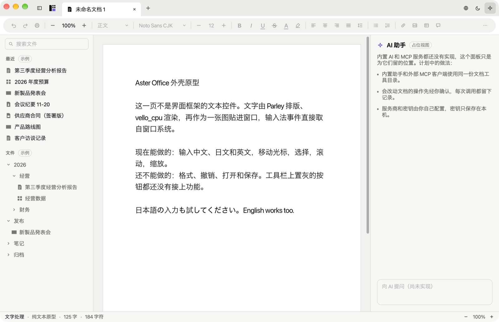

法文界面的开始页，日文界面加深色主题的 Slides 占位视图：

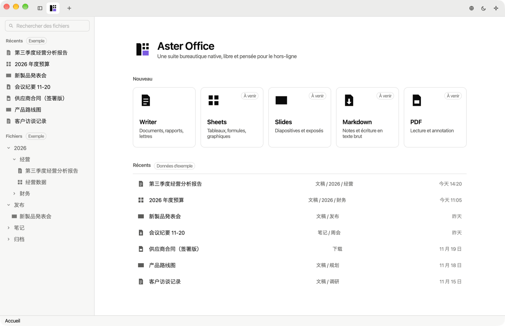


## Markdown 标签

Phase 1 的第一步：在 Markdown 标签里打开、编辑、保存磁盘上的真实文件。编辑的始终是源码本身；语法高亮和预览是后来加的，见下一节。下面这几张截图是加高亮之前拍的。

磁盘上的一个 CRLF 文件，打开后（状态栏右侧是编码和换行符）：


有未保存的修改时，标签上的关闭按钮换成一个圆点；关闭前会问：


不是 UTF-8 的文件被拒绝，文件本身不动：

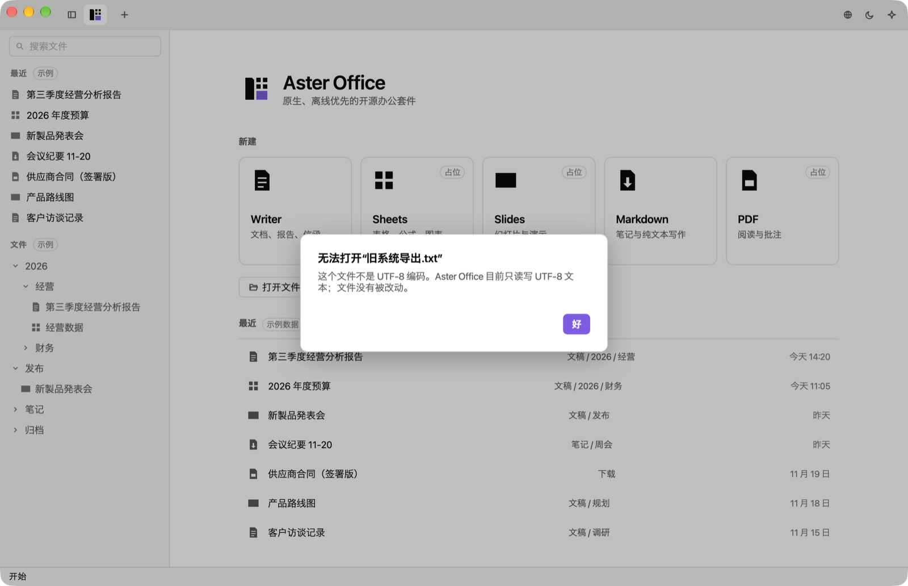

Markdown 标签里的拼音和日文输入：


### 能做什么

| 功能 | 说明 |
| --- | --- |
| 打开 | 文件菜单的“打开…”（Cmd/Ctrl+O）、开始页的“打开文件…”按钮、命令行参数。已经打开的文件再打开一次会切到它的标签，不会开第二个 |
| 新建 | 文件菜单的“新建 Markdown 文档”（Cmd/Ctrl+N）、“+”菜单、开始页的 Markdown 卡片 |
| 保存 | “保存”（Cmd/Ctrl+S）写回原文件；没有文件的文档会弹出系统的保存对话框。“另存为…”（Cmd/Ctrl+Shift+S）总是问，存完后标签改名、之后的保存写到新文件 |
| 原子写入 | 先写同目录的临时文件、刷盘、再改名覆盖，最后刷目录；中途出错原文件不变。原文件的权限保留，经符号链接保存时写到链接指向的文件。实现在 `crates/aster-storage`，来自 G6 关卡 |
| 编码 | 只读写 UTF-8。UTF-16 和其他编码的文件明确拒绝并说明原因，文件不会被改写。文件开头的 BOM 保留 |
| 换行符 | 记住文件原来的风格（LF、CRLF、CR），新输入的换行也按这个风格写回；状态栏显示是哪一种。换行符混用的文件会在状态栏提示“保存时统一为 X” |
| 未保存提示 | 标签上的圆点；关闭有修改的标签前询问“保存 / 不保存 / 取消”；退出时有未保存的文档会问 |
| 读写线程 | 读文件和写文件都在工作线程上，结果经事件循环回到界面线程。保存期间可以继续输入：保存完成时，只有写进去的那个状态算“已保存” |
| 光标与选区 | 方向键、Home、End、Cmd/Ctrl 加左右键、Option/Alt 加左右键按词移动、鼠标点击；Shift 加这些键扩展选区；鼠标拖动选择；全选 |
| 剪贴板 | 剪切、复制、粘贴（编辑菜单和 Cmd/Ctrl+X/C/V），经过系统剪贴板。粘贴进来的换行统一成文档的风格 |
| 撤销重做 | 编辑菜单、工具栏、Cmd/Ctrl+Z 和 Cmd/Ctrl+Shift+Z。连续输入合并成一步；连续的退格、连续的删除各合并成一步；换行、粘贴、剪切各是一步；**输入法的一次上屏是一步，预编辑过程不进撤销栈**；在选区上开始组字时，删掉选区和随后的上屏合成一步。移动光标、保存之后再输入会开始新的一步。撤销回到保存时的状态，圆点会消失 |
| 退格与删除 | 按“用户看到的一个字”删：带组合符的字母、多个码点组成的表情都是一次删掉 |
| 滚动 | 滚轮滚动；光标移出可见区域时视图跟过去，包括撤销和重做之后 |
| 中日文输入法 | 与 G1 和 Writer 标签相同的路径。切换标签、关闭标签、弹出对话框时，进行中的组字会被丢弃，候选窗也会关掉 |

### 不在这一步里的

没有做，碰到了也没有做：自动写回原文件、查找替换、文件树、最近文件的真实记录（后两项后来做了，见“文件和文件夹”一节）、编辑期间外部程序改了文件的提示、拖放打开、编码选择、换行符转换的界面（这几项后来都做了，见“文件和文件夹”和“编码、外部修改和更多编辑”两节）、打印。

Writer 标签保持原样：仍然是没有文档模型、不能保存的纯文本表面。

## 高亮、预览和分屏

Markdown 标签现在认识 Markdown：源码带语法高亮，工具栏右端的三个按钮在“只看源码”“左源码右预览”“只看预览”之间切换，每个标签各记各的。预览用的是和编辑器同一套文字栈（Parley 排版、vello_cpu 渲染、同一条汉字回退链），没有浏览器或 WebView。

分屏，浅色主题。左边的 `#`、`**`、链接地址、列表符号是灰色，标题和粗体加粗，链接文字是紫色，行内代码有底色；右边是预览：


深色主题。源码里的代码块整行有底色，预览里的代码块、引用和任务列表：

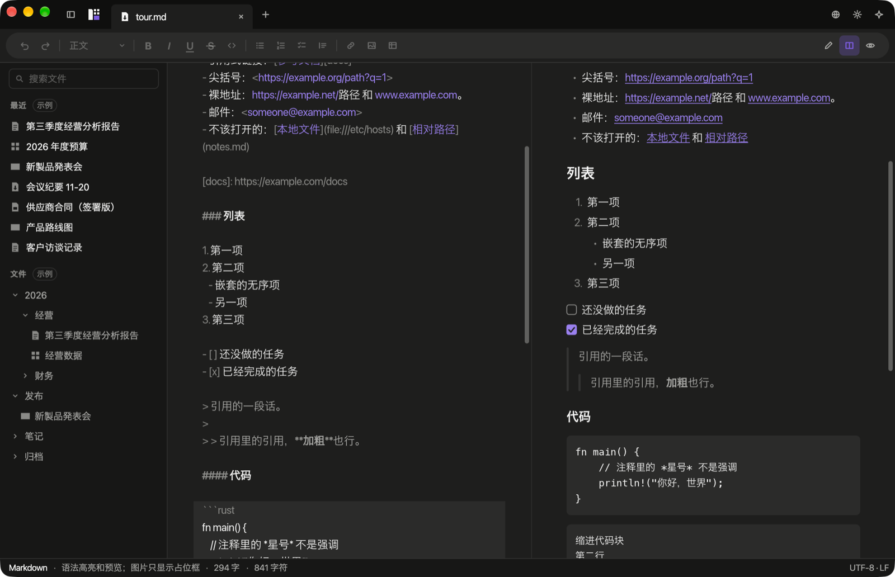

在一级标题末尾用拼音组字：预编辑串带下划线，不受高亮影响；上屏后这两个字和标题一起变粗，停手一会儿后预览里的标题也跟着变了：

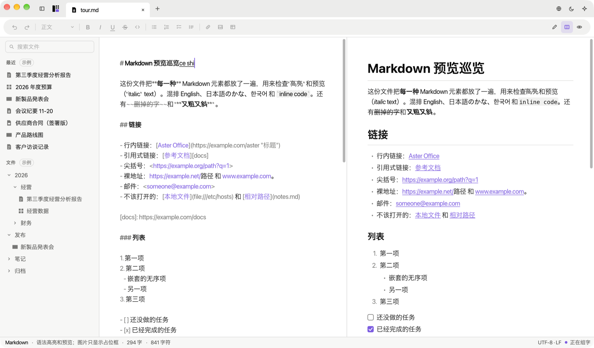

### 能做什么

| 功能 | 说明 |
| --- | --- |
| 解析 | `pulldown-cmark` 0.13（MIT），不带 HTML 输出。CommonMark，加 GitHub 的表格、任务列表、删除线、`[!NOTE]` 提示块，以及脚注和 `$` 数学。编辑器和预览用同一套选项（`aster-markdown/src/syntax.rs`） |
| 源码高亮 | 标题、强调、行内代码、代码块、链接、列表符号、引用、表格竖线和分隔行、分隔线、HTML、数学、链接引用定义。紫色只用在链接文字上，语法符号是第三级灰，引用和删除线是第二级灰，代码用填充色作底。颜色全部来自 `theme.rs` 的令牌，浅色和深色各一组；为深色背景加了一个 `link` 令牌（深色下比强调色浅一些，对比度测试覆盖） |
| 高亮不动文字 | 粗体和斜体是把常规字形描粗、倾斜画出来的，不换字体也不改字号，所以文字位置、换行、光标、选区、输入法都和不高亮时一样。有一条测试专门检查这一点 |
| 高亮不拖慢输入 | 文本按“不可能在任何结构里面的空行”切成块，每块单独解析。一次编辑只从它所在的块重新切，切到和旧切点重合就停，只重新解析中间的块。2000 段的文档里打一个字只解析一两段（有测试）；随机做 3000 次编辑，每次都和整篇重算的结果逐项相同（有测试）。每一帧只取可见的几行的高亮 |
| 预览 | 标题（一、二级带分隔线）、段落、粗体、斜体、删除线、行内代码、代码块（等宽字体，自动换行）、引用（可嵌套）、有序和无序列表（可嵌套）、任务列表（勾选框）、表格（按列对齐，太宽时按比例收窄、单元格内换行）、分隔线、脚注 |
| 图片 | 单独成段、地址是本机 PNG 或 JPEG 文件的图片画出来（相对地址从文档所在的文件夹算起，也认绝对路径和 `file:` 地址）：一个图片像素对一个逻辑像素，宽过正文时缩到正文宽。文件大于 32 MB、边长大于 8192、读不了或文档从没保存过（没有文件夹可算相对地址）时，和网络图片一样画成带边框的框，中间是图片描述。**网络图片从不加载**：加载会告诉对方服务器这篇文档在何时何地被打开。网络共享上的文件也一样：`\\主机\共享`、`//主机/共享`、`file:////主机` 这类地址直接拒绝；判断放在百分号解码之后，开头两个字符是任意两个斜杠或反斜杠（`//`、`\\`、`/\`、`\/`）都算网络共享。路径上每一层文件夹都先查它是不是本机磁盘（macOS 看 `statfs` 的 `MNT_LOCAL`，Linux 看文件系统类型，NFS、SMB、自动挂载和 FUSE 都不算；Windows 只按路径里的盘符问 `GetDriveTypeW`，网络盘和没有盘符的路径都不算，不调用任何会去碰卷的接口），在进入网络挂载点之前就停下，连挂载都不会触发。每一层都先用不跟随链接的方式看（`lstat`）；是链接的，先把它指向的路径从头检查一遍再跟过去，最多跟 8 层，链接不能把检查带进自动挂载。AI 或 MCP 客户端写进文档的图片地址走同一套检查。解码过的图片按路径、修改时间和大小缓存，打字时不重新解码。行内图片仍是带底色的描述文字 |
| 只当代码显示的 | HTML 块和行内 HTML、`$` 数学、脚注引用，按原文显示成代码样式 |
| 链接 | 预览里的链接可以点：`http`、`https` 和 `mailto` 直接交给系统打开，不确认；其他的（`file:`、相对路径、`javascript:`、别的程序注册的协议）一概不打开，状态栏说明原因。白名单在 `aster-platform/src/links.rs`，URL 作为一个参数交给 `open`（Windows 上 `rundll32`，Linux 上 `xdg-open`），不经过 shell。鼠标移到链接上变成手形 |
| 裸地址 | 正文里写出来的 `http://`、`https://`、`www.` 地址也算链接，和 GitHub 一样；不同的是遇到非 ASCII 字符就停，所以“访问https://example.com获取”不会把后面的汉字吞进去 |
| 刷新 | 停止输入 250 毫秒后，在单独的线程上重新排版；界面线程只画可见的部分。排版线程只做每个文档最新的一份请求，过时的丢掉。改窗口大小、换主题会立刻重排 |
| 分屏同步 | 滚编辑器时预览跟着到同一处源码，滚预览时编辑器跟着；按块的源码范围对应，块内按比例插值，所以是“大致”对齐。切换视图时也停在同一处 |
| 只看预览时 | 键盘输入和输入法都不进文档；切过去时进行中的组字被丢弃 |

### 不在这一步里的

查找替换（后来做了，见“查找替换”一节）、导出 HTML 或 PDF（后来都做了）、所见即所得编辑、拼写检查、预览里的中日文禁则（用 Parley 的默认断行）。

### 检查过什么

在 macOS 27.0.1（Apple Silicon，2 倍缩放）上，用 `.app` 包打开 `crates/aster-surface/tests/data/markdown-tour.md`（每种元素都有，中日韩英混排），以下各项用后台注入的点击、滚轮和按键操作，并截图确认：

- 高亮：标题、粗体、斜体、删除线、行内代码、代码块整行底色、链接文字和地址、尖括号链接、裸地址、邮件、列表符号、任务框、引用符号、链接引用定义，浅色和深色都看过。
- 三个视图按钮：只看源码、分屏、只看预览，按下的那个有紫色底；来回切换几轮。
- 分屏同步：滚编辑器，预览停在同一节（“## 链接”对“链接”）；滚预览，编辑器跟着到“### 列表”。
- 点预览里的 `https` 链接：Chrome 打开了 example.com（窗口标题“Example Domain”），没有任何确认框。
- 点 `file:///etc/hosts` 那个链接：没有打开，状态栏显示“只会打开网页和邮件链接，这个链接没有打开”。
- 拼音输入法：在标题末尾打 `ceshi`，预编辑串带下划线、候选窗在下方、状态栏“正在组字”；空格上屏“测试”，只出现一次，并且加粗；约四分之一秒后预览里的标题变成“Markdown 预览巡览测试”。在新建的空文档里打 `# ` 和 `xinwenjian`，`#` 变灰、“新文件”加粗。
- 每个标签记住自己的视图：一个标签分屏、另一个只看预览，来回切换各自保持；切回分屏的标签时预览是它自己的内容（第一版这里会残留另一个标签的画面，已修）。
- 深色主题（用 `--theme dark` 启动）下的源码和预览。
- 空闲时的 CPU：只看源码约 2%，只看预览约 0%（第一版只看预览时每 33 毫秒重画一次、占 50%，已修）。

自动化测试覆盖的（`cargo test --workspace`）：高亮的每种元素、中日文、空文档、10 万字的长行、未闭合的代码块（一直到文末都是代码）、没写完和不规整的表格、增量和整篇重算一致、编辑只解析附近的块；预览结构的每种块、中日文换行不加空格、20 万字的长行、未闭合代码块、不规整表格、松散和紧凑列表；预览排版后链接的位置、源码位置和高度互相换算、空文档和极窄窗口不崩、排版线程只做最新的一份；编辑器里高亮跟着输入和撤销走、组字时高亮不影响上屏、只在需要时请求排版、切换视图和双向滚动后两边停在同一处；链接白名单。

**没有检查的**：

- 没有用真实的鼠标和键盘试过：这一轮的点击、滚轮和按键都是自动化工具注入的（申请全屏控制时没有人在电脑前确认）。拼音组字经过了系统输入法，候选窗是真的。
- 日文输入法在高亮下没有试（拼音试过）。
- 大文件下打字的手感：这一节写的时候没有试过。后来的“大文件”一节解决并实测了。
- 主题按钮在界面上切换：2026-11-23 用真实鼠标在 macOS 上点过，点一次切到深色，再点一次切回浅色。后台注入的点击在标题栏那一条会被投递两次（见“已知问题”），所以自动化测试看不出结果。
- `mailto:` 链接没有点过（白名单有单元测试）。
- Windows 和 Linux 上的链接打开、预览字体，都没有运行过。

### 留下的问题

- **数学、HTML 只显示原文**，不排版公式。（脚注后来做了，见“预览的细节”。）
- ~~预览不做中日文禁则~~、~~中日文的强调不倾斜~~、~~GitHub 提示块显示成普通引用~~、~~预览里不能选择和复制文字，也不能用键盘滚动~~、~~第一次切到预览时有一瞬间是空白~~、~~裸邮件地址不算链接~~：后来都做了，见“预览的细节”。查倾斜时发现，合成的倾斜原来一直是**反方向**的（上端向左），编辑器里也是；已改正。
- **编辑器里的标题不放大**：高亮只能改颜色、粗细和倾斜，不改字号，这是“不动文字”的代价。
- **跨块的结构**：块是单独解析的，一个块里定义的脚注在另一个块里不认；链接引用定义是共享的。高亮只是给眼睛的提示，预览是整篇解析，不受影响。

## 大文件

路线图 Phase 1 的出口条件之一是“100 MB 文本可编辑”。这一步先量、再改、再量；两次的数字都在下面，测量程序在仓库里，可以重复运行。

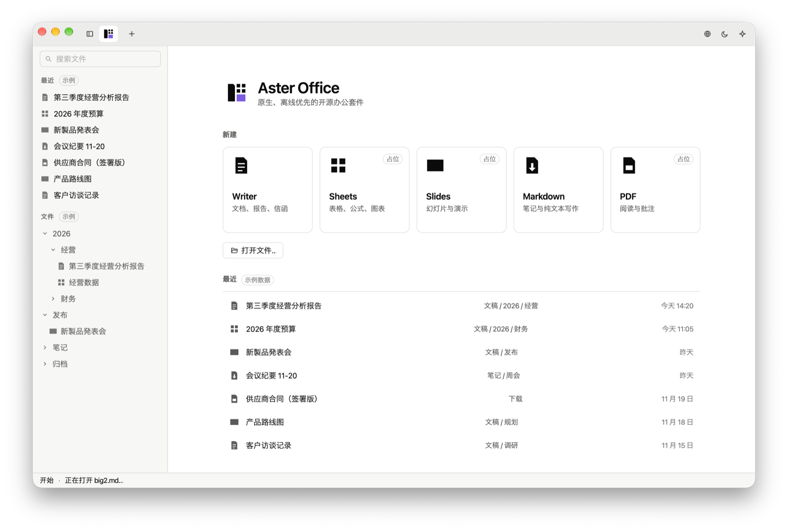

打开 100 MB 的文件时，读文件、建 rope、算行长、高亮、数字数都在工作线程上，界面照常响应，状态栏写着“正在打开 big2.md…”。上图是那时的开始页。

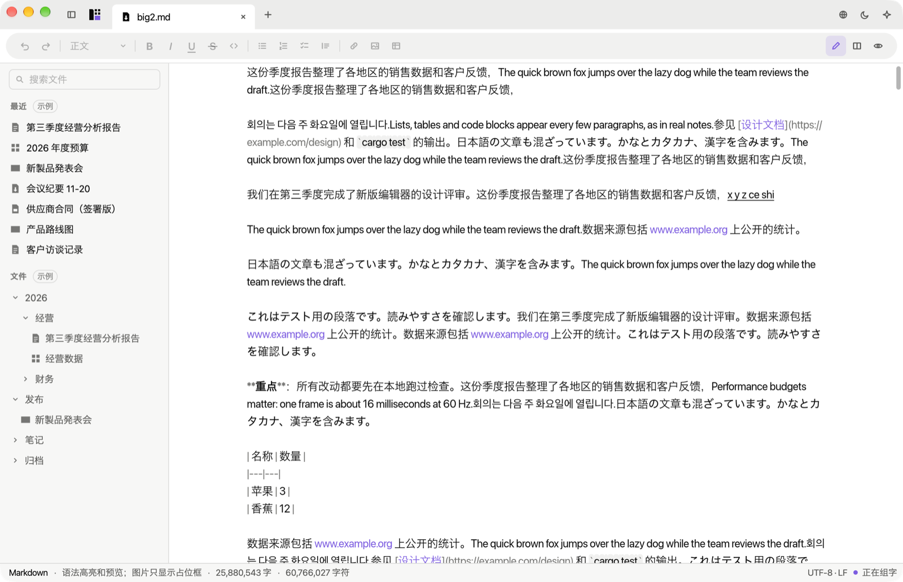

在 100 MB 的文件里用拼音组字：预编辑串、候选窗和平常一样。

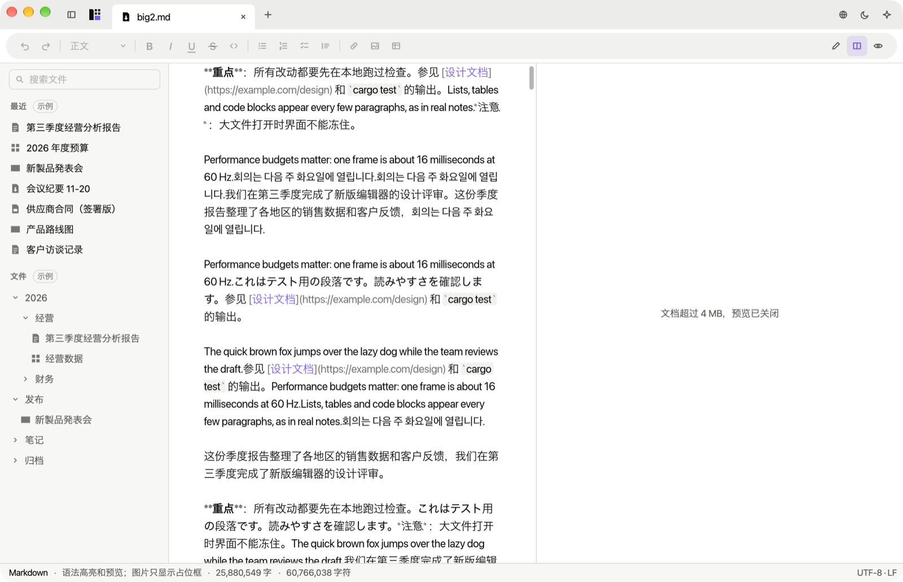

超过 4 MB 的文档没有预览，预览格里说明原因；源码照常编辑，换成窄栏后重新折行也只排可见的部分。

### 怎样测的

```sh
cargo run --release -p aster-shell --example large_files                    # 1、10、100 MB
cargo run --release -p aster-shell --example large_files -- --sizes 1,10    # 只测小的
cargo run --release -p aster-shell --example large_files -- --timeout 300   # 每种情况最多 300 秒
```

`crates/aster-shell/examples/large_files.rs` 先生成测试文件（放在 `target/large-files/`，不进仓库）：每种大小两份，一份是中日英混排的 Markdown（标题、列表、代码块、表格、链接、粗体），一份是整个文件只有一行。每份文件在单独的子进程里测，超时或内存不够只影响那一份。走的是窗口用的同一套代码（`MarkdownEditor`、读文件、恢复记录的写线程），只是没有窗口：

- **按键到画完**：一次编辑、高亮、恢复记录的那一步、把 1008 × 700 的编辑区按 2 倍缩放整个重画一遍。不含 Slint 把这张图贴到窗口上的时间，那部分和文件大小无关。
- **连续滚动一帧**：滚 120 个物理像素（约一格滚轮）再重画。
- **常驻内存**：`ps` 报告的 RSS；峰值来自 `getrusage`。
- 机器：Apple Silicon 的 Mac，macOS 27.0.1，发布模式。

这个程序不在 `cargo test` 里跑（100 MB 那几份要几分钟），`scripts/ci.sh` 只编译它。

### 第一次测（改之前）

每次按键都把整篇重新交给 Parley 排一遍（`PlainEditor`），1 MB 时一次按键约 175 毫秒，10 MB 时约 1.8 秒；100 MB 的文件打开到首屏要一分钟，内存 4.5 到 5.3 GB，在 3 分钟的时限里一次按键都没测完。

| | 1 MB 混排 | 10 MB 混排 | 100 MB 混排 | 100 MB 一行 |
| --- | --- | --- | --- | --- |
| 打开到首屏 | 0.63 秒 | 5.8 秒 | 62 秒 | 58 秒 |
| 打开后常驻内存 | 127 MB | 907 MB | 4477 MB | 5351 MB |
| 按键到画完（中位） | 175 毫秒 | 1.7 秒 | 超时 | 超时 |

<details>
<summary>第一次测的全部结果</summary>

#### 1 MB, 中日英混排

| 项目 | 结果 |
| --- | --- |
| 打开：读文件和解码 | 4.3 ms |
| 打开：到首屏画完 | 630.3 ms |
| 常驻内存（打开后） | 127 MB |
| 按键到画完（文首） | 中位 177.92 ms，95% 199.07 ms，最大 207.13 ms（40 次） |
| 按键到画完（文中） | 中位 173.22 ms，95% 185.89 ms，最大 188.34 ms（40 次） |
| 按键到画完（文末） | 中位 175.60 ms，95% 186.81 ms，最大 191.84 ms（40 次） |
| 连续滚动一帧 | 中位 0.78 ms，95% 1.06 ms，最大 1.34 ms（200 次） |
| 保存：界面线程上取全文 | 0.0 ms |
| 保存：总计 | 12.5 ms |
| 恢复记录：开始（界面线程） | 0.0 ms |
| 恢复记录：开始（写线程，含刷盘） | 29.9 ms |
| 恢复记录：检查点（写线程，含刷盘） | 15.9 ms |
| 恢复记录：检查点（界面线程，最慢一次） | 0.0 ms |
| 常驻内存峰值 | 224 MB |
| 预览：排版全文（工作线程） | 271.9 ms |
| 预览：文档高度 | 1023597 px |
| 文件大小 | 1.0 MB |

#### 1 MB, 只有一行

| 项目 | 结果 |
| --- | --- |
| 打开：读文件和解码 | 2.4 ms |
| 打开：到首屏画完 | 610.8 ms |
| 常驻内存（打开后） | 126 MB |
| 按键到画完（文首） | 中位 186.77 ms，95% 200.15 ms，最大 214.50 ms（40 次） |
| 按键到画完（文中） | 中位 186.23 ms，95% 203.73 ms，最大 212.26 ms（40 次） |
| 按键到画完（文末） | 中位 183.02 ms，95% 189.91 ms，最大 192.96 ms（40 次） |
| 连续滚动一帧 | 中位 1.89 ms，95% 2.21 ms，最大 2.35 ms（200 次） |
| 保存：界面线程上取全文 | 0.0 ms |
| 保存：总计 | 10.7 ms |
| 恢复记录：开始（界面线程） | 0.0 ms |
| 恢复记录：开始（写线程，含刷盘） | 29.5 ms |
| 恢复记录：检查点（写线程，含刷盘） | 15.1 ms |
| 恢复记录：检查点（界面线程，最慢一次） | 0.1 ms |
| 常驻内存峰值 | 225 MB |
| 预览：排版全文（工作线程） | 258.1 ms |
| 预览：文档高度 | 637152 px |
| 文件大小 | 1.0 MB |

#### 10 MB, 中日英混排

| 项目 | 结果 |
| --- | --- |
| 打开：读文件和解码 | 23.6 ms |
| 打开：到首屏画完 | 5755.8 ms |
| 常驻内存（打开后） | 907 MB |
| 按键到画完（文首） | 中位 1748.65 ms，95% 1851.45 ms，最大 1856.50 ms（40 次） |
| 按键到画完（文中） | 中位 1706.32 ms，95% 1915.51 ms，最大 1919.73 ms（40 次） |
| 结束 | 超过 180 秒，已终止 |

#### 10 MB, 只有一行

| 项目 | 结果 |
| --- | --- |
| 打开：读文件和解码 | 21.3 ms |
| 打开：到首屏画完 | 5588.6 ms |
| 常驻内存（打开后） | 902 MB |
| 按键到画完（文首） | 中位 1809.08 ms，95% 1851.48 ms，最大 1855.81 ms（40 次） |
| 按键到画完（文中） | 中位 1808.98 ms，95% 1870.88 ms，最大 1878.86 ms（40 次） |
| 结束 | 超过 180 秒，已终止 |

#### 100 MB, 中日英混排

| 项目 | 结果 |
| --- | --- |
| 打开：读文件和解码 | 236.4 ms |
| 打开：到首屏画完 | 62067.5 ms |
| 常驻内存（打开后） | 4477 MB |
| 结束 | 超过 180 秒，已终止 |

#### 100 MB, 只有一行

| 项目 | 结果 |
| --- | --- |
| 打开：读文件和解码 | 208.3 ms |
| 打开：到首屏画完 | 57712.6 ms |
| 常驻内存（打开后） | 5351 MB |
| 结束 | 超过 180 秒，已终止 |

</details>

### 改了什么

改哪里是测出来的：时间几乎全花在整篇排版上，其次是每次按键都整篇数一遍字。

- **文本存在 rope 里**（`ropey` 1.6，MIT，只把 `\n` 当换行）。编辑是对数时间；保存、恢复记录要“全文”时拿的是一个共享片段的副本，不复制 100 MB。`Document`、日志重放、保存的编码都改成直接读 rope。没有自己写：`ropey` 成熟，许可证合适，自己写一个同样能共享片段的平衡树没有好处。
- **新的文本视图只排可见的行**（`aster-surface/src/text_view.rs`）。每行有一个高度，排过的是实测值，没排过的按长度估计；每 256 行汇总一次，所以按高度找行、按行找高度只走一遍组。滚动位置记成“哪一行、往下多少”，上面的行量出来和估计不同时，画面不跳。排过的行有缓存，离开画面就丢掉。超过 8 KB 的行分成 8 KB 一段分别排，只有一行的 100 MB 文件也是一次排几千字节。光标移动、点击、选区、输入法组字、高亮装饰都按段处理。Writer 标签仍用原来的整篇表面。
- **高亮在大文件下也是局部的**。块按组存放，一次编辑只改动一组、移动后面各组的起点，不再挪动后面所有的块；切块时只看每行开头 256 字节；超过 256 KB 的块（比如一整行 100 MB、一直没闭合的代码块）不高亮，免得每次按键都解析一遍；链接定义变化时只重新解析用到别处定义的块。
- **字数按编辑局部更新**：向两边找到最近的断词处，只把这一小段的旧文和新文各数一遍。找不到（一个上千字节的“词”）时，1 MB 以下当场整篇重数，更大的在后台线程数完再更新。
- **打开、恢复都不占界面线程**：读文件、解码、建 rope、算行长、高亮、数字数都在工作线程上做完，界面线程只把它们装进编辑器（约 50 毫秒）。打开期间状态栏显示“正在打开 …”，窗口照常响应。崩溃后找到的记录也在扫描线程上准备好，点“恢复”时立刻打开。
- **恢复记录**：界面线程只交出 rope 的副本，转成字节在写线程上做（`aster-storage` 的 `Contents::later`）。检查点的间隔随文档变大：至少 256 条或 256 KB，100 MB 时约 1600 条或 6.25 MB 一次，写线程花在检查点上的时间有上限。
- **保存**：取全文是 rope 副本，编码和写盘都在工作线程上。
- **预览**：超过 4 MB 的文档关闭预览，在预览格里说明。10 MB 的文档排一次预览要 2 秒多、上百万像素高，留着不划算。

### 第二次测（改之后）

所有按键、回车和滚动都在 9 毫秒以内，落在一个 60 Hz 刷新周期（16.7 毫秒）里。

| | 1 MB 混排 | 10 MB 混排 | 100 MB 混排 | 100 MB 一行 |
| --- | --- | --- | --- | --- |
| 打开总计（几乎都在工作线程上） | 59 毫秒 | 181 毫秒 | 1.37 秒 | 0.51 秒 |
| 其中界面线程 | 41 毫秒 | 40 毫秒 | 50 毫秒 | 43 毫秒 |
| 打开后常驻内存 | 44 MB | 83 MB | 452 MB | 355 MB |
| 常驻内存峰值（含保存、检查点） | 54 MB | 117 MB | 646 MB | 569 MB |
| 按键到画完（文首、文中、文末，中位） | 1.1 / 1.0 / 0.9 毫秒 | 1.1 / 1.2 / 0.9 毫秒 | 1.2 / 1.0 / 1.2 毫秒 | 4.5 / 7.2 / 3.4 毫秒 |
| 按键到画完（最慢一次） | 1.5 毫秒 | 2.1 毫秒 | 2.0 毫秒 | 9.0 毫秒 |
| 文首回车（中位） | 0.7 毫秒 | 0.8 毫秒 | 2.4 毫秒 | 4.6 毫秒 |
| 连续滚动一帧（中位 / 最慢） | 0.8 / 1.4 毫秒 | 0.8 / 1.4 毫秒 | 0.9 / 1.4 毫秒 | 2.9 / 7.8 毫秒 |
| 保存（工作线程） | 10 毫秒 | 23 毫秒 | 184 毫秒 | 176 毫秒 |
| 检查点（界面线程 / 写线程含刷盘） | 0 / 17 毫秒 | 0 / 28 毫秒 | 0 / 204 毫秒 | 0 / 185 毫秒 |

内存：100 MB 文本打开后常驻 452 MB，是文本的 4.5 倍；峰值 646 MB（6.5 倍），出现在保存和写检查点时，那时各有一份 100 MB 的字节缓冲。打开后的大头是 rope（约 100 MB 多一点）和高亮（每块的标记），行长和行高每行 8 字节。

<details>
<summary>第二次测的全部结果</summary>

#### 1 MB, 中日英混排

| 项目 | 结果 |
| --- | --- |
| 打开：读文件和解码（工作线程） | 4.6 ms |
| 打开：准备文本、行长、高亮、字数（工作线程） | 12.9 ms |
| 打开：建编辑器到首屏画完（界面线程） | 41.3 ms |
| 打开：总计 | 58.8 ms |
| 常驻内存（打开后） | 44 MB |
| 按键到画完（文首） | 中位 1.06 ms，95% 1.21 ms，最大 1.22 ms（40 次） |
| 按键到画完（文中） | 中位 0.97 ms，95% 1.13 ms，最大 1.53 ms（40 次） |
| 按键到画完（文末） | 中位 0.92 ms，95% 1.21 ms，最大 1.34 ms（40 次） |
| 回车到画完（文首） | 中位 0.65 ms，95% 1.08 ms，最大 1.14 ms（40 次） |
| 连续滚动一帧 | 中位 0.79 ms，95% 1.26 ms，最大 1.40 ms（200 次） |
| 保存：界面线程上取全文 | 0.0 ms |
| 保存：编码和写盘（工作线程） | 9.5 ms |
| 恢复记录：开始（界面线程） | 0.0 ms |
| 恢复记录：开始（写线程，含刷盘） | 29.7 ms |
| 恢复记录：检查点（写线程，含刷盘） | 16.7 ms |
| 恢复记录：检查点（界面线程，最慢一次） | 0.0 ms |
| 常驻内存峰值 | 54 MB |
| 预览：排版全文（工作线程） | 267.6 ms |
| 预览：文档高度 | 1023622 px |
| 文件大小 | 1.0 MB |

#### 1 MB, 只有一行

| 项目 | 结果 |
| --- | --- |
| 打开：读文件和解码（工作线程） | 5.2 ms |
| 打开：准备文本、行长、高亮、字数（工作线程） | 2.7 ms |
| 打开：建编辑器到首屏画完（界面线程） | 43.6 ms |
| 打开：总计 | 51.5 ms |
| 常驻内存（打开后） | 43 MB |
| 按键到画完（文首） | 中位 4.07 ms，95% 4.70 ms，最大 4.76 ms（40 次） |
| 按键到画完（文中） | 中位 6.72 ms，95% 7.55 ms，最大 7.99 ms（40 次） |
| 按键到画完（文末） | 中位 2.85 ms，95% 3.15 ms，最大 4.11 ms（40 次） |
| 回车到画完（文首） | 中位 4.15 ms，95% 4.62 ms，最大 4.80 ms（40 次） |
| 连续滚动一帧 | 中位 2.87 ms，95% 5.71 ms，最大 7.57 ms（200 次） |
| 保存：界面线程上取全文 | 0.0 ms |
| 保存：编码和写盘（工作线程） | 9.6 ms |
| 恢复记录：开始（界面线程） | 0.0 ms |
| 恢复记录：开始（写线程，含刷盘） | 27.2 ms |
| 恢复记录：检查点（写线程，含刷盘） | 15.8 ms |
| 恢复记录：检查点（界面线程，最慢一次） | 0.0 ms |
| 常驻内存峰值 | 57 MB |
| 预览：排版全文（工作线程） | 228.9 ms |
| 预览：文档高度 | 637178 px |
| 文件大小 | 1.0 MB |

#### 10 MB, 中日英混排

| 项目 | 结果 |
| --- | --- |
| 打开：读文件和解码（工作线程） | 29.0 ms |
| 打开：准备文本、行长、高亮、字数（工作线程） | 111.6 ms |
| 打开：建编辑器到首屏画完（界面线程） | 39.8 ms |
| 打开：总计 | 180.5 ms |
| 常驻内存（打开后） | 83 MB |
| 按键到画完（文首） | 中位 1.09 ms，95% 1.48 ms，最大 1.56 ms（40 次） |
| 按键到画完（文中） | 中位 1.17 ms，95% 1.73 ms，最大 2.12 ms（40 次） |
| 按键到画完（文末） | 中位 0.88 ms，95% 1.13 ms，最大 1.35 ms（40 次） |
| 回车到画完（文首） | 中位 0.78 ms，95% 1.43 ms，最大 1.58 ms（40 次） |
| 连续滚动一帧 | 中位 0.82 ms，95% 1.14 ms，最大 1.43 ms（200 次） |
| 保存：界面线程上取全文 | 0.0 ms |
| 保存：编码和写盘（工作线程） | 22.6 ms |
| 恢复记录：开始（界面线程） | 0.0 ms |
| 恢复记录：开始（写线程，含刷盘） | 42.3 ms |
| 恢复记录：检查点（写线程，含刷盘） | 28.4 ms |
| 恢复记录：检查点（界面线程，最慢一次） | 0.0 ms |
| 常驻内存峰值 | 117 MB |
| 预览：排版全文（工作线程） | 2351.7 ms |
| 预览：文档高度 | 10239808 px |
| 文件大小 | 10.0 MB |

#### 10 MB, 只有一行

| 项目 | 结果 |
| --- | --- |
| 打开：读文件和解码（工作线程） | 22.6 ms |
| 打开：准备文本、行长、高亮、字数（工作线程） | 25.3 ms |
| 打开：建编辑器到首屏画完（界面线程） | 41.0 ms |
| 打开：总计 | 88.9 ms |
| 常驻内存（打开后） | 73 MB |
| 按键到画完（文首） | 中位 3.91 ms，95% 4.47 ms，最大 4.57 ms（40 次） |
| 按键到画完（文中） | 中位 6.45 ms，95% 7.27 ms，最大 7.75 ms（40 次） |
| 按键到画完（文末） | 中位 2.54 ms，95% 3.21 ms，最大 3.95 ms（40 次） |
| 回车到画完（文首） | 中位 4.12 ms，95% 4.71 ms，最大 5.01 ms（40 次） |
| 连续滚动一帧 | 中位 2.88 ms，95% 5.38 ms，最大 7.74 ms（200 次） |
| 保存：界面线程上取全文 | 0.0 ms |
| 保存：编码和写盘（工作线程） | 23.9 ms |
| 恢复记录：开始（界面线程） | 0.0 ms |
| 恢复记录：开始（写线程，含刷盘） | 42.9 ms |
| 恢复记录：检查点（写线程，含刷盘） | 27.8 ms |
| 恢复记录：检查点（界面线程，最慢一次） | 0.0 ms |
| 常驻内存峰值 | 105 MB |
| 预览：排版全文（工作线程） | 1961.4 ms |
| 预览：文档高度 | 6368666 px |
| 文件大小 | 10.0 MB |

#### 100 MB, 中日英混排

| 项目 | 结果 |
| --- | --- |
| 打开：读文件和解码（工作线程） | 242.2 ms |
| 打开：准备文本、行长、高亮、字数（工作线程） | 1080.1 ms |
| 打开：建编辑器到首屏画完（界面线程） | 49.9 ms |
| 打开：总计 | 1372.3 ms |
| 常驻内存（打开后） | 452 MB |
| 按键到画完（文首） | 中位 1.15 ms，95% 1.34 ms，最大 1.37 ms（40 次） |
| 按键到画完（文中） | 中位 1.02 ms，95% 1.34 ms，最大 2.02 ms（40 次） |
| 按键到画完（文末） | 中位 1.16 ms，95% 1.33 ms，最大 1.79 ms（40 次） |
| 回车到画完（文首） | 中位 2.44 ms，95% 3.08 ms，最大 3.38 ms（40 次） |
| 连续滚动一帧 | 中位 0.90 ms，95% 1.28 ms，最大 1.40 ms（200 次） |
| 保存：界面线程上取全文 | 0.0 ms |
| 保存：编码和写盘（工作线程） | 184.4 ms |
| 恢复记录：开始（界面线程） | 0.0 ms |
| 恢复记录：开始（写线程，含刷盘） | 227.2 ms |
| 恢复记录：检查点（写线程，含刷盘） | 204.4 ms |
| 恢复记录：检查点（界面线程，最慢一次） | 0.0 ms |
| 常驻内存峰值 | 646 MB |
| 文件大小 | 100.0 MB |

#### 100 MB, 只有一行

| 项目 | 结果 |
| --- | --- |
| 打开：读文件和解码（工作线程） | 224.6 ms |
| 打开：准备文本、行长、高亮、字数（工作线程） | 238.4 ms |
| 打开：建编辑器到首屏画完（界面线程） | 42.6 ms |
| 打开：总计 | 505.7 ms |
| 常驻内存（打开后） | 355 MB |
| 按键到画完（文首） | 中位 4.53 ms，95% 4.83 ms，最大 4.89 ms（40 次） |
| 按键到画完（文中） | 中位 7.24 ms，95% 8.00 ms，最大 8.95 ms（40 次） |
| 按键到画完（文末） | 中位 3.36 ms，95% 3.92 ms，最大 4.83 ms（40 次） |
| 回车到画完（文首） | 中位 4.59 ms，95% 5.28 ms，最大 5.50 ms（40 次） |
| 连续滚动一帧 | 中位 2.88 ms，95% 5.48 ms，最大 7.78 ms（200 次） |
| 保存：界面线程上取全文 | 0.0 ms |
| 保存：编码和写盘（工作线程） | 176.4 ms |
| 恢复记录：开始（界面线程） | 0.0 ms |
| 恢复记录：开始（写线程，含刷盘） | 205.4 ms |
| 恢复记录：检查点（写线程，含刷盘） | 184.7 ms |
| 恢复记录：检查点（界面线程，最慢一次） | 0.0 ms |
| 常驻内存峰值 | 569 MB |
| 文件大小 | 100.0 MB |

</details>

### 检查过什么

在 macOS 27.0.1（Apple Silicon，2 倍缩放）上，用发布模式的 `.app` 包，打开 100 MB 的中日英混排文件的一份副本（不是仓库里的文件），用后台注入的点击、滚轮、按键和菜单操作，截图确认：

- 从命令行参数打开 100 MB 的文件：开始页一直可以操作，状态栏显示“正在打开 big2.md…”，随后标签出现，高亮正常，状态栏显示 25,880,543 字。两次打开后的常驻内存是 395 MB 和 616 MB（后者刚打开完，释放还没完成）；空闲时 CPU 2% 到 10%，是光标闪烁时的重画。
- 滚轮滚动；在文中点一下放光标。
- 拼音输入法：`xyzceshi` 出预编辑串和候选窗，空格上屏“需要做测试”，只出现一次；字数和字符数各加 5。
- “全选”后按右方向键，光标到 100 MB 的末尾，视图跟过去；回车、输入 `123`。
- “保存”：写出的文件和原文件相比，正好是在第 4215 字节插入了“需要做测试”、末尾多了 `\n123`，其余逐字节相同。
- 再输入 `456` 不保存，`kill -9` 强杀：恢复记录里有 100 MB 的检查点和日志；重新启动后弹出恢复对话框，点“恢复”标签立刻出现，字符数正是强杀前的数；再保存，文件逐字节等于预期（原文件加上三处输入），恢复记录随之删除。
- 分屏：预览格显示“文档超过 4 MB，预览已关闭”，源码在半宽里重新折行。

自动化测试（`cargo test --workspace`）里新增的：文本视图在 1500 次随机编辑后文本、行长、行高汇总都和重算的一致；光标左右、上下、行首行尾、跨换行、跨长行的段；点击和拖选；组字不进文本；滚过两万行时缓存的版面不超过两百个；长行只排可见的段；装饰不移动文字；改宽度后顶部还是同一处。高亮在每组只有 4 块的设置下做 3000 次随机编辑，和整篇重算一致；超过上限的块不解析。字数的局部更新在 2000 次随机编辑后和整篇重数一致。

**没有检查的**：

- 从系统的“打开”面板选 100 MB 的文件：面板打开了，但后台注入的点击和按键进不了面板，要全屏控制，这次没有人确认，所以只用命令行参数打开过（两条路之后走的是同一段代码）。
- 真实的鼠标和键盘：这一轮都是自动化工具注入的；拼音经过了系统输入法。
- 日文输入法在大文件里没有试。
- 滚动只用滚轮试过几屏。（后来滚动条可以拖动了，见“AI 助手与 MCP”一节末尾的检查记录。）
- 10 GB 级别、几百 MB 的文件没有试；内存大约是文本的 4.5 到 6.5 倍，几百 MB 的文件会用掉几 GB。
- Windows 和 Linux。

### 留下的问题

- **长行在段的边界处会提前折行**：超过 8 KB 的行按 8 KB 分段排，段尾那一行可能比栏宽短。
- **超过 256 KB 的块不高亮**：一整行很长的文件、没闭合的代码块后面的全部内容，都显示成普通文字。
- **超过 4 MB 的文档没有预览**。
- **滚动条的位置是估计的**：没排过的行按长度估高度，滚动时滚动条会轻微伸缩；画面本身不跳。
- ~~没有跳到文首、文末的快捷键~~：现在 Cmd+上、Cmd+下跳到文首、文末（加 Shift 是选到那里），Page Up、Page Down 翻一屏；编辑区和预览的滚动条可以拖动，点滚动条的空白处翻一页。
- **复制整篇**：复制 100 MB 会在界面线程上拼出一个 100 MB 的字符串交给剪贴板，会卡一下。
- **撤销整篇替换**：全选后输入，撤销记录里存着被换掉的 100 MB。
- **恢复对话框的点击会穿透**：后来查明不是穿透，是自动化工具把一次点击投递了两次，见“已知问题”。

## 查找替换

Markdown 标签有了查找栏，在编辑区上方。查找和替换的逻辑在 `aster-markdown/src/search.rs`，不依赖 Slint；编辑器里的状态、后台任务和撤销在 `src/content.rs`。


### 能做什么

| 功能 | 说明 |
| --- | --- |
| 打开 | Cmd+F 打开查找栏，Cmd+Option+F 打开带替换框的查找栏；都在原生“编辑”菜单里。再按一次会选中查找框里的字 |
| 边输入边查 | 每输入一个字就查，查找栏显示“第几个 / 共几个”；查不到显示“无结果”，正则写错了显示“正则表达式有误”并给框加边 |
| 跳转 | Enter 下一个，Shift+Enter 上一个，到头后绕回来；栏上的 ▲▼ 按钮、菜单里的“查找下一个”（Cmd+G）和“查找上一个”（Shift+Cmd+G）也一样。打开查找时从光标处往后找第一个 |
| 关闭 | Esc 或 × 关闭，当前匹配成为选区；焦点在编辑区时按 Esc 也关闭 |
| 用所选内容查找 | Cmd+E 把选中的文字放进查找框，关掉正则选项，打开查找栏并查找；焦点留在文档里，之后可以直接 Cmd+G |
| 选项 | 区分大小写（Aa）、全字匹配（ab）、正则表达式（.\*），快捷键 Cmd+Option+C、W、R。默认不区分大小写，按 Unicode 的大小写折叠（希腊字母 σ、ς、Σ 视为相同） |
| 正则 | `regex-automata` 0.4 和 `regex-syntax` 0.8（`regex` 项目本身的引擎，MIT 或 Apache-2.0），不支持回溯引用和环视，保证线性时间。`^` `$` 按行匹配，`.` 不跨行，`\n` 可以跨行 |
| 高亮 | 可见区域里所有匹配有浅紫底，当前匹配是强调色底、白字。和语法高亮叠在一起，不动文字位置 |
| 替换 | “替换”换掉当前一个并跳到下一个（替换框里按 Enter 也是）；“全部替换”一次换完（替换框里 Cmd+Enter），只占一步撤销，状态栏说“已替换 N 处”，之后再编辑或撤销这句话就消失 |
| 分组引用 | 正则模式下替换文本里可以写 `$1`、`${name}`，`$$` 是一个 `$`。不是正则模式时，替换文本原样插入，`$1` 就是 `$1` |
| 中日文 | 按字符查找，不会在一个字的中间匹配；`.` 是一个字符，emoji 的组合序列（👨‍👩‍👧）按字符而不是按字形簇算。全角和半角、平假名和片假名视为不同（见下面“留下的问题”） |
| 输入法 | 查找框里组字时不查，上屏后才查；编辑区里组字时匹配照常跟着文字走，但不移动光标 |
| 编辑菜单 | 焦点在查找框或替换框里时，“全选”“剪切”“拷贝”“粘贴”“撤销”“重做”作用在框里，不作用在文档上 |

查找栏只在 Markdown 标签上。Writer 标签现在是纯文本表面，没有文档模型，没有接上；`search.rs` 只认文本，以后 Writer 有了文本模型可以直接用。

### 大文件怎么办

- **查找**：2 MB 以内的文档在界面线程上直接查（几毫秒）。更大的文档在工作线程上查，每查完 1 MB 看一眼取消标记；输入下一个字、改选项、关闭查找栏都会取消上一次查找。查找期间查找栏显示“正在统计…”，界面照常响应。100 MB 里找一个出现 100 万次的词约 65 ms（发布模式），取消后 1.2 ms 内停下（`cargo test --release -p aster-markdown search -- --ignored`）。
- **编辑时**：匹配跟着编辑移位，被改到的匹配去掉；停手 200 ms 后在后台重新查一遍，补上新出现的匹配。重新查不移动光标。
- **全部替换**：大文档在工作线程上查找并拼出新的 rope，完成后一次装上。**选的处理方式是：替换期间文档锁住**，输入、粘贴、撤销、重做和输入法都不进文档，状态栏显示“正在全部替换…”；关闭查找栏或按 Esc 取消，文档保持原样。替换的结果超过 4 MB 时，语法高亮在后台重建（期间源码是普通文字），恢复记录直接写一个检查点而不是把 100 MB 写进日志。
- **为什么锁而不是边替换边编辑**：替换是对某一版文本算出来的，期间如果允许编辑，要么丢掉用户的输入，要么把替换结果重新映射到新文本上；后者复杂，而 100 MB 的替换在发布模式下不到一秒，锁住的代价很小。
- **上限**：最多记 100 万个匹配，超过时显示“1 / 1,000,000 个以上”，“全部替换”也只换前 100 万个。

### 检查过什么

在 macOS 27.0.1（Apple Silicon，2 倍缩放）上用 `.app` 包操作，截图确认。**这一轮没有用真实的键盘和鼠标**：点击和按键都是自动化工具在后台注入的，菜单用的是辅助功能接口（等于用鼠标点菜单项），拼音经过了系统输入法。

用开发版打开 `markdown-tour.md` 的一份副本：

- 菜单“查找…”打开查找栏，输入“链接”：显示 1 / 3，当前匹配是紫底白字，另外两个是浅紫底（上图）。
- Enter：1 → 2 → 3。▲ 按钮：1 → 3（绕回）。菜单“查找上一个”：3 → 2；“查找下一个”：1 → 2。
- Esc：查找栏关闭，第 2 个匹配成为选区。
- 菜单“替换…”，替换框填 `LINK`，点“替换”：“行内链接”变成“行内LINK”，查找栏跳到下一个。
- 点“全部替换”：状态栏“已替换 2 处”；菜单“撤销”一次，两处都恢复，重新查到 2 / 2。
- 焦点在查找框时按 Cmd+A（菜单“全选”）：选中的是查找框里的字。
- 查找框里用拼音打“lian jie”：预编辑时位置标签是空的（没有查）；上屏“链接”后显示 1 / 3。
- 查找栏开着时在编辑区里用拼音组字：预编辑串、候选窗正常；上屏后重新查到 4 / 4。

用发布版打开 100 MB 的中日英混排文件的副本：

- 查“Performance”：1 / 117,056，和 `grep -o` 数出来的一样；查“的”：468,010，也和 `grep` 一样。两次都快得看不到“正在统计…”。
- 替换为“性能”，点“全部替换”：状态栏“已替换 117,056 处”，正文里是“性能 budgets matter”，查找栏“无结果”；字符数正好少了 9 × 117,056，字数少了 117,056。
- 菜单“撤销”：正文回到“Performance”，字数和字符数回到打开时的值，标签不再显示有改动。（第一次试时“已替换 117,056 处”在撤销后还留在状态栏，已改成任何编辑或撤销后消失。）

自动化测试覆盖的（`cargo test --workspace`）：大小写和希腊字母折叠、中日文和 emoji（含组合序列）、全角不等于半角、全字匹配、跨行的正则和按行的 `^…$`、零长度匹配（不死循环、不切开字符）、空查找词、写错的正则、分组和命名分组替换、`$$`、非正则模式下替换文本里的 `$1` 原样保留、零长度匹配的替换（每行行首加 `> `）、落在 1 MB 窗口边界上的匹配、取消、从某处往后找并绕回；编辑器里跳转和关闭后的选区、替换一个后跳到下一个、全部替换是一步撤销、匹配跟着输入移位且重新查找不动光标、组字时不移动光标、大文档走后台任务（过时的结果被丢弃、替换期间不能编辑、高亮在后台重建、恢复记录写检查点）。100 MB 的取消测试比较慢，标了 `#[ignore]`，不在默认测试里。

**没有检查的**：

- 真实键盘和鼠标。
- Shift+Enter 跳上一个、Cmd+Option+C/W/R 切换选项、替换框里的 Cmd+Enter：注入的按键不带修饰键（调试日志里 Shift+Return 收到的是 Return，Cmd+Option+R 收到的是 `r`），这几个快捷键只读过代码。Cmd+F、Cmd+G 等菜单快捷键是通过菜单项试的，不是按键。
- 点三个选项按钮：注入的点击会来两次（见“已知问题”），按钮切过去又切回来，界面上看不出效果。因此**正则分组替换只有单元测试，没有在界面上做过**。
- 在界面上取消一次正在进行的查找或全部替换：100 MB 上都在一秒内完成，来不及操作。取消的代码路径在输入查找词时每个字都会走一遍，单元测试覆盖了取消和过时结果。
- 日文输入法；Windows 和 Linux。
- 主会话提到的“全选后按右方向键，插入点没到文末”：没有真实键盘，没能复现。很可能和注入点击投递两次是一回事（见“已知问题”）。

### 留下的问题

- **全角和半角、平假名和片假名视为不同**：“ＡＢＣ”找不到“ABC”，“カタカナ”找不到“かたかな”。要不要提供选项、默认怎样，待定（见“待定的设计问题”）。
- **全字匹配对中日文没有用**：汉字和假名都算“词字符”，`\b` 只在汉字和空格、标点之间成立，“全字匹配”找“文档”时，“文档编辑”里的那个也不算。中日文需要分词才能做好。
- **超过 64 KB 的匹配可能找不到**：后台查找按 1 MB 的窗口、64 KB 的重叠来查，一个横跨窗口边界又长于 64 KB 的正则匹配会被切开。
- **100 万个匹配的上限**：超过时“全部替换”只换前 100 万个，状态栏说的是实际换了几个。
- **撤销 100 MB 的全部替换在界面线程上做**：rope 的编辑本身很快，但撤销记录里存着被换掉的整段文字（最长可达整篇）。
- **点“替换”时只核对当前匹配附近 1 KB**：替换前确认它仍然是一个匹配；依赖更远上下文的正则（比如很长的跨行模式）可能判断不准。
- **Writer 标签没有查找**。

## 文件和文件夹

侧边栏和开始页上原来标着“示例”的数据换成了真的：最近打开过的文件，和一个打开的文件夹。模型在新 crate `aster-workspace` 里，不依赖 Slint；外壳里的 `src/sidebar.rs` 把它们写成界面文字，`src/main.rs` 接线。

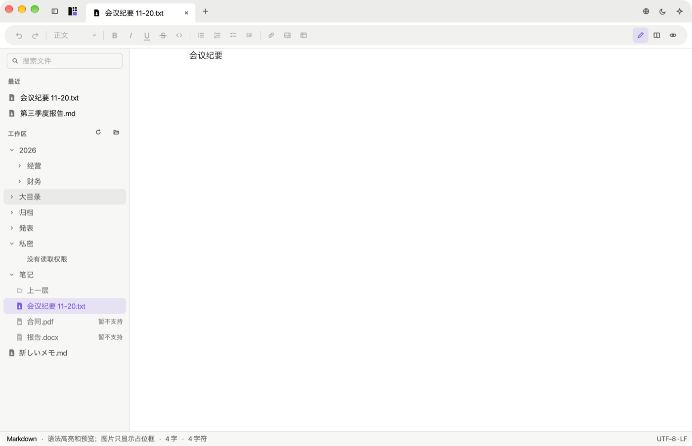

上图：最近列表里有两个文件；文件夹“工作区”展开了几层。当前文档“会议纪要 11-20.txt”是紫色的；“私密”没有读取权限，下面说明了原因；“上一层”是指回上层文件夹的链接，图标变灰、不展开；`.pdf` 和 `.docx` 列出来了，标着“暂不支持”。

### 能做什么

| 功能 | 说明 |
| --- | --- |
| 最近文件 | 打开或保存成功的文件记下来，最多 30 个，最新的在前。同一个文件按规范路径只记一次。开始页列出全部，侧边栏列前 5 个。侧边栏的“最近”一栏总是 5 行高，空着、一项还是五项都一样，免得列表变长时下面的树在光标下移动（过滤时匹配超过 5 个就在这一栏里滚动）。工具栏只在文档区上方，不横跨侧边栏：原来从开始页打开第一个文档时工具栏出现，整个侧边栏下移约 46 像素，双击时第二下会落到另一个文件上每行有文件名、所在文件夹（家目录写成 `~`）和打开时间（“今天 14:20”“昨天 09:05”“11 月 19 日”“2025 年 12 月 31 日”，八种语言各有写法） |
| 不在了的文件 | 启动时、窗口回到前台时、点刷新按钮时，在工作线程上看一遍文件还在不在。不在了的那一行变灰，后面写“不可用”。点它会说明它原来在哪个文件夹、可能被移动改名或删除，并提供“从最近列表中移除”。点的时候会当场再看一次，刚恢复的文件可以直接打开 |
| 移除和清除 | 每行的右键菜单有“从最近列表中移除”和“清除最近列表”；“文件”菜单里也有“清除最近列表”。都不碰文件本身 |
| 只记路径和时间 | 存在应用数据目录的 `recent-files` 里，和恢复记录同一个根目录，原子写入。一行一个文件：秒数、制表符、路径（制表符、换行和反斜杠转义）。不是 Unicode 的路径不记。读到坏行就跳过那一行 |
| 打开文件夹 | “文件”菜单的“打开文件夹…”（Shift+Cmd+O）、侧边栏的按钮、开始页的按钮。用系统的选择文件夹对话框，异步打开（macOS 上是贴在窗口上的面板），不在事件处理里等它 |
| 文件树 | 文件夹在展开时才读，读在工作线程上；同一批要读的文件夹在一个线程上依次读，读完一个显示一个。文件夹在前，再按名字排，名字里的数字按大小排（“第2章”在“第10章”前面）；没读完的文件夹下面写“正在读取…” |
| 跳过的 | 以点开头的文件和文件夹（含 `.git`）、Windows 上标了隐藏属性的（没在 Windows 上试过）、`node_modules`、`target`、`__pycache__` |
| 显示的文件 | `.md`、`.markdown`、`.txt` 点了就在 Markdown 标签里打开（已经开着就切过去）；`.docx`、`.xlsx`、`.pptx`、`.pdf` 显示出来、变灰、标“暂不支持”，点了说明这一版只能打开哪些；其他文件不显示 |
| 大文件夹 | 一个文件夹最多列 2000 项，后面一行写“还有 N 项没有列出”。超过 10 万项的文件夹不读到底，写“还有至少 N 项没有列出” |
| 读不了的 | 没有读取权限、文件夹不在了、不是文件夹，都在那一行下面说明，不是悄悄地空着 |
| 符号链接 | 跟着链接走。指向自己所在文件夹或更上层的链接显示成灰色的文件夹，不展开，点了说明原因；断了的链接不显示 |
| 当前文档 | 在树里用强调色标出来 |
| 双击文件夹 | 半秒内对同一个文件夹的第二下点击算作双击的一部分，文件夹只开或关一次（从访达来的人习惯双击）。这也让自动化工具投递两次的点击不再把文件夹开了又关 |
| 重启后 | 记得上次的文件夹和展开了哪些，存在应用数据目录的 `workspace` 里。启动时在工作线程上读这两个文件；启动后、读到之前打开的文件排在读到的列表前面 |
| 刷新 | 不监视文件夹（`notify` 是 CC0-1.0，方案里属于要法务确认的许可证，没有引入）。窗口重新获得焦点时和点刷新按钮时，把屏幕上展开着的文件夹重新读一遍；新的列表到之前旧的留在屏幕上，不闪 |
| 搜索框 | 按文件名过滤最近列表和树里已经读到的条目，不分大小写，先把名字合成 NFC 再比（macOS 给的文件名常是分解形式，不合成的话输入的“が”找不到磁盘上的“が”）。树里留下匹配的条目和通往它们的文件夹；没展开过的文件夹没读过，不在搜索范围里。Esc 或 × 清空。不做全文搜索 |
| 拖进窗口打开 | 把文件或文件夹从访达拖到窗口上：拖着经过窗口时整个窗口罩上一层淡紫色，中间写“松开即可打开”；松开后文件夹在侧边栏打开（和“打开文件夹…”一样），`.md`、`.markdown`、`.txt`、`.xlsx`、`.pptx`、`.pdf` 在新标签里打开（已经开着就切过去），和“打开…”走同一条路（`start_load`），PowerPoint 和 PDF 文件只读；其他文件弹出“暂不支持打开”。一次拖进几个就逐个处理。屏幕上有对话框或恢复提示时不接受拖放，也不显示那层提示，免得新标签盖住正在问的问题。判断在 `src/files.rs` 的 `dropped`，事件取自 winit 的 `HoveredFile`、`HoveredFileCancelled`、`DroppedFile` |
| 在访达中显示 | 树和最近列表每行的右键菜单，以及“文件”菜单里对当前文档的一项。macOS 用 `open -R`；Windows 用 `explorer.exe /select,`；Linux 先试 freedesktop 的 `FileManager1.ShowItems`，不行就用 `xdg-open` 打开所在文件夹。路径作为参数传，不经过 shell，在工作线程上等它结束；失败时说明原因。Windows 和 Linux 的写好了，**没有运行过** |

不做的：不监视文件夹；不在树里拖动移动文件；不永久删除（只移到废纸篓，见“编码、外部修改和更多编辑”一节）；不做全文搜索。

新依赖：`icu_normalizer` 2.3（Unicode-3.0，ICU4X 的一部分，原来只是 Slint 编译器的依赖，现在进了程序本身，顺带进来 `utf16_iter` 和 `write16` 两个小 crate，都是 MIT 或 Apache-2.0），用来合成文件名；`chrono` 0.4（MIT 或 Apache-2.0，Slint 原来就带着），用来取本地时间写“今天 14:20”。

### 检查过什么

在 macOS 27.0.1（Apple Silicon，2 倍缩放）上用 `.app` 包，`ASTER_DATA_DIR` 指向草稿目录，测试文件夹也在临时目录里（中日文名字、多层文件夹、各种扩展名、隐藏文件、`.git`、`node_modules`、`target`、一个权限是 000 的文件夹、一个指向上层的链接、一个有 2300 个文件的文件夹）。**这一轮没有用真实的键盘和鼠标**：点击和按键是自动化工具在后台注入的，菜单走辅助功能接口。

- 空的数据目录启动：开始页和侧边栏的最近列表写“还没有打开过文件”，文件区写“打开一个文件夹……”和按钮。
- 点侧边栏的“打开文件夹…”：系统的选择文件夹面板贴在窗口上弹出，标题“打开文件夹”。**后台注入的点击和输入进不了面板里的文件列表**（全屏控制没有人确认），所以没能在面板里选到测试文件夹；面板的“打开”按钮可以通过辅助功能接口按下，它把面板当时所在的文件夹（草稿目录里的一个文件夹）打开到了侧边栏，树正确列出了里面的 `.md` 文件，`workspace` 文件里记下了它。之后为了换成测试文件夹，**手工改写了 `workspace` 文件再重启**，这同时验证了“重启后记得文件夹”。
- 树：隐藏文件、`.git`、`node_modules`、`target`、`.png` 都没有出现；展开“2026”“经营”“笔记”“私密”；“私密”下面写“没有读取权限”；“上一层”灰色，点了说明它是指回上层的链接；`.xlsx`、`.pdf`、`.docx` 标“暂不支持”，点 `合同.pdf` 弹出“暂不支持打开“合同.pdf””。
- 点 `第三季度报告.md`：在新标签里打开，树里这一行变紫，最近列表出现这个文件，`recent-files` 里写下了路径和时间。
- 重启：最近列表还在（开始页显示“今天 14:37”），展开过的“2026”“私密”“笔记”自动展开并读好。
- 拖进窗口打开：**没有在界面上试过真的拖放**。从访达拖到窗口要跨应用拖动，需要全屏控制和访达的权限，这一轮访达的权限被拒绝了。看过的只有那层提示：临时加一行让它启动时就显示，截图确认淡紫色罩层、紫色边框和“松开即可打开”的样子，然后删掉了那一行。截图时恰好开着恢复提示，看到提示罩在问题上面，于是改成有对话框时不显示。拖放的判断（文件夹、能打开的文件包括 `.xlsx` 和 `.pptx`、名字像文件的文件夹、`.docx` 和图片和没有扩展名的文件）有单元测试；winit 在 macOS 上是否真的送来 `DroppedFile` 没有验证。
- 打开 `README.md` 后，在外面删掉它，点刷新：最近列表里它变灰、写“不可用”，树里它消失。关掉它的标签后点它：弹出“找不到“README.md””，说明原来所在的文件夹；点“从最近列表中移除”，它从列表里消失。
- 在外面新建一个文件，切到访达再切回来：树里出现了“新しいメモ.md”。
- 搜索框输入“报告”：最近列表只剩“第三季度报告.md”，树只剩“笔记/报告.docx”（“经营”这次运行没展开过，没读过，不在范围里，符合设计）；Esc 清空后恢复原样。
- “大目录”：列到“条目2000.md”，最后一行“还有 300 项没有列出”；拖动列表的滚动条到底看的。
- “文件”菜单的“清除最近列表”：两处最近列表都空了，`recent-files` 里只剩表头，文件夹里的文件没有动。
- “文件”菜单的“在访达中显示”：访达打开了一个名为“笔记”的窗口，就是当前文档所在的文件夹（没有截访达的图，文件是否被选中没有确认）。
- 自动化工具把点击投递两次（见“已知问题”）在这里又出现了：打开文件时第二下落在因列表变长而下移的另一行上，多打开了一两个文件。双击文件夹只算一次之后，文件夹不再被开了又关。

自动化测试：`aster-workspace` 24 个（中日文和 emoji 路径的存取、坏行、去重和上限、不在了的文件、权限 000 的文件夹、指回自己和上层的链接、断链、2300 项的文件夹只列 2000、按需读取、过滤、重新读取时旧列表保留到新的到达、文件夹消失后再出现、根文件夹不在了、写线程只写最新一份、写失败会报告、NFC 和大小写、数字排序）；`aster-platform` 的 `reveal.rs` 2 个；外壳的 `sidebar.rs` 5 个（八种语言的时间写法、`~`、过滤、说明行）和 `main.rs` 2 个（同一文件不同写法只记一次、打开文件夹后读展开的子文件夹）。

**没有检查的**：

- 真实键盘和鼠标。
- 在系统面板里选一个指定的文件夹（见上）。
- 右键菜单：后台不能打开右键菜单（会把应用带到前台），所以树和最近列表的“在访达中显示”“从最近列表中移除”“清除最近列表”都没有从右键点过。走的是同一段代码：“在访达中显示”用“文件”菜单试过，移除用“找不到”对话框试过，清除用“文件”菜单试过。这几个右键菜单原来是原生菜单（`ContextMenuArea`），和样式框的列表一样有让 winit panic 的风险（见“Markdown 格式”一节），现在改成了 Slint 自己画的 `PopupWindow`，在鼠标右键松开处打开；改后能编译、左键点行仍然会打开文件，但右键打开菜单这一步**还没有试过**。
- 中日文输入法在搜索框里组字。
- Windows 和 Linux：隐藏属性、`explorer.exe /select,`、`FileManager1` 和 `xdg-open` 都只是写好了。

### 留下的问题

- **中日文名字按码位排序**，不是按读音或部首：“大目录”排在“归档”前面，平假名排在汉字前面。按读音排需要排序规则数据（ICU 的 collator），以后再定。
- **只有已经读过的文件夹能被搜索**。没展开过的文件夹里的文件搜不到；这是有意的（不为了搜索去读整个硬盘），但用户可能以为搜不到就是没有。
- **不监视文件夹**：在外面改了文件，要切回窗口或点刷新才看得到；窗口一直在前台时不会自己变。
- **最近列表的位置一栏很长时只显示开头**，Slint 的省略号只能放在末尾，看不到最后一级文件夹名。
- **最近列表里的文件被移动了不会跟着走**，只会变成“不可用”。
- **展开很多文件夹后重启**，每个展开的文件夹都要重新读；一个 10 万项的文件夹会让它后面的文件夹在同一个线程上等着。
- **最近列表不在 SQLite 里**，是一个小文本文件，见“和方案的关系”。

## 预览的细节

预览的段落改用我们自己的断行器排版，中日文强调有了倾斜，可以选中复制、用键盘滚动，GitHub 提示块、脚注、裸写的电子邮件地址都按类型显示。

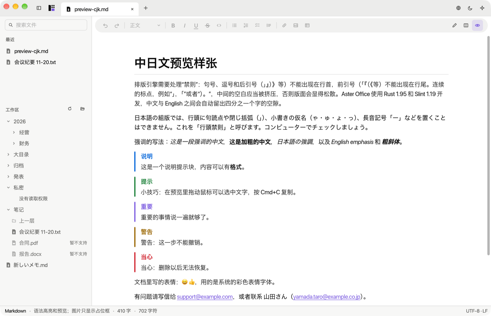

上图：中文和日文段落按禁则断行，句号、逗号、右括号不在行首，左括号不在行尾；连续的标点（“（」』）》等）”）挤掉了多余的半个字宽；“Aster Office 使用 Rust 1.95”这样的中西文之间留出四分之一个字宽。强调的中文和日文是倾斜的，英文用字体自带的斜体。五种提示块各有颜色和标题。电子邮件地址是链接。

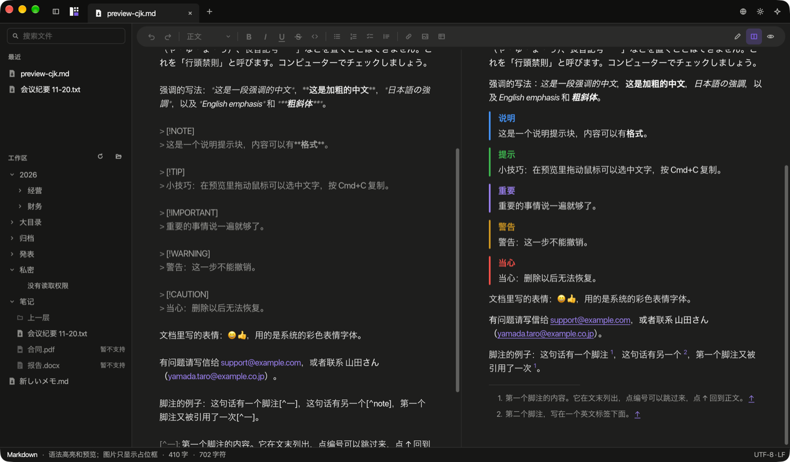

深色主题的分屏：文末是脚注列表，正文里的脚注编号是抬高的小号数字，每条脚注后面的 ↑ 链回引用处。

### 新 crate：`aster-text`

技术方案“Cargo Workspace 与 Crate 职责”一节里，`aster-text` 的职责是“内置与系统字体库、字体替换表、shaping、段落排版、中日文禁则、命中测试”，所以断行器放在这里，而不是方案里叫“在研的排版内核”的 `aster-layout`（那是分页和版面）。那一节里等你接受的建议只涉及工具、MCP 和 AI 几个 crate，和这里不冲突。方案说 `aster-text` 只依赖 `aster-model`，现在还没有 `aster-model`，它只依赖外部的 Parley 和 ICU4X。

| 文件 | 内容 |
| --- | --- |
| `breaker.rs`、`class.rs` | 从 `spikes/g3-cjk` 搬来的断行器和字符分类，算法和测试原样保留。全部用 1/64 像素的整数计算 |
| `segment.rs` | UAX #14 严格模式的断行机会（ICU4X）；按有没有假名判断段落是日文还是中文 |
| `paragraph.rs` | 让 Parley 把段落排成不换行的一行（只整形、选字体），断行器决定在哪里换行、每个字放在哪里；给出绘制用的字形、下划线和删除线、命中测试（坐标到文字位置）、选区矩形；找出没有任何字体能画的字 |
| `selection.rs` | 跨段落的选区（哪一段、第几个字节），复制成纯文本时段落之间换行、表格单元格之间是制表符 |
| `golden.rs` | 八段中日英样张（G3 的五段加三段新的：中文感叹问号和书名号、日文引号套引号、繁体中文），在 6 种行宽下断行，与 `golden/breaks-18em.txt` 逐字节比对，并算摘要值 `0x993999b07a585027` |

验证工程 `spikes/g3-cjk` 没有动，它的 28 个测试（含摘要 `0x8515cd8a10c36b74`）照常通过；`aster-text` 里另有一个测试只取前五段样张重算摘要，结果和 G3 记录的一致，说明搬过来以后断行没有变。

**三个系统逐字节一致**：金样用的是合成度量（汉字一个字宽，其余半个），不涉及字体，原则上三个系统应得到同样的结果；**目前只在 macOS 上跑过**。真实字体下要一致，还需要三端用同一份字体文件，要等内置字体。

### 能做什么

| 功能 | 说明 |
| --- | --- |
| 禁则 | 句号、逗号、顿号、冒号、分号、问号、感叹号、右括号、后引号、小写假名、长音符号不在行首；左括号、前引号不在行尾。一串没有断行机会又比一行还长的字（比如日文样张里的“（ゃ・ゅ・ょ・っ）、”在很窄的栏里）只能硬切，硬切后的下一行不受这条约束 |
| 行尾标点 | 行尾的右括号、句号、逗号先让出空白的半个字宽；还放不下的逗号和句号悬挂到栏外 |
| 标点挤压 | 相邻的全角标点之间最多留半个字宽。简体中文和日文开，繁体中文关（繁体字体的标点居中，挤压会挤坏） |
| 中西文间距 | 汉字、假名和拉丁字母、数字相邻处加四分之一字宽；已经有空格的地方不加 |
| 对齐 | 预览左对齐，和 GitHub 一样，不两端对齐（断行器支持，没有打开） |
| 中日文强调 | 系统的中日文字体没有斜体，强调的汉字和假名合成倾斜 12° 到 14°（字体库给出角度时用它的），和拉丁字母的斜体一致；粗斜体也是。**理由**：着重号（中文）和傍点（日文）是更传统的写法，但两种语言的位置和形状不同，需要额外的行距，而且一段里中西混排时拉丁字母仍是斜体，两种强调混在一起反而难认；编辑器里的强调本来就是倾斜，预览和它一致。合成的倾斜原来是**反方向**的（上端向左），编辑器里也是，这次一起改正，有测试检查上端在右 |
| 选中和复制 | 在预览里按下拖动选中文字，Shift+点击扩展选区；Cmd+C（“编辑”菜单的“复制”）复制成纯文本，Cmd+A（“全选”）选中整篇。列表符号、提示块的标题、脚注编号不在选区里；表格一行的单元格之间是制表符。预览里“剪切”也只复制，“粘贴”不做事。选中后再拖动或点击，会重新选；排版更新（比如在分屏里打字）后选区清除 |
| 键盘滚动 | 预览单独在屏幕上时，或分屏里最后点的是预览时：上下方向键滚一行（40 像素），PageUp、PageDown、空格、Shift+空格滚一屏，Home、End 到头到尾，Esc 取消选区。分屏里点一下编辑区，键盘就回到源码 |
| 第一次切到预览 | 原来要等排版线程，有一瞬间是空白。现在 256 KB 以内的文档在界面线程上当场排好再显示；为此启动时在后台线程上建好并预热一个排版器（读系统字体列表要一点时间），交给界面线程。更大的文档仍走排版线程 |
| 提示块 | `> [!NOTE]`、`[!TIP]`、`[!IMPORTANT]`、`[!WARNING]`、`[!CAUTION]`：左边一条彩色竖线，上面一行彩色的加粗标题（说明、提示、重要、警告、当心，八种语言各有），正文是普通颜色。颜色取 GitHub 的（“重要”用我们的强调色），浅色和深色各一组，对页面的对比度都不低于 4.5:1（有测试）。没有图标 |
| 脚注 | 按第一次被引用的顺序编号，正文里是抬高的小号数字，点它跳到文末的脚注；脚注列表在文末一条短线下面，每条后面的 ↑ 跳回第一次引用的地方。没被引用的脚注排在最后；引用了不存在的脚注时原样显示 `[^名字]`，和 GitHub 一样。标签不分大小写 |
| 电子邮件地址 | 正文里裸写的 `a@example.com` 变成 `mailto:` 链接，编辑器里也高亮成链接。遇到中日文字符就停，和网址一样 |
| 数学 | 仍按原文显示成代码样式 |

### 程序自己写的符号

脚注返回链接最初用的是 ↩（U+21A9），在预览里画成了一个由几条横线叠成的方块。查明的原因是：**我们的字体回退链里没有任何字体有这个字**，Parley 最后落到系统字体，用的是它的“缺字”字形（`.notdef`），这个字形就是那个方块。不是落到了彩色表情字体上（主会话的推测）：彩色表情（😀、👍）其实能正常显示，见下。现在改用 ↑（U+2191）：它在 GB 2312 和 JIS X 0208 里，所有中日文字体都有，系统字体也有；选它而不是画矢量图标，是因为它是文字，能和正文一起选中、换行、跟着字号变。

为了不再出现这种事，`aster-text` 的段落多了一个检查：哪些字没有任何字体能画（字形号为 0）。`crates/aster-shell/tests/symbols.rs` 用它检查：

- 八种语言的全部界面文字；
- 预览自己生成的符号：列表符号 •、脚注返回 ↑、编号里的数字和点；
- 外壳里当文字画的标签：工具栏的 B I U S、查找栏的 Aa、ab、.*；
- 状态栏和文字里用的 ·、…、—。

在 macOS 上全部能画。任务列表的勾选框、提示块的竖线、所有图标（状态栏、工具栏、侧边栏）都是画出来的矢量路径，不经过字体。注意外壳界面的文字是 Slint 自己画的，它的字体回退和预览不同（可能找得到更多字），这个检查用的是更严的那一条。

**文档里用户写的表情符号**：预览和编辑区里都正常显示成彩色（来自系统的 Apple Color Emoji，vello_cpu 能画它的位图）。截图里“文档里写的表情”那一行就是。Windows 和 Linux 上没有试过。

### 检查过什么

在 macOS 27.0.1（Apple Silicon，2 倍缩放）上用 `.app` 包打开 `crates/aster-surface/tests/data/preview-cjk.md` 的副本（长中日文段落、强调、五种提示块、脚注、电子邮件地址、表情），以及一份把脚注推到 60 段之后的副本。**这一轮没有用真实的键盘和鼠标**：点击、按键、拖动都是自动化工具在后台注入的，菜单走辅助功能接口。

- 断行：对照截图逐行看了浅色预览（一栏约 46 个字宽）和深色分屏（一栏约 26 个字宽）的中文和日文段落，句号、逗号、顿号、右括号、后引号没有出现在行首，左括号、前引号没有出现在行尾。
- 中日文强调倾斜，和英文斜体同向；粗斜体也倾斜。编辑区里的强调也改成了向右倾斜。
- 第一次从源码切到“只看预览”：点下后立即截图，预览已经完整显示。
- 键盘：只看预览时 PageDown、空格到底，Home 回顶，下方向键滚一行，End 到底；分屏里点一下预览后 End 让预览到底、源码跟着到对应位置。
- 选区：“编辑”菜单的“全选”选中了预览里的全部文字，选区颜色在文字下面，提示块标题不在选区里；Esc 取消。
- 脚注：在长文档里点正文的脚注编号，跳到文末的脚注；点脚注后的 ↑，跳回正文的引用处（日志里两次都是对应的 `#fn:远` 和 `#fnref:远`）。
- 提示块的颜色和标题、电子邮件地址的链接样式，浅色和深色。
- ↑ 显示正常，表情显示正常。

自动化测试：`aster-text` 41 个（断行器、分类、断行机会、金样和摘要、G3 摘要不变、段落的禁则在 25 种栏宽下成立、命中测试和选区矩形互相对得上、硬换行和空段落、强调倾斜、对齐、下划线连接、缺字检查、选区和复制的文字）；`aster-markdown` 新增电子邮件地址、脚注编号和收集、提示块；`aster-surface` 新增预览段落的禁则、选中复制和全选、脚注双向链接、提示块颜色、倾斜方向；外壳新增提示块颜色的对比度、程序自己写的符号都能画。

**没有检查的**：

- 真实键盘和鼠标。
- **鼠标拖动选中**：注入的拖动结束后工具会多送一次点击，把选区收成插入点（见“已知问题”），所以界面上只用“全选”验证了选区，拖选只有单元测试。
- **复制到剪贴板**：自动化工具拒绝按“复制”菜单（会碰你的剪贴板，里面有你自己的内容），注入的 Cmd+C 又不带修饰键；复制出来的文字只有单元测试检查。
- Shift+空格、PageUp、上方向键、Shift+点击扩展选区：代码写了，没在界面上按过。
- 三个系统逐字节一致：只在 macOS 上跑过金样。
- 日文输入法、Windows、Linux。
- 很长的段落（几百 KB 的一段）在预览里的断行速度：断行器逐行贪心，每试一个断点都重新累加整行宽度，样张和测试文档都很快，长段落没有量过。

### 留下的问题

- **标点挤压的位置是写死的**：按简体中文和日文字体“空白在哪半边”处理；繁体中文直接不挤压。正式做法是用字体的 OpenType 特性（`halt`、`chws`）。
- **中文里的弯引号来自西文字体**：“ ” 中西文共用，Parley 先在西文字体里找到它，是窄的，不参与挤压。要按内容语言给这几个符号指定字体。
- **段落语言是猜的**：有假名就当日文，否则用简体中文的规则。文档没有语言属性。
- **不能两端对齐**，左对齐；断行器支持，预览没打开。
- ~~拖选到预览边缘时不会自动滚动；没有双击选词、三击选段~~：后来做了，见“编码、外部修改和更多编辑”一节。
- **排版更新后选区清除**：分屏里一边打字，预览里的选区就没了。
- **脚注编号是抬高的小字**，不是字体里真正的上标字形。
- **数学公式原样显示**。
- **只支持从左到右的文字**。
- **大于 256 KB 的文档第一次切到预览仍有短暂空白**（走排版线程）。
- **观察到但没查清**：有一次在输入法组字状态残留（候选窗还开着）之后，工具栏的视图按钮点了没反应，重启后正常。没能稳定复现。

## Markdown 格式

Markdown 标签的工具栏按钮和新的“格式”菜单能用了：它们改的是 Markdown 源码里的标记，不是另一套格式。逻辑在 `aster-markdown/src/format.rs`，不依赖 Slint；编辑器里的接线在 `src/content.rs`（`MarkdownEditor::format`）。

### 能做什么

| 功能 | 怎样用 | 说明 |
| --- | --- | --- |
| 粗体、斜体、删除线、行内代码 | 工具栏 **B** *I* ~~S~~ `<>`；菜单 Cmd+B、Cmd+I、Shift+Cmd+X，行内代码没有快捷键 | 有选区时给选区加标记，选区已经被同种标记包着（标记在选区里或紧挨在外面）就去掉。没有选区时插入一对标记，光标在中间。选区跨行时每行分别加，行首行尾的空白留在标记外面；行首的标题、列表、引用标记不被包进去（全选后加粗得到 `# **标题**`，不是 `**# 标题**`）。`**粗**` 和 `*斜*` 分得开，`***两者***` 两种都算。行内代码遇到内容里有反引号时用更长的反引号 |
| 标题 | 工具栏的段落样式框（正文、标题 1–6）；菜单 Cmd+1 到 Cmd+6 | 改光标所在各行的 `#`。样式框跟着光标显示当前行的级别。“正文”在菜单里没有快捷键：Cmd+0 在 Writer 里是缩放复原 |
| 无序、有序、任务列表 | 工具栏三个列表按钮；菜单 Option+Cmd+U、O、X | 所选的每个非空行都已经是这种列表就去掉，否则加上；别的列表会换成这一种。有序列表按 1. 2. 3. 编号。缩进保留 |
| 引用 | 工具栏、菜单 Option+Cmd+Q | 同上，引用可以套在列表或标题外面 |
| 链接、图片 | 工具栏、菜单 Cmd+K（图片没有快捷键） | 弹出一个小对话框，填“显示的文字”和“地址”（图片是“图片描述”和“图片的路径或网址”），回车或“好”插入，Esc 取消。选中的文字自动填进文字一栏；选中的是网址就填进地址一栏；光标在一个已有的 `[文字](地址)` 或图片里时，对话框里是它现在的内容，确定后改写它。文字里的方括号会转义，地址里有空格或括号不配对时写成 `<地址>`。对话框开着时文档被改了（比如 AI 改的），就什么都不写。占一步撤销 |
| 列表里按回车 | 在列表项或引用里按回车 | 新的一行带上同样的标记：同样的项目符号、下一个编号、没打勾的任务框、同样的引用 `>`（引用里的列表两层都带上）。光标在项目中间时，后半段移到新的一项。在空的项目上按回车结束列表，标记去掉。插入编号项后，下面同一层的编号依次加一，直到遇到本来就对的编号、缩进更浅的行、别的内容或连续两个空行为止，最多往下看 64 KB；缩进更深的子项不动。代码块里看着像列表的行按普通回车处理。整个操作占一步撤销 |
| 列表层级 | Tab、Shift+Tab | 光标或选区所在的列表项往里或往外移一层。往里时对齐到上面同一层那一项的文字（`- ` 下面缩两格，`1. ` 下面缩三格；任务框 `[ ]` 算文字，按 `- ` 缩两格）；移进去的编号项如果那一层还没有编号项，从 1 开始。列表的第一项没有可以挂靠的上一项，不动。往外时对齐到它所属的那一项。选区里的其他行跟着移同样的距离。引用里的列表项不处理。不在列表里时 Tab 照旧插入制表符，Shift+Tab 什么都不做。Writer 标签里不变 |
| 只换行 | Shift+回车 | 只插入换行，不续列表 |
| 代码块 | 菜单“格式 › 代码块”（Option+Cmd+C） | 把所选的各行放进 ``` 围栏里；这几行正好是一个围栏代码块的内容时，去掉围栏。空行上插入一个空的代码块，光标在里面。内容里有反引号时用更长的围栏 |
| 分隔线 | 菜单“格式 › 分隔线” | 在光标所在行之后另起一段插入 `---`，前面空一行（紧跟在文字下面的 `---` 会把文字变成标题） |
| 粘贴成链接 | 选中一段文字后粘贴网址（`http://`、`https://`、`mailto:`） | 选中的文字变成 `[文字](网址)`；选区跨行、选中的本来就是网址、粘贴的不是网址时照常粘贴 |
| 拖入图片 | 把 PNG、JPEG、GIF、WebP、SVG、BMP 文件拖到正在编辑的 Markdown 文档上 | 不打开它，而是在光标处插入 ``：在光标所在行之后另起一行（光标在空行上就写在这一行）。图片在文档所在文件夹里或往上三层以内时写相对地址，否则（或文档从没保存过）写完整路径；路径里有空格或括号时写成 `<地址>` |
| 表格列的对齐 | 菜单“格式 › 编辑表格”：本列左对齐、居中、右对齐 | 改分隔行里光标所在那一列的冒号（`:---`、`:---:`、`---:`），其他行不动 |
| 导出 HTML | 菜单“文件 › 导出为 HTML…” | 存成一个独立的网页：自带浅色和深色两套样式，不含脚本；地址照原文写，所以和 Markdown 文件放在同一个文件夹时图片能显示。**文档里的原始 HTML 当作文字导出**（显示成 `<script>` 这样的字样，不会执行、不会加载它指向的东西），因为文档里的文字可能是 AI、MCP 客户端或别人写进去的；`javascript:`、`vbscript:` 和 `data:` 链接换成 `#`（图片自己的 `data:image/…` 保留）。**只有相对路径和图片自己的 `data:image` 导出成图片**，别的都改成一个写着“🖼 图片描述”的链接，读的人想看可以点：网上的图片一打开网页就会加载，等于告诉对方服务器网页被打开了；网络共享（`\\主机\x.png`、`//主机`、`/\主机`、`file://主机/…`，百分号转义后也算）在 Windows 上一打开就会发起 SMB 连接；绝对路径和盘符指向的是这台电脑上的位置，读网页的人那里没有 |
| 编号跟着变 | 删掉、粘贴、拆开或合并列表项，Tab、Shift+Tab，把几行变成有序列表，在空项上回车结束列表 | 从改动处往下，有序列表的每一项接着同一个列表里上一项的号码：`1. 2. 3. 4.` 删掉 2 变成 `1. 2. 3.`；粘贴进来的项按插入的位置编号；Tab 把 `2.` 移进去后下面的 `3.` 变成 2，Shift+Tab 移出来的项接上外层的号码。被删掉的是列表的第一项（从行首删起）时，新的第一项接过它的号码；否则列表的第一项保留自己的号码（`5.` 开头的列表还从 5 开始）。全是同一个号码的列表（`1. 1. 1.`）保持不变。`1.` 和 `1)` 算两个列表；子列表各算各的，被删掉的项下面的子项并到上一项的子列表里接着编。只往下看到改动之后外层第一个号码本来就对的项、两个空行、不在列表里的文字或 64 KB 为止；代码块里的行不算。打字（包括手改号码）不触发，只在换行被加上或去掉时、以及列表的格式操作之后。和原来的改动算一步撤销 |
| 表格 | 工具栏、菜单 Option+Cmd+T | 在光标处另起一段插入两列的空表，光标在第一个表头格里 |
| 表格里移动和加行 | 在表格里按 Tab、Shift+Tab、回车 | Tab 到下一格、Shift+Tab 到上一格，一行到头接着下一行，跳过分隔行（`\| --- \|`）；到了的格子里有字就选中，接着打字就替换，空格子光标在格子中间。最后一格按 Tab 在表格末尾加一行空行（格数和表头一样），光标在它第一格；第一格按 Shift+Tab 不动。回车在光标所在行下面插一行空行（在表头上按就插在分隔行下面），格子里的字不会被断开；在最后一行、而且整行是空的时候按回车，这一行去掉，表格到此结束，光标到空一行之后的新行上。有选区时回车照常。表格的判断：表头、格数相同的分隔行，以及往下直到空行或没有 `\|` 的行；缩进超过三格、在引用里、在代码块里（按语法高亮）的都不算。前后各最多看 64 KB，一行超过 16 KB 不当表格行。Shift+回车照常只换行。新行一律写成 `\|  \|  \|`，不按表格原有的写法（比如两端不写 `\|`） |
| 表格的行和列 | 菜单“格式 › 编辑表格”：在上方插入行、在下方插入行、在左侧插入列、在右侧插入列、删除行、删除列 | 光标在表格里时这几项可用，不在表格里置灰（跟着光标变）。都以光标所在的格子为准：新行的格数和表头一样，光标进新行的同一列；新列在分隔行里写 `---`，光标进新列；删行后光标到顶上来的那一行（删的是最后一行就到上一行，表格只剩表头时到表头），删列后到顶上来的那一列。表头和分隔行不能删，上面也不能插行；只剩一列时不能删列：这些情况菜单项点了不做事。增删列时每一行都改写成两端带 `\|` 的样子，格子里原有的空格不动；格数比表头少的行，新格子加在它末尾。每个命令占一步撤销。没有快捷键 |

每次格式操作只占一步撤销，做完后改过的文字保持选中。只有在源码看得见时（编辑、分屏）才能用；只看预览时按钮置灰，菜单项不可用。输入法组字时和全部替换锁住文档时也不做。**下划线**仍然置灰：Markdown 没有下划线。

**“格式”菜单也打勾**：光标处是粗体、斜体、删除线、行内代码时，菜单里那一项打勾；所在行是哪种列表或引用、哪一级标题，对应的项打勾（“正文”表示不是标题）。

**大纲**：侧边栏下半部分可以在“文件”和“大纲”之间切换。大纲列出当前 Markdown 文档的标题，按级别缩进，光标所在的那一节高亮；点一个标题，光标跳到那里并把它滚到最上面。256 KB 以内的文档随打字更新，更大的在停顿 0.4 秒后更新；超过 16 MB 的文档不列大纲。代码块里的 `#` 不算标题。

**按钮显示当前状态**：光标在粗体里时 **B** 亮起（斜体、删除线、行内代码同理），所在各行都是某种列表或引用时那个按钮亮起。亮着的按钮再点一下就是去掉这种格式：

- 光标在粗体文字里（不在标记外面）时按 **B**，整段粗体的标记去掉，光标留在原来的字旁边；以前这时会在光标处再插入一对 `****`。
- 选区在粗体文字中间时按 **B**，选中的部分变回普通文字，两边剩下的仍是粗体：`**一二三四五**` 选“三”得到 `**一二**三**四五**`，空白留在标记外面。原来用下划线写的（`__一二三__`）拆开后两边改用星号，因为下划线强调在字中间不成立。
- 判断“在不在粗体里”用的是语法高亮的结果（`Highlighter` 的标记），和高亮看到的一致；高亮还没跟上（大段粘贴后在后台重算时）就只认选区正好是带标记文字的情形。选区超过 64 KB 时按钮不显示状态，免得每移动一次光标都读一遍选区。
- 拖动选择时按钮和样式框也跟着变（以前样式框只在点击和按键后更新）。

改动只读、只写所选的那几行，100 MB 的文档上也一样；样式框每次移动光标都要看当前行的级别，只读行首 16 个字节（一行 100 MB 的文件也不会每按一次键就复制整行）。

### 检查过什么

在 macOS 27.0.1（Apple Silicon，2 倍缩放）上用 `.app` 包操作，截图确认。**这一轮没有用真实的键盘和鼠标**：点击和打字是自动化工具在后台注入的，菜单用的是辅助功能接口（等于用鼠标点菜单项）。

- 菜单“格式 › 标题 1”：第一行变成 `# 会议纪要`，工具栏样式框显示“标题 1”；光标移到别的行显示“正文”。
- 光标放在“第二项”上，菜单“有序列表”：变成 `1. 第二项`，光标还在原来的字后面。
- 全选后“粗体”：每行分别加粗，标题和列表标记留在外面；“撤销”一次全部恢复。
- “表格”：在空行之后插入表格，接着打“名称”进了第一个表头格。
- “链接”：在行尾插入 `[]()`，接着打的网址进了括号。
- 分屏的预览里标题、有序列表、表格和链接都正确显示。
- 工具栏上格式按钮可用，下划线置灰；“格式”菜单的各项都在。
- 工具栏样式框点开后出现正文、标题 1–6 的列表，当前级别打勾。
- 列表层级（注入的点击和 Tab 键）：`- 苹果` 行末按 Tab，变成 `  - 苹果`；`2. 细节` 行末按 Tab，变成 `   1. 细节`（字符数 27 → 32）。分屏预览里两项都显示为下一层，编号从 1 开始。也就是说 Tab 确实送到了编辑区，没有被 Slint 拿去切换焦点。Shift+Tab 和 Shift+回车没有在界面上试：注入的按键会丢掉修饰键，只有单元测试。
- 列表里按回车（注入的点击和按键）：`1. 买菜` 行末回车、打“倒垃圾”，得到 `2. 倒垃圾`，原来的“做饭”“洗碗”变成 3、4，有序列表按钮亮着。`- [x] 已完成` 行末回车得到 `- [ ] `；在新的空项上回车，标记去掉，接着打的字在普通的一行上。（这一轮注入的重复点击把光标挪回过一次上一行，看结果时已经把它算进去了。）引用里回车没有在界面上试，只有单元测试。
- 按钮状态（注入的点击放光标）：光标点进 `**很重要的粗体文字**` 中间，**B** 亮起、样式框显示“正文”；接着用菜单“格式 › 粗体”，整段粗体的 `**` 去掉（字符数 64 → 60），**B** 熄灭，光标没动。光标点进列表行的 `` `代码` ``，`<>` 和无序列表按钮亮起；点进引用行的 `~~删除线~~`，删除线和引用按钮亮起。
- 重新编号（2026-11-24，注入的点击和按键，撤销用“编辑”菜单）：`1. 买菜` 到 `4. 睡觉` 的列表，在第一项行末按向前删除，两行并成 `1. 买菜2. 做饭`，下面的“洗碗”“睡觉”变成 2、3；“撤销”一次，四项和原来的号码都回来，标签上的修改圆点消失、撤销按钮变灰。在 `2. 做饭` 行末按 Tab，变成缩进的 `1. 做饭`，下面的变成 `2. 洗碗`、`3. 睡觉`，再撤销一次复原。粘贴、Shift+Tab、工具栏变成有序列表后的重编只有单元测试。
- 表格（2026-11-24，注入的点击、Tab、回车和打字，每步之后截图）：在两行的表格最后一格按 Tab，末尾多了一行空行、光标在它第一格；打“梨”、Tab、打“5”，得到 `| 梨 | 5 |`；回车在下面加了一行空行，在这行空行上再按回车，空行去掉、表格结束，接着打的“结束”在空一行之后的新段落里。分屏预览里表格是三行（“梨 5”在内，数量列右对齐），“结束”是表格后面的段落。保存后文件内容和上面一致。第一次连着注入点击和按键时，点击的第二次投递（见“已知问题”）晚到，把光标放回了上一行，结果不对；点击后隔一会儿再按键就正常。Shift+Tab（注入的按键不带修饰键）和在表头上按回车只有单元测试。
- 表格的行和列（2026-11-24，菜单用辅助功能接口点，光标用注入的点击放）：光标在标题行时“格式 › 编辑表格”下的项是灰的，点不了；光标点进“苹果”后，“在右侧插入列”在名称和数量之间加了一列，接着打的“红”进了新列；“在下方插入行”在苹果下面加了一行，光标在新行的同一列；“删除行”“删除列”之后源码回到原来的样子（53 字符），光标选中顶上来的“5”。分屏预览每一步都跟着变。“在上方插入行”“在左侧插入列”只有单元测试。

自动化测试覆盖的（`cargo test --workspace`）：表格（拆格子、转义的 `\|`、两端可以不写 `|`、分隔行的冒号、Tab 到下一格并选中文字、跨过分隔行、从分隔行出发、空格子的光标、最后一格加行、缩进的表格、Shift+Tab 回上一格和第一格不动、回车在下面和表头下面加行、空的最后一行结束表格、有选区时不管、表头之上的行、普通文字、代码块和引用里不算；编辑器里插入表格后用 Tab 和回车填完一张表；增删行列：上下插行、表头上不能往上插、删行后光标的去处、表头和分隔行不能删、左右插列、删列后光标的去处、两端没有 `|` 的行和短行、只剩一列不能删、表格外不做事；判断光标在不在表格里；编辑器里菜单命令各占一步撤销、表格外不做事、按钮状态里带着“在表格里”）、重新编号（删掉中间一项、退格合并两项、删掉第一项时接过号码、从 5 开始的列表、子项并进上一项的子列表、别的子列表不动、`1)` 是另一个列表、粘贴的项和下面的项、号码变长时光标跟着移、`1. 1. 1.` 不变、插入空行不动下面的号码、代码块里不算、无序列表、正文结束列表、Tab 和 Shift+Tab 两层都连续、变成有序列表时接着上面的列表、空项上回车后下面的号码；编辑器里删掉一项和重新编号是一步撤销和重做、粘贴后编号、打字和手改号码不触发；文档的追加修改和前一步一起撤销、之后打字是新的一步）、加和去掉各种行内标记、粗体和斜体的星号分得开、空选区、空白和逐行包裹、标记放在标题和列表标记里面、反引号围栏、标题级别、三种列表和互换、引用、选区结束在行首时不算那一行、链接和图片的两种情形、表格前后的空行、只读所选的行、行首只读 16 字节；光标在各种样式里去掉整段、`***两者***` 各去各的、紧挨标记外面不算在里面、选区在中间时拆成两段、按钮状态（行内样式、列表和引用、跨行时空行不算、一行 100 MB 时只读行首、没有高亮时的退路）；回车续列表（各种符号和编号、`9)` 到 `10)`、打勾的任务变成不打勾、引用和引用里的列表、项目中间断开、替换选区）、空项结束列表、普通文字和标题和标记中间是普通回车、Tab 往里（两种缩进宽度、任务项、跳过已有的子项、那一层已有编号时不改号、第一项不动、多行一起移）、Shift+Tab 往外、引用里和列表外 Tab 不处理、围栏和缩进代码块里不续、列表里缩进四格的子项照样续、插入后重新编号（子项和一个空行不打断、已经对的编号就停、缩进更浅的行结束子列表）；编辑器里格式操作是一步撤销、改完保持选中、只看预览时不做、光标在粗体里显示粗体并能去掉、回车续编号是一步撤销且空项上回车结束列表、Tab 移动列表项并在别处插入制表符、Shift+回车只换行；按键解码里 Tab、Shift+Tab、Backtab、Shift+回车；工具栏上亮起的按钮跟着状态走、只看预览时不亮。

**没有检查的**：

- 真实键盘和鼠标；所有快捷键都只通过菜单项试过，没有按过键（注入的按键不带修饰键）。
- **在样式框的列表里选一项**：注入的点击落不到 Slint 弹出层的行上，会穿过去落到编辑区，标签栏“+”菜单原有的行也一样，所以没能在界面上试。列表打开、显示、打勾是看过的；选中后的路径（`toolbar-option` → `Format::Heading`）和菜单的标题项是同一个函数。
- 工具栏格式按钮本身的点击：注入的点击会来两次（见“已知问题”），格式会加上又去掉，所以都用菜单试的。按钮和菜单走同一个函数。
- 拖选后再加格式：拖完后注入工具会多补一次点击，把选区收成光标。
- 日文输入法下的格式操作；Windows 和 Linux。

一个修掉的问题：样式框的列表最初用的是原生菜单（`ContextMenuArea` 的 `show()`），从按钮的点击里打开时，原生菜单在 winit 处理事件的过程中跑自己的事件循环，下一个事件进来时 winit 直接 panic（“tried to handle event while another event is currently being handled”），程序退出。现在和标签栏的菜单一样用 Slint 自己画的 `PopupWindow`。（崩溃后重启，恢复对话框把没保存的改动找回来了。）

### 留下的问题

- **没有下划线**：Markdown 本身没有，要不要写成 `<u>` 待定。
- **按钮状态没有用真实鼠标试过拖动选择**：注入的拖动结束后会多补一次点击，把选区收成光标，所以“拖选一段一半粗体一半普通的文字，B 不亮”只有单元测试和代码阅读，没有在界面上看到。从选区中间拆出普通文字也只在单元测试里试过（注入工具不能 Shift 加点击）。
- ~~“格式”菜单的项不打勾~~：后来做了。
- **重新编号的几处保守做法**：去掉一项的标记（`2. b` 退格成 `b`）不会重编下面的项，因为没有换行被加上或去掉；按 CommonMark，没有空行隔开时 `b` 接在上一项里，下面的 `3. c` 仍是第二项，源码里的号码就不连续了（预览按规则只看第一项的号码，显示没有问题）。同样，列表里一行不缩进的普通文字被当作列表到此结束。Shift+Tab 把一项移出来后，原来在它下面的同层项成了它的子列表，号码保留原样（比如从 2 开始）。号码从 9 变到 10 时，子项的缩进不跟着加宽。
- **Tab 一次只移一层**。
- **制表符缩进按一个字节算**：用制表符缩进的列表，层级的对齐可能不准。
- **段落样式框只有标题**：没有“代码块”“引用”之类的段落类型。
- **表格的列不对齐，也不能改对齐方式**：列不按字宽补空格对齐，因为编辑区用的是比例字体，补了空格在这里也对不齐；左、中、右对齐后来加进了“格式 › 编辑表格”。行和列不能拖动换位置。
- ~~链接没有对话框~~：后来做了（Cmd+K）。

## 编码、外部修改和更多编辑

这一批把 Markdown 标签剩下的基础功能补齐：别的编码的文件、在别处被改的文件、文件树里的文件操作、YAML 头，以及双击选词、缩放、转到行这些编辑器常有的东西。

### 能做什么

| 功能 | 说明 |
| --- | --- |
| 别的编码的文件 | 打开一个不是 UTF-8 的文件时不再直接拒绝，也不自己猜：弹出“编码”对话框，列出能把它读出来的编码（GB18030（也读 GBK、GB2312）、Big5、Shift_JIS、EUC-JP、EUC-KR、Windows-1252，按可能性排），下面是文件开头按所选编码读出来的几行，文字正常就是选对了；上下键换、回车打开。猜测只看前 64 KB；所选编码在后面读不通时，说明从第几个字节起读不了，文件不动，不会把读不了的字节换成问号。带 UTF-16 字节顺序标记的文件直接按 UTF-16 打开。逻辑在 `aster-markdown/src/file.rs`（`encoding_rs` 0.8，MIT 或 Apache-2.0 加 BSD-3-Clause，都在许可名单上） |
| 按原编码保存 | 保存时按打开时的编码写回，换行符和字节顺序标记照旧。这种编码里没有的字符（比如 Shift_JIS 里的表情符号）不会被换成问号：保存前就发现，什么都不写，对话框说明是第几行的哪个字，可以“改用 UTF-8 保存”。状态栏显示编码，例如“Shift_JIS · CRLF” |
| 换编码、换换行符 | “文件”菜单：“用其他编码重新打开…”（同一个对话框，重新打开是一步撤销）、“保存时改用 UTF-8”、“保存时用 LF 换行”“保存时用 CRLF 换行”（当前的打勾）。改了编码或换行符的文档算有未保存的修改，状态栏写“保存时会写成 UTF-8 · LF” |
| 在别处被改的文件 | 窗口回到前台时和点侧边栏的刷新时，在后台线程上把每个打开的文档和它的文件比一次：长度和修改时间都没变的只做一次 `stat`，否则读出来比内容。文档没改过的，直接换成新内容（只替换有差别的中间一段，是一步撤销，光标留在原来那一行），状态栏写“已载入新内容（可以撤销）”。文档有没保存的修改的，弹出对话框：“载入磁盘上的版本”（同样可以撤销）或“保留我的修改”；保留的话，保存时先问存到哪里，不会直接覆盖。文件被移走或删掉的，状态栏说明，保存时同样先问。大于 64 MB 的文档不悄悄替换 |
| 文件树里的文件操作 | 右键一个文件或文件夹：“新建 Markdown 文件”“新建文件夹”（在文件夹里，或在文件旁边）、“重命名…”、“移到废纸篓”（Windows 和 Linux 上叫回收站）。文件夹名旁边的“+”在根文件夹里新建。新建的文件叫“未命名.md”，已有就叫“未命名 2.md”，建好直接打开；新建的文件夹建好就问名字。重命名不会盖掉已有的项目（macOS 用 `renamex_np(RENAME_EXCL)`，Linux 用 `renameat2(RENAME_NOREPLACE)`），只改大小写也行；打开着的文档和工作簿跟着改路径和标签名，最近列表跟着改。里面有文档正在保存时不能改名（对话框里说“等保存完成再改名”），否则保存会落回旧名字，出现两个文件。名字不合适时在对话框里说原因（空的、含 `/` `\` `:`、控制字符、Windows 保留名、结尾是句点或空格、超过 255 字节）。移到废纸篓之前先问；不在本机磁盘上的（网络共享没有废纸篓，删了就找不回）一律不删。逻辑在 `aster-platform/src/files.rs`，用 `trash` 5.4（MIT） |
| YAML 头 | 文件开头两行 `---`（结尾也可以是 `...`）之间的 Jekyll、Hugo、Obsidian 式头信息：源码里整块灰色；预览里画成一个两栏的小框，左边是键、右边是值，列表和嵌套的行原样等宽显示；不进大纲；导出 HTML 时不写进正文，有 `title` 就用作网页标题。只认文件最开头的那一块：解析器自带的这个选项会把文中任何空行后面的 `---` 块也当成头信息，那会吞掉正文，所以没有打开它，而是自己找开头这一块 |
| 双击、三击 | 源码里双击选词、三击选一行；预览里双击选词、三击选一段（标题、列表项、表格的一格、代码块）。中日文按词典分词，和 Parley 一样，不是一个字也不是一整串。双击或三击后接着拖，按词或按行（段）扩展。两次按下相隔 0.5 秒以内、5 像素以内才算 |
| 拖到边缘自动滚动 | 在预览里拖选到上下边缘外面，按住不动也会一直滚，越远越快 |
| 缩放 | Markdown 标签也能缩放了：Cmd+= / Cmd+- / Cmd+0，或状态栏的按钮。源码和预览一起放大，正文栏宽跟着放大，所以每行的字数不变。每个标签各记各的 |
| 转到行 | “编辑 › 转到行…”（Cmd+L）：输入行号，或 `行:列`（也认中文冒号和逗号），那一行滚到顶上。超出范围时在对话框里说明有多少行。只看预览时先切到分屏 |

### 检查过什么

自动化测试覆盖的（`cargo test --workspace`）：

- 编码：每种编码逐字节往返（含 CRLF、两种字节顺序的 UTF-16、GB18030 的四字节字符、Shift_JIS 的半角片假名）、严格解码的出错位置、对 GBK、Big5、Shift_JIS、EUC-JP、EUC-KR 样本的猜测顺序、编码不了的字符和它的位置；外壳里打开 GBK 文件得到可选编码和预览、按所选编码打开并原样写回、编码不了时什么都不写、恢复记录记住编码、状态栏的写法。
- 外部修改：同样的内容重写不算变、改了能读出新内容、删了算不在；两段文字的差别在哪里（不切在字的中间）；重新载入是一步撤销、算已保存、光标留在原行。
- 文件操作：起名规则、编号、不覆盖地新建、重命名（文件、文件夹、链接；目标已存在被拒；只改大小写；第二步失败时改回原名）、移到废纸篓之前的检查（不存在、相对路径、根目录、macOS 的自动挂载）、出错原因的说法。真的移进废纸篓的那条测试平时不跑（`#[ignore]`），手动跑过一次。
- YAML 头：识别规则；高亮（随机编辑 3000 次，和整篇重算逐项相同，头信息出现又消失二十多次）；预览里的键值和行；不进大纲；导出时略去并用作标题。
- 选择和其他：预览和源码的选词、选段、按词拖动；点击计数；缩放命令；转到行的输入和光标位置；新打开的文档从页面顶端开始。

在应用里试过的（2026-11-24，开发版，测试文件夹里放了 GBK 文件、带 YAML 头的文件和一个会被脚本改动的文件）：

- YAML 头：源码里整块灰色，分屏的预览里是键值小框，下面的标题和正文照常。
- 双击、三击：预览里双击“中文分词测试”中的“分词”选中“分词”；三击选中整段。源码里双击选中“测试”，三击选中整行。
- 缩放：状态栏的“+”把源码和预览一起放大到 110%、125%。
- 转到行：输入 99 时对话框里说“请输入 1 到 13 之间的行号”；输入 `11:3` 光标到第 11 行。
- 编码：点开 GBK 文件弹出编码对话框，GB18030 排第一、预览正确，点 Big5 预览变成乱码；打开后“用其他编码重新打开…”在 Big5 和 GB18030 之间来回换，状态栏跟着变；打字后保存，文件仍是 GBK 字节。“保存时改用 UTF-8”后标签出现未保存的圆点。
- 外部修改：用脚本改文件后点侧边栏的刷新（窗口在后台，测不到“回到前台”这个时机，所以让刷新按钮也做同样的检查）：没改过的文档直接换成新内容、标签不变成未保存、可以撤销；有未保存修改时弹出对话框，“载入磁盘上的版本”后撤销能回到自己的版本，“保留我的修改”后状态栏说明保存时会先问。
- 文件树：文件夹名旁的“+”新建了“未命名.md”（注入的点击送了两次，于是还有“未命名 2.md”，编号正确），都直接打开；右键菜单五项都在；重命名时输入 `a/b.md` 说“名称里不能有“/”。”，输入已有的名字说“这个文件夹里已经有叫这个名字的项目了。”，改成 `renamed.md` 后树和最近列表都跟着变；“移到废纸篓”先问，确认后文件进了废纸篓，最近列表里那一项变成“不可用”。

测的时候发现并修了：

- **从右键菜单打开的对话框拿不到键盘**：菜单关闭时把键盘还给了文档，重命名时打的字进了文档。现在菜单里的命令等菜单关掉后才执行。
- **注入的三击送来四次按下**，第四次把计数绕回了 1；改成和 macOS 一样，三次以后都算三击。
- **“用其他编码重新打开”后状态栏说的是“文件在别的程序里被修改”**；改成“已按 Big5 重新读取（可以撤销）”。改了保存编码或换行符后，这条提示也会清掉。
- **新打开的文档第一行贴着顶边**（以前就有）：一开始的滚动位置对着第一行而不是页面顶端，页面上方的留白被滚出去了；重新载入后才显示正常，于是看起来像是重新载入让正文往下挪了。现在第一次显示时从页面顶端开始。

没在应用里试的：保存时编码不了的字符（GB18030 能表示所有字符，要用 Shift_JIS 之类的文件才碰得到；有单元测试）、在别的程序里改了文件后让窗口回到前台、预览里拖到边缘自动滚动、Cmd+L 和 Cmd+=（只用了菜单和状态栏按钮）、新建文件夹后问名字、Linux 和 Windows。

### 留下的问题

- **猜编码只看前 64 KB**：后面有读不通的字节时，打开那一步才报错。
- **少数字节保存后会变**：`encoding_rs` 按 WHATWG 的编码表，同一个字有两种写法时（Big5 的重码、Shift_JIS 里 NEC 和 IBM 的重复字），存回去用的是首选的那种。Big5-HKSCS 的字读得出来，存不回去（会提示改用 UTF-8，不会丢）。
- **没有日文汉字和假名混排的 EUC-JP 文本可能先被猜成 GB18030**：对话框里两种都列着，预览一眼能看出。
- **外部修改只在窗口回到前台和点侧边栏刷新时检查**，窗口一直在前台时不会发现；不监视文件。
- **源码里拖到边缘不自动滚动**：只做了预览。
- **废纸篓**：macOS 用 `NSFileManager`，不需要控制访达的权限，但访达里可能没有“放回原处”。Windows 和 Linux 只编译检查过。

## AI 助手与 MCP

右侧的 AI 面板接上了真的模型，外部的 MCP 客户端也能连进来。照 MySSH 的做法：**内置助手和 MCP 客户端用同一份工具目录、同一套权限、同一种审批和同一份审计日志**；MCP 服务跑在应用自己的进程里，另有一个只搬字节的小程序 `aster-mcp` 给只会 stdio 的客户端用。

### 新 crate

| crate | 做什么 | 依赖 |
| --- | --- | --- |
| `aster-tools` | 工具目录（15 个工具，各带 JSON Schema 和 MCP 注解）、权限策略、审批接口、审计日志，以及每次调用都走的一条流水线：查工具 → 校验参数 → 找文档 → 判权限 → 需要时问用户 → 执行 → 截断 → 写审计 | `serde_json` |
| `aster-ai` | 内置助手的引擎：Claude（Messages API）和 OpenAI 兼容接口（OpenAI、DeepSeek、Ollama 之类的自定义地址），流式 HTTPS；最多 25 步的工具调用循环；固定的英文系统提示；发送前遮盖密钥；设置文件和系统钥匙串里的 API Key | `ureq` 3.5（rustls + ring，证书用系统的），`keyring`，`serde_json`，`aster-tools` |
| `aster-mcp` | MCP 服务：本机套接字上按行分隔的 JSON-RPC，`initialize`、`ping`、`tools/list`、`tools/call`，资源（`resources/list`、`resources/read`、`resources/templates/list`），提示模板（`prompts/list`、`prompts/get`），`notifications/cancelled` | `aster-tools`，`serde_json`，`libc`（只在 Unix） |
| `aster-mcp-bridge` | 编出 `aster-mcp` 这个程序：stdin/stdout 和套接字之间原样搬字节，不解析 JSON | `aster-mcp` |

文档工具在界面线程上真正执行的部分在 `src/assistant.rs`（不依赖 Slint，有单元测试）；把它们接到窗口、审批卡片、设置和 MCP 开关的是 `src/agent.rs`。

### 工具

`list_documents`、`read_document`（带行号，长文档分段读）、`get_selection`、`search_document`、`get_outline`、`insert_text`、`replace_selection`、`replace_lines`、`find_and_replace`（支持正则和 `$1` 分组）、`create_document`、`save_document`、`open_file`、`list_folder`，以及表格的 `read_sheet` 和 `write_cells`（见“导出 PDF、表格和更多 AI 功能”一节）。改文字的工具每次调用在编辑器里占一步撤销，和用户自己的编辑一样进崩溃恢复记录、跟着高亮和预览。Markdown 文档和工作簿能读写；演示文稿出现在 `list_documents` 里，但读写会得到“暂不支持”。

### 权限

| 级别 | 读 | 改文字 | 新建文档 | 保存 |
| --- | --- | --- | --- | --- |
| 关闭（默认） | 看不到：对 AI 来说这篇文档不存在，回答和“没有这篇文档”一样 | — | — | — |
| 只读 | 可以 | 拒绝 | 拒绝 | 拒绝 |
| 询问 | 可以 | 每次问 | 每次问 | 每次问 |
| 信任 | 可以 | 直接改 | 直接建 | 每次问 |
| 完全 | 可以 | 直接改 | 直接建 | 直接存 |

- **当前文档**的级别在 AI 面板下方设，只在这次运行里有效（关掉程序就回到“关闭”）。
- **侧边栏打开的文件夹**和**未保存的新文档**的级别在设置页里设，会记住（`assistant.json`）。一篇文档的级别：先看这次运行里给它单独设的，再看它所在的最深一层有规则的文件夹，没有文件的文档看“未保存的新文档”那一项。
- 路径类的工具（`list_folder`、`open_file`）先把路径解析成真实路径再判断，`..` 和符号链接走不出被允许的文件夹。文件夹规则和文档路径在比较前都先规范化：路径里已经存在的那一段（连同其中的 `..`）先交给文件系统解析成真实路径，所以 `链接/..` 是链接指向处的上一层，不是链接所在的文件夹；还不存在的那一段再按文字处理 `.` 和 `..`。
- **新建文档**看“未保存的新文档”那一项：关闭（默认）时每次问；只读时直接拒绝；信任、完全时直接建。
- AI 或 MCP 客户端自己新建的文档，**只给新建它的那个对话或连接**“信任”（保存仍要问），别的对话和客户端看不到它；它一旦保存到某个文件夹，就按那个文件夹的规则来。

### 审批

要问的时候，AI 面板里出现一张卡片：谁想做什么（“AI 想要修改‘笔记.md’”、“e2e-test-client 想要修改……”），工具名和调用方，一行说明它具体做什么，以及**会被替换或删掉的原文**（红边）和**要写进去的文字**（紫边），各取前 600 个字，超出的注明总字数：

| 工具 | 卡片上写什么 |
| --- | --- |
| `replace_lines` | 第几行到第几行、文档共几行；这几行现在的原文；新文字 |
| `replace_selection` | 当前选中了多少字；选中的原文；新文字 |
| `find_and_replace` | 查找的内容、是普通文字还是正则、全部替换还是只换第一处、整篇共几处匹配；替换成的文字 |
| `insert_text` | 插入位置（光标处、文首、文末、第几行之前）；插入的文字 |
| `create_document` | 新文档的标题；内容 |
| `save_document` | 文件路径 |

替换成空文字时，“要写进去的文字”一栏写“（空：只删除，什么都不写入）”，不会显示成一片空白。

**点“允许”时会再核对一次**：问之前先记下文档当时的版本（会按选区或光标位置动手的 `replace_selection`、`insert_text` 还记下选区），点“允许”后真正动手的那一步里再比一次，和改动在界面线程上一气做完，中间插不进别的。卡片开着的时候文档被改过（自己打了字、别的 AI 调用或 MCP 客户端改了它、选区挪了），这次修改就不做，调用方收到“用户考虑期间文档变了，批准的修改没有执行，请重新读取再试”。保存也一样，而且还核对文件路径：卡片开着时文档另存成了别的名字，就不会存到新名字上。问之前如果界面 20 秒没回应、拿不到文档当时的样子，干脆不问，直接拒绝（“Aster Office 说不清文档现在的内容，没有执行”），免得批准后不经核对就执行。按钮是“拒绝”“本次对话都允许”“允许”。**两分钟不回答算拒绝**，这是工具层强制的，界面不配合也一样。外部客户端来问时面板会自己展开，但不抢键盘焦点，正在打字或输入法组字不会被打断（这是有意和 MySSH 的模态框不同的地方）。“本次对话都允许”只对同一个对话（或同一个 MCP 连接）、同一个工具、同一篇文档有效。

### 审计

每次工具调用恰好一条记录，追加到数据目录的 `audit/tools.jsonl`（文件权限 0600，只有本人能读）：时间、调用方（`ai:<服务商>/<模型>` 或 `mcp:<客户端名>`）、工具、文档、权限判断、用户的回答、成败。**文字类参数（文字、查找、替换、搜索词、标题）只记字数**，文档内容不进日志。工具自己报的错误信息也不记（它可能复述查找的文字或正则），只记“工具报错”；拒绝、找不到文档、参数不对这类固定说法照记。

### 内置助手

- 面板：对话（用户的话靠右，回复流式出现，每次工具调用是一行灰字，带状态点），等待回答的审批卡片，当前文档的权限，四个快捷操作，输入框（回车发送，Shift+回车换行）和停止按钮，右上角“新对话”和“设置”。“停止”和“新对话”真的停下这一轮：发给模型的请求中断，这一轮还在等批准的卡片撤下，还没开始执行的工具调用（一次回复里最多 32 个）不再执行，审计记为“cancelled by the caller”；已经在执行的那一个不会中途停下。
- **快捷操作**：“改写”（改写选中的文字并替换）、“校对”（改正选中文字的错别字、标点和语法，并说明改了什么）、“总结”（概括全文，不改文档）、“续写”（在光标处接着写一段）。点一下就用界面语言发出一句写好的请求，和自己打字发出去的一样，同样受权限和审批管；当前文档对 AI 是“关闭”时按钮是灰的。
- 设置页从上到下：服务商（Claude、OpenAI、DeepSeek、自定义）；**API Key**（存在系统钥匙串里，设置文件里没有；粘贴后回车或点“保存 Key”）；模型；接口地址；发送前遮盖密码和令牌（默认开）；文档权限；MCP。
- **保存 Key 后自动列出模型**：在后台向服务商要模型列表（`GET …/models`），列在模型框下面，点一个就选用。打开设置页、换服务商、改接口地址时，有 Key（或服务商不需要 Key）也会去拉一次；“刷新模型列表”按钮可以再拉。不能对话的模型（名字里带 embed、tts、whisper、dall-e、audio、image、moderation 等的）不列出来。模型框是空的时候（DeepSeek、OpenAI 没有默认模型）自动填上列表里的第一个；已经填了的不改，列表里没有的模型名也可以手填。拉不到时写出原因。
- **Key 和接口地址绑在一起**：保存 Key 时记下当时接口地址的协议、主机和端口（比如 `http://localhost:11434`）；之后把接口地址改到别的协议、主机或端口（包括同一主机从 https 改成 http），原来的 Key 立刻从钥匙串里删掉，“仍然允许这个不加密的地址”也关掉，设置页写“已删除：接口地址换了主机，请重新保存 Key”。删除失败时 Key 仍然绑在旧地址上，跟不到新地址去。`aster-ai` 发请求前也会再核对一次，对不上就不带 Key、直接报错。只改路径不算换地址。以前只记了主机名的旧设置：读设置时，接口地址还在那台主机上的，就补上当前地址的协议和端口；已经不在那台主机上的，判断不出 Key 当初是给哪个协议和端口的，就不再发送，设置页写“已保存，但它是给另一个地址保存的，不会发出去；请重新保存 Key”。保存 Key 时接口地址没写协议（`api.example.com/v1`）就先补上 `https://`；补了还认不出主机的（地址是空的之类）不保存，设置页写“先填好接口地址……再保存 Key”。
- **不用环境变量里的代理**（`HTTPS_PROXY` 之类）：代理能看到请求发去哪里，http 时还能看到 Key 和内容。以后真需要代理，做成设置项。
- **http 只允许本机**：`https://` 都可以；`http://` 只允许 `localhost`、`127.x.x.x` 和 `::1`（比如本机的 Ollama）。别的 `http://` 地址（局域网里的模型服务）在设置页标红“未加密”，要手动打开“仍然允许这个不加密的地址”才会连；换了主机这个开关也会关掉。
- **回复的大小有上限**（`aster_ai::limits`）：一行 SSE 数据最多 1 MiB，一次回复的文字最多 200 万字，一次最多 32 个工具调用，工具名最多 128 字节且只能是字母、数字、`_`、`-`，参数最多 1 MiB；超过就结束这一轮并报“回复太大”。工具调用最多 4 个同时执行，结果仍按调用顺序交回；线程起不来时这一轮报错结束，面板不会卡在“运行中”。流式文字在界面线程上成批合并，每批只更新一次那一行，长回复不会越来越慢。
- 每轮把当前文档的编号、标题和选中的文字放在用户消息的 `<context>` 块里（文档对 AI 是“关闭”时不放）；系统提示一个字节都不变，便于服务商缓存。回答语言跟随用户最近一条消息。
- 对话只在内存里，关掉程序就没了（ADR 0003）。可以有多个，见下面“导出 PDF、表格和更多 AI 功能”一节。

### MCP

- 设置页里“允许外部 MCP 客户端连接”默认关。打开后在 `~/Library/Application Support/Aster Office/mcp.sock`（Linux 是 `$XDG_RUNTIME_DIR/aster-office/mcp.sock`）监听；套接字 0600、所在文件夹 0700，每个连接都核对对方的用户 ID。这一版没有 HTTP 端口。Windows 上还不支持。
- 设置页给出两段可以复制的配置：`claude mcp add aster-office -- …/aster-mcp`，以及其他客户端用的 JSON。`aster-mcp` 要和主程序放在同一个文件夹里（打包脚本现在打的还是 Phase 0 的演示程序，`aster-mcp` 没有进安装包）。
- 已连接的客户端名字显示在设置页，每个后面有“断开”；它们的调用和内置助手一样受权限和审批管。
- 每个连接的编号在整个程序运行期间唯一，重启 MCP 服务也不会从 1 重新数，所以旧连接的“本次都允许”落不到新客户端身上。关掉 MCP 时，外部客户端还在等的审批卡片一律按拒绝处理。
- **MCP 的工具结果不遮盖密钥**（内置助手的会）。理由：外部客户端是用户自己装、自己接上的程序，读哪篇文档也是用户一篇篇放开的；遮盖会让它拿到改过的文字，接着做的替换和改写就不准了（查找替换尤其如此）。文档里有不想让外部程序看到的东西，就别给那篇文档或那个文件夹放开权限。

### 检查过什么

在 macOS 27.0.1 上用 `.app` 包，`ASTER_DATA_DIR` 指向草稿目录。点击和打字是自动化工具在后台注入的，菜单用辅助功能接口点。**没有真的模型**：用一个本地的 OpenAI 兼容假服务（Python 标准库写的，按真实格式流式返回，会发工具调用）当“自定义”服务商。也**没有用真实的 Claude Code**：用一个 Python 脚本通过 `aster-mcp` 小程序按 MCP 协议对话。

- Markdown：分屏预览里本机的 PNG 图片画出来了，表格正常；拖动编辑区的滚动条，源码跳到第 67 行左右，预览跟着走；“格式 › 分隔线”在光标行之后另起一段插入 `---`；Page Down 光标下移一屏、画面跟着滚；状态栏写着“只显示本机图片”。
- MCP，文档是“关闭”时：握手成功（协议版本 2025-06-18，13 个工具），`list_documents` 是空的，读编号 0 得到“没有这篇文档”；小程序正常退出（0）。
- 把文档设成“询问”后：`list_documents` 看得到它（access 是 `ask`）；`read_document` 和 `get_outline` 直接返回；`insert_text` 让面板里出现审批卡片（“e2e-test-client 想要修改‘综合测试.md’”，带要插入的文字），点“允许”后那一行出现在第 3 行，标签出现修改圆点。审计日志里三条记录，插入的文字只记了 17 个字。
- 内置助手，文档设成“信任”：输入“把标题改成周会纪要”回车，假模型收到三次请求（系统提示、带文档编号和标题的 `<context>`、13 个工具，三次请求里工具列表逐字节相同，自定义服务商没有发 Authorization），助手调用 `read_document` 和 `replace_lines`，没有问就改了标题，回复流式出现在面板里。审计日志的调用方是 `ai:custom/mock-model`。
- 内置助手，文档设成“询问”：同样的请求让面板出现“AI 想要修改‘综合测试.md’”的卡片，回复停在“正在思考…”、按钮变成“停止”，点“允许”后改完并给出回复；审计记录 `verdict: ask, approval: allow`。
- 正常退出时 MCP 套接字被删掉；有未保存文档时先问。
- 模型列表（2026-11-24，假服务返回 mock-model、mock-large、一个 embedding 模型和 whisper-1；自定义服务商、模型框为空）：打开设置页就去拉了列表，写着“共 2 个模型，点一个即可选用”，列出 mock-large、mock-model，embedding 和 whisper 没有列出；模型框自动填成 mock-large，并写进了设置文件；API Key 在模型和接口地址之上。**点列表里的模型没有试成**：注入的点击会来两次，“设置”和“返回对话”在同一个位置，第二次点击总是把页面切回对话；点选和在模型框里回车走的是同一个函数。
- 安全审查后的复查（2026-11-24，同样用脚本经 `aster-mcp` 调用，文档设为“询问”）：`replace_lines` 第 1–3 行换成空文字，卡片写“第 1–3 行（文档共 136 行）”，红边框里是这三行原文，“将写入的内容”写“（空：只删除，什么都不写入）”；点“拒绝”后客户端收到“用户拒绝”，文档没变。`find_and_replace` 的卡片写“查找“第 (\d+) 行”（正则表达式），整篇文档全部替换，共 119 处”和替换成的“Line $1”；拒绝后审计记录里查找和替换只有字数（9 和 7），日志里搜不到那条正则。审计文件的权限是 `-rw-------`（原来就有的文件也改成了 0600）。Key 和地址绑定、http 只许本机、回复上限、线程上限、MCP 连接编号、新建文档的授权范围、路径规范化、网络路径的图片、导出时的原始 HTML：只有单元测试。关闭 MCP 时拒绝还在等的卡片：没有在界面上试（开关在设置页里，注入的点击会把设置页切回去）。
- 第二批编辑功能（2026-11-24，注入的点击和打字，菜单用辅助功能接口点）：侧边栏切到“大纲”，列出“周会纪要（AI 已改）”和缩进的“议题”，光标所在的第一项高亮；点“议题”，编辑区把 `## 议题` 滚到最上面，样式框变成“标题 2”，高亮跟着换过去。光标放进表格的“苹果”格，“格式 › 编辑表格 › 本列居中”，分隔行变成 `|:---:|---:|`。“格式 › 链接”弹出对话框，“显示的文字”一栏有焦点；填了文字和一个带空格的地址后回车，在光标处插入 `[官网](<…>)`（地址里少了一个字母，是注入的点击来了两次、把输入框里的光标挪了位置；对话框插入的就是输入框里的内容）。AI 面板：文档是“关闭”时四个快捷操作是灰的；设成“信任”后点“总结”，假模型收到的用户消息是“读完这篇文档，用几句话概括它的要点。不要修改文档。”加上 `<context>`，只发了一次。“格式”菜单的勾、拖入图片：没有在界面上试（辅助功能接口读不到勾；拖放要从访达拖），只有单元测试或代码阅读。
- 批准后再核对（2026-11-24）：MCP 脚本请求把第 1 行换掉，卡片出现后在文档里打了一个“！”，再点“允许”：客户端收到“用户考虑期间文档变了，批准的修改没有执行”，标题没变；审计记录是 `approval: allow`、`ok: false`。Key 绑定协议和端口、不用代理、图片路径的 UNC 和链接检查、Windows 盘符检查、导出时的网络图片、`..` 的规范化：只有单元测试（Windows 和 Linux 的盘符和文件系统检查单独编译检查过）。
- 一轮中发现并修了：对话里的工具行被拉得很高、状态点掉到下一行（消息列表填满了整个高度，多出来的空间分给了每一行）；用户的气泡超出面板右边。改完重新看过。

**没有检查的**：

- **真的模型**：Claude、OpenAI、DeepSeek 的真实接口都没有连过（需要你的 API Key，我不能代填）。请求格式只和单元测试里的假服务器、上面的本地假服务对过。Anthropic 默认地址上额外打开的提示缓存和拒答回退（`fallbacks`）字段没有对真实接口验证过。
- **真的 Claude Code** 没有接过；协议是按规范和脚本对的。
- **设置页的点击**：注入的点击会来两次，“设置”和“返回对话”在同一个位置，所以设置页只打开看过一次（服务商、地址、模型、Key 状态、遮盖开关、文档权限、MCP 开关都在），服务商、地址、模型和 MCP 开关是直接写设置文件后启动看效果的；在设置页里点选、填写、保存 Key、开关 MCP 都没有在界面上试过。API Key 没有往钥匙串里写过。
- “格式 › 代码块”：自动化工具认为 Option+Cmd+C 是剪贴板操作，拒绝替我点，只有单元测试。导出 HTML：要在系统的存储面板里操作，没有试，只有单元测试。Cmd+上下方向键：注入的按键不带修饰键，只有单元测试。
- 停止按钮、新对话、拒绝和超时、“本次对话都允许”、`create_document`、`save_document`、`open_file`、`list_folder` 在界面上没有试；它们在 `aster-tools`、`aster-ai`、`aster-mcp` 的单元测试里有（共 15 + 46 + 29 个）。
- Linux 和 Windows 都没有运行过。

### 默认值（2026-11-24 用户已确认，见 [ADR 0003](../../docs/decisions/0003-ai-mcp-defaults.md)）

- MCP 只走本机套接字，没有 HTTP 端口。
- 对话只在内存里，不存盘。
- 新文档默认对 AI“关闭”；当前文档的级别只在这次运行里有效。
- 发送前遮盖密钥默认开；它也会遮盖文档里看起来像密码的文字，可能让改写不准，可以在设置里关掉。
- Claude 的默认模型是 `claude-opus-5-5`；OpenAI、DeepSeek 没有写死模型，要自己填。

## 导出 PDF、表格和更多 AI 功能

这一批：Markdown 能导出 PDF；内置助手和 MCP 客户端能读写表格；AI 面板可以有多个对话，回答可以直接放进文档；MCP 加上资源、提示模板、取消和断开。

### 能做什么

| 功能 | 说明 |
| --- | --- |
| 导出 PDF | “文件 › 导出为 PDF…”：用预览的排版代码按页宽重排（A4，页边距 20 mm，正文 10.5 pt），总是浅色、白纸。文字是真文字：字体嵌入并取子集，能选中、复制和搜索，中日韩文字也一样。网页和邮件链接可以点，脚注在 PDF 里跳转，标题变成书签，页码在下边距居中。分页不切断一行字、表格的一行、图片或代码块的一行；标题不会落在页底。文档标题取 YAML 头的 `title` 或第一个标题。同样的输入得到同样的字节（不写创建时间）。在后台线程上排版和写文件。实现在 `aster-surface/src/pdf.rs`，用 `krilla` 0.8（MIT 或 Apache-2.0，打开了 `raster-images` 以嵌入图片；带进来的新包都在许可名单上） |
| AI 读写表格 | 两个新工具。`read_sheet`：读一张表的单元格，按网格显示的样子（已格式化），公式另列，不给范围时读用到的部分（最多 200 行 26 列），一次最多 1 万格。`write_cells`：从某格起往右往下写，每格的内容按“人在格子里打字”来理解（数字、日期、百分比、TRUE/FALSE、`=` 开头的公式、文字），一次最多 1 万格，整批是一步撤销，写完选中写入的区域、重新计算。工作簿和 Markdown 文档一样受权限管：面板下方可以给当前工作簿设级别，文件夹规则也看工作簿的路径；“询问”时卡片上写“工作表‘Sheet1’的 A1:C4（12 个单元格）”、这些格子现在的内容和要写入的内容，批准后再核对这些格子在问的期间没被改过。`get_selection` 在工作簿上给出工作表、选区和当前格；对话的上下文里写明“这是一张表格”和选中的格子（不放格子的内容，要读用 `read_sheet`）。`write_cells` 必须写明工作表（`sheet`），不按执行那一刻正在看的表来写：用户在模型回复期间切换了工作表，也不会写到另一张表上；`read_sheet` 不写时读当前的表，结果里总写着读的是哪张。**可能连到外部的公式一律不写**，在任何级别都是：`WEBSERVICE`、`FILTERXML`、`HYPERLINK`、`RTD`、`CALL`、`REGISTER.ID`、`IMAGE` 和 Google 表格的 `IMPORT…` 函数，外部工作簿引用（`[…]`）、DDE 写法（含 `|`）、网址和网络共享（`//`、`\\\\`、`http:`、`file:` 等，字符串里出现也算）。我们的引擎不执行它们，但保存后在 Excel 或 LibreOffice 里打开时会执行；一批里只要有一格是这样，整批都不写，调用方收到“哪一格、为什么”。用户想要这种公式可以自己输入。工作簿还不能由 AI 保存 |
| 多个对话 | “新对话”不再丢掉现在的对话，而是把它放到一边；标题栏的时钟按钮列出这次运行里之前的对话（最多 20 个，标题取第一句话），点一个就切回去，“本次对话都允许”跟着各自的对话走。一轮还在回答时不能切换；回答中途新建对话的，那一轮结束后的结果放回它自己的对话，不会出现在新对话里。仍然只在内存里（ADR 0003） |
| 回答的操作 | 每条回答下面：“复制”；当前是显示着源码的 Markdown 文档时，“插入到光标处”和“替换选中的文字”（这是用户自己的编辑，一步撤销，不走审批）；最后一条回答还有“重新回答”：去掉这一轮，把同一个请求再发一次 |
| 翻译 | 第五个快捷按钮。选中的文字翻译成界面语言（已经是界面语言的翻成英文；英文界面时翻成简体中文），替换选中的文字；没选中时把全文译成一篇新文档，不改原文 |
| MCP 资源 | `resources/list` 列出 `aster://documents`（文档列表）和每篇看得到的文档：Markdown 是 `aster://document/{id}`，读出来和 `read_document` 一样带行号（最多 2000 行，超出时说明怎样接着读）；工作簿是 `aster://sheet/{id}`，读出来和 `read_sheet` 一样是 JSON。读资源就是调用对应的工具，所以权限和审计都照常：对 AI 关闭的文档不列出，读它和读不存在的文档得到同样的“找不到” |
| MCP 提示模板 | `summarize_document` 和 `proofread_document`：一段英文的提示，告诉模型用哪些工具（校对时用最小的 `replace_lines` 或 `find_and_replace` 修改）。模板里不放文档内容，所以不会绕过权限 |
| MCP 取消 | 客户端发 `notifications/cancelled`：还在等用户批准的调用，卡片立刻撤下，按拒绝处理，审计记为 `approval: cancelled`、“cancelled by the client”，这个请求不再回复（按 MCP 规范）。已经在执行的不会中途停下 |
| 断开客户端 | 设置页里每个已连接的客户端后面有“断开”：关掉它的连接，撤下它还在等的卡片。关闭 MCP 时也一样 |

### 检查过什么

自动化测试覆盖的（`cargo test --workspace`）：PDF（有效文件、页数、嵌入字体和 ToUnicode、中日文、链接注释只给网页和邮件、脚注跳转、标题跟着下一段、不切断行和表格行、过高的东西切开、本机图片嵌入而网络图片不嵌、YAML 头、两次输出逐字节相同、页边距太大时报错）；表格工具（写入后读回、公式另列、一步撤销、默认读用到的部分、读写的上限、出错说明、卡片上的“现在的内容”和再核对）；工具目录排序和每个工具的 schema；对话上下文里的表格；重新回答时去掉的那一轮；MCP 的资源、模板、提示模板参数检查、取消时撤下卡片且不回复、断开时撤下卡片、关闭 MCP 时撤下卡片。

在应用里试过的（2026-11-24，`.app` 开发版，本地假模型和脚本客户端，点击是后台注入的）：

- 回答的操作：发“写一句话”，回答下面出现“复制”“插入到光标处”“替换选中的文字”“重新回答”。“重新回答”后假模型收到的请求又只有一条用户消息（上一轮被去掉了）。“插入到光标处”把回答插在光标处，是一步撤销（注入的点击送了两次时会插两次，这是注入工具的问题，真实鼠标没有）。
- 多个对话：新建对话后标题栏出现时钟，列出“写一句话 A”，点它切回 A，B 放进列表。
- 表格：新建工作簿，面板下方出现它的权限，设成“询问”后发一句话：`read_sheet` 直接执行，`write_cells` 弹出卡片，写着“工作表‘Sheet1’的 A1:C4（12 个单元格）”和要写入的四行；点“允许”后格子填上，`=B2*C2+B3*C3` 算出 97.5，A1:C4 被选中，状态栏“已计算 1 个公式”；撤销一次全部撤掉。
- MCP（脚本经 `aster-mcp` 连接）：握手里有 resources 和 prompts；资源列表里有文档列表、工作簿和 Markdown 文档；读 Markdown 资源得到带行号的全文，读不存在的得到 `-32002`；两个提示模板都在。文档设成“询问”后请求 `insert_text`，卡片出现，10 秒后客户端发取消：卡片撤下，客户端下一条收到的是 ping 的回复（被取消的请求没有回复），审计记录 `approval: cancelled`、`error: cancelled by the client`，文档没变。
- 停止（2026-11-24 复查后）：工作簿设成“询问”，`write_cells` 的卡片出现后点“停止”：卡片撤下，工具行标红，面板写“已停止”，格子没被写；审计记录 `approval: cancelled`、“cancelled by the caller”。
- 一轮中发现并修了：回答中途新建对话时，那一轮的结果会写进新对话（现在放回它自己的对话，后来的事件也不再显示在新对话里）；工作簿的资源按 Markdown 读，得到“read_document 只能读 Markdown”的错误（现在工作簿是 `aster://sheet/{id}`，用 `read_sheet` 读）。

没在应用里试的：导出 PDF（要在系统的存储面板里选位置；PDF 本身由子代理用 macOS 的 PDFKit 打开检查过，文字能提取、链接能点、有页码）、设置页的“断开”（注入的点击会把设置页切回对话页；有单元测试）、“替换选中的文字”、“复制”、翻译按钮（和别的快捷按钮走同一条路）、真实的模型和真实的 Claude Code、Linux 和 Windows。

### 留下的问题

- **AI 还不能保存工作簿**，也不能新建工作簿。
- **PDF 只有 A4**：还没有按地区选 Letter，也没有页面设置。没有“打印”，可以打印导出的 PDF。
- **PDF 每次导出都重新读一遍系统字体**（约 0.1 秒）。
- **多个对话只在这次运行里**：关掉程序就没了（ADR 0003）。
- **`read_sheet` 读的是显示的文字**：一个格子的数值精度以格式为准，公式另列；要原始数值得看公式或格式。

## 粘贴图片、目录和保存工作簿

### 能做什么

| 功能 | 说明 |
| --- | --- |
| 粘贴图片 | 剪贴板里没有文字、有图片（比如截图）时，在 Markdown 源码里粘贴：图片原样（PNG 或 JPEG，不重新编码）存到文档旁边的 `images` 文件夹，叫 `pasted-20261124-153012.png`，重名时加 `-2`、`-3`，从不覆盖；然后在光标处插入 ``，一步撤销。存文件在后台线程上做。文档还没保存时没有文件夹可放，弹出对话框说明。剪贴板读图片现在只在 macOS 上有（读 `NSPasteboard` 的 PNG 和 JPEG，先核对文件头）；只有 TIFF 或 PDF 的剪贴板不粘贴图片。用的 `objc2-app-kit`、`objc2-foundation` 0.3（MIT）是 winit 和 rfd 已经在用的同一版本 |
| 标题锚点 | 每个标题有一个锚点，规则和 GitHub 一样：小写，空格和连字符变 `-`，其他标点去掉，各种文字的字母和数字保留（`## 第二章 Notes!` 是 `#第二章-notes`），重复的加 `-1`、`-2`。预览里点 `[…](#第二章-notes)` 跳到那个标题（链接里写成百分号转义、大小写不同也认）；导出的 PDF 里也能跳；导出的 HTML 里标题带上同样的 `id` |
| 插入目录 | “格式 › 目录”：在光标所在行之后（空行就在原处）插入一个列表，链接到文档里的每个标题，按级别缩进，一步撤销。代码块里的 `#` 和 YAML 头不算标题。文档没有标题时什么都不做 |
| AI 保存工作簿 | `save_document` 也能保存工作簿了（以前只有 Markdown），和用户自己保存走同一条路。权限和 Markdown 一样：“完全”直接存，其他级别先问；卡片上写文件路径；批准后再核对工作簿没被改过、路径没变。从没保存过的工作簿不能这样存 |
| PDF 的纸张 | 系统地区是美国、加拿大、墨西哥、菲律宾和几个中美、南美国家时用 US Letter（边距 ¾ 英寸），其他地区用 A4。地区用 `sys-locale`（MIT 或 Apache-2.0，Slint 已经在用）读 |

### 检查过什么

在应用里试过的（2026-11-24）：用脚本在文档末尾加了一个“结尾小节”，点侧边栏的刷新载入；光标在第一行时“格式 › 目录”在标题下插入三行链接（`#周会纪要ai-已改`、`#议题`、`#结尾小节`，按级别缩进）；分屏的预览里点“结尾小节”，预览跳到文末那个标题，源码跟着过去。粘贴图片、AI 保存工作簿和 Letter 纸张没有在界面上试（粘贴图片要往你的剪贴板里放一张图，我没有动你的剪贴板）。

自动化测试覆盖的：粘贴图片的存放位置、编号和不覆盖、插入的引用；剪贴板数据的文件头核对；地区的读法和用 Letter 的地区；锚点规则和重复编号；目录的缩进、转义和代码块里的 `#`；插入目录的位置；预览里跳到标题（转义和大小写）；导出 HTML 的标题 `id`。

## 代码着色、任务框、括号和脚注

### 能做什么

| 功能 | 说明 |
| --- | --- |
| 代码块着色 | 围栏代码块按信息字符串（` ```rust `）着色，源码、预览和导出的 PDF 都一样。认 Rust、Python、JavaScript、TypeScript、JSON、Shell、C、C++、C#、Java、Kotlin、Swift、Go、Ruby、Lua、SQL、YAML、TOML、HTML/XML、CSS、SCSS 和它们的常见别名（`rs`、`py`、`js`、`ts`、`sh`、`yml`……）；别的语言不着色。六种颜色：关键字、类型（也用于 JSON/YAML/TOML 的键、HTML 属性）、函数、字符串、数字、注释，浅色和深色主题各一套，在代码底色和页面上对比度都至少 4.5:1。没有用第三方的语法定义（许可证说不清），是 `aster-markdown/src/code.rs` 里自己写的逐行分词器：跨行的块注释、多行字符串、三引号、模板字符串都接得上；只往前走，关键字用二分查找，每行最多看 4 KB，所以 10 万字的一行也不会卡。编辑时只重新分析改动所在的块（“随机编辑 3000 次和整篇重算逐项相同”的测试里也加进了代码）。`aster-text` 按字找样式的地方改成了二分查找，所以预览里几万行的代码块也整块着色。预览里的 HTML 块也按 HTML 着色，源码里不着色 |
| 预览里勾任务框 | 在预览里点任务列表的方框，源码里的 `[ ]` 和 `[x]` 互换，一步撤销；只看预览时也行。鼠标移到方框上变成手形 |
| 括号和反引号自动补全 | 在源码里打 `(`、`[`、`{` 或反引号：后面是行尾、空格或右括号时补上另一半，光标在中间；选中文字时把它括起来并保持选中；紧接着再打补上的那个右半边会跳过去而不是多打一个，在括号里打字后也一样；两半中间没有字时按退格一起删。反引号紧跟在反引号后面不补，所以三个反引号的围栏照样能打。全角括号、输入法上屏的字不处理 |
| 插入脚注 | “格式 › 脚注”：光标处插入 `[^n]`（n 是文档里已有数字脚注的最大号加一，有名字的脚注不算），文末空一行加上 `[^n]: `，光标停在冒号后面等着写内容；两处一起是一步撤销 |

### 检查过什么

在应用里试过的（2026-11-24）：一份带 Rust 和 Python 代码块、两个任务框的文档，分屏下源码和预览里的代码都按语言着色（关键字红、函数紫、类型橙、字符串和数字蓝、注释灰）；点预览里“买菜”的方框，源码变成 `[x]`、预览跟着打勾；在段末打“ (”、“注”、“)”得到“(注)”（右括号被跳过而不是多打一个）；“格式 › 脚注”在光标处插入 `[^1]`、文末出现 `[^1]: `，预览里出现脚注编号。窗口不在前台时后台送来的按键要等窗口回到前台才进去，所以打字这几步是在窗口回到前台后才看到结果的。

自动化测试覆盖的：每种语言的关键字、带转义的字符串、注释、数字、跨行的块注释和字符串、不认识的语言、16 万字的一行；源码里代码块的标记和增量重算；预览里字形的颜色和长代码块着色到末尾；PDF 里关键字颜色的填充；主题颜色的对比度；任务框的识别（各种列表符号、嵌套、引用里）、点击后的一步撤销；括号的补全、括起、跳过、在括号里打字后跳过、成对删除、围栏的反引号；脚注的编号和位置、一步撤销。

## 崩溃恢复

程序被强杀、崩溃或断电式退出之后，再次启动时能把 Markdown 标签里没保存的内容找回来。Writer 标签不在其中：它本来就不能保存。

下次启动时，应用自己画的对话框（不是系统对话框）列出上次没保存的文档，逐个选“恢复”或“丢弃”，也可以“全部恢复”或“稍后决定”：

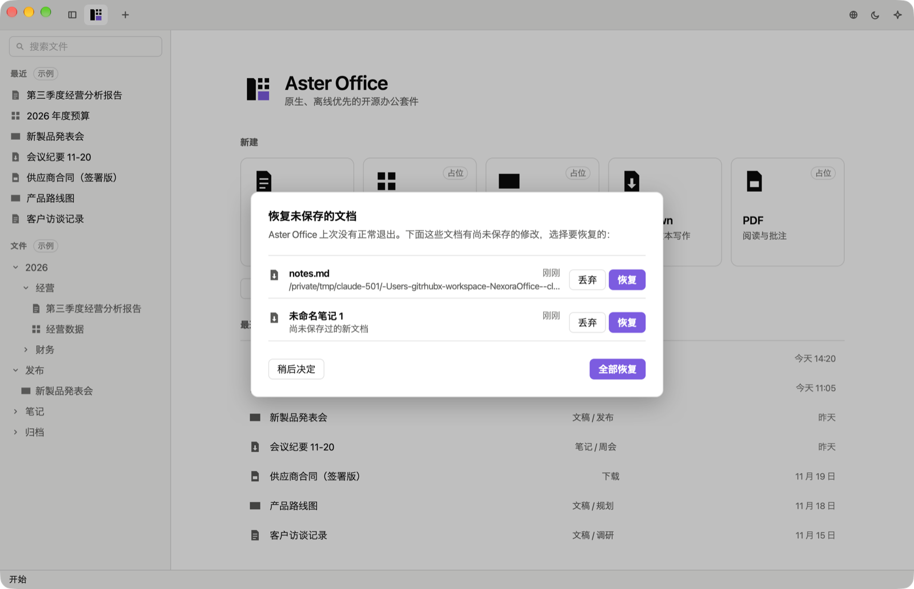

原文件在这期间被别的程序改过，会写在那一行里：


恢复出来的标签带着“有未保存修改”的圆点，记得原来的文件；原文件被改过或不见了，状态栏会说，保存时先问存到哪里，不会悄悄覆盖：


### 怎样做的

- **每个有未保存修改的 Markdown 标签有一条恢复记录**。文档第一次变成“有修改”时，记录以当时的全文开始；之后每个编辑（含撤销和重做）作为“某一段换成了什么”追加进去。保存成功、撤销回已保存的状态、关闭标签（包括选“不保存”）、退出时选“放弃修改并退出”，记录都会删掉。所以下次启动时还在的记录，只能是异常退出留下的。
- **记录放在系统的应用数据目录**，不在用户文档旁边：macOS 是 `~/Library/Application Support/dev.aster.office.preview/recovery`，Windows 是 `%LOCALAPPDATA%\aster-office\recovery`，Linux 是 `$XDG_STATE_HOME/aster-office/recovery`（默认 `~/.local/state/aster-office/recovery`）。设置环境变量 `ASTER_DATA_DIR` 可以换地方。应用标识是占位的，要和 `packaging/common.sh` 一起改。
- **写记录在单独的线程上**，界面线程只把几个字节放进队列，不等磁盘。写线程把攒下的编辑合成一个 SQLite 事务提交，提交了才算确认；每次提交都刷盘，在 macOS 上用 `F_FULLFSYNC`，也就是能扛断电的那种（G6 测得一次 2 到 4 毫秒，所以必须放在后台）。
- **记录的格式**就是 G6 验证过的那套：SQLite WAL 里的命令日志，加一个带校验和的检查点文件。256 条编辑或 256 KB 之后做一次检查点。实现在 `crates/aster-storage`（`journal.rs`、`records.rs`、`writer.rs`），编辑的编码在 `crates/aster-markdown/src/journal.rs`，带版本号。
- **谁的记录**：每条记录有一个锁文件，写它的进程一直锁着。进程不管怎么结束，系统都会释放这把锁；启动时能拿到锁的记录就是没人要的。同时开着的另一个 Aster Office 的记录拿不到锁，不会被列出来。
- **恢复**：在工作线程上扫描、重放、比较原文件，然后才弹出对话框。恢复出来的标签接着写同一条记录，以恢复出的全文作为新的检查点。读不出来的记录照样列出来，只能丢弃或稍后决定，文件不会被自动删除或修复。
- **原文件是否被改过**，按内容判断：记录里存着上次读或写这个文件时的长度和校验和（FNV-1a），恢复时重新读一遍比较。修改时间只用来显示。
- **不会自动写回用户的原文件**。恢复记录已经保证稿子不丢，悄悄改写用户的文件风险太大。

### 检查过什么

**强杀测试**（`crates/aster-storage/tests/kill.rs`，仿照 G6）：测试程序把自己作为子进程启动，子进程扫描恢复目录、接管上一轮留下的记录，然后通过 `RecordWriter` 不停地编辑，写线程每提交一次就在标准输出上报告修订号；父进程在随机时刻杀掉它，再像下次启动那样恢复，检查：至多一条记录、SQLite 完整性检查通过、恢复到的修订号不低于已报告的、恢复出的文本等于从头重算的文本。

| 规模 | 强杀次数 | 丢失已确认的编辑 | 文本不一致 | 杀在启动和接管阶段 | 恢复得比已报告的多 |
| --- | --- | --- | --- | --- | --- |
| `cargo test` 里的默认规模（`scripts/ci.sh` 会跑） | 40 | 0 | 0 | 7 | 17 次，最多 64 个修订 |
| `ASTER_KILL_ROUNDS=1000`，release | 1000 | 0 | 0 | 238 | 225 次，最多 64 个修订 |

“恢复得比已报告的多”是正常的：写线程已经提交、还没来得及打印就被杀了。

**实际运行外壳**，macOS 27.0.1，`.app` 包，真实的鼠标和键盘：

1. 干净启动，没有恢复提示。点开始页的“打开文件…”，在系统的打开面板里选中一个 CRLF 的中文 Markdown 文件。
2. 在末尾用拼音输入“你好世界”，换行，用日文输入法输入“日本語”。Cmd+N 新建一个文档，日文输入“下書き”，换行，拼音输入“草稿”。两个标签都带圆点，恢复目录里有两条记录；原文件没有被写过。
3. `kill -9` 杀掉进程，重新启动：出现恢复对话框，列出两个文档（截图见上）。逐个点“恢复”：两个标签带着圆点回来，未命名文档保留了原来的标题。
4. 保存：未命名文档用系统保存面板存成 `未命名笔记 1.md`，内容逐字节等于 `下書き\n草稿`（新文档是 LF）；`notes.md` 用 Cmd+S 原地保存，逐字节等于原文件加上 `你好世界\r\n日本語`，4 个 CRLF、没有单独的 LF。保存后恢复目录变空。
5. 两个文档都存好以后再 `kill -9`、重启：没有恢复提示。
6. 再打开 `notes.md`，输入“测试”，`kill -9`，然后用 shell 在文件末尾追加一行，模拟别的程序改了它。重启：那一行写着“原文件在此期间被其他程序修改过”。恢复后状态栏提示；按 Cmd+S 弹出保存面板而不是覆盖，取消后文件仍是别的程序写的版本。关闭标签选“不保存”，记录随之删除。
7. 新建文档、输入、`kill -9`、重启，选“稍后决定”：对话框关闭，记录留在磁盘上；正常关闭窗口再启动，同一条记录又被列出来；点“丢弃”，记录删除。
8. 新建文档、输入，点窗口的关闭按钮，出现“有 1 个文档尚未保存”，选“放弃修改并退出”：进程退出，恢复目录为空。

**没有检查的**：

- Windows 和 Linux 完全没有构建、运行过，那里的数据目录、文件锁和刷盘都没有实测。
- 真正的断电。软件模拟不了；刷盘设置按 G6 的建议选的，但没有拔过电源。
- 磁盘写满、恢复目录没有写权限时的提示（`record_failed`）：只有写线程的单元测试，界面上的状态栏提示没有在窗口里看过。
- 读不出来的记录在对话框里的样子：只有单元测试，没有在窗口里造过一条坏记录看。
- 很大的文档：检查点每 256 条编辑复制一次全文，几 MB 的文档会让这一下变慢，没有测。
- 同时开两个 Aster Office：锁的逻辑有单元测试（同一进程里两次打开），两个进程同时跑没有试过。

### 和方案的关系

- 方案“存储与恢复”一节写的是“每个事务先写命令日志再确认，定期写检查点并截断日志，启动时扫描日志、发现未保存的会话就提示恢复”，这里就是这样做的。
- 路线图 Phase 1 写的是“自动保存与恢复”。这里只做了恢复，**没有做“自动保存”**：如果“自动保存”的意思是定时把内容写回用户的原文件，那和这一步“不自动写回原文件”的决定相反，需要你来定。
- “线程模型”一节说存储线程是唯一的 SQLite 写入者。这里的写线程只写恢复记录；元数据、搜索索引都还没有。最近文件后来做了，但不在 SQLite 里，见“文件和文件夹”一节。

## Excel 和 PowerPoint 标签

方案里 Sheets 是 Phase 2、Slides 是 Phase 4（阶段顺序 2026-11-23 定为 Markdown、Sheets、Writer、Slides）。第一步是**只读**地打开真实文件，第二步让它们看起来对。第三步（2026-11-24）让工作簿可以**编辑和保存**：在单元格里输入（含中文、日文输入法）、选区域、复制粘贴、撤销重做、增量重算，保存成 .xlsx 时只改动变了的单元格；开始页的 Sheets 卡片新建一个真的空白工作簿。第四步（2026-11-24）加上工具栏改格式、拖动改行高列宽、插入删除行列、增删和改名工作表。演示文稿从第八步起可以编辑和保存，见“PowerPoint 编辑”一节。

一个工作簿：公式已经由引擎重新算过，状态栏“已计算 60,019 个公式”；A1:F1 是合并单元格；第 13 行的长文字越过右边的空单元格；日期列放不下“2026年6月27日”，按 Excel 的做法显示 `###`；隐藏的工作表不出现在下面的标签里：


3 万行、6 万个公式的工作表。文件里没有存公式结果，打开时先显示公式原文（灰色，下面第二张是德文界面下计算中的样子），后台算完后换成结果（第一张，深色主题）：


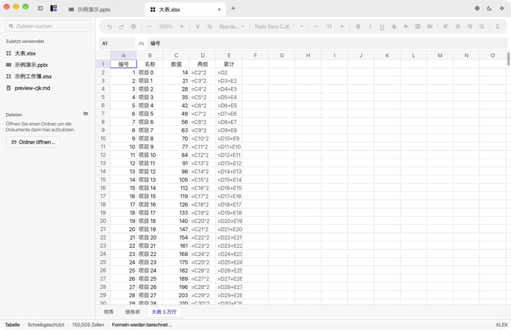

演示文稿：左边是缩略图，右边是当前幻灯片。标题的位置来自版式，字号和对齐来自母版，下面的横线是母版上的形状；第 4 张是放映时跳过的隐藏幻灯片，缩略图上画一条斜线：

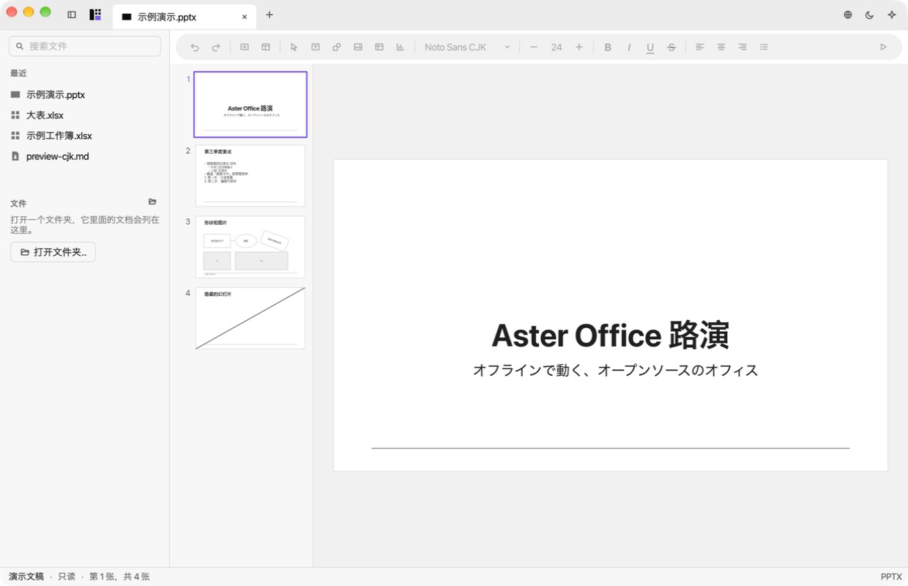

上面四张是第一步的界面截图。第二步（2026-11-24）让真实文件**看起来对**：单元格样式、冻结窗格、图片，幻灯片的背景、主题颜色和字体、填充和线条、图片、表格内容和演讲者备注。下面两张是这一步用 `render_office` 无界面渲染的 G4 样例（不是窗口截图）：表头的填充和白色粗体字、边框、冻结的第一行（下面一条深色线）、日期列不再是 `###`、表上的小图标和图表框；幻灯片里的图片、主题色填充的圆、PowerPoint 默认表格样式（强调色表头、条纹行）：

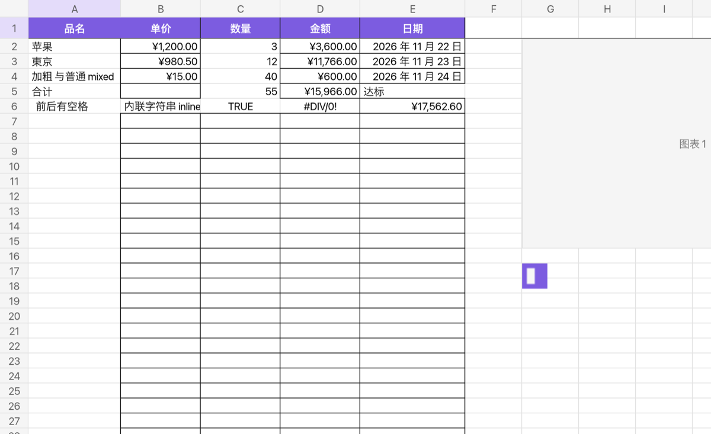
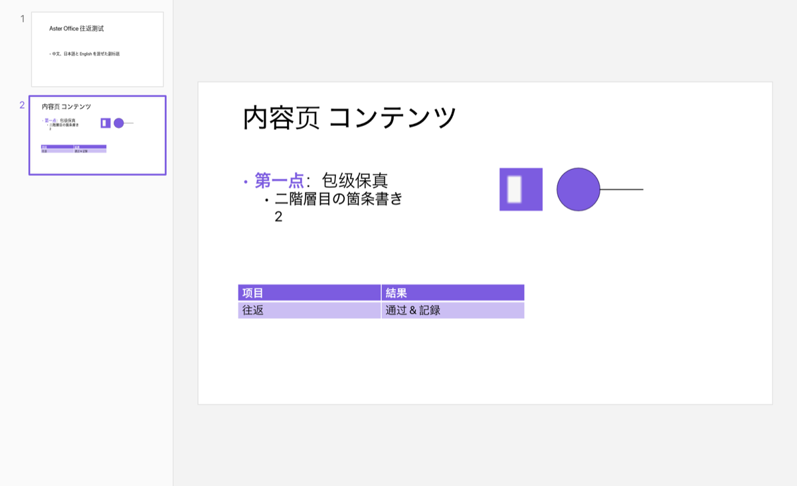

### 能做什么

| 功能 | 说明 |
| --- | --- |
| 打开 | “打开…”（对话框多了“所有支持的文件”“Excel 工作簿”“PowerPoint 演示文稿”三个过滤项）、侧边栏的文件树和最近列表、命令行参数。`.xlsx`、`.xlsm`、`.pptx`、`.pptm`。读和解析在工作线程上，状态栏显示“正在打开…”。同一个文件再打开会切到已有的标签 |
| 打不开时 | 按原因给出八种语言的说明：Office 97–2003 格式或设了打开密码（两者外观相同，都是复合文档）、不是 Office 文件、内容和扩展名不符、超过安全限额、某个部件损坏（说出部件名）。文件不会被改动 |
| 安全限额 | 包里最多 2 万个部件；单个部件解压后最多 1 GiB，全部最多 2 GiB；超过 1 MiB 的部件压缩比不得超过 1000:1；文件本身最多 1 GiB。解压的字节是边读边数的，不信 zip 目录里写的大小。部件用到时才解压。图片在打开时读进内存（压缩着），画到时才解码 |
| 图片 | 工作表上锚定的图片和幻灯片里的图片：PNG 和 JPEG 由新 crate `aster-image` 解码，两种标签共用。图片头里声明超过 1 亿像素的直接拒绝，不分配内存；长边超过 2560 像素的解码后缩小；解码结果有 384 MB 的缓存上限。EMF、WMF、TIFF、SVG 等格式和其他图形画成带名称的灰框；图表画出来，见“Excel 的条件格式和图表”一节 |
| 工作表 | 只画窗口里的部分，100 万行的表也一样。列宽、行高、隐藏行列、合并单元格；文字左对齐、数字右对齐、逻辑值和错误居中，单元格设了水平对齐的按设置；没有自动换行的文字越过旁边的空单元格（左对齐往右，右对齐往左）；数字放不下显示 `###`。列宽按工作簿“常规”样式字体的数字宽度换算：Calibri、Arial、Aptos 是 7 像素，等线、宋体、游ゴシック、ＭＳ Ｐゴシック、맑은 고딕等东亚默认字体是 8 像素 |
| 单元格样式 | 字体（字号、粗体、斜体、下划线、删除线、颜色、字体名）、填充（纯色；图案按两色混合的颜色画，渐变画第一个颜色）、边框（细、中、粗、双线、点线、各种虚线，带颜色）、垂直对齐、自动换行、缩进。主题色加 tint、`indexed` 颜色（包括工作簿自己的调色板）在读文件时算好。整行、整列的格式对文件里没有的单元格也生效；只有填充或边框的空单元格也画出来。文件关掉网格线的表不画网格线。字体按文件写的名字找，系统没有时用系统字体，字号按 0.9 倍画（替代字体比 Calibri、等线宽） |
| 冻结窗格 | 冻结的行和列在滚动时不动，冻结线画一条深色线；点击、键盘移动和“滚到选中单元格”都按冻结区域算 |
| 数字格式 | 常规、小数位、千分位、按千缩放、百分比、科学计数、日期和时间（含 `[h]` 累计时间、上午下午、毫秒）、文字字面量、四段格式、`000-0000` 这类分段数字。按 Excel 的方式舍入（先取 15 位有效数字，再四舍五入，`1.005` 保留两位是 `1.01`）。内置格式 14 和 22 按中日文习惯显示为年在前 |
| 公式 | 打开后在工作线程上用 formualizer 0.15.0 全部重算（ADR 0002），引擎只从我们的模型取输入。算完之前显示文件里存的结果；文件里没存结果的公式先显示公式原文（灰色）。引擎未实现的函数（`#N/IMPL!`）保留文件里的结果。关掉标签会取消还在进行的计算。共享公式按单元格展开，公式栏显示每个单元格自己的公式。定义名称（第五步）：工作簿级和工作表级的名称都交给引擎，指向单元格或区域的按引用，数字和 TRUE/FALSE 按常量，其余按公式（如 `=B2*(1+TaxRate)`）；Excel 自己的 `_xlnm.` 名称（打印区域、筛选范围）和指向别的工作簿的名称不交。插入删除行列、改名删表时，模型里的名称和文件里的一样跟着改，引擎重新载入后照样算得出。6 万个公式的表，发布版从读文件到算完约 0.2 秒 |
| 公式栏和工作表标签 | 公式栏显示选中单元格的地址（合并单元格显示整个区域，选区显示区域）和公式或输入值（日期按日期显示），输入时显示正在输入的内容；点公式栏在原内容上编辑。下方的标签切换工作表，每张表记住自己的选中位置和滚动位置；隐藏的表不列出 |
| 输入 | 选中单元格直接打字是替换；F2、双击或点公式栏是在原内容上改，光标在末尾。回车、Tab 确认并移动（加 Shift 反向；选了区域时在区域里按行或按列走），Esc 取消，Alt+回车在单元格里换行。新输入时方向键确认并移动，在原内容上改时左右键移动光标。Delete、Backspace 清空选区，保留格式。中文和日文输入法按 G1 的做法：从 winit 取输入法事件，组字时在单元格里显示带下划线的预编辑串，候选窗跟着光标 |
| 识别类型 | 数字（千分位、百分号、货币符号 `$ ¥ € £ ₩`、括号负数、科学计数）、TRUE/FALSE、日期和时间、以 `=` 开头的公式，其余是文本；`'` 开头强制为文本。日期按单元格日期格式的年月日顺序读，没有日期格式时按界面语言的习惯（英文月/日/年，法德西日/月/年，中日韩年/月/日），也认 `2026年11月24日`、`9:30 PM`。常规格式的单元格输入日期、时间、百分比、带货币符号的金额或带千分位的数字时，像 Excel 一样自动套上格式（已经有格式的单元格保留原格式）：先找工作簿里已有的、字体填充边框对齐都相同的合适格式；没有就新加一个样式，以单元格原来的样式为底，换成 Excel 的内置格式（日期 14、日期时间 22、时间 20 或带秒的 21、百分比 9 或带小数的 10、千分位 3 或带小数的 4；金额没有内置编号，用工作簿自己的格式，如 `"¥"#,##0`、`"$"#,##0.00`、`#,##0.00"€"`）。保存时这个样式作为一个新的 `<xf>`（复制原 xf 的字体、填充、边框和对齐，只换 `numFmtId`，加 `applyNumberFormat="1"`）追加到 styles.xml 里 `cellXfs` 的末尾并更新计数；金额的格式码若文件里已有就用它的编号，没有就以 164 起、避开已有编号的新编号追加到 `numFmts`（没有 `numFmts` 时插在 `styleSheet` 开头）。相同的样式只加一次。撤销一次输入时，为它新加的样式也一起撤掉，重做时放回原处；已经保存进文件的样式不随撤销去掉，免得以后新加的样式占了文件里同一位置的旧 `<xf>`。**输入新格式时会改 styles.xml，这是用户 2026-11-24 的决定**；styles.xml 的其余字节不动。公式里的函数名和单元格引用转成大写，引号里的文字和带引号的表名不动 |
| 重算 | 每个工作簿标签有自己的计算线程，引擎（formualizer）打开时全部算一次，之后每次输入、清空、粘贴、撤销只把改动的单元格交给引擎，由它的依赖图增量重算受影响的公式（2,000 个链式公式改第一格只算这条链，改最后一格只算它自己）。计算中又有新改动时取消当前计算，连同新改动一起算。结果在界面线程上原地写回，界面不等计算。公式错误照 Excel 显示（`#DIV/0!` 等）；循环引用显示 0，状态栏说出第一个单元格，八种语言 |
| 选区和剪贴板 | Shift+方向键、拖动、点行号列标选整行整列、点左上角全选。复制、剪切把选区按 TSV（制表符分隔，Excel、Numbers 和网页表格互通的格式：显示的文字，含制表符、换行、引号的字段加引号，行尾 CR LF）放进系统剪贴板，整行整列裁到用到的范围。粘贴别处来的文字时逐格按输入识别；粘贴从这里复制的内容时带格式粘回单元格，公式里的相对引用跟着移动（移出表外变 `#REF!`）；剪切再粘贴是移动，公式不变。一个单元格粘到选区上会填满选区。正在输入时复制粘贴作用于输入框里的文字 |
| 撤销和重做 | Cmd+Z、Shift+Cmd+Z 和工具栏的撤销重做（在 Sheets 标签上可用了）；一次输入、清空、粘贴、剪切移动各算一步，撤销后选中改动的单元格，并经引擎重算。全部撤销或回到保存时的状态就不算修改。标签上显示未保存标记，关闭和退出时提示保存，和 Markdown 一样 |
| 保存 | Cmd+S 和“另存为”，在工作线程上用 aster-storage 的原子写入；正在输入的内容先确认。按 ADR 0001：没改动的部件连压缩后的字节一起原样拷贝（关系部件和 `[Content_Types].xml` 也在内）；改动的工作表只重写变了的 `<c>`（新行按顺序插入），其余字节不动；公式只是结果变了时保留原来的 `<f>` 元素，只换 `<v>`；改了共享公式的首格时，同组其他单元格写出各自的公式；新文字追加到 sharedStrings 末尾并更新计数，没有 sharedStrings 部件的工作簿用内联字符串，这样不用新增部件；公式写上算好的缓存值。calcChain：增删了公式时删掉 `calcChain.xml`，并从 `workbook.xml.rels` 和 `[Content_Types].xml` 里按原字节切掉对应元素（Excel 遇到对不上的计算链也是这样丢掉）；只改值时保留。保存期间又改的单元格留到下一次保存 |
| 新建 | 开始页的 Sheets 卡片和新建菜单创建一个空白工作簿（一张 Sheet1），可以输入、保存成 .xlsx，第一次保存时问保存到哪里。常规字体随界面语言（等线、新細明體、游ゴシック、맑은 고딕，其余 Calibri），模板里带 sharedStrings 部件和日期、时间、百分比、千分位格式 |
| 工具栏改格式（第四步） | Sheets 标签的工具栏可用了：粗体、斜体、下划线、删除线（也有 Cmd+B、Cmd+I、Cmd+U），字号加减和字号框（框显示当前字号，点它回到 11），货币、百分比和数字格式下拉框（常规、数字、货币、百分比、日期、时间、文本，框里显示当前单元格的格式；货币随界面语言：中文 `"¥"#,##0.00`、日文 `"¥"#,##0`、韩文 `"₩"#,##0`、法德西 `#,##0.00" €"`，其余 `"$"#,##0.00`），填充色（黄色，再点去掉），边框（四边细线，再点去掉），合并后居中（再点拆开；其他单元格的内容像 Excel 一样清掉），左中右对齐（再点回到常规），自动换行，自动求和（对上方或左方连续的数字写 `=SUM(...)`，旁边没有数字时开始输入 `=SUM(`）。按钮的按下状态跟着当前单元格。作用于整个选区，整行整列也行（20 万格以内的选区逐格设，更大的只改有内容的单元格）；一次操作一步撤销。样式按外观复用：工作簿里已有相同外观的样式就用它。保存时新的字体、填充、边框和 `<xf>` 追加到 styles.xml 各列表末尾并更新计数，新字体复制原字体元素只改变了的子元素，对齐改了才写 `<alignment>` 和 `applyAlignment`；合并区域写回 `<mergeCells>`（没有时按 schema 顺序插入） |
| 行高列宽（第四步） | 在列标的右边线、行号的下边线上鼠标变成左右或上下箭头，拖动改宽度或高度（最小 4 像素），松开时算一步撤销。保存时列宽按“常规”字体的数字宽度换算写进 `<cols>`：覆盖这一列的 `<col>` 拆成三段，各段保留原来的样式等属性，没有 `<cols>` 时插在 `sheetData` 前；行高写成 `ht` 和 `customHeight="1"`，没有这一行时新加一个空的 `<row>` |
| 插入删除行列（第四步） | “编辑”菜单的插入行、插入列、删除行、删除列，作用于选区跨过的行或列。所有工作表里指向它的公式像 Excel 一样跟着移动：插入点及以后的引用（绝对引用也一样）往后挪，区域跨过插入点时变大；删除时区域缩小，单个引用变 `#REF!`（带表名的连表名一起换成 `#REF!`）。合并区域、行高列宽、整行整列格式、图片锚点也跟着移动。插入会把有内容的单元格挤出表外时不插入，状态栏说明。撤销把整个工作簿放回原样；计算线程从移动后的工作簿重新建引擎。保存时在文件原来的 XML 上重放每一次插入删除：行和单元格保留原字节、只换 `r`，删掉的行和单元格去掉；`<dimension>`、选区和冻结位置、`<cols>`、条件格式（范围和公式）、数据验证（范围和公式，整个被删的去掉并更新计数）、超链接、筛选（范围；按列的条件跟着列重新编号，列被删时去掉它的条件；记住的排序范围）、忽略的错误、分页符、绘图部件里的锚点、`workbook.xml` 的定义名称（打印区域、筛选范围、命名区域）都跟着移动；移动过的表里每个公式单元格整个重写（脱离共享公式组），calcChain 删掉。工作表含有还不能跟着移动的内容时拒绝并在状态栏说明是什么：Excel“表”、透视表、引用这张表的图表、单独的排序状态（`<sortState>`）、新式（x14）条件格式和数据验证、迷你图，以及上面列表以外的工作表元素。状态栏用用户看得懂的说法（第五步）：“批注”“Excel 表”“数据透视表”“引用这张表的图表”“带条件的筛选或排序”“新式的条件格式、数据验证或迷你图”“控件或嵌入的对象”，其他的才说出文件里的名字，八种语言。插入的行列照 Excel 的“与上面格式相同”（第五步）：上一行（或左边一列）有格式的单元格，在新行里各给一个带同样格式的空单元格（最多 20 万个），行高或列宽也照它；保存时写进文件。还没保存的插入删除被撤销时，从要在文件上重放的列表里拿掉，而不是再加一个反向的移动：文件里的行保留原字节（样式、隐藏、行高、分级），图片锚点不动。别的表上的条件格式和数据验证的公式指向这张表时，保存时也跟着移动（第五步） |
| 工作表的增删和改名（第四步） | 工作表标签栏右端的 + 加一张空表（排在最后，名字按 Excel 各语言的习惯：Sheet、工作表、Feuil、Tabelle、Hoja 加编号；新建的空白工作簿第一张也这样命名）。双击标签或右键菜单“重命名…”改名，名字按 Excel 的规则检查（不能空、最多 31 个字符、不能有 `: \ / ? * [ ]`、首尾不能是 `'`、不能和别的表重名、不能叫 History），不合格时在对话框里说明。右键菜单“删除”删掉一张表，至少要留一张可见的工作表；含 Excel“表”或透视表的工作表暂不能删。改名后所有公式里的表名跟着改（需要时加引号）；删除后指向它的引用变 `#REF!`。每次都是一步撤销，删除在保存后再撤销，表作为新表整张写回。保存时留下的表的 `<sheet>` 元素保持原字节（改名的只换 `name`），删掉的表去掉部件、关系、内容类型和只属于它的定义名称，新表新增部件、关系和内容类型；定义名称、图表的数据引用、`docProps/app.xml` 里的表名跟着改名，`activeTab` 跟着移动。别的表上条件格式和数据验证的公式也跟着改名，删表后变 `#REF!`；`docProps/app.xml` 的工作表清单按 Excel 的写法（`HeadingPairs` 第一组计数、`TitlesOfParts` 开头的表名）整组重写成现在的表，计数和 `size` 跟着变，写法不同时只改改名的表名（第五步） |
| 格式菜单（第五步） | 菜单栏“格式”的粗体、斜体、删除线在工作簿上也可用，作用于选区，勾选状态跟着当前单元格；另加“下划线”（Cmd+U，只在工作簿上）。Cmd+B、Cmd+I、Cmd+U 在工作簿上走菜单，和 Markdown 一样 |
| 查找和替换（第六步） | 查找栏（Cmd+F、Cmd+Alt+F、Cmd+G、Shift+Cmd+G、Cmd+E）在工作簿上照 Excel 的默认做法：在当前工作表里按行找，找的是公式栏显示的内容（输入的值，公式连 `=`），区分大小写、全字匹配、正则表达式和 Markdown 一样。输入时选中当前单元格之后的第一个，上一个下一个在表里循环，查找栏显示“3 / 12”。替换把当前单元格里的匹配都换掉、再到下一个；全部替换把所有匹配的单元格各按输入重新识别，算一步撤销，状态栏说替换了几个。查找栏打开时公式栏和表格往下让 |
| 隐藏和取消隐藏（第六步） | “编辑”菜单的隐藏行、隐藏列、取消隐藏行、取消隐藏列，作用于选区跨过的行列；选区里没有隐藏的，取消隐藏时显示紧挨在选区前面的那一段隐藏的（像在 Excel 里选中两边）。显示出来的用默认尺寸。一步撤销。保存时 `<col>` 和 `<row>` 写 `hidden="1"`，保留原来的宽度和高度（没有宽度的列写 Excel 的默认宽度），取消隐藏时去掉 |
| 填充色和字色（第六步） | 填充色按钮不再只是黄色开关，另加字色按钮（A 下面一条色带）。点开是色板：“无填充”（字色是“自动”），再是仿 Excel 色板的 16 种颜色（浅色适合填充，下面一行是标准色）；按钮下的色带和色板里加框的色块是当前单元格的颜色。每次选色一步撤销。保存新字体时照旧复制原字体，只有颜色变了才写 `<color>`，只加粗的字体保留文件里原来的主题色 |
| 整行整列的格式（第六步） | 选整行或整列（行号、列标，或全选）设格式时，给这些行列自己的格式（Excel 也这样存），并改掉里面已有的单元格，不再给一整行的每一格造一个带格式的空单元格。撤销放回行列原来的格式。插入的行列也继承旁边行列自己的格式。保存时行的格式写成 `<row>` 的 `s` 加 `customFormat="1"`（去掉时两个都去掉），列的格式写成 `<col>` 的 `style`（从原来覆盖它的 `<col>` 里拆出来，没有就新加一个，带上列宽） |
| 工作簿的崩溃恢复（第七步） | 和 Markdown 一样，有未保存修改的工作簿写进恢复记录：内容是“现在保存会写出的文件”（在上次读入或保存的文件上照常保存），在写记录的线程上生成，同一个工作簿最多每两秒写一次，另有每两秒一次的计时器补写一连串修改里的最后一次。记录里有标题、文件路径和文件当时的指纹。保存、关闭或选择不保存退出时记录删除。程序异常退出后，恢复问题里也列出工作簿；恢复后在自己的标签里打开，带未保存标记，保存到原来的文件，并重新计算；记录继续写 |
| 填充柄（第七步） | 选区右下角的小方块，鼠标移上去变成十字。往下、上、右、左拖动时画出将要填充的范围，松开后按列（横着拖按行）照选区填：两个以上的数字按平均步长成序列，一个日期按天递增，结尾是数字的文字（`Item 08`、`Q1`）递增并保留前导零，其他内容循环重复，公式像粘贴一样移动相对引用；格式一起带过去。一步撤销，填完选中整个范围 |
| 拖动工作表标签排序（第七步） | 按住标签拖过一小段就开始拖动，落点处显示一条强调色竖线，松开后工作表移到那里；一步撤销。待保存的改动、在文件里的位置和只属于它的定义名称跟着走，保存时按新顺序写 `<sheets>` |
| 冻结窗格（第八步） | 新的“视图”菜单：冻结窗格（冻结当前单元格上面的行和左边的列，和 Excel 一样）、冻结首行、冻结首列、取消冻结窗格；一步撤销。保存时第一个 `<sheetView>` 换成新的 `<pane state="frozen">` 和一个在滚动区域里的 `<selection>`，其余子元素保留；取消冻结时去掉；没有 `<sheetViews>` 的表按 schema 顺序加一个。新加的表也写 |
| 排序（第八步） | 新的“数据”菜单和工具栏的排序框：升序、降序。选中一个单元格时排它周围的数据块（Excel 的“当前区域”），第一行全是文字、而排序列下一行不是文字时当作标题行不动；选中多个单元格时排选区，整列只排到有数据的地方。按当前单元格所在的列排：数字（日期也是数字）在前，然后是文字（不分大小写）、TRUE 和 FALSE、错误值，空单元格不论升降都在最后；相同的行保持原来的顺序。公式跟着行走，相对引用像粘贴一样移动。范围里有合并单元格时不排，状态栏说明。一步撤销，排完选中排过的行 |
| 筛选（第八步） | “数据”菜单的“筛选”（打勾表示这张表有筛选）：选中一个单元格时给它周围的数据块加筛选，选中多个单元格时给选区加；没有数据时状态栏说明。再点一次去掉筛选，筛选藏起来的行都回来。标题行每个单元格右边画一个下拉按钮，筛选了的列按钮变色、箭头上多一横。点按钮打开列表：升序、降序（只排筛选显示的行，藏起来的行留在原处）、全选（部分选中时显示一横）、这一列出现的每个值（按显示的样子，即格式化后的文字）和“（空白）”，确定、取消。确定后不在选中值里的行藏起来，藏之前的行高记住，筛选放宽时按原来的行高回来；手工隐藏的行不受筛选影响。一步撤销。保存时写 `<autoFilter>`：按值的筛选写 `<filters>`（空白写 `blank="1"`）；文件里本来按别的方式筛选的列（自定义条件、前十项、颜色、日期分组）这里不提供，原样保留并按新的左边重新编号；藏起来的行写 `hidden="1"`。打开文件时读这些，筛选范围里隐藏的行算筛选藏的 |
| 批注（第八步） | “编辑”菜单的“插入批注…”（单元格已有批注时变成“编辑批注…”）和“删除批注”，在对话框里输入多行文字（Cmd+回车确定），一步撤销。有批注的单元格右上角画红色小三角（合并区域画在区域的右上角）；鼠标停在这个单元格上，或它是选中的单元格时，旁边显示批注的文字。读文件时读 `commentsN.xml`（作者和文字）和会话式批注 `threadedComments`（连回复，一个回复一行）；会话式批注只读：菜单拒绝修改，排序遇到它拒绝，状态栏说明。保存时只重写批注改过的工作表的 `comments` 部件：文件里没动过的批注保留原字节（作者加粗的那行、字体），新批注写成一个 run；VML 里被删的批注的框去掉、新批注得到 Excel 默认大小的框，其余形状保留原字节；原来没有批注的工作表新增 `comments`、`vmlDrawing`、关系、内容类型和 `<legacyDrawing>`；会话式批注的部件和人员列表原样不动。批注跟着排序、插入删除行列移动（文件里的批注和框也一起移）。工作表带批注不再拦住插入删除行列 |
| 数据验证下拉列表（第八步） | 读 `type="list"` 的数据验证：列表写在规则里（`"是,否"`）、指向单元格区域（可带表名）或定义名称的都认，别的公式（如 `INDIRECT`）不认。选中的单元格在规则范围内且文件没把箭头关掉（`showDropDown`）时，右边画一个箭头；点它或按 Alt+向下键，在单元格下面打开列表，点一个值就像输入一样写进单元格，一步撤销。规则的“显示错误信息”打开、警告方式是“停止”时，输入不在列表里的值再按回车、Tab、方向键或点别的单元格，不接受，状态栏说明（规则里有自己的错误信息就用它），输入框保持打开，改对后再回车，或按 Esc 放弃；输入的值和列表比较：规则里直接写的列表区分大小写，指向区域的不区分，和 Excel 一样；空输入总是允许。警告和信息两种方式这里不弹问题，直接保留输入并在状态栏说明。粘贴和填充不检查（Excel 也不检查）。规则跟着插入删除行列移动，范围全被删时规则去掉，指向的区域也跟着改。保存仍在文件原来的 XML 上进行，所有种类的规则都原样保留 |
| 复制工作表（第八步） | 工作表标签的右键菜单“移动或复制…”：选“下列选定工作表之前”的位置（或“移至最后”），勾“建立副本”则复制，不勾就是移动（和拖动标签一样）；副本叫“原名 (2)”（编号往上找没被占用的，名字超过 31 个字符时截短原名）。副本带着单元格、格式、合并区域、行高列宽、整行整列格式、冻结窗格、筛选、批注和下拉列表规则；副本里写着原表名的公式（`原名!A1`）改指副本自己的单元格，别的表里指向原表的公式不变；图片、图表、条件格式、只属于原表的定义名称、超链接、打印设置不复制。一步撤销；保存时副本作为新工作表整张写出（包括批注部件和下拉列表规则）。只在不是文件原有的新工作表上写，原有工作表的保存方式不变 |
| 键盘 | 方向键、Tab、回车（加 Shift 反向）、Page Up/Down、Home/End、Cmd/Ctrl 加方向键跳到数据块边缘、Cmd/Ctrl+Home/End 到 A1 和最后一个单元格，加 Shift 时扩展选区。跳过隐藏行列，从合并区域出来时从它的远端算起 |
| 鼠标 | 点单元格选中，Shift+点击扩展选区，拖动选区域，双击编辑；点行号、列标选整行、整列，点左上角全选；滚轮上下左右滚动 |
| 幻灯片 | 按演示文稿里的顺序列出。文字框的文字（字号、粗体、斜体、下划线、删除线、颜色、字体、对齐、级别、项目符号和自动编号、段内换行、自动缩小字号、上中下对齐）、矩形、圆角矩形、椭圆和线、旋转和翻转、组合形状。母版和版式上的非占位形状画在幻灯片自己的形状下面（`showMasterSp` 关掉时不画）；占位符的位置、字号、项目符号、文字边距、填充和线条从版式和母版继承 |
| 颜色和字体 | 母版的主题和配色映射（版式、幻灯片可以改写映射）：背景（纯色、渐变、图片、主题背景样式），形状的填充和线条（自己的，或形状样式引用的主题填充和线条），文字颜色（包括形状样式和表格样式给的文字颜色）。颜色修饰 `lumMod`、`lumOff`、`tint`、`shade`、`satMod`、`alpha` 等都算。主题字体 `+mj-lt`、`+mn-ea` 等按文字的语言选日文、简体、繁体、韩文的字体。幻灯片按自己的颜色画，不跟随界面的深浅色 |
| 图片和表格 | 图片按文件里的裁剪画。表格画单元格的文字、填充、边框、横向和纵向合并、单元格边距和对齐，行高按文字撑开。表格样式来自 `tableStyles.xml`；PowerPoint 默认的“中度样式 2 - 强调 1”文件里通常不写，内置了一份。标题行、汇总行、首列、末列、条纹行列按表格的开关 |
| 演讲者备注 | 幻灯片下方的面板，只读，显示当前幻灯片的备注；点标题栏或箭头收起、展开；没有备注时说明“这张幻灯片没有备注”。八种语言 |
| 幻灯片的操作 | 点缩略图切换；上下左右、Page Up/Down、空格、回车翻页，Home/End 到第一张和最后一张；在幻灯片上滚动滚轮翻页，在缩略图上滚动滚轮滚动缩略图。窗口窄于 560 像素时不显示缩略图 |
| 状态栏 | 工作表的单元格数、计算进度和结果、循环引用；演示文稿只读，“第 n 张，共 m 张”，隐藏的幻灯片加注“隐藏” |

### 不在这一步里的

任意颜色（色板以外的颜色）、字体选择、边框样式的选择（只有四边细线）、格式刷、按住 Ctrl 拖填充柄（Excel 用来在复制和序列之间切换）、Excel“表”（ListObject）的样式和扩展、在合并区域里输入时的特殊处理、单元格里的富文本（一个单元格里几种字体）、条件格式和图表的编辑（只显示，见“Excel 的条件格式和图表”一节）、会话式批注的编辑、拆分窗格（只做了冻结）、筛选列表的搜索框和按条件筛选（数字大于、文字包含、前十项、颜色）、数据验证里除下拉列表以外的种类（整数、日期、自定义公式等只保留，不检查，也不能在程序里新建或改规则）、超链接、打印（只有打印区域，不能真的打印；页面设置、分页符、页眉页脚还没有）、单元格的旋转和竖排文字、对角线边框；幻灯片的图表、SmartArt、效果（阴影、发光、三维）、图片的重新着色和透明度、径向和路径渐变（按线性画）、图案填充（按前景色画）、虚线（按实线画）、箭头、自定义几何（按外框画）、动画、备注里的格式；Word（.docx）、PDF、旧版的 .xls/.ppt，以及 ODF。工具栏上除了 Sheets 标签的撤销重做和格式按钮，仍然是置灰的设计稿。

### 新 crate 和依赖

| crate | 作用 | 新依赖（许可证） |
| --- | --- | --- |
| `aster-ooxml` | 包层和两个读取器，`FormatCodec` 接口 | `zip` 8.6（MIT，只开解压，后端 zlib-rs 是 Zlib）、`quick-xml` 0.42（MIT），和 G4 关卡用的是同一对 |
| `aster-sheets` | 工作簿模型、数字格式、`CalcEngine` 接口 | 无 |
| `aster-calc` | formualizer 适配器 | `formualizer` =0.15.0（MIT OR Apache-2.0），带进约 140 个 crate，主要是 Apache Arrow；其中 `tiny-keccak` 只有 CC0-1.0，已按 2026-11-23 的决定加进 `deny.toml` |
| `aster-slides` | 演示文稿模型 | 无 |
| `aster-image`（第二步） | PNG、JPEG 解码，像素数上限和缩小 | `png` 0.18（MIT OR Apache-2.0）、`zune-jpeg` 0.5（MIT OR Apache-2.0 OR Zlib）。两者原来就经 Slint 在依赖树里，`Cargo.lock` 没有多出新的第三方 crate；`packaging/licenses.py --check` 通过（557 个第三方包，许可证都在允许列表里）。本机没有装 `cargo-deny`，没有跑 |

第二步新加的 `aster-ooxml::drawingml` 是工作簿和演示文稿共用的 DrawingML 部分：主题（配色、字体、填充和线条样式）、颜色和修饰、填充、线条。

方案的 crate 表把“CalcEngine 及其 Adapter”放在 `aster-sheets` 里；ADR 0002 要求引擎放在单独的适配器 crate、核心 crate 不直接依赖它，这里按 ADR 放在了 `aster-calc`。方案里 DrawingML 形状属于 Phase 4 的 `aster-drawing`，现在形状的几何暂时放在 `aster-slides`，到时候移过去。`aster-model`、`aster-render` 还不存在，两个视图直接用 `aster-text` 排版、vello_cpu 绘制，和 Markdown 预览一样。

### 检查过什么

在 macOS 27.0.1（Apple Silicon，2 倍缩放）上，用 `.app` 包带着测试文件启动，截图确认：

- 工作簿：数字格式（千分位、百分比、年月日、`h:mm:ss`）、合并的标题行、长文字越格、数字放不下时的 `###`、隐藏工作表不出现在标签里；VLOOKUP（引用名字是日文的工作表）、INDEX/MATCH、CONCAT、`#DIV/0!` 都由引擎算出了正确结果。
- 3 万行、6 万个链式公式的表：先显示公式原文，算完后累计列全部正确。深色主题，德文界面下的状态栏文字。
- 演示文稿：标题从版式继承位置、从母版继承字号和对齐，副标题居中，母版上的横线；第二张的项目符号、二级项目符号和自动编号；第三张的矩形、椭圆、旋转的圆角矩形、连接线、图片框和图表框（名称随界面语言）、斜体小字；隐藏的第四张。日文和简体中文界面。

上面截图里的文件是用 Python 标准库的 zipfile 手写拼出来的。另外用两份 Microsoft Office 存的真实文件试过（Excel 16 存的 JPX 上市公司一览，日文，1 张表；PowerPoint 存的 16 张中日文路演稿），用 `cargo run -p aster-surface --example render_office -- 文件 输出目录` 把每张表的首屏和每张幻灯片渲染成 PNG，看过：表的列宽、日文、数字和文字混排都对；幻灯片的标题、正文、版式继承来的页脚和页码、圆角卡片、项目列表都对，表格只有框（已知限制）。这样发现并修了一处：行首的小图标也印上了“图片”二字，溢出到正文上，现在放不下名称的框只画框。这两份文件不在仓库里。

**和文件里缓存的结果对不上的地方**：`Workbook::mismatches` 列出算出的结果和文件里保存的结果不同的公式（数字按 15 位有效数字比较）。`cargo run --release -p aster-calc --example time_xlsx -- 文件.xlsx [表名!A1 ...]` 打印读文件、载入引擎、计算各花多久，列出对不上的单元格，并打印指定单元格算出的值。用 G5 关卡的三个工作簿（`spikes/g5-formula` 里 `cargo run --release --no-default-features -- write 目录` 写出，缓存值故意写成 0 和 `?`）试过：每个工作簿 10 万个公式全部报为不一致，G5 列出的 11 个期望值（如 `Orders!F2 = 小`、`Ledger!A100001 = 101834.25`）全部逐位相同；每个工作簿从读文件到算完 0.2 到 0.3 秒（发布模式）。外壳里还不显示这个对比。

自动化测试覆盖的（`cargo test --workspace`）：地址、列名、行高列宽的二分查找（100 万行都设了行高）、共享公式的引用平移（字符串、带引号的表名、结构化引用、函数名不动，移出表外变 `#REF!`）、数字格式的每一类和 20 多个奇怪的格式码不崩溃、1900 年的闰年错误和 1904 日期系统；XLSX：中日文共享字符串（富文本拼接、注音假名去掉、`_x000D_` 转义）、各种单元格类型、没有缓存值的公式、共享公式、没有地址的行和单元格、合并单元格、列宽行高、空的工作表和没有 `sheetData` 的工作表、40 万个单元格的表（含 XFD1048576）、不是 zip、旧格式、不是 Office 的 zip、把演示文稿当工作簿打开、XML 不合法、压缩比超限和单个部件超限；PPTX：版式和母版的继承（按 idx 和按类型匹配）、母版文字样式、列表样式的层级、自动编号、组合形状的嵌套变换、AlternateContent、隐藏幻灯片、`showMasterSp`、没有幻灯片的演示文稿、300 张幻灯片里有 30 张部件缺失；计算：中日文文字函数、跨表 VLOOKUP、日期转序列号（两种日期系统）、修改后重算、取消、空工作簿、2 万个链式公式、远角单元格；两个视图的绘制、键盘移动（隐藏列、合并区域、跳到数据边缘）、点击命中、每张表记住位置、翻页和缩略图滚动、空演示文稿和极小窗口。

**第二步检查过什么**：单元测试覆盖主题读取和配色映射、颜色修饰（和 Office 的“强调 1 浅 40%、深 50%”逐位相同）、Excel 的 tint（“浅 80%”“深 25%”）、`indexed` 调色板和工作簿自己的调色板、字体填充边框对齐的读取、整行整列格式、空单元格的填充、冻结窗格、关掉网格线、数字宽度换算、图片锚点（两格、一格、绝对，`AlternateContent` 里的图表）；PPTX 的背景（自己的、主题背景样式、渐变）、配色映射的改写、形状自己的和样式引用的填充线条、文字颜色的优先次序、主题字体按语言选、图片裁剪、默认表格样式的表头条纹和边框、单元格自己的格式、合并、备注；PNG 的各种颜色类型、JPEG、截断的文件、声明 2 万×2 万像素的文件头、缩小时透明像素不变暗；两个视图按像素检查填充、边框粗细、图片、冻结区域滚动时不动、点击命中冻结区域、渐变背景两端的颜色、解不了的图片画灰框。用 `render_office` 无界面渲染了 G4 的工作簿和演示文稿，和第一步用过的两份 Office 真实文件（只复制到临时目录，不进仓库）：JPX 的表正常；16 张的路演稿深色背景、圆角卡片、图标、主题色文字、表格都画出来了，16 张渲染共 0.25 秒（发布模式）。

**第三步（编辑和保存）检查过什么**：单元测试覆盖输入识别的每一类（数字、百分比、货币、千分位、括号负数、日期的三种顺序和中文日期、时间和上午下午、日期加时间、不存在的日期是文本、公式大写化不动引号里的内容）、单元格放入取出和撤销、格式的选用、单元格编辑器的光标和输入法组字、选区（Shift、拖动、行列表头、全选、回车在区域里走）、编辑框的绘制和候选窗位置、TSV 的读写和引号、粘贴时公式移动、剪切移动、填满选区、撤销重做和“已修改”状态、计算线程（增量结果、批次合并、循环引用、撤销经过引擎）、保存（不改动时所有部件逐字节相同、改值只动那个单元格和受影响公式的 `<v>`、新文字和新行和新公式、calcChain 连同关系和内容类型一起删、改共享公式首格、无 sharedStrings 时写内联字符串、清空保留格式、带前缀的元素和 BOM、空白模板），以及外壳层的“打开、输入、保存、再打开”往返和保存期间继续输入。

用 G4 比较工具新加的 `cargo run --release --no-default-features -- diff 之前.xlsx 之后.xlsx`（在 `spikes/g4-ooxml` 里）和新的示例 `cargo run --release -p aster-ooxml --example edit_cell -- 输入.xlsx 输出.xlsx 单元格 内容`（打开、按输入改一个单元格、保存）逐部件比较：G4 的工作簿改数值后 20 个部件里 19 个逐字节相同，只有 sheet1.xml 里那个 `<v>` 变了；在常规单元格里输入日期后 18 个相同，只有那张表和 styles.xml 不同（`cellXfs` 末尾多一个 `<xf>`、计数 5 变 6；输入的若是新文字，sharedStrings 也会不同），JPX 的真实文件同样只多一个 `<xf>`；输入 `¥1,200` 时 styles.xml 的 `numFmts` 另多一条 `"¥"#,##0`；输入新文字后多了一个 `<c>`、一行和 sharedStrings 里一个 `<si>`（计数加一），其余 18 个相同；输入新公式后另外删了 calcChain.xml，`[Content_Types].xml` 和 `workbook.xml.rels` 各少一个元素，其余 16 个相同。G5 的三个工作簿（2 万到 6 万个公式）和 JPX 的真实 Excel 文件（只复制在临时目录）改一个单元格后，同样只有那张表和 sharedStrings 不同。上一轮用的另一份真实文件是演示文稿，不在这一轮的范围里。保存出来的文件用 macOS 的快速查看（`qlmanage -t`）都能读出并画出缩略图，改过的单元格显示新值。

**第四步（格式、行高列宽、行列、工作表）检查过什么**：单元测试覆盖工具栏的每个格式命令和按下状态、样式按外观复用、整列选区、合并后居中和拆开、自动求和的两个方向、货币格式随语言；拖动边线改尺寸（只在边线附近命中、按住时跟着走、最小宽度、一步撤销）；行列插入删除时公式的调整（相对和绝对、区域变大缩小、整行整列、带引号的表名、别的表的公式、字符串里不动、`#REF!`）、轴上的行高列宽、合并区域、图片锚点；工作表名字的检查、改名时公式加引号、删除后 `#REF!`、外部工作簿的同名引用不动；保存的往返：两张表、条件格式、两条数据验证、分页符、两个定义名称的工作簿删一行、插两列再删回，逐元素比对写出的 XML，再读回和模型逐格相同；改名只改 workbook.xml 和引用它的那张表；删一张加一张时部件、关系、内容类型、定义名称都对；外壳层“插入、撤销、重做、删除列、撤销、保存、再打开”和“加表、改名、撤销重做、保存、删表、保存、撤销、再保存、再打开”的往返，以及插入行后计算线程从新位置算。

新的示例 `cargo run --release -p aster-ooxml --example change_sheets -- 输入.xlsx 输出.xlsx insert-rows 0 3 2 delete-columns 0 2 1 rename 0 新名字 add 表名 delete 2`（表从 0 数，行列从 1 数）照编辑器的做法插入删除行列、增删改名工作表并保存，再读回和编辑后的模型逐格比较。用它试了 JPX 的真实 Excel 文件（只复制在临时目录；在第 3 行上面插 2 行、删 B 列；以及改名加表）和 G5 的三个工作簿（插行、插列、加表、改名）：读回都逐格相同；JPX 的筛选范围 `$A$1:$J$4452` 变成 `$A$1:$I$4454`，`<dimension>` 从 `A1:J4445` 变成 `A1:I4447`；改名加表时 14 个部件里 10 个逐字节相同，变的是 workbook.xml、它的关系、内容类型和 app.xml，另外多出新表的部件；G5 查找表里 `VLOOKUP(A2,Prices!$A$2:$B$1001,2,FALSE)` 变成 `VLOOKUP(A2,'改名 1'!$B$5:$C$1004,2,FALSE)`，用 `time_xlsx` 重算，改前改后的结果相同（如 `Orders!C2 = 49.25`、`Orders!D2 = 2314.75`）。保存出来的文件用快速查看都能画出缩略图，插入的空行和删掉的列都在该在的位置。这样发现并放开了一处：JPX 的表带着 Excel 的“自定义属性”（`customProperty` 关系），里面不引用单元格，原来被当成不能移动的内容拒绝了。

**第四步在窗口里试过的**（2026-11-24，发布版 `.app`，JPX 真实文件的临时副本，简体中文界面；表标签、右键菜单、改名、拖动、Cmd 快捷键用真实的鼠标和键盘，其余用后台点击和菜单）：粗体按钮、货币按钮（显示 `¥100.00`，格式框变成“货币”）、Cmd+B；“编辑”菜单的插入行、插入列、删除行和撤销；标签栏的 + 加表；双击标签改名，名字带 `/` 时对话框里说明，改名后另一张表的 `=Sheet1!E2*2` 变成 `='上場 一覧'!E2*2`，值还是 100；右键菜单删除和 Cmd+Z 放回；拖动列标边线加宽；Cmd+S 保存后读回文件。这样发现并修了三处：双击**没在前面的**标签时，第一下切换了工作表、标签栏整个重建，第二下落在新标签上，改名对话框不出来（现在名字不变就不重建标签栏）；Cmd+B/I/U 改了格式但工具栏按钮的按下状态不跟着变（现在和点按钮一样刷新）；新加的表拖过列宽再保存，`<cols>` 和改写的空 `<sheetData/>` 在同一位置，保存报“overlapping changes”失败（现在同一位置先插入、后替换，加了回归测试）。另外把标签的右键菜单从栏的左端挪到点击的位置。修后重新在窗口里试过这三处和菜单位置。

**第七步（弹出列表、工作簿恢复、填充柄、标签排序、隐藏尺寸）检查过什么**：单元测试覆盖填充的每种规则（两个数的序列、往上拖倒数、一个数复制、一个日期按天、带编号的文字和前导零、公式移动引用、混合内容循环、往上从末尾循环）、填充柄拖动结束后一步撤销并选中整个范围；工作簿恢复记录的读写往返（种类、标题、路径），外壳层“输入、两秒内的第二次修改不写、过后补写、模拟崩溃后找到记录、恢复成带未保存标记的标签、值都在、关闭后记录删除”；移动工作表后未保存的输入跟着走、保存后顺序和值都对、撤销回到原处；隐藏的列取消隐藏回到 150 像素，保存再打开后也是。窗口里（发布版 `.app`，后台点击和菜单）：上一步发现的“查找框有焦点时工具栏列表点了没用”复现后修好（打开列表前把键盘交还给表格），同样的步骤下 A3 填成黄色；**被强制结束的测试窗口留下的工作簿记录，下次启动时出现在恢复问题里，恢复后 A3 仍是黄色、带未保存标记、重新算了 10 个公式**；之后用恢复问题的“丢弃”删掉了这条测试记录。没有在窗口里试过：填充柄和拖动标签（后台注入的拖动送不到程序里，连拖动选区都不行；没人批准全屏控制）、取消隐藏后的尺寸。

**第六步（查找替换、隐藏、颜色、整行整列格式）检查过什么**：单元测试覆盖查找按行的顺序、从当前单元格往后、上一个下一个循环、公式按 `=` 后的文字找、坏的正则表达式、替换一个后到下一个、全部替换一步撤销；隐藏列和两行、已经隐藏的不再隐藏、保存后 `<col … hidden="1"/>` 和 `<row r="4" hidden="1"/>`、读回仍隐藏、选中后一列取消隐藏前面那列、撤销、选中跨过隐藏行时取消隐藏；字色只在变了的字体里写 `<color>`，加粗的字体保留原来的颜色；整行加粗只给行格式、不造单元格，撤销重做，整列填充，在加粗的行下面插入的行继承行格式，保存后 `<row s customFormat>` 和 `<col style>` 读回后格式都在。窗口里（发布版 `.app`，G4 工作簿的临时副本，后台点击和菜单）：查找栏打开在公式栏上面，输入“京”选中 A3、显示“1 / 1”；填充色的色板（“无填充”和 16 种颜色）选黄色后单元格变黄；“编辑 › 隐藏列”藏起了 A 列。**发现的问题**：查找栏的输入框有键盘焦点时，点工具栏弹出的列表（色板、数字格式）不起作用，列表关掉了但选择没有送到程序；原有的数字格式列表也是这样。第七步修了（见上）。没有在窗口里试过：替换和全部替换、取消隐藏、字色、整行整列的格式。

**第五步（定义名称、拒绝说明、格式菜单、插入继承格式、撤销不动文件、别的表的规则、app.xml）检查过什么**：单元测试覆盖引擎里的区域名、常量名、公式名和只属于一张表的名称（`ROUND(B2*(1+TaxRate),2)` 得 220，另一张表看不到别的表的局部名称），读文件时只读给公式用的名称，名称随插入行、改名、删表变化；插入的行和列继承格式和尺寸，第一行前面插入时什么都不继承；外壳层的“删一行、撤销、保存”后工作表的 XML 和删之前逐字节相同，在加粗的行下面插入一行后保存的文件里新行的单元格带同样的样式和行高；别的表的条件格式随插入行、改名、删表变化，`app.xml` 的表名清单随改名和加删表变化；拒绝原因的说法。窗口里（发布版 `.app`，G4 工作簿的临时副本）：汇总表的“含税合计”`=B2*(1+TaxRate)` 显示 17562.6，不再是 `#NAME?`；在汇总表第 1 行上面插入一行后仍是 17562.6（名称跟着移到了 `$B$2`）；在有批注的“销售”表上插入行，状态栏写“这张工作表含有还不能随行列移动的内容（批注），暂时不能插入或删除行列”；“格式”菜单在工作簿上有粗体、斜体、下划线、删除线可用，真实键盘的 Cmd+B、Cmd+U 经菜单作用到选中的单元格，工具栏的 B、U 跟着按下。没有在窗口里试过：菜单项的勾选状态、插入行继承格式的样子、别的表的条件格式。

**第四步没有检查的**：字号框、数字格式下拉框、填充、边框、合并、对齐、换行、自动求和的按钮，行高的拖动和鼠标形状，状态栏的拒绝说明，没有在窗口里试过（逻辑在单元测试里）；中文和日文输入法下改名没有试过。**本机没有 Excel，Numbers 也没有打开过**保存的文件（上一轮卡在自动化权限），Excel 能否打开插入删除过行列、增删过工作表的文件，会不会提示修复，待用户验证。删掉的工作表用过的绘图、批注等部件留在包里没有引用（Excel 不在意多余的部件，没有验证）。

**第三步没有检查的**：**Numbers 没有打开过保存的文件**：用 AppleScript 让 Numbers 打开时卡在等待自动化权限，90 秒后停掉了，没有重试。**本机没有 Excel**，Excel 能否打开、会不会提示修复，待用户验证。**编辑、选区、剪贴板、撤销、保存都没有在运行的程序窗口里试过，也没有用真实的鼠标和键盘和输入法试过**：这一轮没有申请窗口控制，界面代码只编译通过，逻辑都在单元测试里。要在窗口里补测：打字、F2、双击、点公式栏、中文和日文输入法上屏和候选窗位置、回车 Tab 方向键 Esc、拖动选区和点表头、复制粘贴到 Numbers 和从 Numbers 粘回来、撤销重做、Cmd+S、另存为对话框、关闭时的保存提示、开始页的 Sheets 卡片。

**第二步没有检查的**：**演讲者备注面板、冻结窗格、样式和图片都没有在运行的程序窗口里看过**，也没有用真实的鼠标和键盘试过：这一轮申请控制测试程序窗口没有被批准，界面代码只编译通过。备注面板的收起展开和滚动、冻结窗格下的点击和滚轮，都要在窗口里补测。有图表、条件格式、复杂表格样式的 Office 文件没有试过。

**没有检查的**（第一步）：

- **没有用真实的鼠标和键盘试过，界面上的点击和按键也没有在运行的程序里验证。** 这一轮后台注入的点击和按键完全没有送到窗口（连纯 Slint 的标签栏和工作表标签都没反应），申请全屏控制时没有人在电脑前确认。点单元格、方向键、切换工作表、点缩略图、滚轮、复制，都只有单元测试。上面的截图都是启动时就显示的画面（用 `activeTab` 让工作簿打开在第三张表上）。
- Office 存的真实文件只试了两份，而且是用无界面渲染看的，没有在窗口里打开；WPS、Numbers、LibreOffice 存的文件没有试过。
- 文件树和最近列表里点 .xlsx/.pptx 打开、打开对话框的过滤项、各种出错对话框：代码路径和 Markdown 相同，没有在界面上走过。
- Windows 和 Linux 上没有运行过。

### 留下的问题

- **字体是替代的**：Calibri、等线、游ゴシック这些 Office 字体 macOS 上通常没有，用系统字体按 0.9 倍字号画，文字宽度和 Excel、PowerPoint 里略有出入，放得下与放不下的边界上可能不同。
- **数字宽度只认常见字体**：东亚默认字体按 8 像素、其他按 7 像素换算（按字号缩放），不是真去量字体。少见的“常规”字体列宽可能差一两个像素。G4 的 `aster.xlsx` 日期列显示 `###` 就是因为以前一律按 7 像素：Excel 用等线 11 时是 8 像素，列宽 16.625 是 133 像素而不是 116，日期在 Excel 里本来放得下。
- **深色主题下的工作表**：没有填充的单元格里，颜色太接近窗口底色的文字和边框（比如 Excel 默认的黑字）改用窗口的文字颜色，免得看不见；有填充的单元格按文件的颜色画。
- **保存的局限**：`<dimension>` 不更新（只是提示，Excel 和快速查看都不依赖它）；从 .xlsm 另存为 .xlsx 时宏部件和内容类型照旧保留，文件实际上仍是带宏的工作簿；保存时还没算完的公式写的是当时的值。
- **公式的计算结果可能与 Excel 不同**：ADR 0002 记录的三处差异（`0.1+0.2=0.3`、`VALUE("1,234")`、`LAMBDA` 直接调用）仍在；动态数组溢出只取左上角；易失函数（`NOW`、`RAND`）打开时算一次，之后不再变。
- **竖排文字**按横排画；**翻转的形状**里的文字也跟着翻转（PowerPoint 不翻文字）。
- 内置数字格式 14 和 22 不跟随系统的短日期格式。
- **插入删除行列和工作表的局限**（第四步，第五步修了一部分）：插入的行列继承单元格格式、行高列宽和整行整列的格式（第六步）；取消隐藏的行列恢复隐藏前的尺寸（第七步；文件里隐藏的行列从 `<col width>`、`<row ht>` 读，隐藏时保存的文件也写上这个尺寸）；保存**之后**再撤销一次删除时，文件里那几行原来的 `<row>` 属性已经没了，只写回单元格和非默认的行高，删除区里锚定的图片落在插入点之后一行（保存之前撤销没有这个问题）；透视缓存的来源范围和表名不跟着动（有透视表的工作簿整个不能插入删除行列；改名和删表不拦，透视表刷新时会找不到来源）；新表在程序里用第一张表的默认列宽，存进文件后是 Excel 的默认列宽；撤销靠整个工作簿的快照，很大的工作簿每一步都要复制一份。
- **定义名称**（第五步）：名称只交给引擎，还不能在程序里新建、改、删名称；引擎不接受的名称（名字不合法、公式解析不了）不交，用到它的公式照旧是 `#NAME?`。

## PowerPoint 编辑

第八步（2026-11-24）让 Slides 标签里的演示文稿可以**编辑和保存**：在文本框、占位符和形状里打字（含中文、日文输入法），改文字格式，移动和改大小形状，插入文本框、形状和图片，新建、复制、删除、排序幻灯片，写演讲者备注，撤销重做，从当前幻灯片开始放映，崩溃后恢复。保存成 .pptx 时只改动变了的部分，没动的部件连压缩字节原样复制。开始页的 Slides 卡片和新建菜单创建一个真的空白演示文稿。

### 能做什么

| 功能 | 说明 |
| --- | --- |
| 文字 | 在文本框、占位符和形状里点一下放光标（填充了颜色的形状第一下先选中，第二下进文字；文本框和占位符一下就进），双击选词（按字母数字、汉字、假名、韩文分），三击选段。输入、退格、Delete、回车新段落、Shift+回车段内换行、方向键、Option+左右按词、Cmd+左右到行首行尾、Cmd+上下到开头结尾、Home/End、Shift 扩展选区、Cmd+A。在段首按 Tab/Shift+Tab 改列表级别，别处 Tab 插入制表符；Esc 退出文字回到选中形状。中文日文输入法：组字串带下划线显示在光标处，候选窗跟着光标（和 Markdown、单元格同一条路径，从 winit 取输入法事件）。剪切、复制、粘贴文字（粘贴的多行变成多个段落）。空占位符显示虚线框和“单击此处添加标题/副标题/文本”提示（只在编辑视图，缩略图和放映里不显示）。“调整形状大小以适应文字”的文本框随文字变高 |
| 格式 | 工具栏的粗体、斜体、下划线、字号加减（按 PowerPoint 的字号表）、字号框（点它回到 18）、字色（色板，第一项是“自动”即继承）、左中右对齐、项目符号、编号；“格式”菜单的粗体、斜体、下划线、删除线（Cmd+B/I/U 走菜单，菜单没接住时按键处理也能用，和工作簿一样）；“幻灯片”菜单的提高/降低列表级别。没选文字时作用于光标所在的词；选中形状（没进文字）时作用于它的全部文字。按钮按下状态跟着光标处的文字 |
| 形状 | 点选、拖动移动（Shift 只沿一个方向）、八个控制点改大小（Shift 保持比例，线只有两端两个点，表格只能移动）、方向键微移（Option 更细），复制（Cmd+D）、删除（Delete/Backspace）、置于顶层（Cmd+Shift+]）、置于底层（Cmd+Shift+[，仍在版式和母版形状之上）。插入文本框（插入后直接打字）、矩形、圆角矩形、椭圆、直线（工具栏“形状”列表）、图片（打开对话框，PNG 和 JPEG，最多占幻灯片三分之二，按 96 dpi 定大小）。新形状用主题的强调色 1 填充、深一些的边框和浅色文字，和 PowerPoint 一样。鼠标在控制点、形状和文字上会变成相应的箭头和 I 形 |
| 幻灯片 | 工具栏“新建幻灯片”列出演示文稿的版式，选一个就在当前幻灯片后加一张（只有占位符，日期、页脚、页码除外，和 PowerPoint 一样）；“幻灯片”菜单的新建（Cmd+Shift+N，用当前版式，标题幻灯片之后用第二个版式）、复制、删除；在缩略图上拖动排序（拖动时显示插入位置）；点缩略图后焦点在缩略图上，Delete 删除幻灯片、Cmd+D 复制幻灯片 |
| 演讲者备注 | 备注面板可以直接输入（Slint 自己的输入框，输入法也能用），没有备注时显示“单击此处添加备注”；连续输入算一步撤销 |
| 撤销重做 | 每个改动一步，连续打字合成一步，拖动松开时算一步；全部撤销回到保存的状态时不算修改。标签上的未保存标记、关闭和退出时的保存提示和工作簿一样 |
| 新建 | 开始页的 Slides 卡片和新建菜单创建一个真的空白演示文稿：16:9，一张标题幻灯片，一个母版和五个版式（标题幻灯片、标题和内容、节标题、仅标题、空白，名字随界面语言），Office 风格的主题（含日文、简体、繁体、韩文字体）。第一次保存时问保存到哪里（.pptx） |
| 放映 | 工具栏的播放按钮或“幻灯片”菜单“从当前幻灯片开始放映”（Cmd+回车）：全屏、黑底、当前幻灯片撑满；右、下、PageDown、空格、回车、N 和单击前进，左、上、PageUp、Backspace、Shift+空格后退，Home/End 到头尾，跳过隐藏的幻灯片，最后一张之后或 Esc 退出。没有动画和切换效果 |
| 崩溃恢复 | 和工作簿一样，有未保存修改的演示文稿写恢复记录（内容是“现在保存会写出的文件”，在写记录线程上生成，最多每两秒一次，生成慢时更少），记录种类 presentation；保存、关闭、不保存退出时删除；恢复后带未保存标记，保存到原来的文件 |

### 保存

做法见 ADR 0001，代码在 `crates/aster-ooxml/src/pptx_save.rs`。

- 总是从最初读入的文件（或空白模板）出发，把模型和读入时的样子比较，所以保存后再撤销、再保存也对，恢复记录也用同一个函数。
- 没动的部件连压缩字节原样复制，关系部件和 `[Content_Types].xml` 也在内。
- 改过的幻灯片只重写改过的形状：移动或改大小的形状只换 `xfrm` 里的 `off`/`ext`（组合里的形状按组合的变换换算回子坐标），文字改过的只换段落；没改的段落原样写回，改过的段落和文字串保留原来的 `pPr`/`rPr`，只改变了的属性（`sz`、`b`、`i`、`u`、`strike`、`algn`、`lvl`、`marL`、`indent`、项目符号元素、`srgbClr` 颜色），和继承值相同时去掉属性而不是写死。没改的形状保留原字节，即使绘制顺序变了。字段（页码等）仍写成字段。
- 新形状、新幻灯片、复制的幻灯片、新备注、新图片成为新的元素和部件，并加上关系和内容类型；复制的幻灯片有自己的备注部件；文件没有备注母版时写备注会先加一个备注母版和它的主题。删除的幻灯片连同它的部件、关系、备注和 `presentation.xml` 里的条目一起去掉。
- 新打的中日韩文字按文字的书写系统标 `lang`（假名 `ja-JP`、韩文 `ko-KR`、只有汉字时按演示文稿里最多的东亚语言，没有时 `zh-CN`）。

模型和读取在 `crates/aster-slides` 和 `crates/aster-ooxml/src/pptx.rs`：幻灯片、形状、段落、文字串都带着“从哪里来”（原来的 XML 和读入时的样子）；文字体保存每个列表级别继承来的样子，改级别时没被自己设置的字号、粗细、颜色、对齐、项目符号、缩进跟着新级别；空占位符保留可编辑的空文字体；读出版式列表（每个版式一张“新幻灯片”）和新形状用的主题颜色。`xml.rs` 的读取器能报告字节位置。新增 `crates/aster-ooxml/src/xml_edit.rs`（按文本改 XML 的小工具）。编辑逻辑在 `crates/aster-slides/src/edit.rs`，视图在 `crates/aster-surface/src/slide_view/editing.rs`，外壳接线在 `crates/aster-shell/src/slides_ui.rs`。没有新的第三方依赖（aster-shell 只多依赖了工作区里的 `aster-image`）。

### 检查过什么

- 单元测试：
  - 编辑操作：打字进前一个文字串、回车和退格拆合段落、跨段删除、格式拆合文字串、按书写系统选词、编号和级别、按字符移动。
  - 视图：点进占位符、输入法组字和提交、候选窗位置、连续打字一步撤销、回车退格换行、全选替换、拖动移动、Shift 按比例改大小、置底、复制删除、文本框变高、粗体字号编号缩进、加复制移动删除幻灯片和撤销、拖缩略图排序、放映跳过隐藏幻灯片。
  - 保存：空白演示文稿原样保存，所有部件逐字节相同；打字只改那张幻灯片；格式只改变了的属性，没动的副标题逐字节相同；加、复制、删除幻灯片后部件、关系、内容类型和 `sldIdLst` 都对；移动形状、新形状、新图片（同一张图只写一次）；新备注和备注母版；再改备注只改备注部件；项目编号写出 `buAutoNum`。
  - 崩溃恢复：写记录、像崩溃后一样找到并恢复、内容和备注都在、关闭后记录删除。
- 无界面窗口测试（Slint 测试后端，在 `main.rs` 的 `ui_tests` 里）：在新标题幻灯片的标题占位符上点击、打字、回车退格、Cmd+A 和格式菜单粗体、Cmd+I、撤销回到已保存状态；从形状列表插入椭圆、拖动、置于底层、方向键微移、Delete；新建复制幻灯片、在备注里输入、放映中按键和单击前进、Esc 退出。
- 真实文件：一份 16 张的中日文路演稿（PowerPoint 存的，只复制到临时目录，不进仓库）。用新示例 `cargo run -p aster-ooxml --example edit_slides -- 输入.pptx 输出.pptx [编辑…]`（`type`、`bold`、`move`、`rect`、`add`、`copy`、`delete`、`notes`；输入写 `blank` 时从空白演示文稿开始）：
  - 不改直接保存，140 个部件全部逐字节相同。
  - 在第 1 张标题后加字、加粗第 2 张的形状、移动第 3 张的形状、第 4 张加矩形、复制第 2 张、删除第 16 张、新加一张、改第 5 张备注后，140 个里 129 个逐字节相同，变的只有这几张幻灯片、它们的备注、`presentation.xml`、它的关系和内容类型，新加了两张幻灯片和一份备注；读回后标题和备注都对。
  - 保存出的文件用 macOS 快速查看（`qlmanage -t`）画出了缩略图，第 1 张显示加上的字；从空白演示文稿开始打字、加幻灯片、加矩形、写备注后保存的文件快速查看也能画出来。
- `scripts/ci.sh` 通过（格式、clippy、全部测试、许可证；本机没有 cargo-deny，那一步跳过）。

### 没有检查的

- **没有在真实窗口里用真实的鼠标、键盘和输入法试过**（这一轮只做了无界面窗口测试）。中文日文输入法的候选窗位置、全屏放映、拖动改大小的手感、插入图片的对话框、另存为对话框都要在窗口里补测。
- **没有用 PowerPoint、Keynote 打开保存的文件**（本机没有 PowerPoint；Keynote 留给用户），会不会提示修复待验证。
- Windows 和 Linux 没有运行过。

### 留下的问题

- **不能改的**：形状的填充和边框颜色、字体，色板以外的颜色；没有旋转控制点，旋转过的形状改大小是近似的；不能复制粘贴形状，不能换幻灯片的版式。
- **表格、图表等**：表格只能移动，表格里的文字不能编辑；图表、SmartArt 等只能移动和改大小。
- **组合**：组合里的形状可以改文字、移动、改大小、删除，但置于顶层/底层只对组合外的形状有效。
- **备注的格式**：备注保存成纯文本段落，原来备注里的格式在改过之后不保留。
- **自动缩小字号**：比例不重新计算；“适应文字”只调高度。
- **保存的局限**：复制的形状和幻灯片保留原来扩展里的 `creationId`；`docProps/app.xml` 里的幻灯片数和标题不更新（PowerPoint 不依赖它们）。
- **撤销占内存**：撤销按每一步保存那张幻灯片前后的副本，很大的幻灯片会多占内存。

## Sheets：公式提示、整个工作簿里查找、打印区域

2026-11-25 加的四件事，都在 Sheets 标签上。

| 功能 | 说明 |
| --- | --- |
| 公式提示：函数和名称 | 在单元格里输入、文字以 `=` 开头时，光标前的那个词（字母、数字、`_`、`.` 组成，以字母开头；不在引号里，前面不是 `!`、`$`、`:`）列出以它开头的函数和定义名称，最多显示 8 行，多的上下滚动，按字母排序。↑↓选择（到头回绕），Tab 插入 `函数名(`（回车不插入，照旧确认输入并下移）（名称不加括号；光标后面本来就是 `(` 时也不再加），Esc 关闭列表，再按一次 Esc 才取消输入；文字不变时列表保持关闭。也可以点一行。工作簿级和当前工作表的定义名称都会列出，Excel 自己的 `_xlnm.` 名称不列。完整输入的名称、又没有别的可补全时不列。函数清单是引擎 formualizer 0.15.0 实现的全部 423 个（含 `BINOMDIST`、`STDEV` 这类旧名），每个带参数名和一句英文说明（`aster-sheets/src/functions.txt`；说明只有英文，列表外围的文字走八种语言）。`aster-calc` 里的测试把这份清单和引擎自己的注册表双向对照：引擎有的都要有说明，说明里的都要是引擎有的，参数个数不少于引擎要求 |
| 公式提示：参数 | 在函数的括号里，单元格下面（放不下时在上面）显示一行签名，当前参数加粗，如 `VLOOKUP(lookup_value, ` **`table_array`** `, col_index_num, [range_lookup])`。逗号只数当前函数这一层：引号里、`{}` 数组里、嵌套调用里的逗号不算，单纯的括号组不换函数；可重复的参数（`SUM` 的 `number2, …`，成对的 `IFS`）超出后停在最后一个（一对）上；不认识的函数没有提示 |
| 输入法和速度 | 输入法组字时没有列表、没有签名，也不拦任何键；候选上屏后才按上屏的文字重新算。提示只在输入框里有文字变化时算一次：扫一遍光标前的文字（超过 8 KB 的公式不提示），函数名在排好序的清单里二分查找，列表最多 200 项，不碰单元格和引擎。窗口上画的是普通矩形，不是弹出窗口，键盘一直在文档上 |
| 在整个工作簿里查找 | 查找栏在 Sheets 标签上多了：“整个单元格”开关和一个范围按钮（“当前工作表”或“整个工作簿”，点一下切换）；“区分大小写”原来就有。整个工作簿时按工作表顺序、再按行列找所有可见工作表（隐藏的表不找），“3 / 12”数的是整个工作簿里的第几个、一共几个。下一个、上一个（绕一圈）找到别的工作表里的单元格时切换到那张表。替换一个后跳到下一个匹配，也可以在别的表里；全部替换改所有表里的匹配，算一步撤销（一步历史里放着所有表的改动），状态栏说替换了几个。“整个单元格”对普通文字和正则表达式一样：匹配必须是整个单元格的内容（不是行首行尾，多行的单元格是一个整体）。匹配列表按（表、行、列）排好，上一个下一个用二分查找；每次找下一个仍然重新搜一遍（单元格可能变了）。10 万个单元格的一次搜索，调试版约 50 毫秒 |
| 打印区域 | “数据”菜单（程序里没有“页面布局”菜单，打印区域放在最接近的“数据”里）：“设置打印区域”把选区设为打印区域，“取消打印区域”去掉（没有时置灰）。读文件里的 `_xlnm.Print_Area`（带 `localSheetId` 的工作表级名称）：`$A$1:$C$10`、整列 `$A:$B`、整行 `$1:$3`、单个单元格、逗号隔开的几块都认；写的是别的东西的（函数、别的表）当作没有，文件里原样不动。网格里用虚线框出每一块（只画屏幕上看得见的部分）。插入删除行列时跟着移动：区域里插入变大，删掉一部分变小，全删了就没有了；撤销放回。设置和取消各是一步撤销。保存时只重写 `workbook.xml` 里这一个名称：改过的表在原来的 `<definedName>` 里换文字，没有就加一个，去掉就删（列表空了连 `<definedNames>` 也删；没有列表的工作簿在 `</sheets>` 后面按 schema 顺序新建，带文件用的命名空间前缀）；工作表改名、删除、排序、复制后用现在的表名和位置写。没改过的文件，所有部件字节不变 |
| 公式栏里的输入 | 公式栏本身不是输入框（点它是在单元格里编辑），所以“单元格里”和“公式栏里”的输入是同一套提示 |
| 备注浮窗的边框 | 设计令牌加了 `outline`（浮层的轮廓线，比 `hairline` 深：浅色主题 38% 墨色、深色主题 42% 纸色），备注浮窗和公式提示用它加 1 px 边框和一圈阴影（深色主题的阴影更深）。主题测试检查它比 `hairline` 更明显，对比度至少 1.6:1 |
| 撤销的刷新 | 撤销和重做一步没有改单元格（打印区域、冻结窗格）时，以前窗口不刷新；现在按历史有没有动来判断 |

### 和 Excel 不一样的地方

- 和 Excel 一样，只有 Tab（或点一行）插入，回车永远是确认输入并下移，所以 `=A1+B` 这样的引用后按回车不会被补成函数名。
- 没有悬停说明，也没有“函数向导”对话框。说明只有英文。
- 查找没有“在公式里找”和“在值里找”的区别：一律在公式栏显示的内容里找；也不找批注、图表和工作表名。
- 打印区域只能设一块（选区），不能用 Ctrl 选几块再设；文件里有几块时保留并画出，设新的时整个换掉。没有“添加到打印区域”。
- 不能真的打印；页面设置、分页符、页眉页脚、重复标题行没有。
- 函数清单是引擎实现的那些：引擎没有的函数不会出现在列表里。

### 检查过什么

只用无窗口测试，没有真实键盘和屏幕：

- `aster-sheets::hints`：前缀、点号函数名、引号和表名里不提示、引用不提示、名称、签名随参数移动、嵌套和数组里的逗号、可重复参数、超长文字。
- `aster-calc`：函数清单和引擎注册表双向对照。
- `aster-shell::formula_hints`：选择保持、回绕和滚动、插入的文字、Esc 到文字变化、组字时清空。
- 窗口测试（Slint 测试后端）：按键选择和 Tab 插入，回车在列表打开时照样确认输入并下移，Esc 两次，签名随逗号变化，名称，点一行，组字时没有列表也不拿键。
- 查找：三张表的跨表下一个、上一个、回绕、隐藏表、区分大小写、整个单元格（含正则）、全部替换和撤销重做（一步）、替换一个跳到别的表、10 万单元格；窗口里把这些按按钮的方式走一遍。
- 打印区域：地址的读写往返；插入删除行列的移动；`xlsx_save.rs` 的保存往返（读、替换、新增、清除、没有名称列表、带 `x:` 前缀、随行移动、改名、删光、不动的文件字节不变）；`office.rs` 里设置、撤销重做、随行移动、复制工作表、删除工作表后的保存和重新打开；窗口里的菜单项；网格里虚线的像素测试，整列区域的绘制时间。
- 备注浮窗的轮廓：主题测试。没有看过真实屏幕。

### 还没做

- 函数说明的翻译；悬停说明；“函数向导”。
- 多块打印区域的编辑；页面设置；真的打印。
- 查找批注和工作表名；在值里找。
- 在公式里点单元格、拖选区域来输入引用（Excel 的“指向”模式）。
- 函数列表按“最近用过”排序，和按类别分组。

## Excel 的条件格式和图表

2026-11-25 加上，分支 `feat/sheets-cf-charts`。两样都只**显示**，不能编辑；保存时文件里的部件原样写回。

### 条件格式（显示）

| 规则 | 画成什么 |
| --- | --- |
| `cellIs`（小于、小于等于、等于、不等于、大于等于、大于、介于、不介于） | 规则的 dxf：填充、字体颜色、粗体、斜体、下划线、删除线、边框、数字格式。空单元格按 0 或空文本比较，文字不分大小写，数字小于文字小于逻辑值 |
| `expression` | 公式相对规则范围左上角的单元格，对每个单元格各算一次，`ROW()`、相对引用、别的表的引用都对 |
| `containsText`、`notContainsText`、`beginsWith`、`endsWith` | 用规则的 `text`，不分大小写；数字按写出来的样子查 |
| `containsBlanks`、`notContainsBlanks`、`containsErrors`、`notContainsErrors` | 只有空格的文本也算空 |
| `duplicateValues`、`uniqueValues` | 数字、文字（不分大小写）、逻辑值和错误各自计数，空单元格不计 |
| `top10` | 前 n 个或前 n%，`bottom` 为后；并列的都算；百分比至少取一个 |
| `aboveAverage` | 高于、低于，`equalAverage` 含等于，`stdDev` 按样本标准差 |
| `colorScale` | 2 或 3 个颜色，停靠点是最小值、最大值、数值、百分比、百分位、公式；在 RGB 里线性混合 |
| `dataBar` | 最短和最长按 `minLength`、`maxLength`（默认 10% 和 90%），`showValue="0"` 时不写数字 |
| `iconSet` | 箭头（彩色、灰色，3、4、5 个）、交通灯（两种，3、4 个）、红到黑、标志、符号（两种）、星、三角、四分圆、方框、评级条：都画成简单图形，在单元格左边；`reverse`、`showValue`、各档的阈值和“大于等于/大于”都照办。左对齐的文字让出图标的位置 |

- 规则按优先级（`priority`）顺序，同一优先级按文件里的顺序；前面的规则设过的属性后面的不改，`stopIfTrue` 到此为止。
- 读 `dxfs`（字体、填充、边框、数字格式）；dxf 里的实心填充用背景色，和单元格的相反。
- 用不了的规则（`timePeriod`、不认识的类型、损坏的 cfvo、超长的公式）读进来记下类型，不画；其他规则照常。
- 新式（`x14`）的规则（有负值一侧的数据条、新的图标集、跨表范围的规则）**没做**：留在文件里原样保存，不画；含它们的工作表仍然不能插入删除行列（和以前一样）。
- 插入删除行列时模型里的规则和文件里的一起移动（范围和公式；范围全删光的规则去掉），有测试把保存后的文件读回来和模型比较；改名时公式里的表名跟着改。复制工作表时副本不带条件格式（和以前一样，副本整张写成新表）。

**限额和为什么**：一个规则算统计（平均、第 n 大、出现次数、最小最大）最多读 25 万个单元格；一张表缓存 6 万个单元格的结果；一次只看窗口里的单元格，最多 4 万个、2000 条规则；一个文件最多读 5 万块 `conditionalFormatting`，每块 256 条规则、2000 个范围；公式和文字超过 8192 个字符的规则不画。这些都是防着恶意文件让程序卡住，正常的表碰不到。

**重算怎样保持快**：统计在规则第一次用到时才算，结果连同每个单元格的效果一起留着，直到有单元格变化才清掉（`workbook_mut` 一处），清掉以后只为窗口里看得到的单元格重算；滚动不重算。公式由 formualizer 算：`aster-calc` 的 `ExprProbe` 只装值（算好的结果），公式解析一次、在单元格的上下文里求值，不写进任何单元格。第一次用到时装入整个工作簿（一百万个单元格约 1 秒），之后每次改动给每一行算一个哈希，只重写哈希变了的行（40 万个单元格改一格约 16 毫秒）；改动的行太多（插入行时）就重装。工作簿超过 400 万个有值的单元格时不装，公式规则不生效。

**检查过什么**：每一种规则的单元测试（运算符、优先级、停止、前 n 与百分比、标准差、百分位的色阶、数据条长度、图标阈值和反转）；`ExprProbe` 的测试（`ROW()`、`COLUMN()`、跨表、`SUM`、`COUNTIF`、错误值、不能解析的公式、改动后读到新值、插入行后重装、100 万个单元格的耗时）；视图的像素测试（填充、字体颜色、数字格式变宽、色阶两端和中点、数据条长短和不写数字、三色图标、改单元格后重画、插入行后规则跟着走、20 万行表上的前 10 和色阶仍很快）；读文件的测试（每种规则、dxf、损坏和恶意的规则）和保存往返（原样保存、改一格后条件格式、dxf、x14 都原字节、插入行后模型和文件一致）。

### 图表（显示）

图表部件（`xl/charts/chartN.xml`）按绘图里的锚点画在格子上，和图片一样随行列大小移动、冻结窗格里的在冻结的那一块里。用自己的 CPU 渲染（`vello_cpu`）：每个图表先画进一块和它一样大的像素图，滚动时只是把这块像素贴到位置上，数据、大小、配色或语言变了才重画。

- **画的类型**：柱形和条形（簇状、堆积、百分比堆积，间距和重叠照文件）、折线（有或没有标记，平滑）、面积（标准、堆积、百分比堆积）、饼图和圆环图（多个系列是多圈）、散点图。多个图组合（柱加线）时按各自的类型画，第二个值轴放在右边。
- **画的元素**：标题（没有文字的标题用系列名）、图例（上下左右，按宽度换行）、坐标轴（刻度按 1、2、5 的倍数，数值格式、网格线、轴标题、反向、文件里的最小值最大值和主单位）、类别标签（放不下时隔几个写一个）、系列颜色（文件里的，否则用主题的强调色 1 到 6，再往后用深一点和浅一点的）、饼图每块的颜色、标记的形状和大小、线宽、图表和绘图区的背景、数据标签（值、百分比、类别名）。
- **数据来自单元格**：`c:f` 指向的区域按它们现在的值取（多个区域、带引号的表名、隐藏的行列默认不画，照 `plotVisOnly`），改单元格图表就跟着变。文件里存的值只在引用找不到时用（表不在了、不是区域）。改表名时模型里图表的引用和保存的文件里的 `c:f` 一起改。
- **没做、画出能画的并在图表下角写一句“图表的部分内容未显示”**：雷达图、股价图、曲面图、气泡图（按散点画）、复合饼图（按饼图画）、三维（按平面画）、趋势线、误差线、数据表、对数轴、系列轴。数据标签只做了值、百分比和类别名。图表工作表（整页是一张图）还是原来的提示。`chartEx`（树状图、瀑布图等）还是灰框。
- **限额**：每个图表最多画 64 个系列（再多的忽略并提示），每个系列最多画 1 万个点，超过的折线保留每一段里的最低和最高点（尖峰不丢）、其他图每隔几个取一个；每个系列最多读 20 万个单元格，一个图表最多读 200 万个；标题、系列名、标签最长 200 个字符；一个图表最多 8 个图组、500 个类别标签、200 块饼；图表部件超过 32 MB 不读；文件里的点数最多读 20 万个、不按 `ptCount` 分配内存；嵌套超过 256 层的 XML 读不了，这样的图表画成只有一句话的空框；像素图最长边 4096，所有图表的像素图合起来最多 192 MB；标记超过 400 个就不画（太密了）。
- **保存**：图表部件和绘图部件逐字节不变；改表名时 `c:f` 照旧更新（已有的功能，有测试）；引用这张表的图表仍使插入删除行列被拒绝（以前就这样）。

**检查过什么**：解析（柱形、折线、饼、圆环、面积、散点，系列、颜色、数据点颜色、标记、坐标轴、标题、图例、不画的元素的名字；损坏的 XML、嵌套 5000 层、点序号 39 亿不分配内存、超限的部件、200 个系列、一万字的标题）；取值（跟着单元格变、引用找不到时用存的值、隐藏行、多个区域、64 个系列、10 万点折线保留尖峰、100 万行的区域、200 万个单元格的总限额、改名后引用）；像素测试（柱形的颜色和面积、改单元格后重画、堆积和百分比堆积、条形躺着、折线的标记、面积、散点的方块、饼图各块的比例、圆环的洞、标题和图例和轴标题和数据标签和提示都有字、没有数据或引用不对的图表只画框、64 个系列和 20 万个点的各种图仍在几秒内画完、滚动时不重画）；文件往返（读 Office 绘图里的图表、同一个图表出现两次只读一次、部件不存在的画灰框、原样保存、改单元格后图表和绘图部件不变、改表名后文件和模型一起改）。

**手试用的文件**：`cargo run -p aster-ooxml --example make_cf_chart_sample -- 样例.xlsx` 写出一个工作簿，“条件格式”表里每种规则一列，“图表”表里六种图表；`cargo run -p aster-surface --example render_office -- 样例.xlsx 输出文件夹 1` 无窗口渲染成 PNG（最后的 1 是缩放，默认 2）。

**没有在窗口里看过**：这一步没有屏幕，只用 `SheetView` 的无窗口渲染和像素检查。真实 Excel 做的图表（样式、字体大小、图例位置）和这里画的会有差别，要在窗口里对照。

## PDF 标签

PDF 文件可以打开查看。第一步是只看，不改；第二步加了大纲（书签）、选择和复制文字、查找。链接、批注在后面几步做。

### 能做什么

| 功能 | 说明 |
| --- | --- |
| 打开 | “打开…”（对话框多了“PDF 文档”过滤项）、侧边栏的文件树和最近列表、拖进窗口、命令行参数。以前弹出的“暂不支持打开”不再出现。文件在这个标签自己的子进程里读和检查，窗口只收像素，状态栏显示“正在打开…”。同一个文件再打开会切到已有的标签 |
| 连续滚动 | 页面上下排成一列，中间留空，滚轮、触控板、右边的滚动条都能滚。放大到比窗口宽时可以左右滚。方向键滚一小段；Page Up/Page Down 和空格翻一屏（Shift+空格往回）；Home 和 End 到第一页和最后一页 |
| 缩放 | 打开时“适合宽度”。工具栏和状态栏的 −、百分比、+，以及 Cmd+=、Cmd+−、Cmd+0（回到 100%），从 10% 到 800%。工具栏的“适合宽度”按钮在“适合宽度”和“适合整页”之间切换。缩放和改窗口大小时停在原来那一页的原来位置 |
| 缩略图 | 左边一列缩略图，下面是页码，当前页加框。点缩略图跳到那一页。工具栏最左边的按钮开关这一列；窗口太窄时自动不显示 |
| 转到页 | 点工具栏上的“3 / 13”，或者菜单里的“转到行…”（在 PDF 标签里问的是页码），输入页码。超出范围时对话框里说明 |
| 大纲 | 侧边栏的“大纲”标签列出文件的书签，按文件里的顺序排成一列，有子项的可以展开和收起（文件里写了展开的，打开时就是展开的），点一项跳到它的页，写了位置的（`/XYZ`、`/FitH`、`/FitBH`、`/FitR`）跳到那个位置，旋转过的页从显示出来的上边算。目标可以是直接写的目的地、具名目的地（目录里的 `/Dests` 字典和 `/Names /Dests` 名字树都查），也可以是 `GoTo` 动作。其他动作（`URI`、`Launch`、`JavaScript`、`GoToR` 等）一概不执行，这一项只显示标题，点了没有反应；标题和目标从来不当作路径、网址或命令。没有书签的文件在这个标签里写“这个 PDF 没有大纲（书签）。” |
| 选择和复制文字 | 在页面上拖动选择，双击选一个词，三击选一行，Cmd+A 选当前页的全部文字；可以拖过好几页，复制时按文档顺序。Cmd+C 把选中的文字作为纯文本放进剪贴板，不带格式，最多 1 MB。鼠标在文字上变成文字光标。没有文字层的页（扫描件）在状态栏显示“这一页没有文字层（可能是扫描件），不能选择或查找文字。”，不做 OCR。中日韩文字能读；嵌入的 CID 字体没有 ToUnicode 表时，按这种字体的字符集（Adobe 的 GB1、CNS1、Japan1、Korea1）的 UCS2 表把字符码转成 Unicode。找不到意思的字符显示成 U+FFFD。竖排文字和从右往左的文字：字符的位置是对的，读出来的顺序不对。拖到窗口边上时不会自动滚动，要继续选就先滚动再拖 |
| 查找 | Cmd+F 打开查找条，输入时开始查，结果一边找一边出现；“区分大小写”开关；Enter 下一个，Shift+Enter 上一个，Cmd+G 同样，Esc 关掉查找条；条上显示“n / m”，还在找的时候 m 后面带“…”，一直增长；还在找的时候改查询词、改区分大小写或关掉查找条，旧的查找立刻取消，不再收它的结果。所有命中都高亮，当前这个颜色更深，并滚到它那里（缩放后太宽时也左右滚）。最多 10 000 处，到上限时条上写“10 000 个以上”，状态栏说明只列出了前面的。换行当空格：跨两行的词组也找得到。**只比较字符本身，只忽略大小写**：全角和半角（“Ｈ”和“H”）、连字（“fi”和“fi”）、带音符的字母（“é”和“e”）都是不同的字符，找不到对方。查询词最多 256 个字符。找的是每页的文字层，所以扫描件找不到 |
| 状态栏 | “第 3 页，共 13 页”、“只读”、“PDF”和缩放比例 |
| 加密文件 | 要打开密码的文件弹出密码框，输入的字显示成圆点，密码不对时在框里说明，可以再输。只设了权限密码的文件直接打开。密码只用来打开这一次，不保存；对话框关掉后输入框清空 |
| 打不开时 | 损坏的文件、不支持的加密方式、超出安全上限（见下）、解析时出了意外，各有一句说明。超出上限时说是哪一项，比如“没有打开：其中的数据解压后超过 256 MB，超出了为安全设的上限。” |

### 渲染

用 [hayro](https://github.com/LaurenzV/hayro) 0.9，一个用 Rust 写的 PDF 光栅化库，Apache-2.0 或 MIT。选它的理由和与 PDFium、MuPDF、pdf-rs 的比较，见给主会话的选型报告。要点：许可证在允许清单里，不用往程序里带 C/C++ 库，它的光栅化用的 vello_cpu 和我们自己的是同一个库。

- **只渲染看得见的页。** 视图（`aster-surface` 的 `pdf_view.rs`）算出窗口里有哪几页，加上前后各一页（以前是两页），再加上看得见的缩略图，按离当前页的远近排好，交给这个标签的子进程。还没到的页先画成白纸；缩放后新的一张还没到时，先把旧的拉伸着画。离窗口远的页不留，内存不随页数增长。
- **子进程。** 每个 PDF 标签一个 `Worker`（`aster-pdf`），同时活着的子进程最多 2 个（后台标签的子进程会被结束，回来时再启动，见下）：窗口这边只有一个管理线程，文件在子进程里读、检查、解析和渲染，窗口只收到像素。新的请求替换旧的：快速滚动时中间经过的页不会排队渲染。关掉标签，子进程立刻被杀掉。
- **字体。** 文件里嵌入的字体直接用。没嵌入的：14 种标准字体用 hayro 自带的 Foxit 字体；中文、日文、韩文按字符集找系统字体（macOS 的宋体、冬青黑体、Apple SD Gothic Neo，Windows 的宋体、MS 明朝、Batang 等，Linux 的 Noto CJK），找到一次就记住。
- **不做的事。** hayro 不执行 JavaScript，不联网，不打开附件，不跟随任何动作。链接现在点了没有反应，下一步按 `aster_platform::links` 的规则处理。

### 安全上限

hayro 自己限制了嵌套的深度：数组和字典 512 层，表单和图案互相引用 50 层，交叉引用表的链 256 节，页面树走过的节点不再走。但它解压数据流时没有上限，几 KB 的文件就能让它申请几 GB 内存；图片的尺寸也只看文件里写的。所以有三道防线：先检查，再把打开和渲染放进子进程，子进程在 macOS 上再套一层沙盒。窗口这边另外限制自己收下的像素。

**检查。** 在 hayro 解析完文件之后做。查的是 hayro 自己解析出来的字典和数据，不是我们另外扫一遍文件，所以两边看到的是同一个文件：

- 找数据流：用 `pdf.objects()` 过一遍，再加上原始字节里每一个 `N G obj` 头。hayro 在交叉引用表坏掉时会延迟修复，修复之后才出现的数据流，第一遍看不到。所以这一步重复最多 5 轮，直到不再冒出新的对象。
- 数据流可以直接写在别的对象里面（比如页面字典里）。对每个对象的字典和数组往下走（深度不超过 64，节点数有上限）找出这些数据流；走到头还没走完的，拒绝，不当作没有。
- 过滤器按 hayro 的读法取：`/F` 排在 `/Filter` 之前，`#xx` 写法的名字先解码，间接引用跟下去，开头的 `/Crypt` 跳过，不认识的名字像 hayro 一样丢掉。参数 `/DP` 和 `/DecodeParms` 的取法也照 hayro 的两个分支，不另外猜。
- 数据用 hayro 按 `/Length` 截出来并解密之后的（`raw_data()`）。加密文件因此也能查。
- 过滤器由我们自己的解码器来做，解压结果超过 256 MB 就停：Flate、LZW、RunLength、ASCIIHex、ASCII85，以及 PNG 和 TIFF 预测器。
- 遇到我们不会解的过滤器、解不开的数据、读不出尺寸的图片，整个文件拒绝，提示“无法安全检查”。
- 图片的尺寸按 hayro 的读法取（`/W` 在 `/Width` 之前），再加上数据里的真实尺寸：JPEG 取第一个扫描段之前最大的 SOF；JPEG 2000 取紧跟 SOC 的 SIZ，JP2 格式要走过各个 box 找到 `jp2c`，也看 `ihdr`；JBIG2 的页信息；CCITT 的行列数。JPEG 和 JPEG 2000 还数颜色分量：宽 × 高 × 分量数不超过 4 × 1 亿。
- 内容里的内联图片用 hayro 自己的内容解析器找出来，同样查数据和尺寸。一页的 `/Contents` 有好几个数据流时，hayro 把它们接起来读（每个流后面补一个空格）。我们用自己解码出来的结果照样接一遍，再找内联图片，所以一张内联图片横跨两个数据流也查得到。接起来的总长超过 256 MB，拒绝。

**子进程。** 打开和渲染都在子进程里：就是同一个可执行文件，带子命令 `--pdf-worker`。页面通过管道送回窗口。

- **启动。** 子进程一开始就关掉继承来的文件描述符（只留 0、1、2），窗口进程手里的套接字和文件它用不了。
- **内存。** 子进程里用一个会计数的全局分配器，一超过预算就当场退出。所以 hayro 打开文件时就解压的那种对象流炸弹（来不及检查）也只是让子进程结束，窗口和其他文档不受影响。总预算默认是 3 GiB 和内存的四分之一里小的那个，由最多 2 个同时活着的子进程平分，每个拿一半。
- **后台标签。** 切到别的标签后，这个标签的子进程不留着：需要空位时先结束最久没用过的后台标签的子进程，不然在后台待满 60 秒也结束。回到这个标签时重新启动，再打开文件。
- **时间。** 每次打开（包括重启后重新打开）都计时，最多 60 秒；渲染一页最多 20 秒。超时就杀掉子进程。
- **请求。** 窗口这边的请求交给一个写线程送进管道，新的替换旧的（以最新的为准）。子进程不读管道时，窗口不会卡住。
- **尺寸核对。** 窗口这边收到一页之后，先看头部：页面比 ceil(页面尺寸 × 请求的缩放) + 1 大，或者缩放不是请求过的，就在分配像素之前拒绝，并重启子进程。渲染也不会超过请求的尺寸；很小的缩略图缩放不再被抬高。
- **渲染中途结束。** 子进程在渲染时结束，就重新启动一个（最多 8 次），那一页画成白纸，以后不再请求。有一页画出来之后，重启的次数清零。重启用完，或者重新打开失败，标签里显示一条提示（`pdf_stopped`，八种语言），不再继续。
- **父进程没了。** 子进程在 stdin 关闭时退出，也看自己的父进程有没有变（getppid 看门狗），窗口进程崩了它也会走，不留孤儿。
- **panic。** hayro 里出了 panic，子进程以 70 退出，这样它被污染的缓存和锁不会带到下一次渲染。
- **关标签。** 关掉标签就杀掉子进程。
- 没用 macOS 的 RLIMIT。

**沙盒（macOS）。** 子进程读完文件、之后解析之前，调用 `sandbox_init` 进入 Seatbelt 沙盒，进入后不能撤销。规则是默认全部拒绝，只放行三样：

```
(version 1)
(deny default)
(allow sysctl-read)
(allow file-read-metadata)
(allow file-read* (subpath "/System/Library/Fonts"))
(allow file-read* (subpath "/Library/Fonts"))
```

所以子进程不能联网，不能写任何文件，不能启动新进程，只能读系统字体目录。Linux 和 Windows 现在没有沙盒，只有上面的关描述符、预算和时间限制。自测（`aster-pdf/tests/sandbox.rs`）：进沙盒之后，禁止的动作都被拒绝；没嵌入字体的中文页仍然读得到系统字体（有字体目录时画出 2791 个有墨的像素，没有时是 0）。

| 上限 | 值 | 怎么查 |
| --- | --- | --- |
| 文件大小 | 1 GB | 读之前看文件大小，超过就不读 |
| 对象数 | 400 万 | 解析后看 hayro 找到的对象数 |
| 页数 | 5 万 | 解析后数 |
| 一个数据流解压后的大小 | 256 MB | 见上面的检查 |
| 一页拼起来的内容流 | 256 MB | 见上面的检查 |
| 图片的像素 | 1 亿（JPEG 和 JPEG 2000 乘上分量数，不超过 4 亿） | 见上面的检查 |
| 子进程的内存 | 总预算 min(3 GiB, 内存 / 4)，每个子进程一半 | 子进程里数分配，超过就退出 |
| 同时活着的子进程 | 2 个 | 后台的先结束；后台满 60 秒也结束 |
| 打开的时间 | 60 秒 | 超过就杀掉子进程 |
| 渲染一页的时间 | 20 秒 | 超过就杀掉子进程，这一页画成白纸 |
| 渲染一页的像素 | 1600 万，每边不超过 16 384 | 放得太大时按比例缩小渲染，再拉伸显示。像素直接从 hayro 的 pixmap 写进管道 |
| 窗口里每个 PDF 视图的像素 | 256 MB | 超过时先丢最久没画过的，屏幕上正在显示的不丢；后台标签的像素全部丢掉 |
| 视图里的页面尺寸 | 1 到 14 400 pt | 文件里写的尺寸超出就按边界取 |
| 一页的文字 | 20 万个字符 | 子进程读到这里就停；父进程收到时再核对一遍 |
| 一次文字请求 | 4096 页 | 子进程拒绝更多的；窗口这边也只发这么多 |
| 大纲 | 1 万项、32 层、每个标题 512 个字符、所有标题合计 8 MiB | 子进程里按上限停；父进程在分配之前核对，超过就当作子进程出了错 |
| 具名目的地的查找 | 整个大纲一共最多访问 12.5 万个名字树节点（预算 200 万，每个节点算 16） | 名字树的 `/Kids` 绕圈时也停 |
| 查找 | 查询词 256 个字符；命中 1 万处；每处最多 256 个框；一帧里所有框 262 144 个 | 父进程在分配之前核对 |
| 窗口里的文字层 | 64 MiB | 超过时先丢最久没用过的页的文字 |
| 等着窗口取走的文字、大纲、命中 | 32 页文字和 16 MiB、大纲 1 万项、命中 1 万处（每处 256 个框） | 应用的信箱，见下 |
| 复制到剪贴板 | 1 MB 纯文本 | 视图里截断，在字符边界上 |

**文字、大纲和查找。** 这三样都在子进程里做，沙盒、内存预算和时间限制和渲染一样：每次读一页的文字、读大纲、查一页，子进程先发一条“开始”，窗口这边按页面的时间上限计时，超时就杀掉子进程。读文字用 hayro 解释这一页的内容，但只收字形，不画；子进程在解释时崩溃、超内存或超时时，这一页的文字当作空的（状态栏会显示“没有文字层”），大纲当作没有，查找跳过这一页，其余照常。

窗口这边对子进程送来的新消息和对页面一样不信任：

- **先看头部再分配。** 一页的文字、大纲的项数和标题的字节数、命中的数量和框的数量，都在读正文、分配内存之前和上面的上限比。字符数和框数不一样、坐标不是有限的数、页码或目标页超出文档、命中不属于当前的查找，都拒绝。
- **答案要对得上请求。** 窗口这边有一本账（`Ledger`）：问过哪几页的文字、问没问过大纲、哪个查找在进行、刚结束的查找还有哪些答案可能在路上。没问过的文字、没问过的大纲、不认识的查找的命中、页码不按顺序的命中、超过 1 万的命中、同一个答案答两遍、同一个查找结束两次，都像别的撒谎一样：杀掉子进程，已经送到的部分按上限收下，反复这样的标签停下来并说明。窗口这边换了新的查找，旧查找还在路上的答案读完再丢掉，不算子进程的错。
- **控制字符在父进程里去掉。** 文字和标题里除换行以外的控制字符，在窗口这边收到时去掉；视图选出来的文字也再去一遍。
- **剪贴板只收纯文本。** 选中的文字最多 1 MB，没有格式、没有链接。
- **应用的信箱限制等着窗口的东西。** 同一页的文字只留最新的，最多 32 页和 16 MiB（最新的一页总是留下）；大纲只留最新的一份，最多 1 万项；命中最多 1 万处，旧查找的命中被丢掉；其余的和渲染的帧一样合并，不会因为子进程送得快而涨内存。
- **标题和目标只是数据。** 大纲里只跟 `GoTo` 动作和目的地；其他动作（`URI`、`Launch`、`JavaScript`、`GoToR`……）不执行也不保存目标。标题只显示成文字，不当作路径、网址或命令。大纲和名字树的链绕圈、过深、过长时停，不卡住。

### 威胁模型

假设一个恶意的 PDF 能做这些事：让 hayro 崩溃，或者让它耗尽内存和时间；利用 hayro 或字体、图片解码里的漏洞在子进程里执行代码，再试着通过文件系统或网络出去。

| 防的是什么 | 靠什么 |
| --- | --- |
| 解压炸弹、巨大的图片、过深的结构 | 检查，拒绝并说明是哪一项 |
| 内存、CPU 耗尽 | 子进程，加上分配器预算和时间限制；坏了只杀这个子进程 |
| 读文件、联网、写文件、启动进程（macOS） | 沙盒；之前先关掉继承的描述符 |
| 子进程送来不合理的页面，吃掉窗口自己的内存 | 窗口这边的头部核对和视图的像素预算 |
| 被攻破的子进程送来过大的文字、大纲、命中，或没人问过的答案 | 窗口这边先看头部再分配，账上对不上就杀掉子进程；信箱和视图各有上限 |
| 恶意的书签和链接：执行脚本、打开文件、打开网址 | 只跟文档内部的 `GoTo`；其他动作不执行，标题不当作路径、网址或命令 |

下面这些检查不覆盖，只靠子进程的预算、时间限制和沙盒：

- 字体程序（TrueType、CFF、Type 1 等）的解析。
- 渐变（shading）和函数的计算。
- JBIG2、CCITT、JPEG 2000 解码器内部的行为。检查只看它们声称的尺寸。
- 打成 `.app` 之后的程序里这些保护是否照样工作，还没有试过。
- Linux 和 Windows 没有沙盒。被攻破的子进程拥有用户的全部权限，包括连上应用自己的 MCP 套接字。
- 不经过 Rust 分配器拿的内存（系统库、字体加载等）不计入预算。
- Seatbelt 不是挡内核漏洞的边界；`sandbox_init` 是 Apple 标为弃用的接口。
- macOS 的沙盒配置现在是：

  ```
  (version 1)
  (deny default)
  (deny process-info*)
  (allow file-read* (subpath "/System/Library/Fonts"))
  (allow file-read* (subpath "/Library/Fonts"))
  ```

  除了读字体目录，什么都不允许：不能读系统参数（sysctl），也就不能读父进程的环境变量和进程列表；除字体目录外，不能查看任何路径的元数据，`readlink` 也不行；不能打开 IOKit 的用户客户端。`deny default` 本来会放过 `process-info-pidinfo`（`KERN_PROCARGS2` 查的就是它），所以要明确写 `(deny process-info*)`。IOKit 注册表里只读条目的名字仍能列出来，Seatbelt 管不到这一项。这些都有自检测试盯着。
- 每个文档请求过的缩放比例有上限，不会无限增长。
- 同时开着好几个 PDF 时，只有两个子进程名额，名额可能在文档之间来回交换，每次切换都要重新打开文档。

### 新 crate 和依赖

| crate | 内容 |
| --- | --- |
| `aster-pdf` | 打开后的检查、有上限的解码器（`inflate`）、系统字体回退（`fonts`）、`Document`（打开、页面尺寸、渲染）、`text`（一页的文字和每个字符的框）、`outline`（大纲）、`find`（查找）、`child`（子进程里跑的部分、消息格式和计数分配器）、`Worker`（在窗口这边管理子进程，含账本） |

新依赖：`hayro` 0.9（Apache-2.0 或 MIT）和它带进来的 hayro 的七个子 crate、`brotli`（BSD-3-Clause 和 MIT）、`pic-scale`、`moxcms`、`pxfm`（BSD-3-Clause 或 Apache-2.0）、`phf`（MIT）等，都在允许清单里。`flate2` 已经在依赖树里（`zip` 用它），这次直接用。

hayro 编进程序的数据有它们自己的许可证，`packaging/licenses.py` 生成的第三方清单（`THIRD-PARTY-PACKAGES.txt`）末尾附上了全文：

| 数据 | 来自 | 许可证 |
| --- | --- | --- |
| 14 种标准 PDF 字体 | Foxit，经 PDFium | BSD-3-Clause |
| 中日韩文字的预定义 CMap | Adobe | BSD-3-Clause |
| 两个 ICC 颜色配置文件（CMYK、Lab） | Compact-ICC-Profiles、LCMS2 生成 | CC0-1.0 |

`licenses.py --check` 现在也检查这些数据的许可证在允许清单里、许可证文件找得到。

### 检查过什么

自动化测试覆盖的：

- **正常文件。** 一页的文件打开，页面尺寸对，渲染出的像素在红色方块里是红的、外面是白的；`/Rotate 90` 的页宽高对调。
- **坏文件和构造的恶意文件**（`aster-pdf/src/tests.rs`，带一分钟的时限）：
  - 不是 PDF、空文件、20 万字节的随机数据；一个正常文件每隔 7 个字节截断一次，每一种都不崩。
  - 内容流里 2 GB 的零（压缩后几 MB）：拒绝。
  - 十六进制里套 Deflate 再套 Deflate：逐层解开，拒绝。
  - 对象流里藏 1 GB 的空格：在 hayro 解析前拒绝。
  - 内联图片里 1 GB 的零：拒绝。
  - 图片字典写 10 万 × 10 万；字典写 10 × 10 而 JPEG 头里是 6.5 万 × 6.5 万；宽度写成间接引用；内联图片 5 万 × 5 万：都拒绝。
  - 过滤器写在 `/F` 键里；`/Crypt` 和不认识的名字排在过滤器前面；`#xx` 写法的过滤器名；过滤器写成间接引用：都和 hayro 读成一样，照样查出炸弹。
  - `endstream` 藏在 stored（不压缩）的 deflate 块里：按 `/Length` 截，不被它骗。
  - 图片宽度写成间接引用；读不出尺寸的图片：拒绝（“无法安全检查”）。
  - JPEG 2000 里放一个假的 SIZ 当诱饵，真的尺寸在后面：取真的。
  - 内联图片 `/F /Fl` 的炸弹：拒绝。
  - 页面树的 `/Kids` 里有自己；页面的 `/Parent` 链首尾相连：打开，页数对，能渲染。
  - 交叉引用表的 `/Prev` 指向自己、两节互相指：不卡住。
  - 交叉引用表声称有 20 亿项：很快返回，不分配。
  - 页面字典和内容流里嵌套 100 万层的数组和字典：不栈溢出。
  - 画自己的表单：能渲染（hayro 在 50 层停）。
  - 100 万次 `q` 和裁剪：能渲染。
  - 对象数、页数、文件大小超过上限：各报各的。
- **子进程**（`aster-pdf/tests/process.rs`，真的启动子进程）：
  - 一页从子进程送回来；打开出错时各报各的错。
  - 对象流炸弹（1 GB 的空格，打开时就解压），预算 256 MB：子进程退出，报“内存超限”。
  - 一页的像素就超过预算：这一页失败，子进程重启，其余的页照常渲染，那一页不再请求。
  - 指数嵌套（30 层表单，每层画下一层两次）：超过页面时间上限后被杀掉，进程确实没了。
  - 关掉标签：子进程结束。
  - 解压炸弹：由子进程拒绝。
- **第二次安全审查之后加的回归测试**，按发现的问题分组：
  - 页面尺寸（H1）：`a_page_larger_than_asked_for_is_refused_before_its_pixels`、`a_page_at_a_scale_that_was_not_asked_for_is_refused`、`a_thumbnail_of_a_huge_page_stays_a_thumbnail`、`a_scale_is_never_raised`、`a_page_too_thin_to_draw_fails_without_ending_the_child`（进程），`large_render_requests_are_scaled_down`（`tests.rs`），`absurd_page_sizes_stay_finite_and_fast`（视图）。
  - 延迟修复（H2）：`a_stream_that_only_a_repaired_table_has_is_checked`、`object_headers_in_the_raw_bytes_are_found`（`tests.rs`）。
  - 内联图片横跨内容流（M1）：`an_inline_picture_split_across_content_streams_is_refused`、`content_streams_that_add_up_to_too_much_are_refused`。
  - 缩略图和正文缩放相同（M2）：`equal_thumbnail_and_main_scale_settles`、`equal_scales_settle_when_the_main_page_is_far_away`（视图）。
  - 描述符、沙盒、进程池（M3）：`a_simple_page_renders_inside_the_sandbox`、`a_system_font_is_read_inside_the_sandbox`、`inherited_descriptors_are_closed`（`tests/sandbox.rs`）；`a_third_document_sends_the_older_foreground_one_away`、`a_document_in_the_background_goes_before_an_older_one_in_front`、`a_child_in_the_background_ends_after_a_while_and_returns_on_resume`、`each_child_gets_its_share_of_the_memory`、`the_default_memory_is_a_quarter_of_the_machine_at_most_3_gib`（进程）；`pixels_held_never_exceed_the_budget`、`an_image_larger_than_the_budget_is_not_kept`、`drop_pixels_frees_everything_and_the_view_recovers`、`a_full_screen_of_big_pages_settles_within_budget_plus_what_is_visible`（视图预算）。
  - 父进程没了（L1）：`the_child_ends_when_its_input_closes`、`the_child_ends_when_its_parent_is_gone_though_its_input_is_open`。
  - 停下来并说明（L2）：`restarts_start_over_after_a_page_is_drawn`、`a_tab_whose_child_keeps_ending_is_stopped_and_says_so`。
  - 重新打开计时、写线程（L3）：`a_child_that_cannot_open_the_file_again_stops_the_tab`、`a_child_that_hangs_when_opened_again_stops_the_tab`、`requests_do_not_wait_for_a_child_that_reads_nothing`。
  - 参数和颜色分量（L4）：`filters_follow_the_parsers_two_branches`、`components_count_in_jpeg_pictures`。
  - 直接写在别的对象里的数据流：`streams_written_inside_other_objects_are_the_parsers_too`、`a_bomb_written_directly_in_a_page_is_refused`、`nesting_beyond_the_walk_is_refused_not_skipped`。
- **解码器。** Deflate 在上限内外、炸弹停在上限、截断的数据保留已有的部分；LZW 用 PDF 规范里的例子；RunLength、ASCIIHex、ASCII85；JPEG、JPEG 2000、JBIG2 的尺寸读取。
- **视图**（`pdf_view.rs`）：适合宽度、适合整页、缩放的档位和上下限、缩放时停在原页、只请求窗口附近的页、渲染过的页不再请求、缩放后旧图拉伸着先画、远处的页丢掉、尺寸不对的像素被拒绝、点缩略图跳页、窄窗口不显示缩略图、放大后左右滚、到底时当前页是最后一页。
- **外壳**：扩展名识别、页码解析、每种错误在八种语言里都有说明、按键。

- **第二步（文字、大纲、查找）的自动化测试。**（窗口里的试用结果在下面单独一段）
  - **文字**（`aster-pdf/src/text.rs`）：`order_separators_and_boxes`（顺序、空格、换行、每个字符一个框）、`gaps_from_adjustments_become_spaces`（`TJ` 的间距变空格）、`rotated_page_gives_boxes_in_the_shown_space`（旋转页的框）、`control_characters_are_removed`、`text_is_cut_at_the_limit`、`cjk_text_is_read`（全角 20 pt）、`missing_page_and_empty_page`、`stroke_and_fill_text_is_read_once`、`cid_fonts_without_to_unicode_use_the_ucs2_table`（只测到字体字典这一层，见下）。
  - **大纲**（`outline.rs`）：没有大纲、嵌套和展开、各种直接写的目的地（`XYZ`、`FitH`、`FitR`……）、`Dests` 字典和名字树里的具名目的地、只有 `GoTo` 动作有目标（`URI`、`Launch`、`JavaScript` 等没有）、旋转页从显示出来的上边算、`/Next` 和 `/First` 绕圈时结束、比深度上限更深的项跳过而后面的保留、超过项数上限就停、名字树的 `/Kids` 绕圈、过长的标题被截断、标题的解码（UTF-16BE 带 BOM 的、孤立的代理字符变 U+FFFD、截断的）和清理。
  - **查找**（`find.rs`）：区分和不区分大小写、跨行的词组、一处命中按行合并框、中日韩文字、命中数上限且不重叠、空查询和过长的查询、除了大小写什么都不折叠（全角字母找不到半角）、折叠时位置不错开。
  - **协议上限**（`child.rs`）：消息两个方向都走得通、文字大纲和查找的答案走得通、写不出去的东西不写、超大的消息在分配之前拒绝、请求有上限、超大的文字在分配前拒绝、字符数和框数不一致拒绝、不是数的坐标拒绝、文字和标题到父进程时没有控制字符、超过上限的大纲拒绝、页码和目标页超出范围拒绝、命中太多或框太多拒绝、先问父进程再读正文、子进程按解析器给的数量收尾。
  - **子进程**（`tests/process.rs`，真的启动子进程）：文字一页一页回来、每个字符一个框；文字和页面一起请求都回来；大纲按平面列表回来、带目标；查找按页码顺序给命中并结束；到命中上限时停下并说明；空的或过长的查询立刻没有结果；取消或被替换的查找之后不再有结果；子进程在中途被杀后换新的、工作接着做；文字、大纲和查找的步骤和页面一样计时。
  - **被攻破的子进程**（`tests/process.rs`，用假子进程）：越过上限的文字、越过上限的大纲、不属于当前查找的命中，都到不了应用；文字、大纲、查找答两遍，第一个答案之后子进程被杀；超过命中上限的，放进去能放的就杀掉；反复这样的标签停下来；被替换的查找可以把当前这一页做完，不算错；没问过的答案杀掉子进程。
  - **视图**（`aster-surface/tests/pdf_view_text.rs` 和 `pdf_view.rs`）：文字层的收下和拒绝、文字层的预算（最久没用的先丢）、要读哪几页的文字（近的先，已有的跳过）、单击、双击选词、三击选行、跨页拖动按文档顺序、Cmd+A 选当前页、选出的文字没有控制字符且不超过上限、选最近的字符、左边的缩略图一列不算文字、命中和选中会画出来并引起重画、命中的数量和框的数量有上限、跳到远处的命中、放大后左右滚到命中、页面按比例缩小时框跟着缩。
  - **外壳**（`aster-shell/src/pdf.rs`）：信箱在洪水下保持有界（同一页的文字合并、最新的大纲、旧查找的命中被丢掉、各种事件一起来也有界）、大纲只显示展开的父项下面的行、一万项的大纲很快、点行取目标、收起和展开、在命中里前进和后退（到头回绕）、查找条在八种语言里都说出位置、新的字符串在八种语言里都有、选中和命中的颜色在两种主题里都是半透明的。

第二步在真实窗口里试过（2026-11-25，调试版，`ASTER_DATA_DIR` 指向临时目录，测试文件放在临时目录里：三页，嵌套书签，有命名目标、GoTo 动作、一个 URI 动作，中英文正文）：

- 大纲：书签按文件里的展开和折叠状态显示（`/Count` 为负的默认折叠），中文书签标题显示正确。
- 查找：`fox` 找到 1 / 5（不区分大小写，包括 `FOX` 和 `foxes`），当前结果橙色，其余黄色；回车跳到下一个，翻到第 2 页的 `FOX`；打开“区分大小写”后变成 1 / 4；`中文` 找到 1 / 2；Esc 关掉查找栏，高亮清除。
- 选择：双击中文行选中“搜索中文”（连在一起的汉字算一个词）。
- 没在窗口里确认的，留给手测：拖选（用程序注入的拖动在 Markdown 里也选不中文字，是测试工具的限制）、三击选行、Cmd+C 复制（没按，免得改掉剪贴板里真实的内容）、Cmd+A、展开或折叠后再点书签（注入的点击有时会送两次，展开会被立刻收回，无法判断）、点 URI 书签没有反应、扫描件的提示。

第二次审查之后在真实窗口里试过（2026-11-25，调试版，`ASTER_DATA_DIR` 指向临时目录）：

- 同时打开 4 个 PDF：始终只有 2 个子进程（各 1.5 GB 预算）。切到别的标签时，后台标签的子进程被结束；切回来时重新启动、重新打开，页面照常画出。
- 字体不嵌入的中文、日文页面在沙盒里照常显示（系统字体在沙盒里读到了）。
- 加密文件输入密码打开后，切到别的标签让它的子进程结束，再切回来：用记住的密码重新打开，不再问。

子进程的版本在真实窗口里试过（2026-11-25，调试版，`ASTER_DATA_DIR` 指向临时目录）：

- 简体中文许可协议正常显示，每个 PDF 标签各有一个 `--pdf-worker` 子进程。
- 对象流炸弹（打开时 hayro 就要解压 1 GB）：弹出“没有打开：其中的数据解压后超过 256 MB”，窗口照常。
- 2 GB 解压炸弹：同样的提示。几个文件同时打不开时，对话框只留最后一个（外壳原来就这样，不是这次引入的）。
- 指数嵌套的页面：第 1 页 20 秒后放弃，画成白纸；子进程被杀掉重启，第 2 页照常画出来；这期间窗口一直能操作。
- 关掉 PDF 标签，它的子进程随即结束。

上一版（打开和渲染还在窗口进程的线程里）在真实窗口里试过：

- 打开系统自带的简体中文许可协议（13 页），缩略图和页面都对，状态栏“第 1 页，共 13 页”。
- 放大到 200%，点第 3 张缩略图跳到第 3 页。
- 加密文件：先输错密码，框里说“密码不对”；再输对，打开。
- 231 页的英文文件滚动；字体不嵌入的中文、日文显示正确。
- 2 GB 解压炸弹文件弹出“没有打开：其中的数据解压后超过 256 MB”，其他标签照常。
- 打开 3 个 PDF 时程序（调试版）占内存约 450 MB；打开过炸弹文件后约 640 MB，多出来的是检查时用过的那块内存，系统的分配器没有马上还回去。

### 不在这一步里的

链接（页面里的内部链接和外部链接，点了没有反应，按 `aster_platform::links` 的规则做）；高亮、下划线、删除线、便签等批注（第三步）；旋转页面（第四步）。打印、填写表单和签名不做。AI 和 MCP 现在不读 PDF 的文字。

### 留下的问题

- Linux 和 Windows 没有沙盒，也没有试过。
- 打成 `.app` 之后的程序（沙盒、子进程、字体目录）还没有试过。
- 检查一个很大的共享数据流时，每个列出它的页面都会解一遍，只受 60 秒的打开时间限制。解压结果最多在内存里放 256 MB，一个合法的、解压后很大的内容流，打开时会短暂多用这么多内存。
- 几个文件同时打不开时，对话框只留最后一个（外壳原来就这样）。
- 比 1600 万像素还大的页（高倍放大时）会画得小一些再拉伸，看起来发虚。分块渲染留到以后。
- hayro 0.9 用 vello_cpu 0.3，我们（为了 Parley 0.13）用 0.2，现在两份都编进程序。以后升级 Parley 时一起统一。
- 内存是在子进程里数 Rust 分配器的分配来限制的，不是操作系统限制的：不经过 Rust 分配器拿的内存（系统库、字体加载等）不计入。
- macOS 新版本把日文的明朝体放在按需下载的字体里；没下载时，不嵌入字体的日文用冬青黑体显示。
- 没有标注 `/AP` 外观的批注不显示（hayro 只画有外观的）。第三步写批注时一起补。
- 嵌入的 CID 字体没有 ToUnicode 表时按 UCS2 表读字：这条路只在字体字典这一层测过（`cid_fonts_without_to_unicode_use_the_ucs2_table`，测试里造不出嵌入的 CID 字体），没有用真的嵌入字体的文件试过。
- 读一页文字时子进程崩溃、超内存或超时：这一页的文字当作空的，状态栏显示“没有文字层”，和扫描件一样，分不出原因。这一页以后不再请求。
- 不显示的文字（文字渲染模式 3，扫描件里 OCR 软件放的隐形文字层）也读进来，可以选择、复制、查找，没有区分。这对做过 OCR 的扫描件有用：看到的是图片，选和查的是它下面的文字。不过位置只是 OCR 软件写的位置，对不对看它。
- 藏起来的批注里的文字：读文字时 hayro 解释页面，会带上它画的批注外观，所以隐藏批注的文字也可能读出来。没有专门去掉。
- 竖排文字和从右往左的文字：字符的框是对的，选中和高亮是对的，但读出来的顺序（复制、查找的顺序）不对。
- 拖选时指针到了窗口边上不会自动滚动；要选的内容在窗口外时，先滚动再拖。
- 查找和选择只认字符本身：全角和半角、连字、带音符的字母不折叠（查找“fi”找不到连字“fi”）；没有 OCR，扫描件没有文字层就查不到。
- 选择和查找只看每页的文字层，所以一页最多 20 万个字符，多出的部分既选不到也查不到。
- 大纲里指向别的文件（`GoToR`）、网址、脚本的项只显示标题，点了没有反应；写在名字树里却找不到的名字也一样。
- 双击选词按“字母和数字”切，所以一段连续的中日韩文字会被当作一个词整段选中。

## 外壳里哪些是真的

| 部分 | 状态 |
| --- | --- |
| 标签栏 | 真的。新建、切换、关闭；关掉当前标签后右侧邻居顶上来，没有右侧邻居就是左侧的；全部关掉回到开始页。左侧的标志按钮随时回开始页 |
| Writer 标签的文档区 | 真的，但只是纯文本。就是 G1 关卡的自绘表面：Parley 排版、vello_cpu 渲染，整帧作为一张图交给 Slint。能输入、移动光标、选择、滚动、缩放 |
| 中文和日文输入法 | 真的。输入法事件经 Slint 的 winit 钩子直接取自窗口系统，候选窗跟随光标 |
| 缩放 | 真的。工具栏和状态栏的 −、100%、+。每个文档各记各的。键盘快捷键写了但没试过 |
| 字数和字符数 | 真的。汉字、假名、谚文每个算一个字，其余按词算 |
| 浅色和深色主题 | 真的。一套令牌两组取值，文档区的页面一起变。用启动参数看过两种主题；界面上的切换按钮没有用真实点击试过 |
| 界面语言 | 真的。八种：简体中文、繁體中文、日本語、English、Français、Deutsch、Español、한국어。标签栏右侧的地球按钮切换，即时生效 |
| 最近文件、文件树、侧边栏的搜索框 | 真的，见“文件和文件夹”一节 |
| 侧边栏开合、AI 面板开合 | 写了，带展开动画。AI 面板用启动参数看过展开的样子；两个按钮本身没有用真实点击试过 |
| macOS 上标签栏与标题栏合一 | 真的。空白处可以拖动窗口，双击缩放 |

## 外壳里哪些是占位

| 部分 | 说明 |
| --- | --- |
| 新建的 Slides 标签和 PDF 标签 | 只有一张说明卡片，背后是一层淡的布局线框。线框是画出来的示意，不响应任何操作。Sheets 标签（新建的和从文件打开的）可以编辑和保存，从文件打开的 Slides 标签也可以编辑和保存，见“Excel 和 PowerPoint 标签”和“PowerPoint 编辑”两节；从文件打开的 PDF 标签只读，见“PDF 标签”一节 |
| 工具栏上除 Writer 的缩放、Markdown 的撤销重做、格式按钮和三个视图按钮以外的所有按钮 | 置灰，点了没有反应。它们的位置和分组是设计稿，功能都没接 |
| 字体、字号、段落样式这几个下拉框里显示的值 | 写死的。`Noto Sans CJK` 是方案里计划内置的字体名，现在并没有内置 |
| Writer 这个名字 | 标签叫 Writer，里面其实是纯文本表面。状态栏写着“纯文本原型” |

没有做的：Writer 的文档模型、格式、右键菜单、提示气泡、设置、工具栏放不下时的“更多”菜单（现在是直接裁掉）、跟随系统的主题和语言（现在默认浅色、简体中文，由启动参数或界面按钮改）。

## 结构

外壳分成两个 crate，名字和分层取自技术方案的 crate 表。

**`aster-surface`**（`crates/aster-surface`）是文档表面。

- `text_surface.rs`：从 `spikes/g1-ime` 搬出来的纯文本表面。不出现 Slint 和 winit 的类型，拿到输入事件，吐出像素。这次加了调色板、居中的定宽页面、滚动、缩放。现在只有 Writer 标签用它：它把全文排成一个 Parley 版面。
- `text_view.rs`：Markdown 标签用的文本视图，见“大文件”一节。文本是 rope，只排可见的行，长行分段排。
- `lib.rs` 里的 `Surface`：外壳对两种表面共同的要求（尺寸、绘制、滚动、输入法位置）。
- `host.rs`：把表面接进 Slint 窗口的胶水：按键解码、winit 输入法事件的转换、候选窗定位、界面字体的汉字回退链。
- `preview.rs`：Markdown 预览的排版（在工作线程上，产出带绝对位置的绘制列表、链接区域和源码锚点）和绘制（界面线程上只画可见部分）。
- `glyphs.rs`：两边共用的画字形：按段换颜色，合成粗体和斜体。
- 预览的段落由 `aster-text` 排版（见“预览的细节”）：Parley 只整形，断行用我们自己的断行器。

G1 的 spike 现在依赖这个 crate，不再有自己的一份表面代码，`cargo run -p g1-ime` 照常可用。

Markdown 这一步又加了三个 crate，都不依赖 Slint：

- **`aster-markdown`**：文档模型。文本、选区、编辑命令、撤销历史（`document.rs`、`history.rs`），以及文件的编码和换行符规则（`file.rs`）。高亮和预览这一步加了 `highlight.rs`（增量高亮）、`preview.rs`（预览的块结构）和 `syntax.rs`（共用的解析选项、链接标签、裸地址），解析交给 `pulldown-cmark`。需要排版才能回答的问题（光标上移一行到哪里、鼠标下面是哪个字）由视图回答，再把结果告诉文档。
- **`aster-storage`**：原子写入，以及崩溃恢复用的命令日志、检查点、记录目录和写线程。都来自 `spikes/g6-storage`，G6 的 spike 现在用这里的原子写入。
- **`aster-text`**：文字排版，方案里排版内核的第一块。G3 关卡的中日文断行器、UAX #14 严格模式的断行机会、在 Parley 整形结果上排段落（命中测试、选区矩形、绘制用的字形和装饰线）、跨段落的选区和复制出的纯文本、中日文金样。见“预览的细节”。
- **`aster-platform`**：系统的打开和保存对话框，用 `rfd` 0.18（MIT）；用系统程序打开网页和邮件链接（`links.rs`，只放行 `http`、`https`、`mailto`）；在访达或文件管理器里显示一个文件（`reveal.rs`）；以及应用数据目录在各系统上的位置。

后来又加了一个，也不依赖 Slint：

- **`aster-workspace`**：文档周围的文件。最近文件列表（`recent.rs`）、侧边栏的文件夹树（`tree.rs`，一次读一个文件夹）、重启后要记住的文件夹和展开状态（`state.rs`）、写这两个小文件的线程（`store.rs`），以及文件名的比较和排序（`names.rs`）。见“文件和文件夹”一节。

编辑时的分工：每个编辑先交给文档，文档改完文本、记好撤销，再把“哪一段换成了什么”交给文字表面重放。所以两边的文本始终一致，有一组测试专门检查这一点。组字中的预编辑文字只在表面上，文档在上屏时才知道。

**`aster-shell`**（本目录）是外壳，一半是库，一半是程序。

| 文件 | 内容 | 是否引用 Slint |
| --- | --- | --- |
| `src/theme.rs` | 设计令牌：颜色、间距、圆角、字号、控件高度，浅色和深色各一组。**颜色和尺寸只写在这一处** | 否 |
| `src/i18n.rs` | 八种语言的界面文字。**界面文字只写在这一处** | 否 |
| `src/icons.rs` | 线性图标的路径数据，自己画的 | 否 |
| `src/tabs.rs` | 标签状态：打开、关闭、切换、未命名文档的编号 | 否 |
| `src/toolbar.rs` | 每种文档的工具栏有哪些控件、哪些可用 | 否 |
| `src/stats.rs` | 字数统计 | 否 |
| `src/sidebar.rs` | 把最近文件和文件树写成界面上的一行行文字：打开时间、所在文件夹、树里的说明行 | 否 |
| `src/cli.rs` | 启动参数 | 否 |
| `src/files.rs` | 读写 Markdown 标签背后的文件（阻塞调用，只在工作线程上用） | 否 |
| `examples/large_files.rs` | 大文件的生成和测量，见“大文件”一节 | 否，但用 `aster-surface` |
| `src/recovery.rs` | 恢复记录里存什么、启动时怎样读出来 | 否 |
| `src/main.rs` | 把上面这些和界面接起来：标签、菜单、对话框、后台读写 | 是 |
| `src/content.rs` | 标签的内容：Writer 的纯文本视图，Markdown 的编辑器（文档模型加文本视图，高亮、视图模式、预览、两边的滚动同步、恢复记录的步骤）。在库里而不在程序里，好让基准程序 `examples/large_files.rs` 走和窗口一样的代码 | 否，但用 `aster-surface` |
| `src/macos.rs` | macOS 专用的两处修正，见下文 | 是 |
| `ui/*.slint` | 界面。只引用令牌和语言表，自己不写颜色、尺寸和文字 | — |

标着“否”的模块不出现 Slint、winit 和 `aster-surface`，有一条单元测试专门检查这一点。但要说清楚：它们和程序同在一个 crate，这个 crate 整体是链接 Slint 的，所以这是模块级的隔离，不是 crate 级的。

### 和技术方案不一致的地方

- **令牌的出处**。方案写的是“在 aster-shell 里用一个 Slint 全局单例定义”。这里改成写在 Rust 里，启动和切换主题时拷进 Slint 的全局单例。原因有两个：自绘的文档区也要用这套颜色，而它不能依赖 Slint；写在 Rust 里才能脱离窗口做单元测试（对比度、“紫罗兰是唯一色相”等）。
- **界面字体没有内置**。方案要求内置界面字体以保证三端一致。这里用的是系统界面字体，加一条显式的汉字回退链，取的都是 macOS 自带的字体。Windows 和 Linux 上这些字体名不存在，会落回系统默认。
- **渲染在 UI 线程上**。方案要求排版和渲染在文档线程。这里和 G1 一样，每次按键都在 UI 线程上整帧重绘。G2 测过这条路径在 60 Hz 下够用，但它不是最终结构。
- **图标**。方案提到 Material Symbols，前提是先复核许可。这里用的是自己画的线性图标，没有引入任何外部图标。
- **AI 和 MCP**。方案的 crate 表里没有这一块。
- **文档模型和撤销历史放在 `aster-markdown`，不在 `aster-model`**。方案把 `History` 和 `DocumentSession` 放在 `aster-model`。现在只有一种文本文档，为它单独建 `aster-model` 太早；等第二种编辑器出现、知道哪些是共用的，再把通用部分提出来。
- **编辑在界面线程上**。方案要求每个文档一个文档线程。这一步只把读写文件放到了工作线程，按键到文档的路径仍在界面线程。
- **预览排版在工作线程上，绘制在界面线程上**。方案要求渲染也离开界面线程；预览的绘制只画可见部分，和编辑器一样留在界面线程。
- **剪贴板不在 `aster-platform`**。Slint 没有给应用代码的剪贴板接口，这里借用一个看不见的 Slint 文本框来复制和粘贴（`ui/app.slint` 的 `copy-to-clipboard` 和 `clipboard-text`）。只能传纯文本。

## 检查过什么

在 macOS 27.0.1（Apple Silicon，2 倍缩放的内置屏）上，用 `.app` 包启动，以下各项是用真实的鼠标和键盘事件逐项操作并截图确认的：

- 标签单击切换；在标签上双击只切换，不缩放窗口
- 在标签栏空白处双击缩放窗口，再双击还原；按住空白处拖动窗口
- 语言菜单打开、选择、界面即时切换
- 简体拼音：`nihao` 出预编辑串和候选窗，空格上屏“你好”；接着“世界”。各出现一次
- 日文罗马字：`nihongo` 出假名，空格转换出候选列表，回车上屏。只出现一次
- 状态栏的字数随上屏增加（125 → 129 → 133），输入法状态在“已启用”和“正在组字”之间变化

以下各项只用后台注入的点击或启动参数看过，没有用真实点击复核：

- 开始页的卡片、“+”菜单、侧边栏的最近文件：都能打开对应的标签
- 标签上的关闭按钮
- 状态栏的缩放按钮（100% → 110%，页面跟着放大）
- 文档区滚轮滚动、拖动选择文字
- AI 面板（用 `--assistant` 启动）、深色主题（用 `--theme dark` 启动）
- 八种语言里，法、德、日文界面看过截图

以下各项写了代码但**没有在界面上试过**：

- 标签栏左侧的侧边栏按钮。后台注入的点击在标题栏那一条里会被投递两次（见“已知问题”），开了又关，看不出结果。主题按钮已用真实鼠标确认，见上文
- 鼠标中键关闭标签
- 缩放的键盘快捷键（Cmd/Ctrl 加 `=`、`-`、`0`）。按键到命令的映射有单元测试
- 在文档区用真实鼠标双击
- 繁体中文、英文、西班牙文、韩文界面。文字齐全由单元测试保证，排版没有逐屏看过
- 全屏状态下标签栏左侧的留白收回

自动化检查：`cargo fmt --all --check`、`cargo clippy --workspace --all-targets -- -D warnings`、`cargo test --workspace` 通过。

**Windows 和 Linux 完全没有运行过。** 代码里为它们留了路径（标签栏放在系统标题栏下面，窗口图标取自 `assets/brand`），但从未在那两个系统上构建或打开，输入法也没有测。

## Markdown 标签检查过什么

在 macOS 27.0.1 上，用 `.app` 包启动，真实的鼠标和键盘：

- 打开一个 CRLF 的中日文 Markdown 文件，在末尾输入英文、换行、再输入，保存；文件和预期**逐字节一致**，换行全是 CRLF，没有混进 LF。
- 简体拼音在 Markdown 标签里组字：预编辑串带下划线、候选窗在它正下方；上屏“世界”后撤销一次正好撤掉“世界”，重做恢复。
- 日文罗马字：`nihongo` 实时转换、空格出候选、回车确认、再回车上屏，“日本語版”只出现一次。
- 用 Shift 加左键选中两个字，再用日文输入法在选区上组字：选区被替换；撤销一次，原来的两个字和选区一起回来。
- 用 Cmd+S 保存后再打开，内容与保存的一致；这一份同样逐字节核对过。
- “另存为”（Cmd+Shift+S）存到新文件名：新文件逐字节等于原文件，原文件没有被改动，标签改成新文件名。
- 鼠标拖动选中一段文字，Cmd+C 后系统剪贴板里正是这段文字；在行首 Cmd+V 粘贴；Shift 加右键选两个字后 Cmd+X，文字消失、剪贴板里是这两个字；两次撤销恢复原文。测试前备份了剪贴板，测试后原样恢复。
- 连按 45 次下方向键，视图跟着光标往下滚。
- 组字过程中关闭标签：候选窗随之关掉（修正前它会留在屏幕上，跟到下一个文档的光标处）。

用后台注入的点击和菜单操作看过：

- 打开 GBK 编码的文件：弹出“这个文件不是 UTF-8 编码……文件没有被改动”，文件的 SHA-1 前后一致。
- 换行符混用的文件、200 行的长文件同时打开；长文件滚轮滚动、点击插入。
- 全选后输入整篇替换；关闭时出现询问，选“取消”回到文档，撤销恢复全文；选“保存”写入后关闭，文件内容正确；对新建文档选“不保存”直接关闭。
- 新建文档后“保存”弹出系统保存对话框，取消后什么都没写。
- 有未保存修改时从应用菜单退出，出现“有 1 个文档尚未保存”，取消后留在原处。

**没有检查的**：

- Windows 和 Linux 完全没有构建、运行过，包括文件对话框、剪贴板和输入法。
- ~~系统的“打开”对话框一次也没有打开过~~：崩溃恢复这一步的实测里，开始页的“打开文件…”按钮和系统打开面板已经实际用过。Cmd/Ctrl+O 仍没有试过。
- 同一个文件再打开一次切到已有标签：只有单元测试。
- 按键里，Cmd 加左右键、Shift 加左右键、下方向键、退格、回车用真实按键试过；Option/Alt 按词移动、Home、End、上方向键、Delete 没有在窗口里试过（解码有单元测试）。
- 退出确认里的“放弃修改并退出”按钮，以及在有未保存文档时点窗口的关闭按钮。
- 保存失败的提示（比如写到只读目录），只有单元测试。
- 外部程序在编辑期间修改或删除了文件，没有处理也没有测。
- 大文件：这一节写的时候只试过 200 行；见“大文件”一节。

## 已知问题

- **macOS 标题栏的点击归属**。标签栏画在透明的标题栏下面。winit 的内容视图默认允许“按住即拖动窗口”，于是系统会把标签上的双击当成双击标题栏而缩放窗口。`src/macos.rs` 在运行时把这个视图的 `mouseDownCanMoveWindow` 改成返回否，之后拖动和缩放都由外壳自己在空白处处理。这是对 winit 的类做的运行时替换，winit 升级后要重测。
- **后台注入的点击会出错**。用自动化工具向后台窗口注入点击时，落在标题栏那一条高度内的点击会被投递两次（间隔约 0.37 秒，日志里切换函数被调了两次），间隔很短的两次点击还会让系统缩放窗口，而外壳自己的拖动和缩放处理函数都没有被调用。真实鼠标下没有复现：真实点击打开的语言菜单在一秒后仍然开着，真实的标签双击也不缩放，真实点击主题按钮一次只切换一次。原因没有查清，写在这里是为了以后做界面自动化测试的人不要被它骗到。
  - 不只是标题栏：窗口里任何地方的注入点击都可能来两次。在“要保存吗”对话框上点“取消”时，winit 收到的鼠标事件是：按下、抬起（对话框关闭），约 0.37 秒后又一次按下、抬起，第二次按下落在已经没有对话框的编辑区上，于是插入点跟着动了。这就是“恢复对话框的点击会穿透”的来历：对话框的遮罩把它收到的点击都吃掉了，漏过去的是另一次点击。对话框关闭后的第一次真实点击本来就应该落在编辑区上，所以没有改代码去挡它。
  - “全选”后按右方向键，插入点没有到文末：可能也是这个原因，在“全选”前点过的那一下的第二次投递在“全选”之后才到，把插入点放回了原处。真实键盘没有试过。
- **红绿灯按钮偏高**。标签栏高 40，系统的窗口按钮按 28 高的标题栏居中，比标签栏里的其他按钮高出约 4 像素。
- **工具栏放不下时直接裁掉**。窗口窄于工具栏时右侧的控件看不见，还没有“更多”菜单。
- **切换语言后，已经显示过的汉字可能保留原来的字形**。日文界面优先用日文字体，繁体界面优先用繁体字体，但 Slint 已经排过版的文字不一定重排。重启后一定正确。
- **切到别的窗口再回来时，拼音的预编辑串会按原字母上屏**。组字时窗口失去焦点再回来，按空格得到的是 `nihao` 而不是“你好”。没有和系统原生应用对比过，可能是输入法本身的行为（G1 清单第 6 项，一直没测）。没有丢字，也没有重字。
- **后台注入的拖动在这个窗口上不可靠**：自动化工具在拖动结束后会多送一次点击，把刚拖出的选区收成光标。真实鼠标拖动没有这个问题。
- **工具栏右端连点两下会缩放窗口**。用自动化工具在工具栏右端很快地点两个按钮（比如先“只看预览”再“分屏”），窗口会变成系统的“缩放”尺寸（1388×813），第二下没有送到按钮上。只有 Writer 标签时也能复现，和预览无关；真实鼠标下没有试。测试时两次点击之间隔开一点就不会发生。
- **后台注入的点击和按键有时完全送不到窗口**。2026-11-23 测 Excel 和 PowerPoint 标签时，自动化工具报告点击和按键都已投递，但窗口里什么都没变，连标签栏都不响应。原因没查；之前几轮同样的注入是有效的。
- **截图会触发系统提示**。用 `screencapture` 截窗口时，macOS 弹过一次屏幕录制的提醒。
- **日文候选窗打开时按回车**，第一次只关候选窗，第二次才上屏。和 G1 记录的一样，还没有和系统原生应用逐键对比。

## 已定的设计问题

- **界面正文 13 px，控件高 28**（2026-11-22 定）。和参照对象一致；方案里“中日文界面用 14 px、控件高 30”的建议不采用。取值在 `src/theme.rs` 的 `Metrics::standard`。

## 待定的设计问题

1. **深色主题下页面是深色还是保持白色**。现在是深色页面配浅色字。文档本身的页面颜色将来是文档的属性，这里只决定默认观感。
2. **标签栏的“+”**。现在弹出五种类型的菜单。另一种做法是点“+”直接回开始页。
3. **开始页是不是一个常驻标签**。现在它不是标签，由左上角的标志按钮进入。
4. **AI 与 MCP 的形态**：已按方案的建议做了，见“AI 助手与 MCP”一节。那一节末尾的默认值已由用户确认（ADR 0003），其余待定事项也列在那份 ADR 里。
5. **语言范围和默认值**。现在八种，默认简体中文。是否跟随系统语言、要不要再加，需要定。译文是我写的，没有经过母语者校对。
6. **令牌写在 Rust 还是 Slint**。见上文“和技术方案不一致的地方”，如果认可现在的做法，方案文档要跟着改。
7. **图标**。继续用自绘的这一套，还是复核许可后换成 Material Symbols。
8. **平台相关的代码放哪**。`src/macos.rs` 按方案应当属于 `aster-platform`，那个 crate 还不存在。
9. **查找时全角和半角、平假名和片假名是否视为相同**。现在都视为不同。可以做成选项（像 macOS 的“忽略全角半角”），也可以默认相同；做法上要在查找前把文本和查找词都规范化，并把位置映射回原文。
